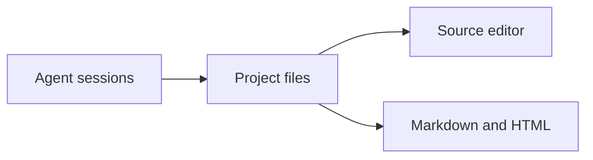

# Your workspace, in one window

Keep your agents, project files, and review documents together.
Close the window and your terminal sessions keep running.

## Read, edit, and preview

Open several files in document tabs. Each file keeps its edits and selected mode.
Use **Preview / Markdown** or **Preview / HTML** beside the path to switch views.
Saved local HTML opens in the system browser engine on Windows and macOS.

> [!TIP]
> Pin your current project and fold the others. Your sessions stay open.

## Know which agent needs you

| Tag | Meaning |
| --- | --- |
| `idle` | Waiting for your next prompt |
| `run` | Working on a turn |
| `input` | Needs a reply or permission |
| `done` | Finished, with an unread result |

Unknown states have no tag. Reading a finished result changes `done` to `idle`.

## Keep your preferred appearance

- Source syntax uses GitHub Light or Atom One Dark over the app's background.
- Source font, size, and line height are independent of terminal typography.
- GitHub is the built-in Markdown theme; v2 YAML packages add custom themes.
- The file tree shows dotfiles and uses Symbols file and folder icons.
