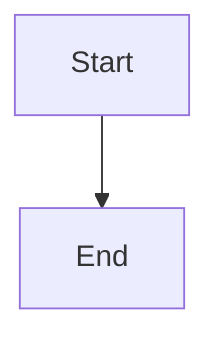

# Mermaid diagram support

ctty7 renders Mermaid diagrams in Markdown preview.

## Usage

Use a fenced code block with the `mermaid` language identifier:

~~~markdown

~~~

The diagram renders in the native reading view. Inline diagrams follow reading
zoom and preserve their full aspect ratio and height; a tall diagram stays at
its reading width instead of shrinking to a height limit. Ordinary wheel input
continues scrolling the document, including after inline diagram zoom.
Click the canvas or Expand to open a larger viewer. A tall diagram opens at the
top with readable nodes and a visible vertical scrollbar. A toolbar row above
the diagram holds Reset, Expand and Copy at its right edge, so no control is
drawn over the image; the expanded viewer replaces Expand with
**Fit whole diagram**. Copy preserves the original Mermaid source.

In the expanded viewer, ordinary wheel input zooms around the pointer.
Ctrl+wheel (Command+wheel on macOS) also works, from 25% to 800%.
Drag with the left button to pan short or tall diagrams; Shift+wheel scrolls
horizontally, and the scrollbars and keyboard navigation reach the remaining
content. **Fit whole diagram** (`F`) shows the complete diagram, including very
tall diagrams below the normal 25% zoom limit. Reset restores its initial reading
size and position. Inline diagrams use Ctrl+wheel (Command+wheel on macOS) to
zoom, leaving ordinary wheel input available for document scrolling at every
diagram zoom level. A gesture hint appears at the left of the toolbar row on
hover or keyboard focus and hides while dragging. Zoom and directional buttons
are omitted; mouse gestures and keyboard navigation provide these operations
without a separate navigation pad.

SVG rasters follow display DPI, reading scale and diagram zoom. Each viewer
retains one raster of at most 16,777,216 RGBA pixels (64 MiB), with neither axis
over 8192 pixels. Extremely long diagrams or high zoom can therefore become less
sharp at that allocation limit. Moving between displays regenerates the raster
for the current scale.

Opening the larger viewer does not necessarily create horizontal overflow.
Left-button dragging can still reposition a fitted diagram; zooming beyond the
available width adds horizontal scrolling. The inline canvas reserves only its
reading inset, allowing wide diagrams to use the old navigation pad's space.

In the focused diagram, `+`/`-` zoom, arrows move, Page Up/Down or Space move by
a viewport, and End reaches the bottom. Home scrolls the expanded diagram to its
top while retaining zoom; `0` resets its size and position. Escape
closes the expanded viewer and returns focus to the reading view. Document
Home/End shortcuts continue to navigate the reading view.
Fences accept both LF and Windows CRLF line endings without changing the source
buffer or the copied diagram code.

## Diagram types

Rendering uses `merman` 0.7. Supported syntax depends on that renderer; it does
not guarantee every feature of the browser Mermaid implementation. Diagram
families include:

- **Flowcharts** (`graph`, `flowchart`)
- **Sequence Diagrams** (`sequenceDiagram`)
- **Class Diagrams** (`classDiagram`)
- **State Diagrams** (`stateDiagram`)
- **Entity Relationship** (`erDiagram`)
- **User Journey** (`journey`)
- **Gantt Charts** (`gantt`)
- **Pie Charts** (`pie`)
- **Requirement Diagrams** (`requirementDiagram`)
- **Git Graphs** (`gitGraph`)
- **Mindmaps** (`mindmap`)
- **Quadrant Charts** (`quadrantChart`)

## Theme integration

The built-in GitHub reading theme uses Mermaid's `default` or `dark` element
colors and a transparent canvas over the application background. Switching
application appearance updates the diagrams.

Custom v2 themes supply their reading palette to the renderer:

| Theme Element | Used For |
|--------------|----------|
| `background` | Canvas background |
| `paper` | Surface elements (boxes, cards) |
| `foreground` | Text color |
| `border` | Lines and borders |
| `accent` | Activation bars, highlights |
| `code_background` | Actor boxes in sequence diagrams |
| `quote_background` | Note boxes |

The colors adapt automatically when switching between light and dark modes.

## Custom themes

To customize how Mermaid diagrams look, edit your Markdown theme file:

```yaml
# ~/.config/tty7/markdown-themes/my-theme.yaml
schema_version: 2
id: my-theme
name: My Custom Theme

light:
  accent: '#0066cc'      # Controls activation bars
  border: '#cccccc'      # Controls lines and borders
  # ... other colors
  
dark:
  accent: '#3b82f6'
  border: '#444444'
  # ... other colors
```

## Implementation

The reading view replaces Mermaid fences with loading placeholders and renders
SVGs on the background executor. Completed images replace the placeholders;
results from an older document/theme generation are discarded. The current
view retains its rendered images until content or theme changes replace them.
Diagram interactions notify the affected view. Expanded dragging does not
force the entire Markdown document to redraw.

Documents of at least 32 KiB use the component's measured block list. Long
fixed-width tables cache column and row geometry and paint visible rows. Font,
theme, width and image changes invalidate the relevant layout. A selection-only
geometry pass updates offscreen text ranges when selection endpoints change.
Nested heading links first reveal their containing block, then align the actual
heading. See the [navigation and performance verification](testing/markdown-navigation-performance.md)
for the fixture, measurements and native interaction evidence.
The latest [GitHub-style reading verification](testing/github-mermaid-reading.md)
records the scroll viewer, compact controls and updated measurements.
The [toolbar simplification verification](testing/mermaid-controls-simplification.md)
records the current three-button toolbar and native comparison screenshots.

### Source files

- [markdown_mermaid.rs](../src/ui/markdown_mermaid.rs) handles theme integration, rendering and the expanded viewer.
- [markdown_preview.rs](../src/ui/markdown_preview.rs) handles fence preprocessing, background work and image state.

### Custom theme mapping

```rust
HostThemeRoles {
    canvas: palette.background,
    surface: palette.paper,
    text: palette.foreground,
    border: palette.border,
    activation_background: palette.accent,
    actor_background: palette.code_background,
    note_background: palette.quote_background,
    // ... semantic colors stay fixed
}
```

## Error handling

If a diagram fails to render, the reading view falls back to the original code
block. Preprocessing records the renderer error in an HTML comment; it does not
provide a dedicated line-number error panel.

## Examples

Use the [GitHub acceptance sample](examples/markdown-github-theme.md) for a
flowchart and the [reading theme guide](customization/markdown-themes.mdx) for
v2 installation and palette fields. See the
[verification record](testing/markdown-github-theme.md) for native checks.

## Limitations

- In-diagram click handlers and links are not supported. The application's copy and expanded-view controls are separate.
- Native/browser glyph rasterization and all Mermaid horizontal geometry are not guaranteed to match.
- Complex diagrams still require rendering time, even though rendering runs in the background.

## Possible follow-ups

These are proposals, not open implementation tickets. Current tracked work is
listed in [project status](maintenance/status.md).

- Reuse SVGs across document or theme generations with a source/theme cache.
- Export individual diagrams to PNG/SVG files.
- Show a live preview while editing Mermaid source.
- Add diagram-specific theme overrides.
- Highlight errors with line numbers.

## Viewer controls

A toolbar row above the diagram holds Reset, Expand (or Fit whole diagram) and
Copy at its right edge; nothing is drawn over the image. Drag to move the
diagram. Inline diagrams zoom with Ctrl+wheel or Command+wheel; the expanded
viewer also zooms with the ordinary wheel. Keyboard shortcuts and scrollbars
remain available in the expanded viewer. A contextual hint appears at the left
of the toolbar row when the diagram is hovered or focused.
