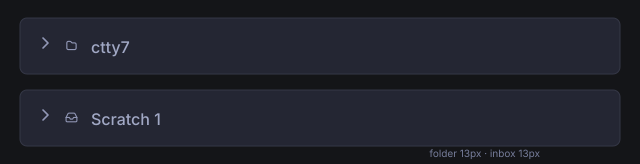

# Scratch group icon

The Scratch group collects sidebar sessions that have no repository or folder
group. Give its header a tray icon so it reads as a holding area rather than a
directory.

The project folder and Scratch inbox glyphs use the same 13px drawing size. The
Scratch header keeps its disclosure arrow; the Inbox icon identifies the group
and does not replace the expand/collapse state cue.

## Behavior

- Show the Inbox glyph on the Scratch group header, after its disclosure arrow
  and before its label.
- Keep the glyph at 13px and use the same active, muted, and hover colors as the
  group header icons.
- Keep project folder icons controlled by the existing group icon settings.
- Keep Scratch's disclosure arrow behavior controlled by those settings.

## Rationale

Inbox is the closest existing symbol for a collection of ungrouped sessions.
A document-and-pencil icon would suggest editable document drafts, which is not
what the Scratch group contains.
