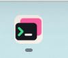
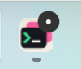
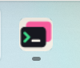
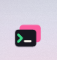
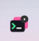
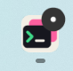
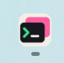
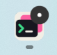
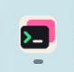

# Agent completion badge acceptance

Agent results that have not been viewed leave a dark circular mark with a
white dot on the Windows taskbar and tray icons. There is no numeric count.
Viewing the result clears its unread state; another unread pane keeps the
application reminder visible. Existing waiting-for-input attention is retained.
Sounds and desktop notification preferences are independent and unchanged.

## Native Windows before and after

These are lossless crops of Windows system screenshots taken on 2026-10-20,
not HTML renders or repainted icons. The baseline is `f16436fa`, with only the
same opt-in screenshot fixture added. The changed build runs the same fixture,
window size, display scaling and Agent status sequence.

| Location | Before, completed result unread | After, completed result unread | After viewing result |
| --- | --- | --- | --- |
| Taskbar |  |  |  |
| Tray |  |  | Windows returned the inactive icon to its overflow area after the result was viewed. |

On the Windows 11 system used for these captures, `ITaskbarList3::SetOverlayIcon`
places the mark at the upper-right. Windows controls placement and scaling;
older taskbars can position overlays differently. The app supplies the same
circle-and-dot artwork used by the tray. No taskbar setting is changed.

## Reproduce

Build the opt-in native fixture:

```powershell
cargo build --locked --bin tty7-app --features markdown-visual-tests
```

Save a UTF-8 JSON file without a BOM, using absolute paths:

```json
{
  "sidebar": true,
  "attention_badge": true,
  "output": "C:/temp/ctty7-attention/after.png",
  "hold_seconds": 120
}
```

Launch with isolated configuration:

```powershell
target/debug/tty7-app.exe --config-dir C:/temp/ctty7-attention/config --ssh-tab-visual C:/temp/ctty7-attention/options.json
```

The fixture uses production terminal views, status messages, tray polling and
native taskbar delivery. It opens no real Agent or SSH connection. The first
pane reports Working then Done while another pane is selected. Wait for
`NATIVE_ATTENTION_BADGE_UNREAD`, then use Windows Screenshot Tool in Full screen
mode. Screenshot Tool's auto-saved PNG includes the actual taskbar and tray.

Create `after.read` next to the configured `after.png` path to focus the
completed pane through the normal application focus path. Wait for
`NATIVE_ATTENTION_BADGE_READ` and at least one tray polling interval before
capturing again. Remove the control file before another run. The fixture exits
after its hold period and does not write real workspace/session settings.

## Verification and limits

- The original native capture switched from another tab to the completed pane,
  producing a pane focus callback. It did not cover returning to an already
  selected pane when rendering does not produce that callback. PR #173's
  original implementation and its merged version both relied on that callback
  to clear unread state; this was a coverage gap, not a dropped merge change.
- An activation regression now suppresses pane rendering while retaining the
  focused handle. It fails without the activation observer and passes with it:
  returning reads the focused result and leaves another pane's result unread.
  A separate regression checks that manual "Mark as Unread" survives the menu's
  immediate refocus and clears on the next visit, both with and without the
  menu-refocus callback. These are automated view
  tests; the screenshots above remain the original native acceptance evidence.
- The new lifecycle regression failed before the focus correction: a selected
  pane in an inactive window incorrectly reported its result as already read.
  It passes after checking both window activation and pane focus, including
  clearing on return to the selected pane.
- Foreground tests explicitly activate the window as well as focus its pane.
  GPUI test windows start inactive; pane focus alone does not establish the
  foreground case. Cross-platform tests cover both foreground and background
  completion, including their activation/focus preconditions.
- Notification/channel/focus integration tests and tray rendering/state tests
  pass, including the dark circle, white center and transparent outer corners.
- The Windows production and native-fixture paths compile. Taskbar updates run
  independently of the tray visibility preference and reapply during the
  existing one-second poll, including after Explorer recreates taskbar buttons.
- Unread state remains attached to live panes. Closing/reconstructing a
  workspace follows existing read-state semantics; this change adds no saved
  notification history.
- Native visual acceptance covers this Windows 11 environment. Other taskbar
  versions, Explorer restart recovery, and macOS/Linux visuals were not
  exercised interactively. macOS has no new Dock badge implementation.

## LCU follow-up on 2026-10-21

The follow-up runs the fixed native binary with two isolated windows. LCU
operates the actual minimize button, window activation, sidebar/top tabs,
split panes and context menus. A feature-gated fixture sends deterministic
Agent reports through production terminal streams and records the real window
activation, pane focus, unread state and aggregate attention. It does not set
focus or unread state through its control file. No live Agent, shell or SSH
session is used.

LCU found another gap that the earlier simulated menu test missed: the real
tab context menu did not return focus after "Mark as Unread". Its pending
refocus guard then consumed the reader's next click. The shared action now
returns focus explicitly, protects that immediate refocus, and leaves an
already-focused action without a pending guard. Its application regression
also checks that marking an inactive tab does not steal focus.

All 26 native state assertions passed after this correction. The
[recorded results](agent-attention-activation-results.ndjson) contain only
fixture state, with no user session content.

| Native scenario | Observed result |
| --- | --- |
| Foreground completion in the focused pane | No unread reminder |
| Selected pane completes while minimized | Unread until restored, then cleared |
| Another application/window is active | Source result stays unread until its window is visited |
| Completion in an unrelated tab | Unread until that result is selected |
| Two unread results | Reading one retains the other; reading the last clears attention |
| Two split panes | Focusing one reads only that pane; the other retains attention |
| Sidebar and top-tab context menus | Manual unread survives menu dismissal with real pane focus restored |
| Return after manual unread | First return clears it, including minimize/restore |
| Waiting for input | Viewing keeps input attention; resuming work clears it |
| New work before an old result is read | Obsolete completion reminder clears |
| Repeated Done report | Does not re-badge an already-read result |
| Tray icon disabled | Taskbar reminder still appears and clears |

The following are lossless crops of full-screen captures made through the
Windows Screenshot Tool during the LCU run. They show the actual taskbar icon,
not a rendered mockup. Windows controls icon order and overlay placement.

| Configuration | Unread result | After viewing |
| --- | --- | --- |
| Tray enabled |  |  |
| Tray disabled |  |  |

Reproduce the interactive fixture after building with
`--features markdown-visual-tests`. Create a UTF-8 JSON file without a BOM:

```json
{
  "control": "C:/temp/ctty7-attention/control.json",
  "state": "C:/temp/ctty7-attention/state.json",
  "split": false,
  "top": false,
  "tray_disabled": false
}
```

Launch `tty7-app --config-dir C:/temp/ctty7-attention/config
--agent-attention-visual C:/temp/ctty7-attention/options.json`. Change the
control file to send Agent reports, for example
`{"sequence":2,"reports":[[1,0,"done"]]}`. Indices identify the window and pane,
both starting at zero; panes 0 and 1 are Agents and pane 2 is the unrelated
terminal. Increment `sequence` for each batch. Use the UI to select panes,
switch windows and minimize/restore. `state.json` is an observation only.

The system tray overflow icon itself was not visually re-captured in this
follow-up; its aggregate attention state was checked. Explorer restart,
other Windows versions and macOS/Linux native interaction remain unverified.
The original screenshots earlier in this document describe the earlier run.
