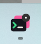
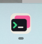
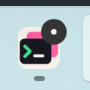
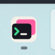

# Agent completion badge acceptance

Agent results that have not been viewed leave a dark circular mark with a
white dot on the Windows taskbar and tray icons. There is no numeric count.
Viewing the result clears its unread state; another unread pane keeps the
application reminder visible. Existing waiting-for-input attention is retained.
Sounds and desktop notification preferences are independent and unchanged.

## Native Windows before and after

These are lossless crops of Windows system screenshots taken on 2026-10-20,
not HTML renders or repainted icons. The baseline is `f16436fa`, with only the
same opt-in screenshot fixture added. The changed build runs the same fixture,
window size, display scaling and Agent status sequence.

| Location | Before, completed result unread | After, completed result unread | After viewing result |
| --- | --- | --- | --- |
| Taskbar |  |  |  |
| Tray |  |  | Windows returned the inactive icon to its overflow area after the result was viewed. |

These historical captures used `ITaskbarList3::SetOverlayIcon`. Windows controls
overlay placement; the reported vertical taskbar placed it at the lower-right.
The correction below composes the mark into the window icon instead. No taskbar
setting is changed.

## Reproduce

Build the opt-in native fixture:

```powershell
cargo build --locked --bin tty7-app --features markdown-visual-tests
```

Save a UTF-8 JSON file without a BOM, using absolute paths:

```json
{
  "sidebar": true,
  "attention_badge": true,
  "output": "C:/temp/ctty7-attention/after.png",
  "hold_seconds": 120
}
```

Launch with isolated configuration:

```powershell
target/debug/tty7-app.exe --config-dir C:/temp/ctty7-attention/config --ssh-tab-visual C:/temp/ctty7-attention/options.json
```

The fixture uses production terminal views, status messages, tray polling and
native taskbar delivery. It opens no real Agent or SSH connection. The first
pane reports Working then Done while another pane is selected. Wait for
`NATIVE_ATTENTION_BADGE_UNREAD`, then use Windows Screenshot Tool in Full screen
mode. Screenshot Tool's auto-saved PNG includes the actual taskbar and tray.

Create `after.read` next to the configured `after.png` path to focus the
completed pane through the normal application focus path. Wait for
`NATIVE_ATTENTION_BADGE_READ` and at least one tray polling interval before
capturing again. Remove the control file before another run. The fixture exits
after its hold period and does not write real workspace/session settings.

## Verification and limits

- The original native capture switched from another tab to the completed pane,
  producing a pane focus callback. It did not cover returning to an already
  selected pane when rendering does not produce that callback. PR #173's
  original implementation and its merged version both relied on that callback
  to clear unread state; this was a coverage gap, not a dropped merge change.
- An activation regression now suppresses pane rendering while retaining the
  focused handle. It fails without the activation observer and passes with it:
  returning reads the focused result and leaves another pane's result unread.
  A separate regression checks that manual "Mark as Unread" survives the menu's
  immediate refocus and clears on the next visit, both with and without the
  menu-refocus callback. These are automated view
  tests; the screenshots above remain the original native acceptance evidence.
- The new lifecycle regression failed before the focus correction: a selected
  pane in an inactive window incorrectly reported its result as already read.
  It passes after checking both window activation and pane focus, including
  clearing on return to the selected pane.
- Foreground tests explicitly activate the window as well as focus its pane.
  GPUI test windows start inactive; pane focus alone does not establish the
  foreground case. Cross-platform tests cover both foreground and background
  completion, including their activation/focus preconditions.
- Notification/channel/focus integration tests and tray rendering/state tests
  pass, including the dark circle, white center and transparent outer corners.
- The Windows production and native-fixture paths compile. Taskbar updates run
  independently of the tray visibility preference and reapply during the
  existing one-second poll, including after Explorer recreates taskbar buttons.
- Unread state remains attached to live panes. Closing/reconstructing a
  workspace follows existing read-state semantics; this change adds no saved
  notification history.
- Native visual acceptance covers this Windows 11 environment. Other taskbar
  versions, Explorer restart recovery, and macOS/Linux visuals were not
  exercised interactively. macOS has no new Dock badge implementation.

## LCU follow-up on 2026-10-21

The follow-up runs the fixed native binary with two isolated windows. LCU
operates the actual minimize button, window activation, sidebar/top tabs,
split panes and context menus. A feature-gated fixture sends deterministic
Agent reports through production terminal streams and records the real window
activation, pane focus, unread state and aggregate attention. It does not set
focus or unread state through its control file. No live Agent, shell or SSH
session is used.

LCU found another gap that the earlier simulated menu test missed: the real
tab context menu did not return focus after "Mark as Unread". Its pending
refocus guard then consumed the reader's next click. The shared action now
returns focus explicitly, protects that immediate refocus, and leaves an
already-focused action without a pending guard. Its application regression
also checks that marking an inactive tab does not steal focus.

All 26 native state assertions passed after this correction. The
[recorded results](agent-attention-activation-results.ndjson) contain only
fixture state, with no user session content.

| Native scenario | Observed result |
| --- | --- |
| Foreground completion in the focused pane | No unread reminder |
| Selected pane completes while minimized | Unread until restored, then cleared |
| Another application/window is active | Source result stays unread until its window is visited |
| Completion in an unrelated tab | Unread until that result is selected |
| Two unread results | Reading one retains the other; reading the last clears attention |
| Two split panes | Focusing one reads only that pane; the other retains attention |
| Sidebar and top-tab context menus | Manual unread survives menu dismissal with real pane focus restored |
| Return after manual unread | First return clears it, including minimize/restore |
| Waiting for input | Viewing keeps input attention; resuming work clears it |
| New work before an old result is read | Obsolete completion reminder clears |
| Repeated Done report | Does not re-badge an already-read result |
| Tray icon disabled | Taskbar reminder still appears and clears |

The following are lossless crops of full-screen captures made through the
Windows Screenshot Tool during the LCU run. They show the actual taskbar icon,
not a rendered mockup. They predate the composed-icon correction below.

| Configuration | Unread result | After viewing |
| --- | --- | --- |
| Tray enabled |  |  |
| Tray disabled |  |  |

Reproduce the interactive fixture after building with
`--features markdown-visual-tests`. Create a UTF-8 JSON file without a BOM:

```json
{
  "control": "C:/temp/ctty7-attention/control.json",
  "state": "C:/temp/ctty7-attention/state.json",
  "split": false,
  "top": false,
  "tray_disabled": false
}
```

Launch `tty7-app --config-dir C:/temp/ctty7-attention/config
--agent-attention-visual C:/temp/ctty7-attention/options.json`. Change the
control file to send Agent reports, for example
`{"sequence":2,"reports":[[1,0,"done"]]}`. Indices identify the window and pane,
both starting at zero; panes 0 and 1 are Agents and pane 2 is the unrelated
terminal. Increment `sequence` for each batch. Use the UI to select panes,
switch windows and minimize/restore. `state.json` is an observation only.

The system tray overflow icon itself was not visually re-captured in this
follow-up; its aggregate attention state was checked. Explorer restart,
other Windows versions and macOS/Linux native interaction remain unverified.
The original screenshots earlier in this document describe the earlier run.

## Vertical taskbar correction on 2026-10-23

`ITaskbarList3::SetOverlayIcon` does not accept a position. Its documented
placement is the lower-right, matching the reported vertical-taskbar symptom.
The app now draws the tray's dark circle and white dot directly into the
upper-right of its logo and supplies that full icon through `WM_SETICON`.
The same 256-pixel artwork fills both window icon slots so Explorer can scale
it for high-DPI taskbars and Alt+Tab. The reminder therefore also appears in
Alt+Tab while attention is active.

Every registered window receives the existing aggregate attention state.
Clearing attention restores each window's previous small and large icons,
including the null handles that select GPUI's class icon. Repeated polling
does not overwrite those originals. The icon handles remain alive until
detached from the windows; no shortcut or taskbar preference is rewritten.

Run the focused regression suite on Windows:

```powershell
cargo test --locked --bin tty7-app ui::tray:: -- --nocapture
```

The native-window regression failed against the old overlay delivery and
passed after the change. It checks delivery to two real hidden Win32 windows,
repeated polling, clearing one window without disturbing the other, and
restoring both null and non-null original handles before icon destruction.
Artwork assertions check the white center and dark circle at the upper-right
at 16, 32, 48, 64 and 256 pixels, with the entire lower half unchanged.
These checks verify the window handles and pixels; they do not capture Explorer.

The Windows native fixture builds and reaches
`NATIVE_ATTENTION_BADGE_UNREAD`. Fresh taskbar screenshots were not obtained:
computer use failed to activate the captured test and Screenshot Tool windows.
Vertical/horizontal shell placement, pinned/grouped-button rendering and
Explorer restart remain pending interactive acceptance. The screenshots
elsewhere in this document are historical evidence, not captures of this fix.

## Cleared taskbar icon follow-up on 2026-10-23

The new native acceptance found a separate clearing bug on the integrated
main build. The fixture reported aggregate `attention: false` and all Agent
panes had `unread: false`, but Explorer still showed the upper-right reminder.
Returning a window to its null icon override restored the title-bar fallback
without refreshing the taskbar bitmap.

The correction saves the effective original icon. If `WM_GETICON` returns
null, it obtains the borrowed class icon through `GetClassLongPtrW`, using
the large class icon when the small class handle is absent. Clearing now
sends a real, unbadged icon handle. The window class retains ownership, so
the application creates no additional icons and never destroys class icons.
Explicit per-window icons and the existing attention-icon lifetime remain
covered by the native-window tests.

Microsoft documents the null-window-icon/class-icon fallback in
[WM_GETICON](https://learn.microsoft.com/en-us/windows/win32/winmsg/wm-geticon).
Chromium's own [class-icon restoration](https://chromium.googlesource.com/chromium/src/+/49f72db8dbff60fb22dfddf09dddeffe54f674db/chrome/browser/ui/views/frame/glass_browser_frame_view.cc)
also uses explicit class handles to refresh a taskbar icon after an override.

### Native Before/After

These are lossless crops of full-desktop captures made through Windows
Screenshot Tool. Both show the fixture after its aggregate attention became
false. Only the fixture taskbar button is retained in the repository images.

| Before, attention cleared but bitmap stale | After, attention cleared and original logo restored |
| --- | --- |
|  |  |

The baseline is fork main `b0b57316`; the changed build adds the class-icon
fallback correction. Both runs use the same two-window
`--agent-attention-visual` fixture, Windows 11 build 22000.2538, 175% display
scale, a 2560 by 1600 desktop and the bottom horizontal taskbar.

Send `{"sequence":1,"reports":[[0,0,"done"]]}` while the first Agent pane is
unfocused, then `{"sequence":2,"reports":[[0,0,"working"]]}`. Wait for the
fixture's state JSON to report sequence 2 and `attention: false`, and allow
the existing taskbar poll to run before capture. In both recorded states,
every pane reports `unread: false`. The original run retains the circle;
the corrected run displays the plain logo. The earlier capture also verifies
that active attention is visibly composed into the upper-right of the real
taskbar icon.

### Regression and limits

`clearing_attention_supplies_the_class_icon_to_explorer` registers a real
Win32 class with an icon but no per-window override. It failed before the
fix because clearing installed two null handles. It passes after the fix,
covering repeated attention/clear cycles, both icon slots and dropping the
taskbar owner while attention is active. The full tray suite passes 11 tests.
The workspace suite reports 3,158 passed and 12 ignored in its standard
summaries. The native-feature build, rustfmt, diff whitespace and Host
boundary checks pass.

The earlier handle/pixel tests did not cover a window with a class icon and
no explicit icon, which is the production GPUI case. Their passing null-handle
assertions could not establish that Explorer had cleared its cached bitmap.
The native comparison above closes that coverage gap for this environment.
Vertical taskbars, live orientation changes, other taskbar customizations and
Explorer recreation remain unverified; these screenshots do not claim those
checks passed.

## Installed taskbar group regression on 2026-10-27

PR #189 replaced the native taskbar overlay with `WM_SETICON` to move the
reminder into the upper-right of the window artwork. Installed applications
use the `com.github.tty7` AppUserModelID and its registered shortcut. In this
environment that taskbar group kept the shortcut's plain icon, even while the
Agent result was `done`, `unread: true`, and aggregate `attention: true`.
Directly launched, unbranded fixtures displayed the window artwork, masking
the installed-application regression.

The correction also submits a standalone attention mark through
`ITaskbarList3::SetOverlayIcon` for the installed application identity. Cargo
builds retain their separate development identity and window artwork. The
existing poll reapplies the native overlay and clears it when aggregate
attention ends. Overlay initialization failure is logged without disabling
the window artwork. The shell chooses the taskbar overlay's position; this
does not promise an upper-right position on every taskbar configuration.

The native fixture now sets the same process identity as normal startup,
before creating windows, without creating or rewriting the user's shortcut.
Run its executable outside Cargo's build directory to exercise the installed
identity. Running directly from `target/debug` intentionally selects the
development identity and cannot accept this regression.

### Matched native Before/After

Both captures use the same two-window `--agent-attention-visual` fixture,
configuration, `com.github.tty7` process identity, selected unrelated terminal,
and Agent report sequence. Window 2's Agent A completes while the application
is inactive. The Before executable uses the corrected fixture identity with
only native overlay delivery disabled; its `WM_SETICON` behavior matches
main. This isolates overlay delivery from the fixture-identity correction.
The After executable enables the overlay. The small
[baseline patch](background-agent-attention-before.patch) reproduces that
single-variable experiment against this change.

These are lossless 90 by 90 crops at `(1435, 1510)` from native full-desktop
captures through LCU and Windows Screenshot Tool on Windows 11 build 22000,
a 2560 by 1600 display, 175% scaling, and the bottom horizontal taskbar.
The existing installed application remains running in the same taskbar group.

| Before: unread result, no taskbar mark | After: same unread result, mark visible | After viewing the result |
| --- | --- | --- |
|  |  |  |

| Tray icon disabled: unread result | Tray icon disabled: after reading |
| --- | --- |
|  |  |

### Local verification

The [12 native state observations](background-agent-attention-results.ndjson)
record only fixture state. LCU performs the actual tab clicks, minimize and
restore; the control file supplies Agent reports without manipulating focus
or unread state. The observations cover:

- Background completion and clearing when its result is selected.
- Completion in the already-selected pane while minimized, followed by
  reading it on restore.
- Unread results in two windows; reading one retains the other window's
  attention, and new work clears an obsolete completion.
- Waiting-for-input attention in the focused pane and clearing on resume.
- Taskbar delivery and clearing with the tray icon disabled.

`cargo test --offline --locked --workspace --target-dir D:/gh-prj/ctty7/target`
passes 3,177 tests, with 12 ignored and no failures. This includes the
background unread, activation, notification-channel and native icon tests,
plus the standalone overlay artwork regression. The native-feature build,
normal production build, rustfmt, whitespace and Host boundary checks pass.

### Known limitations

This acceptance exercises production terminal views, Agent reports, polling,
application identity and Explorer delivery through a deterministic fixture.
It does not run a live coding Agent, and fixture sound/toast channels are
disabled. The screenshots accept this Windows taskbar configuration only.
Explorer restart, vertical/custom taskbars, small-icon mode, and native
macOS/Linux interaction were not verified in this run. Windows controls
overlay placement and can suppress native overlays in small-icon mode.
See Microsoft's [SetOverlayIcon documentation](https://learn.microsoft.com/en-us/windows/win32/api/shobjidl_core/nf-shobjidl_core-itaskbarlist3-setoverlayicon).
