# Agent pane titles and hover actions acceptance

Spec: cloudy-liu/ctty7#234. The HTML prototype and its renders under
`docs/prototypes/agent-pane-titles/` are design references; the captures below
are the native application.

## Reproducible native state

Baseline source: `1063bc9b` (fork `main`) with only the fixture overlaid by
`scripts/agent-pane-native-visual.py prepare-before`. Final application source:
`0dec85b0`. Both are debug builds of the production app with
`--features markdown-visual-tests`, started as
`tty7-app --config-dir <fresh dir> --agent-pane-visual <options.json>`.

Windows 11, 175% display scale, a 1200 x 700 logical window (the settings
scene asks for 1200 x 1400 and the screen clamps it to 923), left sidebar at
240, one tab holding a 2 x 2 split. Three panes report a recognized agent
through the normal daemon message (Claude Code, Codex, Cursor, all `Working`);
the fourth is a PowerShell terminal with no agent. The terminal text is
fixture output; no agent or shell runs. The title setting travels to the
fixture as JSON, which the baseline ignores, so one fixture builds on both.

Captures are `scripts/capture-native-window.ps1`: `PrintWindow` of the fixture
window at physical resolution, no pointer, no overlapping windows. Hover scenes
post one `WM_MOUSEMOVE` to the window a quarter of the way across the pane's
top edge (clear of the drag grip's handle in the middle); the settings scene
posts `WM_MOUSEWHEEL` through `scripts/post-mouse-wheel.ps1` to reach the end
of the Tabs block. The real pointer never moves. Each scene is a fresh process
and config dir, so Before and After differ only in the binary.

## Matched Before and After

**Pointer on the Claude Code pane's top edge, titles off (the default).** Before,
only the existing drag grip appears. After, the same grip plus the four tiles
at the pane's top-right: split right, split down, zoom (outward arrows), close.
The terminal does not move: the toolbar is an overlay.

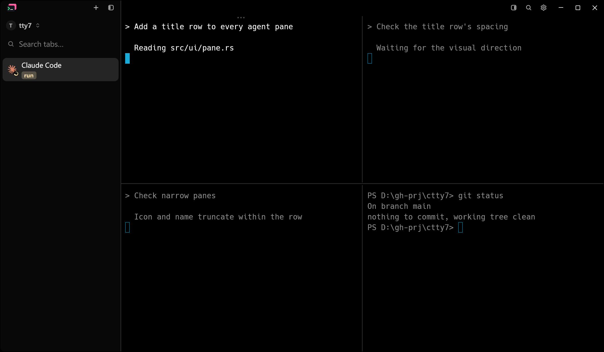
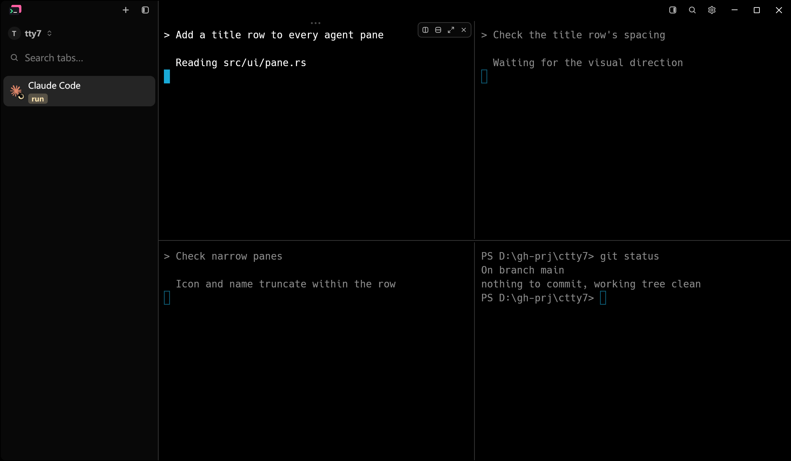

**Titles on, pointer on the Claude Code pane.** After, the three agent panes carry
a 28px row with the agent's icon and name above their first terminal line; the
PowerShell pane does not. The toolbar sits inside the hovered pane's row.

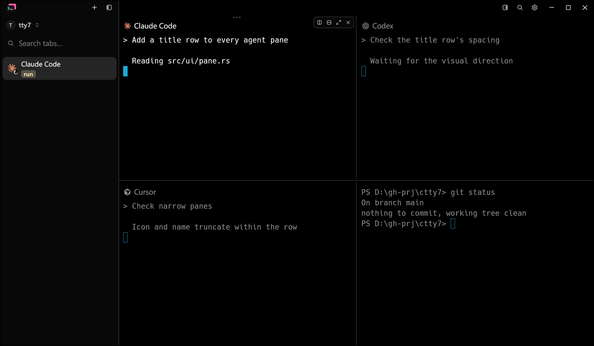

**Titles on, no pointer.** The rows alone, no tiles: focus does not reveal them.

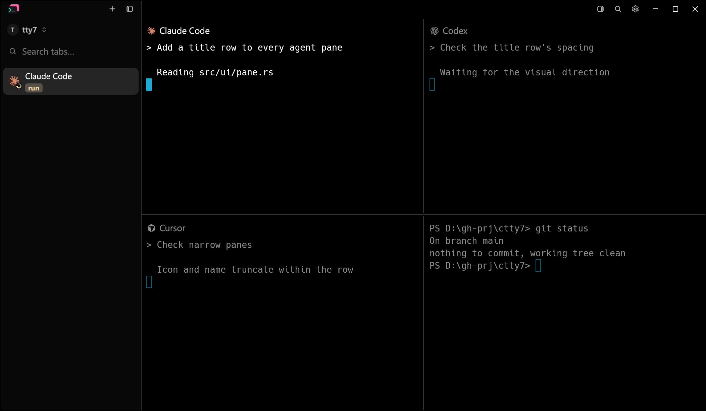

**Pointer on the PowerShell pane's top edge, titles on.** The ordinary terminal
gets neither a row nor tiles; only the pre-existing grip answers the hover.

**Claude Code pane zoomed, pointer on its top edge, titles on.** After, the pane
filling the tab keeps its row and toolbar, with inward arrows for restore.

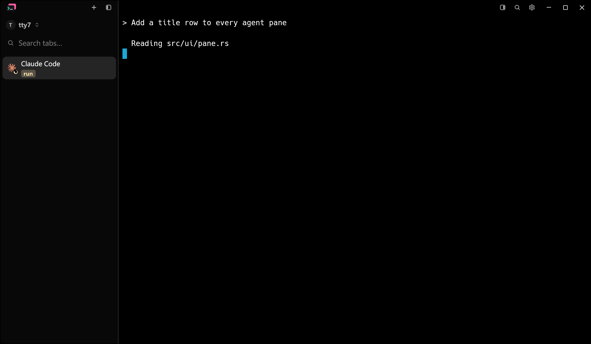
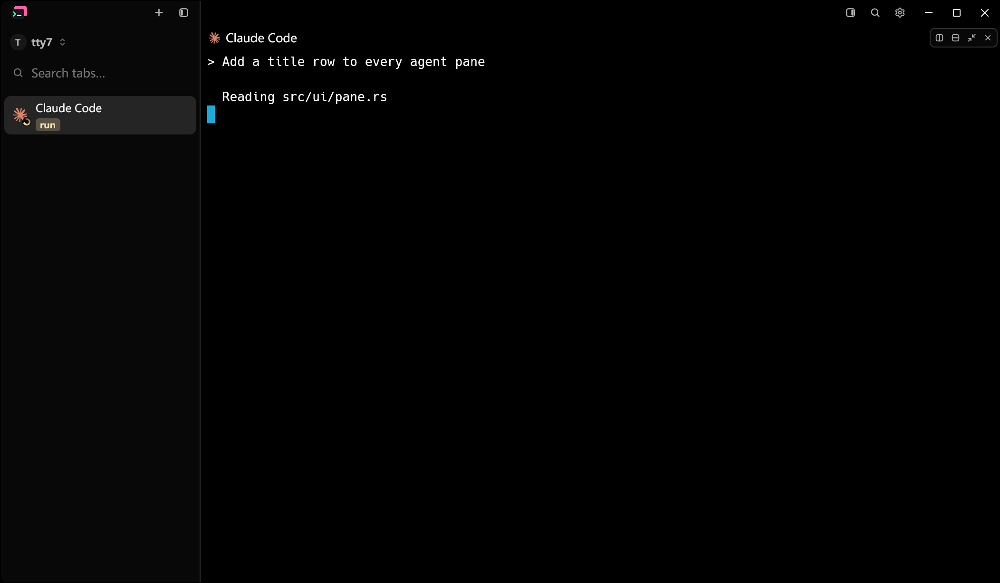

**Light theme, titles on, with and without hover.**

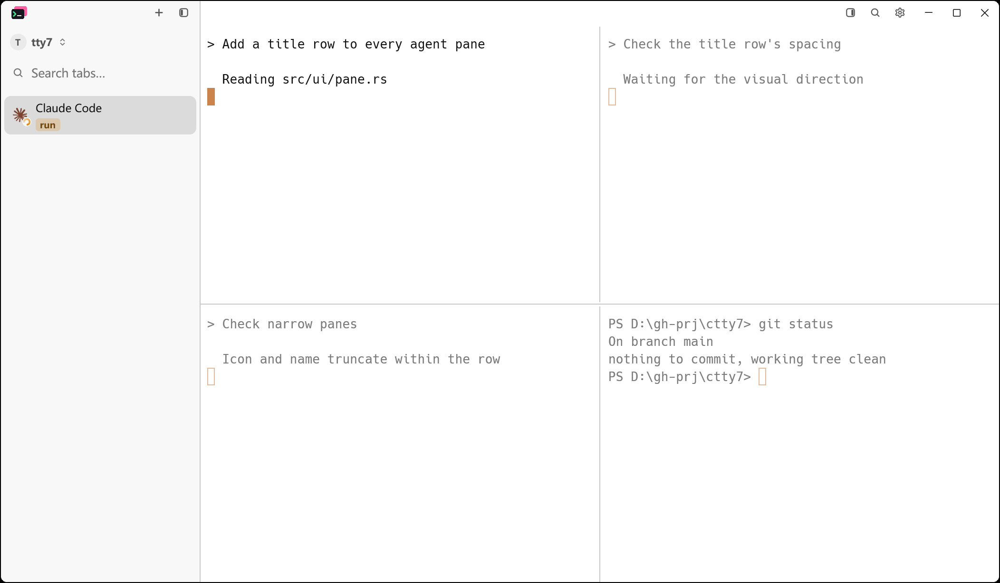
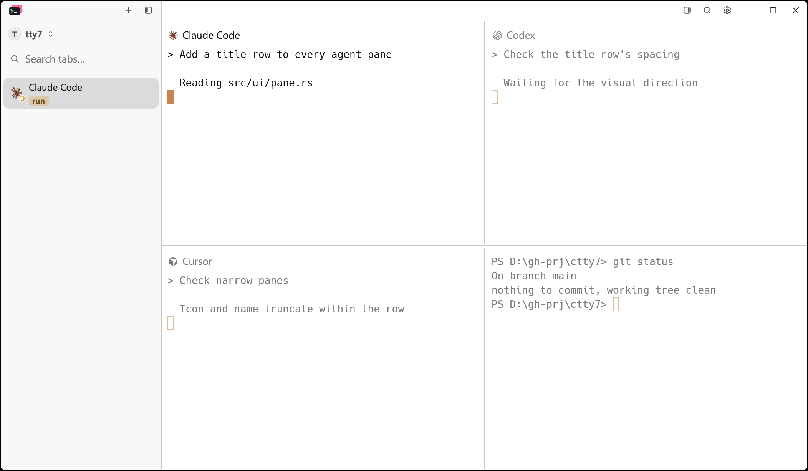

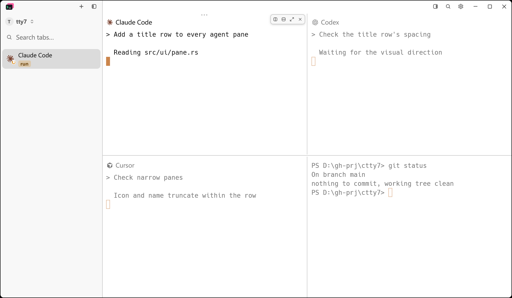

**Settings, Window & Tabs, scrolled to the end of the Tabs block.** After, a
"Show agent pane titles" switch follows "Show agent status text in sidebar",
off.

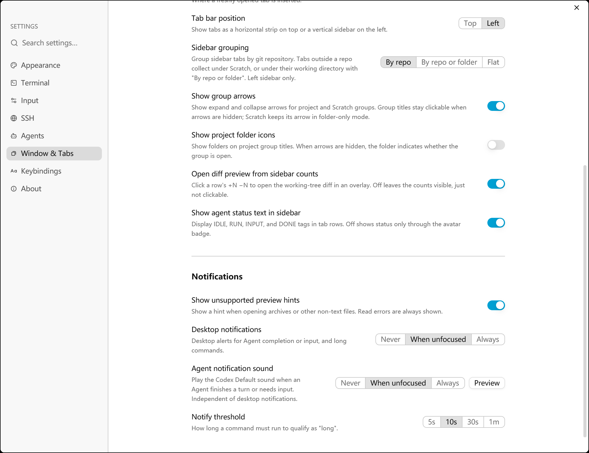
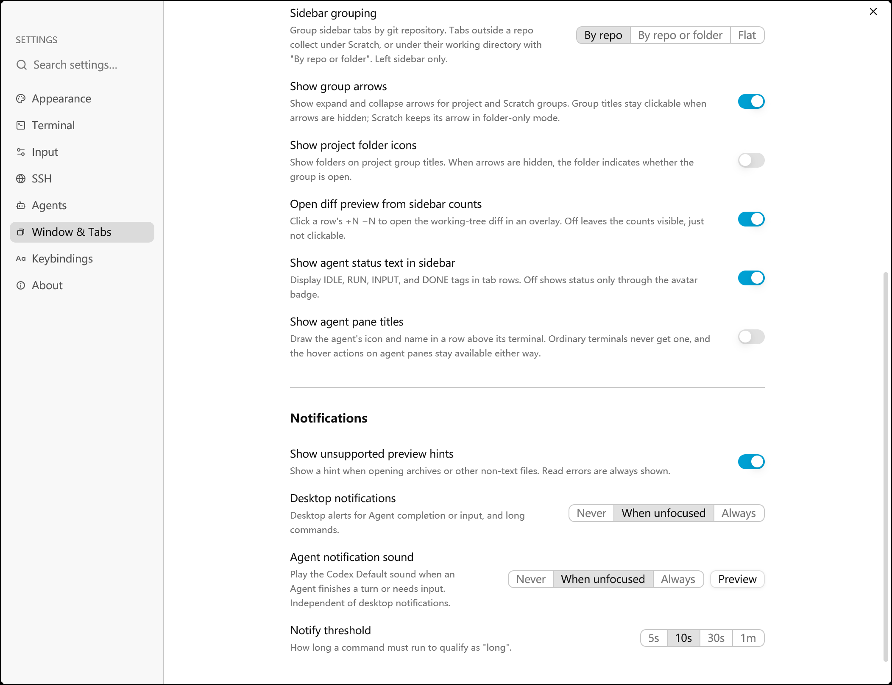

**Control: titles off, no pointer.** Both binaries draw the same screen.

## Automated checks

On this Windows machine: the config round trip (`show_agent_pane_titles`
absent, false, true), the chrome decision for agent and non-agent panes, the
split icons resolving to SVG artwork, and the locale parity test over the new
keys. The app-level GPUI tests in `src/ui/pane_title.rs` (top-edge reveal on
the agent pane and never on the shell, the setting adding and removing the row,
a tile acting on its own pane rather than the focused one, an exiting agent
taking its chrome with it) are unix-only like every pane test and run on CI.

## Known limitations

- Hover is a posted pointer message, not a physical pointer. The reveal path
  it exercises is the production `on_hover` band; a physical pointer takes the
  same path.
- The drag grip's dots show in every hovered split pane in both phases; that
  is existing behaviour, not part of this change.
- No narrow-pane capture: the title row truncates its name with an ellipsis,
  which the fixture's 480px panes do not reach.
