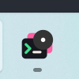
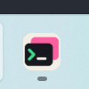
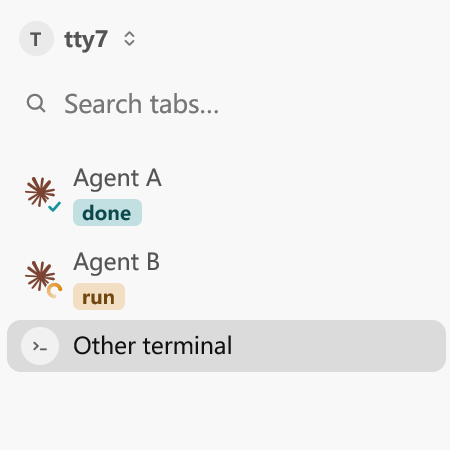

# Background attention clears on application return

## Release provenance

The v0.9.0 tag does not include local commit `57a2e4a5` from
`fix/background-attention-on-return`. The
[v0.9.0 local-change audit](local-change-audit-v0.9.0.md) explicitly preserved
that branch outside the release, without an open PR. Consequently, the release
still computes application attention from waiting Agents and unread results.

This follow-up reapplies that change to fork main `1063bc9b`. A live completion
or input request while all ctty7 windows are inactive creates an application
reminder. Activating any workspace window acknowledges it immediately, even
when another tab is selected. The unread result and waiting status remain on
their original panes. Leaving again does not revive the acknowledged reminder;
a new background event can raise another one. Sound and toast preferences do
not control this application reminder.

## Regression

Run from the checkout with its normal Cargo target directory, or append
`--target-dir D:/gh-prj/ctty7/target` when sharing the existing local build cache:

```powershell
cargo test --offline --locked --bin tty7-app returning_to_another_tab_clears_the_app_badge_but_keeps_the_result_unread -- --nocapture
```

With only the regression added to main, the test failed in 0.19 seconds at:

```text
returning to the app must clear its badge without visiting the result
test result: FAILED. 0 passed; 1 failed
```

The baseline assertion reads production Agent rows and their actual attention
aggregation. The corrected test reads the production application snapshot.
Both send Agent reports through the real terminal stream and activate real
GPUI test windows; neither assigns the attention or unread state directly.

Coverage includes return to another tab, preserving its unread result, leaving
again, a later background input request, return through another workspace
window, foreground completion in another window, and another background turn.
An initial restored waiting report remains a silent baseline. Both sound and
toast channels are disabled in this regression.

## Verification on 2026-11-01

- The focused regression passed after the correction; the final complete GUI
  test run passed with **1,829 passed, 7 ignored, 0 failed** in 46.76 seconds.
- The first complete run had 1,828 passing tests and one failure in
  `editor_binary_notice_can_be_muted_without_hiding_open_errors`, at its
  simulated confirmation click. That test passed alone in 0.45 seconds, and
  the subsequent complete run passed. No editor code was changed.
- `cargo check --offline --locked --bin tty7-app --features markdown-visual-tests`
  passed, including the native fixture's switch to the production application
  attention snapshot.
- `cargo fmt --all -- --check`, `git diff --check`, and the Host boundary check
  passed. Existing compiler warnings remain.
- Independent Standards and Spec reviews against fork main `1063bc9b`
  reported zero actionable findings on both axes.
- The primary checkout and original `fix/background-attention-on-return`
  worktree were preserved. The follow-up lives in
  `fix/background-attention-return-v090` for independent review and delivery.

## Native Windows acceptance on 2026-11-01

The following are lossless crops of actual full-desktop PNG captures made with
Windows Screenshot Tool through LCU. They show the running GPUI application
and Explorer taskbar, not unit-test renders or repainted icons. Each saved
crop was inspected; no mouse pointer is visible. The capture button moves the
pointer outside both retained regions before capture.

Both binaries were built with `cargo build --offline --locked --bin tty7-app
--features markdown-visual-tests`, from baseline `1063bc9b` and corrected
`9c7fb7ab`. Both use the same two-window `--agent-attention-visual` fixture,
light theme, 1120 x 640 logical-pixel client, 175% display scale, Windows 11
build 22000, and 2560 x 1600 desktop. Sound and toast channels are disabled;
the tray preference is enabled. The binaries use the same separate Cargo
development taskbar identity; the installed application is left running.

Select Other terminal, minimize the fixture through its native title-bar
button, and send `{"sequence":3,"reports":[[1,0,"done"]]}` while both fixture
windows are inactive. Capture the taskbar. Restore the same fixture through
native input, retaining Other terminal as the selected tab, then capture
again. Returning never selects Agent A. Screenshot Tool briefly takes focus
for capture; the activation observations below independently establish the
actual return and subsequent departure.

| Inspect | Before (`1063bc9b`) | After (`9c7fb7ab`) |
| --- | --- | --- |
| Background completion raises the dark circle and white dot in both builds. |  |  |
| Return to Other terminal: the old badge remains; the corrected badge clears. |  |  |
| Other terminal remains selected and Agent A retains its unread done mark. |  |  |

Taskbar crops retain the same physical rectangle `(1620, 1500, 100, 100)`;
sidebar crops retain `(300, 310, 450, 450)`. No scaling, compositing, or pixel
modification was applied. Agent B's working animation can have a different
phase without changing the fixture state. Full desktop originals remain local;
only the fixture's taskbar button and sidebar are included in the repository.

The [five native observations](background-attention-on-return-results.ndjson)
record the real activation, focused pane, unread result, and aggregate
attention. Before and After both have `attention: true` in the background.
On return to the unrelated tab, Before retains `attention: true`; After has
`attention: false`, while both retain the completed pane's `unread: true`.
After leaving again, the corrected attention remains false. A local observer
recorded fixture state-file transitions without changing focus, Agent reports,
or application state. This also avoids losing short native activation states
when desktop input returns to the user's previous window.

The earlier capture attempt was blocked by minimized-window activation and
browser URL policy. This follow-up used only native fixture and Screenshot
Tool surfaces, refreshed bindings before actions, and restored the minimized
fixture through native input. These captures supersede that taskbar blocker.

## Known limitations

The tray overflow icon and the shortcut-backed installed taskbar group were
not visually captured in this follow-up. The captures verify the real Windows
development taskbar button and pane state. Keep the PR in draft until the
remaining visual claims have matched native captures or an explicitly accepted
limitation. Native macOS/Linux interaction, Explorer restart, and installation
of a final package remain unverified. The fixture sends deterministic Agent
reports through production terminal streams; it does not run a live coding
Agent, shell, or SSH connection.
