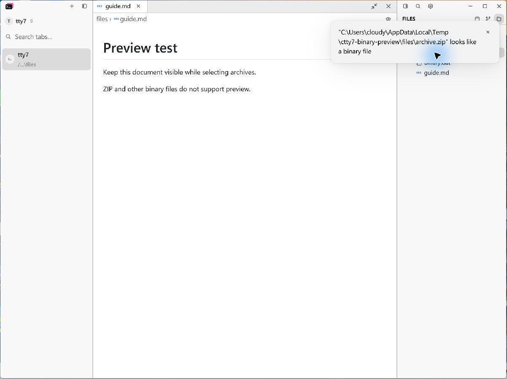
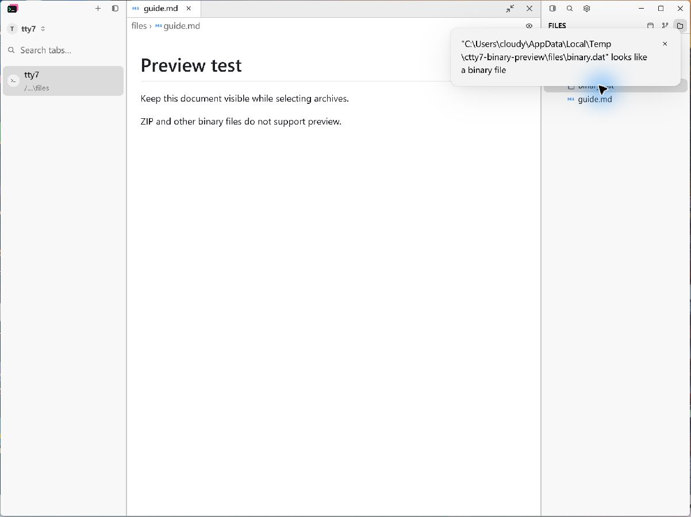
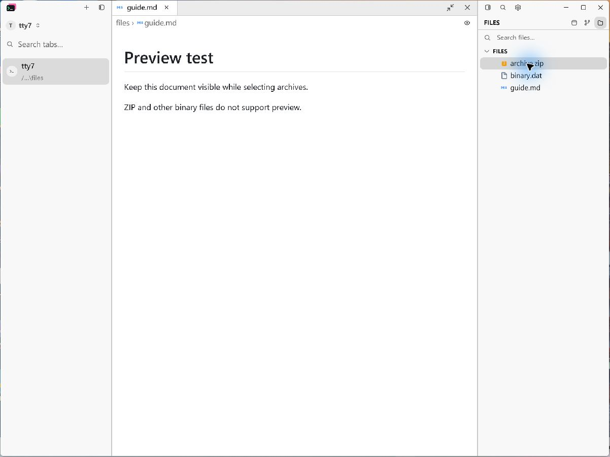
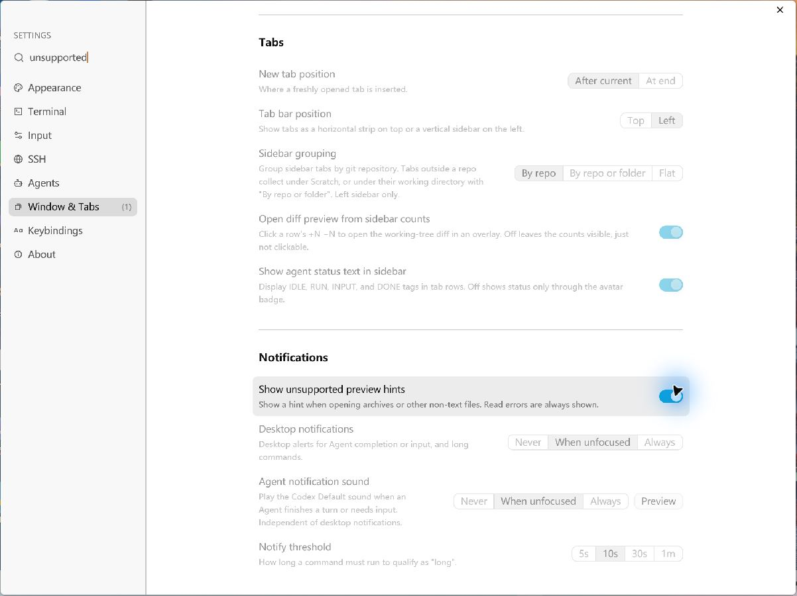
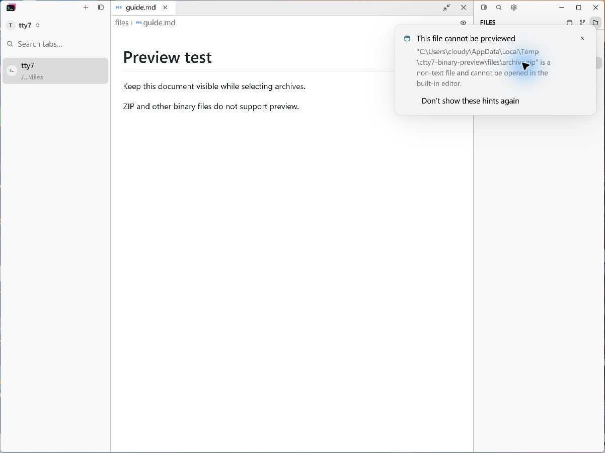
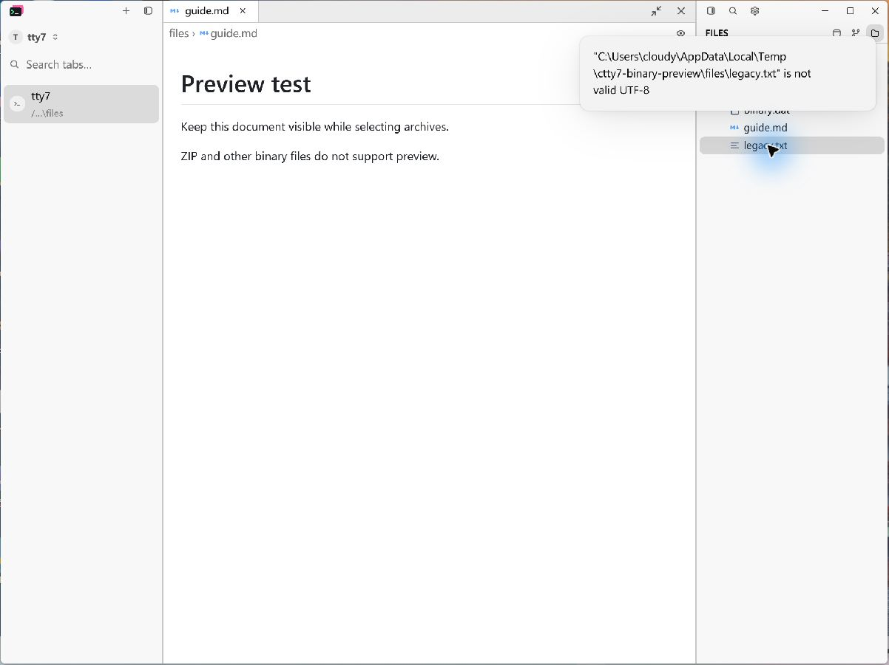

# Unsupported file preview hints

Clicking an archive or another detected binary file keeps the current document
and shows an informational notification with a **Don't show these hints again**
button. The choice is saved as `show_binary_file_notice: false` in `config.json`.
The **Window & Tabs → Notifications → Show unsupported preview hints** setting
restores these hints. Missing files, read failures, oversized text files and
unsupported text encodings still report their own errors.

Known archives are recognized case-insensitively before the size limit and
content download. Other files retain the existing binary-content check. The
shared editor-opening path covers the local/WSL/SSH Files panel and SFTP.

## Native Windows reproduction

Use `--config-dir` scratch directories for every acceptance process. Do not use
the installed application's config or session. The opt-in `--document-visual`
fixture runs the production application and document-opening path; its initial
configuration is deterministic, so fixture restarts intentionally reset settings.

Create a scratch directory with a `files` child containing these sample files:

```powershell
$captureRoot = Join-Path $env:TEMP 'ctty7-binary-preview'
$files = Join-Path $captureRoot 'files'
New-Item -ItemType Directory -Force -Path $files | Out-Null
[IO.File]::WriteAllText((Join-Path $files 'guide.md'), @'
# Preview test

Keep this document visible while selecting archives.

ZIP and other binary files do not support preview.
'@)
[IO.File]::WriteAllBytes((Join-Path $files 'binary.dat'), [byte[]](1, 2, 0, 3, 4, 5))
Compress-Archive -LiteralPath (Join-Path $files 'guide.md') -DestinationPath (Join-Path $files 'archive.zip') -Force
$options = @{
    root = $files
    files = @('guide.md')
    width = 1200
    height = 900
    right_panel = $true
    hold_seconds = 600
    output = Join-Path $captureRoot 'after-ready.json'
}
[IO.File]::WriteAllText((Join-Path $captureRoot 'after-options.json'), ($options | ConvertTo-Json), [Text.UTF8Encoding]::new($false))
```

Build with `cargo build --release --locked --bin tty7-app --features markdown-visual-tests`.
The local acceptance build used the same command with
`--config 'profile.release.package.tty7.opt-level=0'` and
`--config 'profile.release.package.tty7.codegen-units=16'` to shorten compilation;
dependency optimization and the project's default LTO were retained.
Copy the resulting executable outside `target` before launching it. Pass
`--config-dir <scratch>/after-config --document-visual <scratch>/after-options.json`.
Wait for `NATIVE_DOCUMENT_READY_FOR_CAPTURE` in stderr. Click `archive.zip` in
the Files panel, then click `binary.dat` repeatedly. Only one unsupported-preview
hint should remain. Click its opt-out button, repeat both file selections, and
inspect `config.json` for the saved false value. The guide and its single tab
must remain visible throughout.

Open Settings and use its search to find **Show unsupported preview hints**.
Re-enable the setting, return to Files and select the archive again. Add a text
file containing invalid UTF-8 to the scratch directory and select it while
hints are disabled; its encoding error must still be visible.

For persistence acceptance, close the fixture and start the same executable
normally with `--config-dir <scratch>/after-config --open-path <scratch>/files`
(without `--document-visual`). Keep the matching `tty7-server.exe` beside it.
Open `guide.md` from Files and select the archive. The saved opt-out must still
apply. This normal-startup check passed on Windows; the fixture itself does not
load saved preferences.

## Capture conditions

Before: pre-change executable from `d6ad6f30`; its unrelated Diff controls do
not appear in this scene. After: this change based on fork `main` (`ee23f9d6`).
Both captures use the same files, 1200 × 900 viewport, 1.75 display scale, light
theme, Fill document layout, visible right Files panel, and the LCU native window
capture API. Screenshots are unmodified captures of the running application.














## Verification

The Windows unit and integration test executables completed with **3,167 passed,
12 ignored, 0 failed**, and the CLI end-to-end harness exited successfully.

| Area | Passed | Ignored |
| --- | ---: | ---: |
| Application | 1,797 | 7 |
| Core | 1,213 | 5 |
| CLI unit tests | 138 | 0 |
| Server unit and integration tests | 19 | 0 |

The application test harness was built with `cargo rustc -p tty7 --profile bench
--locked --bin tty7-app`, using the corresponding `profile.bench.package.tty7`
optimization overrides above. It was executed as a normal test harness, without
the benchmark flag. On Windows, use `Start-Process -Wait` with redirected stdout
and stderr when running this GUI-subsystem test executable directly.

`cargo fmt --all -- --check`, `git diff --check`, and
`bash .github/scripts/check-host-boundary.sh` also passed.

The new regression covers uppercase and oversized archives, binary content,
notification deduplication, the opt-out button, restoring the preference,
preserving the current document/overlay, and showing missing-file and encoding
errors while hints are muted. The config regression checks the enabled default
for old configuration files and serialization of the disabled preference.

## Known limitations

- Native UI acceptance was performed on Windows. macOS/Linux UI and live
  WSL/SSH/SFTP sessions were not manually exercised.
- Files other than recognized archives retain the existing 4 MiB size check
  before binary-content detection.
