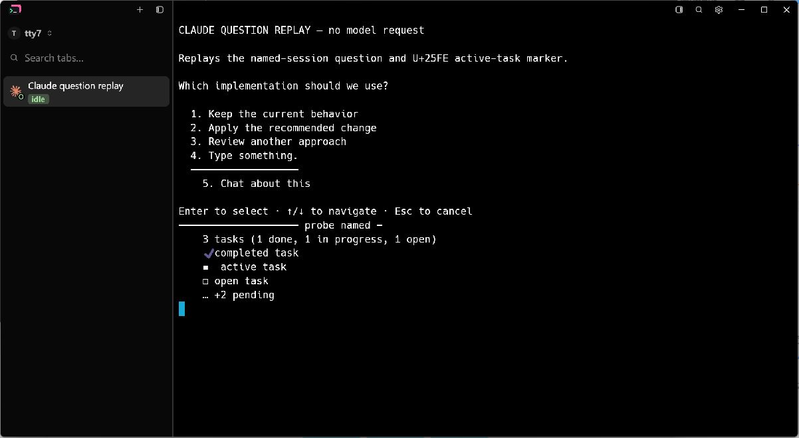
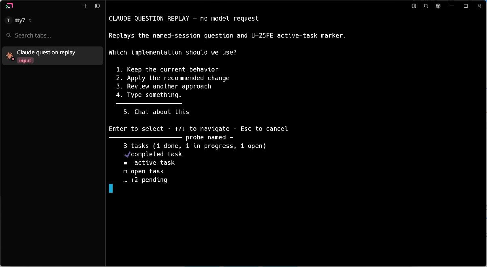

# Claude named-session input detection

A question in a named Claude session can be followed by a counted task panel
whose active-task row starts with `◾` (U+25FE). The pinned upstream rule only
accepts `◻`, `◼` and `✔`; it also rejects the row-end padding retained by
the terminal grid around the task count and pending overflow. This screen falls
back to Idle. The local Claude extension accepts the additional marker and
padding and classifies the question as Blocked, which the sidebar displays as
`input`.

## Native Windows comparison

Both images are unmodified LCU captures of the running native application.
The same feature-gated replay sends
[`fixtures/claude-named-question.txt`](fixtures/claude-named-question.txt) through
the production daemon reader, terminal grid, screen detector and sidebar.
It starts with an Idle Agent report; neither build is sent a Blocked/Waiting
status. No model, shell or network request is made by the replay.

The baseline uses `1063bc9b` detection code with the identical replay fixture;
the fixed build adds the local Claude rule, including terminal-row padding
handling, with that fixture. The window is 1200 × 660 logical pixels, uses the
dark preset, and has cursor blinking
disabled. Both captures use the same Windows display scale and viewport.
The saved JPEGs are both 1202 × 661 pixels, including the native window border.
The mouse pointer is parked outside the captured window before each capture.

Before: inspect the sidebar's `idle` label even though the terminal shows
“Enter to select” and the `◾ active task` row.



After: inspect the sidebar's `input` label for the same question and task panel.



## Reproduce

Build with `cargo build --locked --bin tty7-app --features markdown-visual-tests`.
Create an options JSON file using absolute paths:

```json
{
  "sidebar": true,
  "output": "C:/temp/claude-question/unused.png",
  "hold_seconds": 1800,
  "claude_question": "D:/gh-prj/ctty7/docs/testing/fixtures/claude-named-question.txt"
}
```

Launch `tty7-app --config-dir C:/temp/claude-question/config --ssh-tab-visual
C:/temp/claude-question/options.json`. On Windows the replay does not write
`output`; capture the native window with LCU after its sidebar settles.
For the baseline, apply the same replay fixture to `1063bc9b` before building.

## Scope

The captures verify the exact reported screen pattern in the native application
on this Windows environment. A live Claude model session and native macOS/Linux
screens were not exercised in this comparison.
