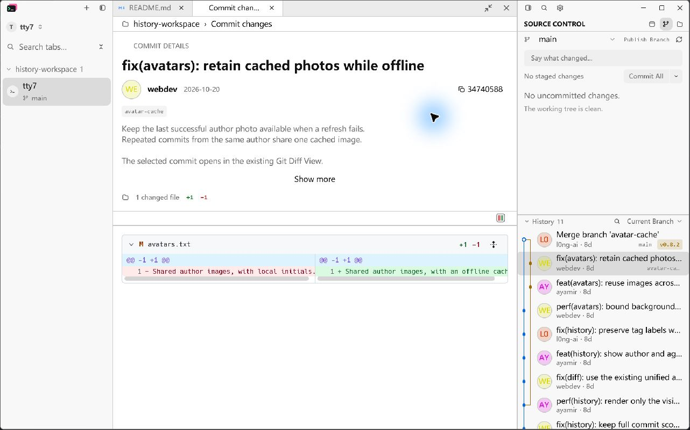
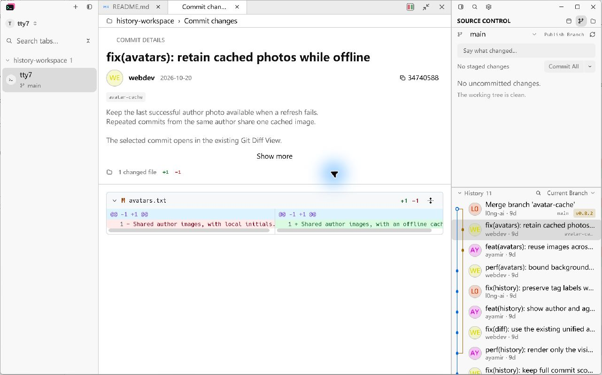
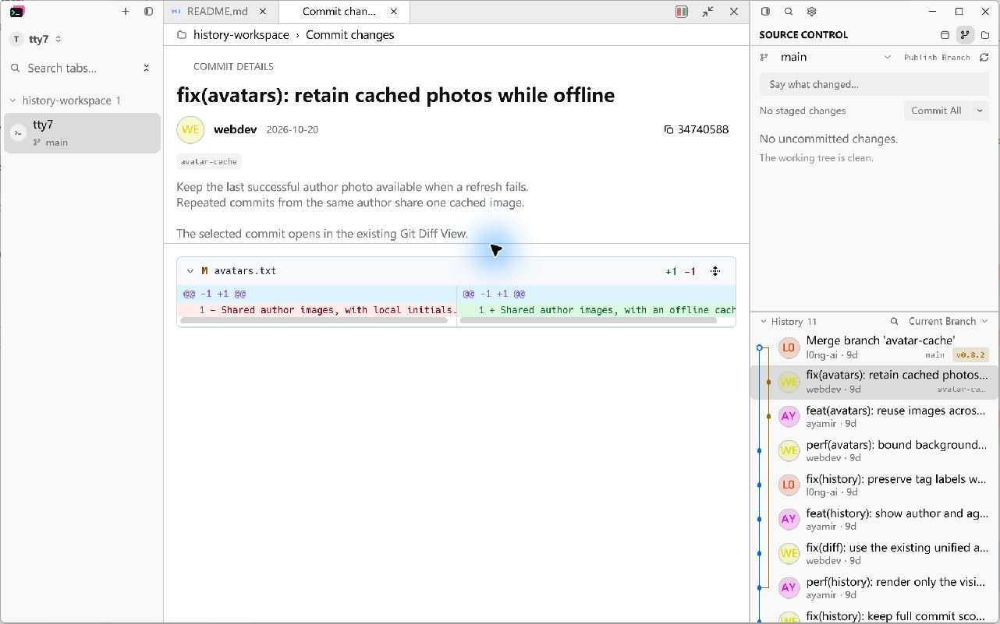
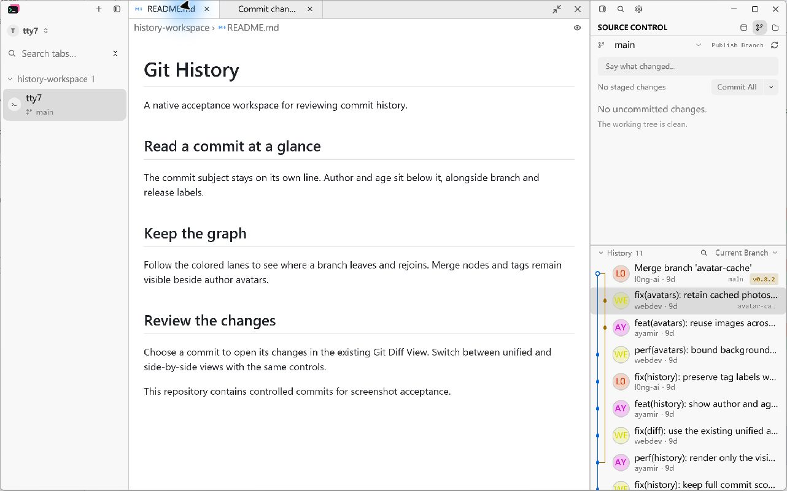
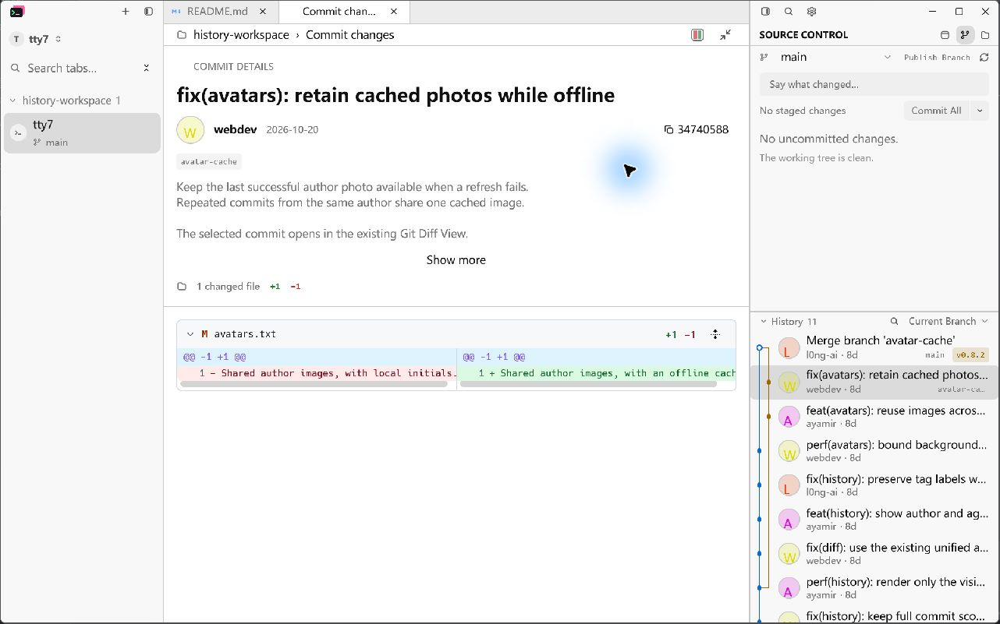
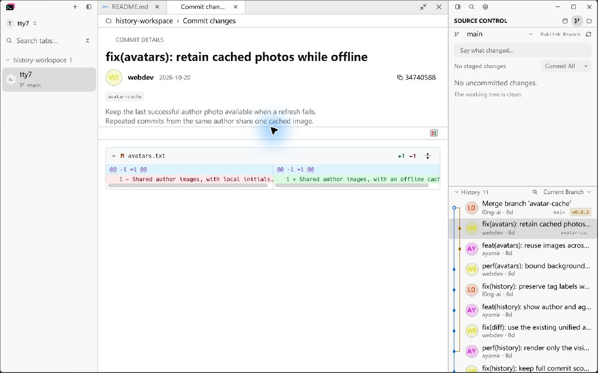
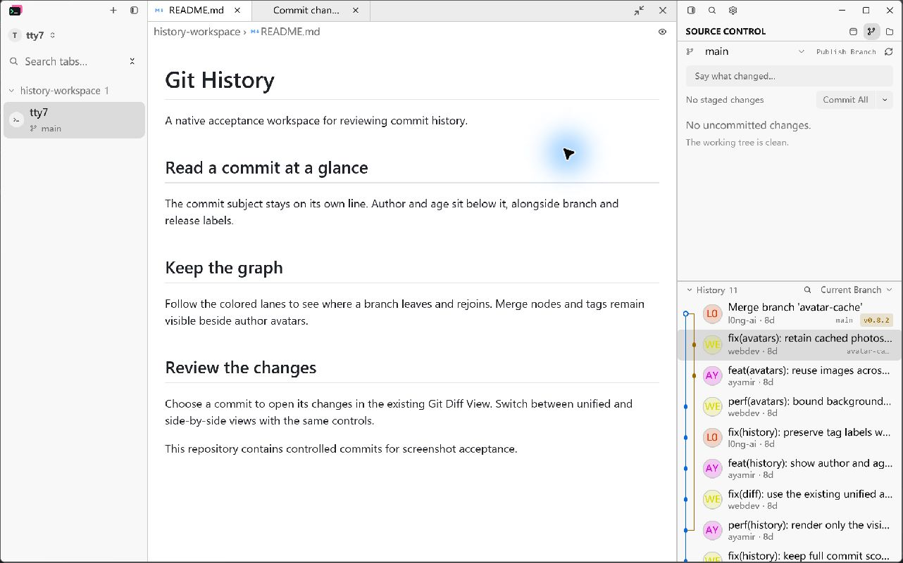
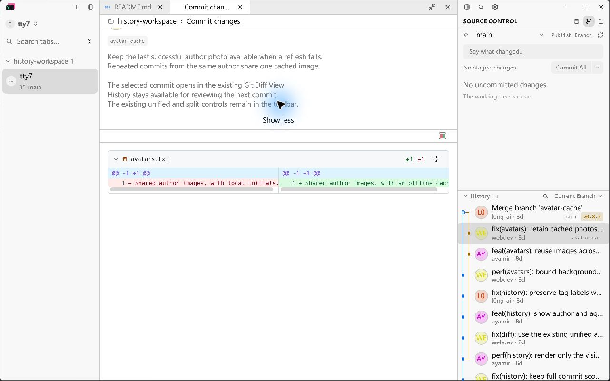
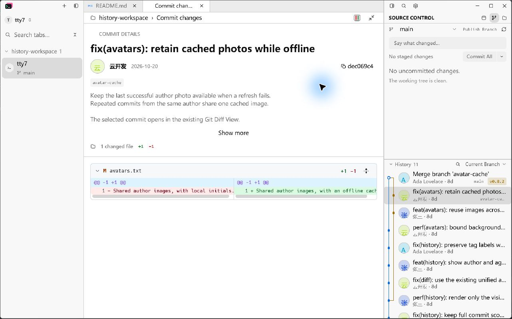
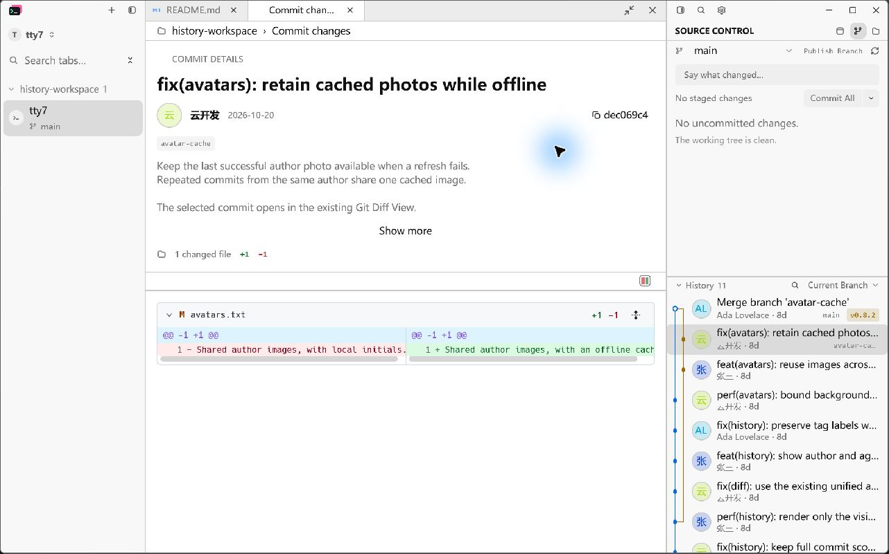

# Commit detail layout B

The commit document keeps shared layout actions in its tab strip. The diff mode
and focused-file controls now share that strip instead of taking a separate row;
the mode icon appears when the active commit document contains a text diff.
The existing fine separator still resizes the message and diff regions, and the
existing icon artwork is retained.

The final toolbar placement was verified on 2026-10-29 in the running native
application built from the final `e422dfcd` source. Raising the exact acceptance
window before capture resolved the earlier foreground-window capture blocker.
The original LCU JPEG bytes were saved through a loopback capture receiver.

## Final toolbar evidence

The Before and After use the same repository, selected commit `34740588`,
1280 x 800 logical viewport, 1.75 display scale, light theme, 320px Source
Control panel, 400px History, and disabled remote author photos.

Inspect the mode icon moving from its separate row into the top document strip,
beside fill/restore and close; the extra content row is gone.





Dragging the separator still resizes the message and diff regions.



Switching to README hides diff mode while retaining the same fill/restore position.



## Earlier native evidence

Before is the production application at `cb0bc217`. After in this historical
pair is revision `3e2de8f8`, before the later toolbar move.
Both run the opt-in production document fixture on Windows with the same real
Git repository, selected multiline commit `34740588`, 1280 x 800 logical viewport,
1.75 display scale, light theme, 320px Source Control panel and 400px History.
Author image loading is disabled through the History scope menu in both runs.

LCU captures are saved as their original JPEG bytes without cropping, resizing,
overlays or redrawing. The local capture receiver only persists the LCU bytes;
it does not capture the desktop or render substitute images.

Inspect the initials in History and commit details, and the fill/restore icon:




The existing separator can be dragged directly; it has a one-pixel visible line
and a 9px invisible hit area, without a grip or tooltip.



The same-size file document keeps fill/restore at the identical tab-strip position:



After scrolling and expanding the reduced message region, the final message
lines remain reachable while the diff and separator stay in place:



A second real fixture uses authors `Ada Lovelace`, `云开发` and `张三` with
`example.invalid` emails. Its selected commit is `dec069c4`; both versions use
that same fixture with remote-avatar loading left at its default. Inspect the
Chinese first character and two-letter Latin initials in History and details:





## Reproduce

```powershell
python scripts/prepare-git-history-captures.py <fixture-directory> --detail-body
cargo build --offline --locked --features markdown-visual-tests --bin tty7-app
# Run baseline and changed binaries with separate throwaway config directories.
<binary> --config-dir <scratch-config> --document-visual <fixture-directory>/light-320.json
```

In History's scope menu, disable **Load Author Avatars**. Select
`fix(avatars): retain cached photos while offline`. Capture the initial state,
drag the message/diff separator, expand and scroll the message, and switch
between README.md and Commit changes. Capture through LCU, not the fixture's
optional GPU image output.

## Automated acceptance

The existing rendered document interaction test is extended at its UI seam:
`commit_changes_is_a_separate_document_tab_beside_open_files` checks the toolbar
hierarchy, real pointer dragging, keyboard adjustment, retained split when
switching files, minimum allocations and the first inward arrow after shrinking
the window. It failed on the baseline because layout controls were in the
breadcrumb row.

`selected_commit_shows_message_details_above_the_existing_diff` now checks that
expanding the complete message preserves the chosen split, and scrolling the
upper region reaches the end of the message independently of the diff.

The final `cargo test --offline --locked` workspace run passes **3,183 tests,
zero failures, 12 ignored**. `cargo fmt --check`, `git diff --check`, and the host
boundary guard pass. The native evidence build with `markdown-visual-tests`
passes. No dependency, icon asset, or persistent configuration schema changed.

The source was compiled under a temporary evidence binary name to avoid
replacing an unrelated running development executable; the manifest and build
script were restored byte-for-byte before final validation. Both captured
binaries run as `tty7-app.exe`.

## Review

The independent Standards review found one keyboard edge case after window
shrink; clamping the visible ratio before applying the delta fixes it. A shared
bounds calculation prevents mouse, keyboard and layout limits from diverging.
Follow-up Standards review reports no remaining findings. Spec review found no
code-level deviations from B and requested native confirmation of fallback
initials and full-message scrolling. The final LCU captures confirm both, and
the natural-height content wrapper received a follow-up Spec review with no findings.

## Known limitations

Native screenshots cover Windows/light-theme only; macOS, Linux, and dark-theme
visuals have not been manually exercised. Empty and binary-only commit states
are covered by rendered interaction checks rather than native screenshots.
The split is retained for the open commit document, not persisted across app restarts.
