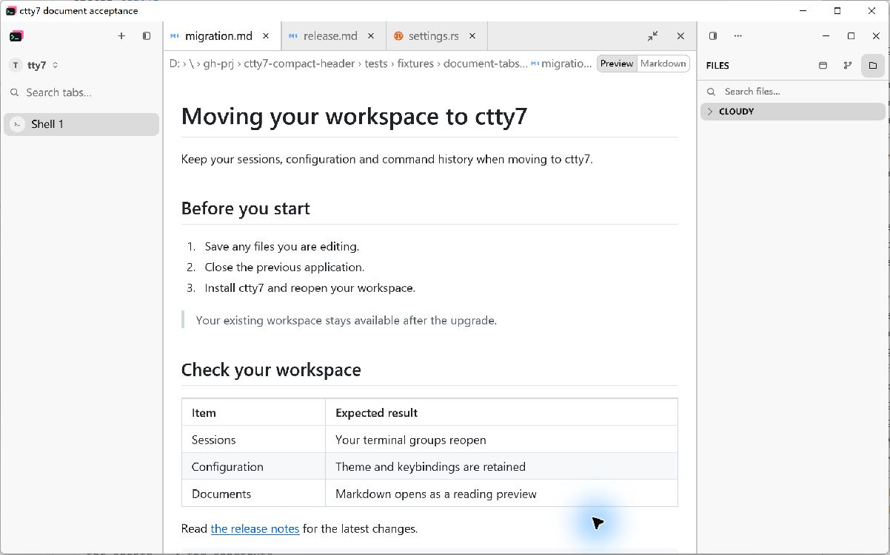
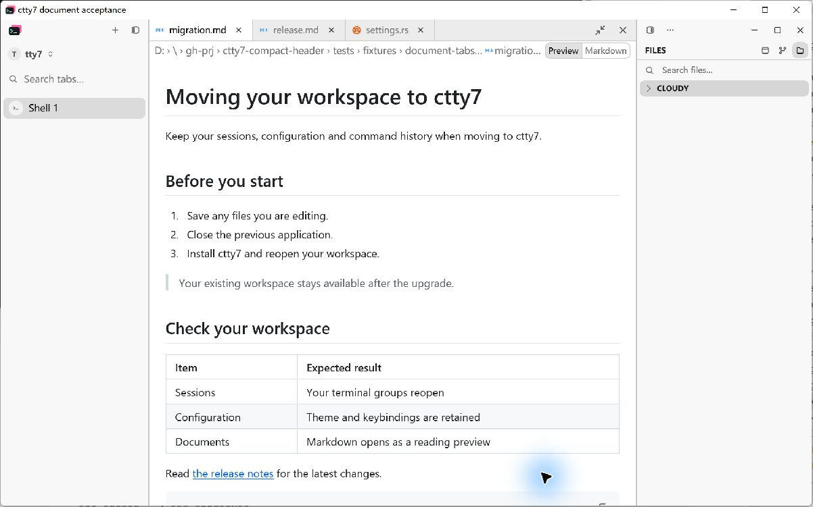
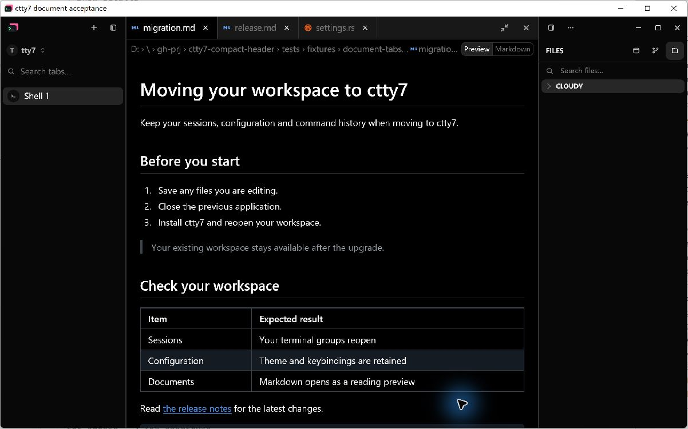
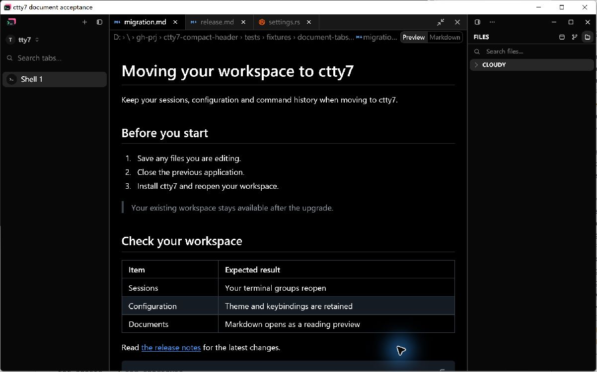

# Compact document header acceptance

The approved C + 13px layout reduces the shared window/document top strip to
32 logical pixels, document breadcrumbs and panel titles to 28, and file-tab
labels to 13/16 rem (13px at the default 16px UI size). Top chrome buttons use
28px targets; panel-tab buttons use 24px targets. Existing sidebar/window
backgrounds and transparent top-strip borders are retained. No horizontal
separator is added beneath the sidebar or window buttons.

| Header geometry | Before | After |
| --- | --- | --- |
| Window and document top strip | 40 | 32 |
| Document breadcrumbs | 34 | 28 |
| Files title row on Windows/Linux | 40 | 28 |
| Document / Files total | 74 / 80 | 60 / 60 |
| File-tab text at default UI size | 14 | 13 |

## Native evidence

These are LCU captures of the running Windows application, not HTML mockups or
GPUI test renders. Before uses production commit `b0b57316` plus only this PR's
`right_panel` fixture option. After uses the implementation in this PR.

Each pair opens the same three files from `tests/fixtures/document-tabs`:
`docs/maintenance/migration.md`, `docs/maintenance/release.md`, and
`src/settings.rs`. `migration.md` is active in Preview, in Fill layout, with the
Files panel visible and its root collapsed. The pointer is placed in the same
blank document area before capture. Separate scratch configuration directories
keep the user's normal sessions and preferences out of the fixture.

The viewport is 1200 by 720 at an OS scale factor of 1.75. LCU's JPEG exports
include the native frame and measure 1202 by 751 pixels. The returned image bytes
are saved unchanged, with no cropping, resizing, overlays or redrawing. The
fixture's readiness metadata verifies the viewport, theme, selected document,
preview mode and panel visibility before each capture.

Inspect the filename whitespace, icon centers, and the junction between the
breadcrumb row and the Files title. Document text and reading settings stay the
same while the chrome uses less height.

| Light Before | Light After |
| --- | --- |
|  |  |

| Dark Before | Dark After |
| --- | --- |
|  |  |

## Native interaction verification

LCU pointer input verified switching `migration.md` into Markdown source,
switching to `release.md` in its independent Preview mode, returning to the
retained source mode, and switching back to Preview. Closing inactive
`settings.rs` preserved the active document. Dock and Fill controls remained
usable and the narrow docked header retained its path and mode controls.

## Automated checks

- `cargo build --locked --bin tty7-app --features markdown-visual-tests` passed.
- `cargo test --locked --workspace --features markdown-visual-tests -- --test-threads=4`
  passed: 3157 tests, 0 failures, 12 ignored.
- `cargo fmt --all -- --check` passed.
- `bash .github/scripts/check-host-boundary.sh` passed.

Existing document tests still cover typical filename visibility, long paths,
mode switching and tab state. The long-path control check also verifies that
mode controls fit vertically inside the compact breadcrumb row.

## Reproduction and limits

Use the [native document fixture](document-tabs-native.md) with `width: 1200`,
`height: 720`, `right_panel: true`, `dock: false`, `active: 0`, `preview: true`,
and the three files above. Set `dark` to false or true for the two themes.
Use the same fixture source for baseline and final builds; the fixture addition
only exposes the existing Files panel and records its visibility.

Native visual acceptance was performed on Windows. macOS and Linux native
appearance and platform-specific window controls were not inspected locally.
