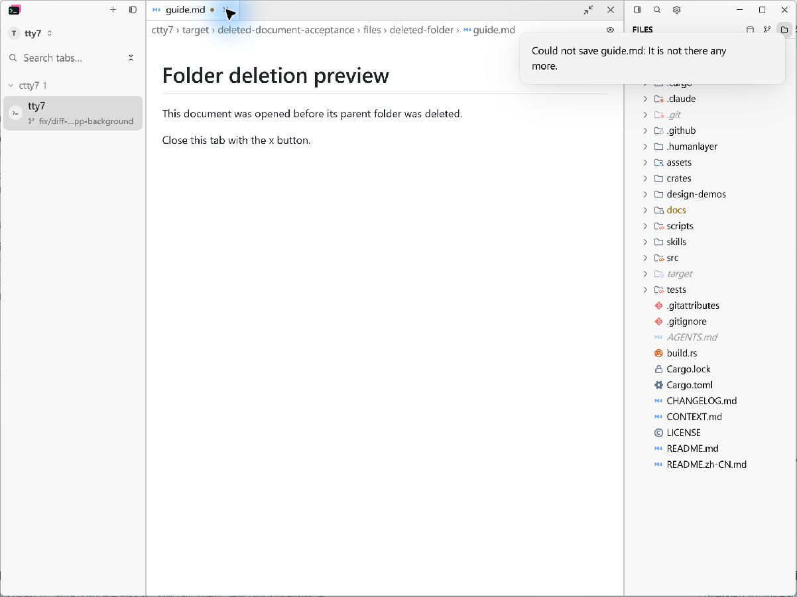
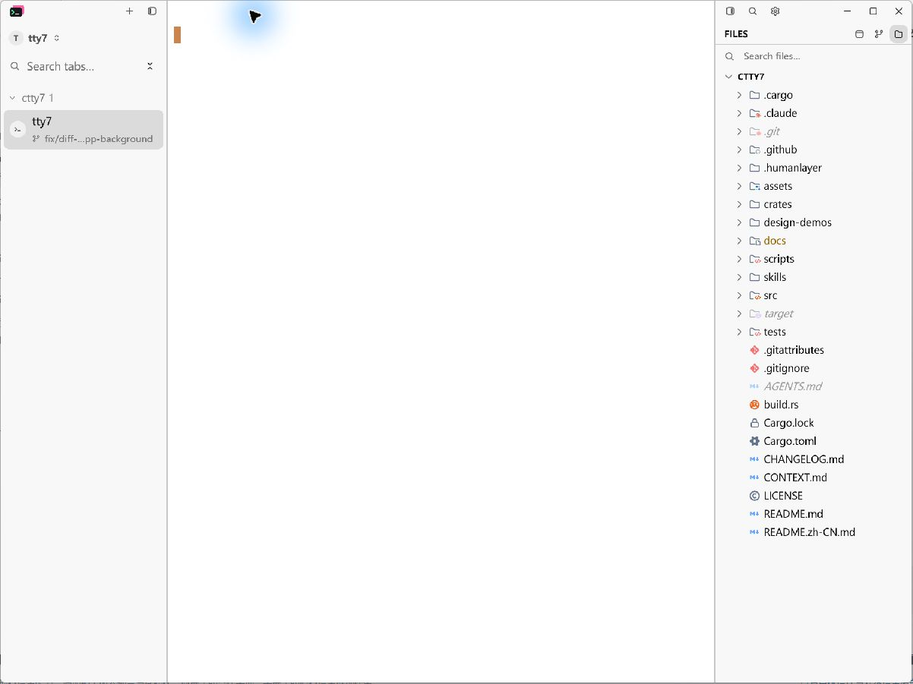

# Close a preview after its folder is deleted

## Cause and behavior

An external deletion starts a reload of an open, unedited document. The failed
read used to set `dirty = true`, even though the user had made no edits.
Closing the tab then offered Save/Cancel/Discard; choosing the default Save
failed because the parent folder no longer existed, leaving the tab open.

A failed reload now preserves the buffer's existing dirty state. An unedited
document closes immediately. Actual edits remain in memory and retain the
Save/Cancel/Discard prompt, including the ability to discard a deleted file.

## Native Windows reproduction

Build the full application with:

```powershell
cargo build --locked --bin tty7-app --features markdown-visual-tests
```

Use the existing `--document-visual` fixture with an isolated `--config-dir`.
Create a `files/deleted-folder/guide.md` fixture with this content:

```markdown
# Folder deletion preview

This document was opened before its parent folder was deleted.

Close this tab with the x button.
```

Pass these options, replacing the two absolute paths with scratch paths:

```json
{
  "root": "D:/scratch/files",
  "files": ["deleted-folder/guide.md"],
  "width": 1200,
  "height": 900,
  "right_panel": true,
  "hold_seconds": 600,
  "output": "D:/scratch/ready.json"
}
```

1. Wait for `NATIVE_DOCUMENT_READY_FOR_CAPTURE` in stderr.
2. Delete only the scratch `deleted-folder` directory outside the application.
3. Click the document tab's close button. On the baseline, accept the default
   Save response to the unexpected unsaved-changes prompt.
4. Inspect whether the tab closes and whether a save error appears.

The Before build is fork `main` at `ddd81dfa`; the After build uses this fix.
Both captures use the same fixture path and content, 1200 × 900 logical viewport,
175% Windows display scale, Light theme, Fill layout and visible Files panel.
Captures are the original LCU native screenshot bytes, with no image processing.
The reproduction uses scratch configuration and does not operate on the installed
application's session.

**Before:** the deleted, unedited document has a dirty indicator and stays open.
The notification says that `guide.md` could not be saved because it no longer
exists.



**After:** the same close action dismisses the final document and returns to
the terminal without a save prompt or error.



## Automated regression coverage

- `document_tabs_close_after_their_parent_folder_is_deleted` opens an actual
  Markdown file through the production opening path, removes its parent folder,
  delivers the external-change event, waits for the asynchronous reload, and
  clicks the rendered close button. It checks that the final tab and panel close
  without recreating the folder. The baseline fails with `an unedited deleted
  file must close without trying to save it`.
- `deleted_document_keeps_real_edits_and_can_be_discarded` edits a document,
  deletes its file, and attempts to reload it. It checks that failed reload keeps
  the edited text and dirty state, Cancel preserves the document, and Discard
  closes it without recreating the file.

Verified on Windows on 2026-10-30:

- `cargo test --locked --workspace`: 3,200 passed, 12 ignored, zero failures;
  the separate CLI end-to-end harness also passed all 13 checks. Git for Windows'
  `usr/bin` directory was prepended to the test process's PATH.
- Both new regression tests passed in the full application test suite
  (1,821 passed, 7 ignored).
- `cargo fmt --all -- --check`, `git diff --check`, and
  `bash .github/scripts/check-host-boundary.sh` passed.
- Both native fixture builds completed successfully, and the Before/After close
  interaction was verified through LCU.

## Known limitations

Native acceptance covers Windows. macOS/Linux UI and live WSL/SSH/SFTP sessions
were not manually exercised. The production fix is in the shared host-based
reload completion path and adds no local filesystem assumptions.
