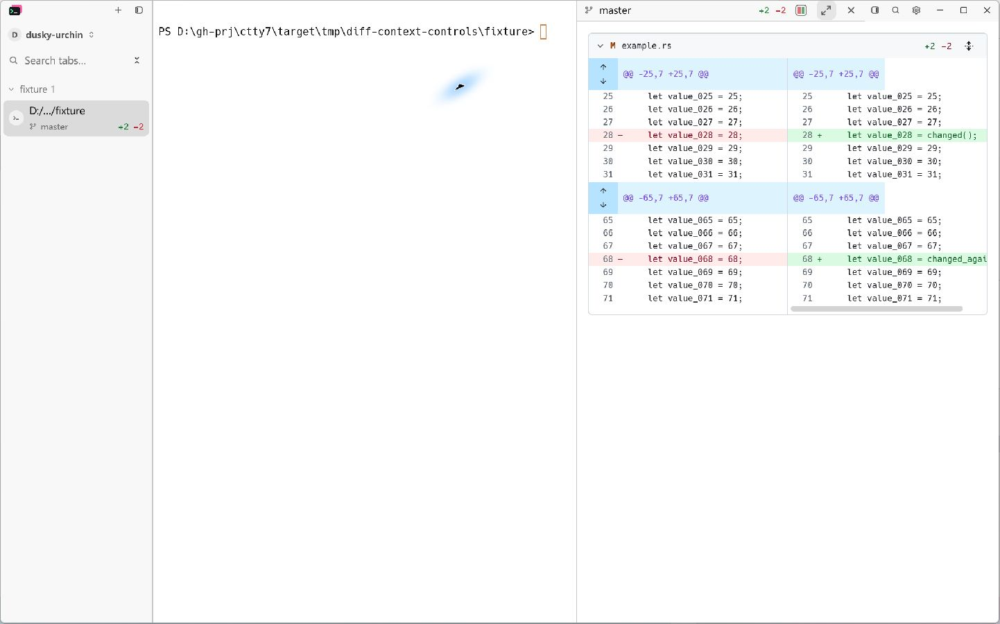
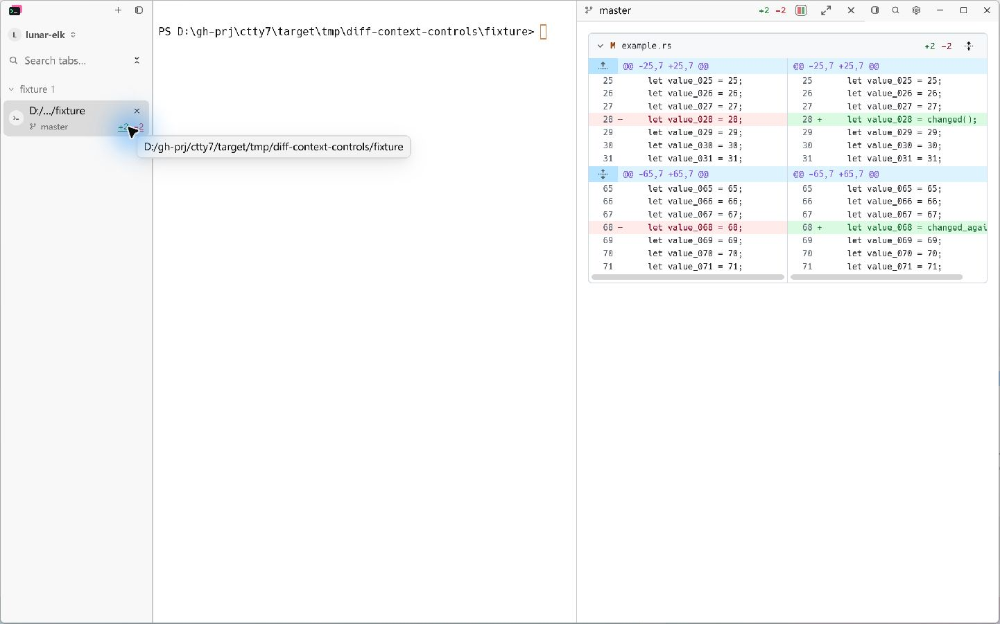
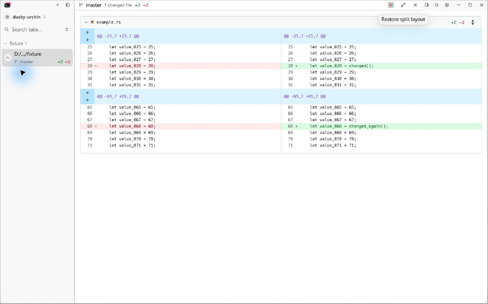
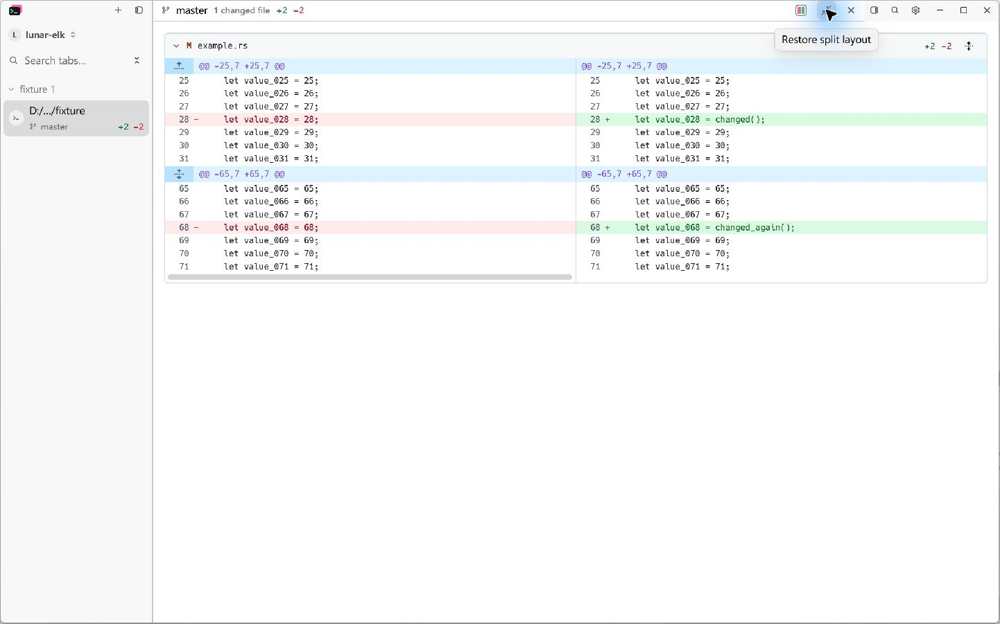

# GitHub-style diff context controls

The collapsed context gutter uses GitHub's Octicons `fold-up`, `fold-down`,
`unfold`, and `fold` graphics, including their dotted separators. The original
MIT notice is retained in [OCTICONS-LICENSE](../../assets/markdown-themes/OCTICONS-LICENSE).
Source: [primer/octicons](https://github.com/primer/octicons/tree/main/icons).

At the start of a file, the gutter reveals up to 20 preceding lines. Between
hunks, overlapping or adjacent 20-line reveal ranges become one combined
control that reveals the entire gap (up to 40 lines). Larger gaps retain two
directional controls. Single controls use the normal hunk header height.
Each SVG has an explicit foreground color, which GPUI's native SVG painter
requires even when the enclosing button already has a text color.

The scrolling content has a definite width at least as wide as its column.
This keeps every hunk background filled, including short headers in a column
whose source lines require horizontal scrolling.

## Native Windows evidence

Both versions run the production application with an isolated configuration,
the same light theme, window bounds, and unchanged Windows display scaling.
The fixture is a real Git repository containing 100 Rust source lines, with
replacements at lines 28 and 68. The baseline executable was built before this
change, from `ee23f9d6`. Captures use LCU against the running native window.

| Before | After |
| --- | --- |
|  |  |
|  |  |

Inspect the right edge of each blue header in the docked capture, and the dotted
separator and joined up/down arrows in the second header. The blue gutter is
one continuous rectangular click target for the combined control.

Detail crops: [before](images/diff-context-controls/before-detail.png) and
[after](images/diff-context-controls/after-detail.png). Both use the same
rectangle (left 848, top 48, width 576, height 408) from the docked screenshots,
without scaling or redrawing.

Additional native captures: [expanded context](images/diff-context-controls/after-expanded-split.png),
[unified layout](images/diff-context-controls/after-unified.png), and
[dark theme](images/diff-context-controls/after-dark.png).
The expanded capture shows the formerly hidden lines 32–64 connected to the
first hunk; the hunk now covers lines 25–71 and the file totals remain +2/−2.

The native capture check also verifies that both context controls contain
contrasting pixels and that both blue headers cover the right edge of both
columns. This catches invisible SVGs that geometry-only window tests miss.

## Regression coverage

- `short_context_gap_uses_one_full_width_hunk_row` checks single-row height and
  both column edges in split and unified layouts.
- `gap_context_controls_stack_in_the_hunk_gutter` retains separate,
  non-overlapping controls for a large gap.
- `short_hunks_keep_the_full_column_width_after_horizontal_scroll` checks hunk
  backgrounds after scrolling to the far right of a long line.
- `full_file_controls_preserve_change_position_and_layout` clicks the combined
  control and checks that it joins the hunks while preserving both additions
  and deletions, in both layouts.

## Results

Verified on Windows on 2026-10-26: 24 relevant tests passed, with the existing
manual frame benchmark skipped. This includes 15 diff window tests, one context
projection test, seven row-pairing tests, and the Git icon asset-resolution test.
Formatting, `git diff --check`, and the HostOps boundary check passed.

The production application was built with cached release dependencies and
application optimization disabled to shorten local validation:

```powershell
cargo rustc --offline --release --locked --bin tty7-app -- -C lto=thin -C opt-level=0 -C codegen-units=16
```

The tests used the same cached dependencies and application compiler settings.
Their standard development entry points are:

```powershell
cargo test --locked --bin tty7-app ui::diff_overlay::github_theme_gpui_tests -- --test-threads=1
cargo test --locked --bin tty7-app ui::diff_context:: -- --test-threads=1
cargo test --locked --bin tty7-app ui::diff_rows:: -- --test-threads=1
cargo test --locked --bin tty7-app ui::assets::tests::every_git_icon_resolves -- --exact --test-threads=1
```

This is Windows visual and targeted regression acceptance. Linux, macOS, and
the full workspace suite were not rerun; no rendering-performance claim is made.
