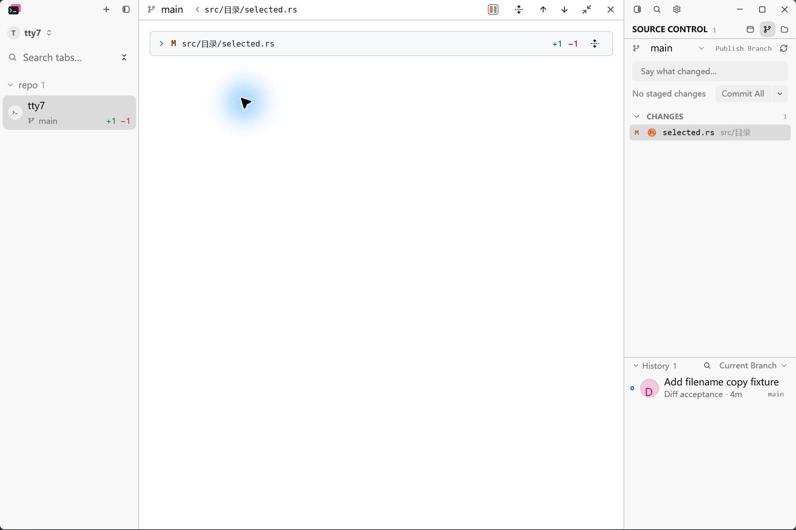
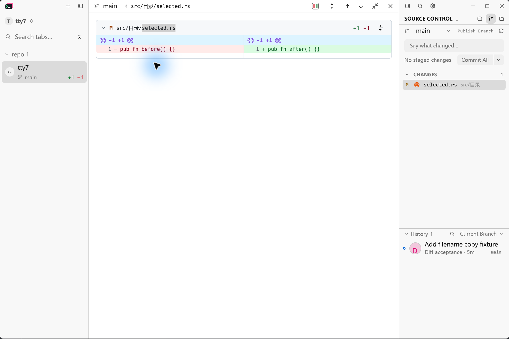

# Diff file name selection and copying

## Request and acceptance

The user reported: "diff view 文件内容支持了选中复制，但文件名不支持操作". File card names must support selecting and copying text while retaining file expansion and independent diff-content selection.

## Native before and after

Captured on Windows 11 at 175% display scale, with the same 1200 x 800 logical-pixel application window, light theme, split diff, and working-tree change to `src/目录/selected.rs`. The disposable Git repository contains one commit and a one-line change from `pub fn before() {}` to `pub fn after() {}`. Both runs use the production document acceptance fixture with the same options and SCM file-opening action. The baseline binary is the pre-fix application from the background-attention worktree, whose diff code matches `d13a2ae9`; the after binary contains this change.

Screenshots were captured using the native Windows Screenshot Tool through LCU. The same lossless 2100 x 1400 pixel window crop was applied to both desktop captures, excluding other applications. These are screenshots of the running native application.

Before: dragging across `selected.rs` collapses the file card and selects no text.

After: the same drag highlights `selected.rs` and leaves the diff expanded.

Native clipboard verification also passed: with the filename focused, Ctrl+A then Ctrl+C followed by Ctrl+V into Search tabs produced `src/目录/selected.rs`.

## Automated verification

- Regression before the implementation: dragging and copying the filename left the clipboard as `UNCHANGED` instead of `selected.rs`.
- Both split and unified views now pass actual GPUI mouse/key tests for partial Unicode-path selection, full-path Select All/Copy, the Copy context menu, independent body copying, and selection in collapsed cards. The disclosure arrow still toggles expansion.
- `cargo test --offline --locked --bin tty7-app ui::diff_`: 49 passed, 2 ignored.
- `cargo test --offline --locked --workspace`: 3179 passed, 12 ignored, no failures.
- Production `cargo check --offline --locked --bin tty7-app`, formatting, whitespace, and the Host boundary check passed.

## Known limitations

Native interaction was verified on Windows only. Cross-platform GPUI tests exercise split and unified selection; native macOS/Linux clipboard interaction was not run locally. Long names retain truncation; Select All copies the complete underlying displayed path, including the existing rename representation.
