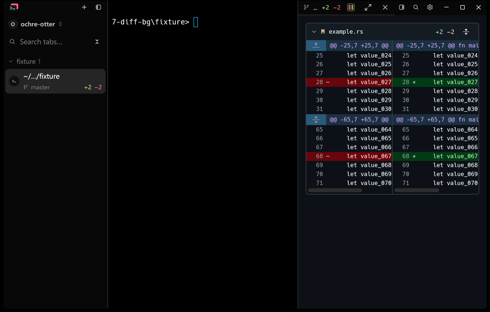
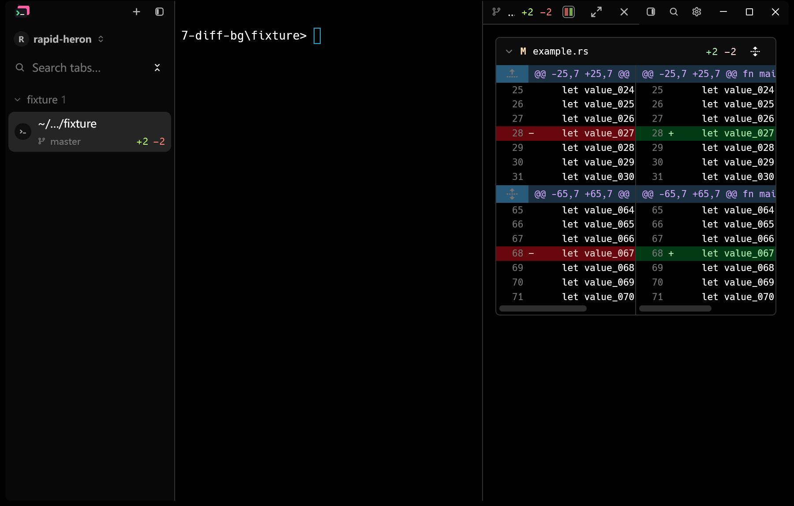
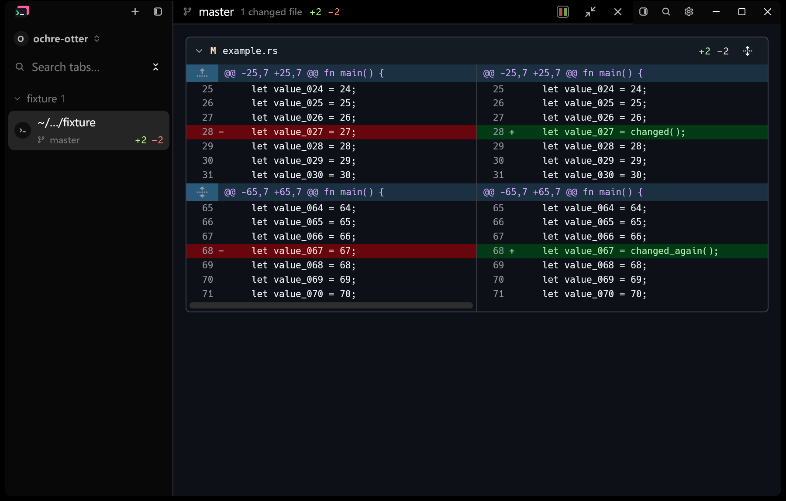
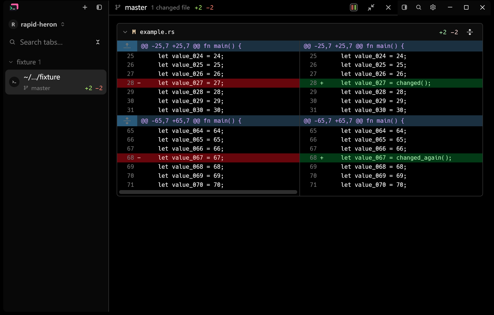

# Diff background follows the application theme

The diff reading area painted GitHub's own page colors (`#0d1117` dark,
`#ffffff` light) regardless of the active preset, so it stood out against the
sidebar and terminal in most dark themes. The background, file headers, text,
muted text and borders now come from the application theme, the rule the
bundled Markdown theme already follows. Additions, deletions, hunk headers and
their backgrounds keep the GitHub values approved in cloudy-liu/ctty7#111.

## Native Windows evidence

Both runs use the full debug application on Windows 11 at 175% display scale,
an isolated configuration with the built-in Dark preset (`#000000`), the same
1800 x 1150 physical-pixel window and the same click sequence. The fixture is a
Git repository with a 100-line `example.rs` and working-tree replacements at
lines 28 and 68. The baseline binary was built from `cb0bc217` with this
change stashed. Captures use `PrintWindow` on the native window.

| Before | After |
| --- | --- |
|  |  |
|  |  |

Pixel samples from the same coordinates:

| Surface | Before | After |
| --- | --- | --- |
| Terminal | `#000000` | `#000000` |
| Diff background | `#0d1117` | `#000000` |
| File header | `#151b23` | `#0d0d0d` |

## Regression coverage

- `rendered_context_and_file_cards_share_the_application_surface` checks
  context rows and file cards against the Light, Dark and Nord preset
  backgrounds, text and borders, with unrelated preset status colors changed.
  With the previous GitHub surface colors restored it fails on the Light
  preset: context text is GitHub `#1f2328` instead of the theme's `#111111`.
- `rendered_changes_use_github_colors_in_both_modes` still pins the GitHub
  addition and deletion colors in both modes.

```powershell
cargo test --locked --bin tty7-app ui::diff -- --test-threads=1
cargo test --locked --bin tty7-app ui::document_column -- --test-threads=1
```

Verified on Windows on 2026-10-29: 49 diff tests passed with 2 ignored, and
21 document column tests and 22 Markdown preview tests passed. Formatting
and `git diff --check` passed. Light presets and macOS
or Linux were not captured natively.
