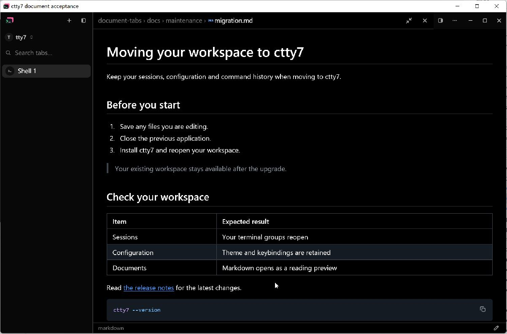
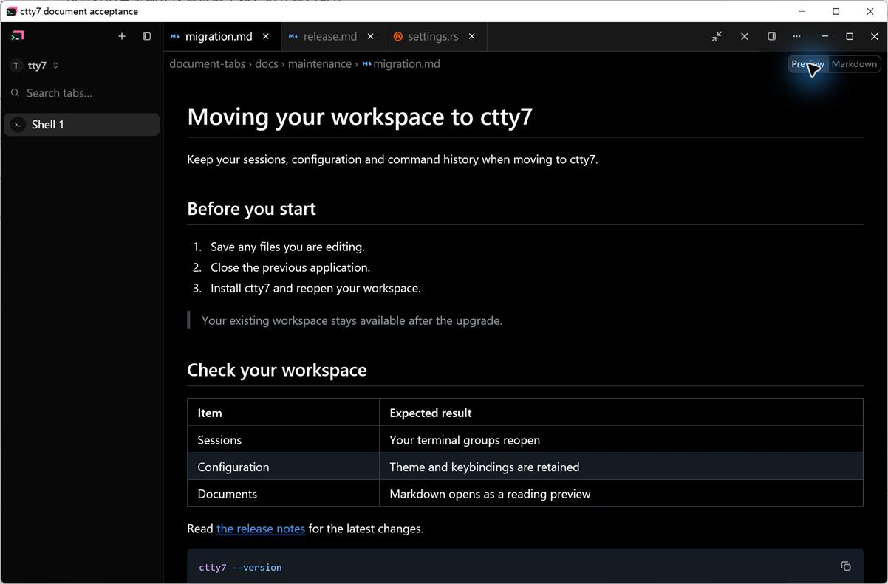
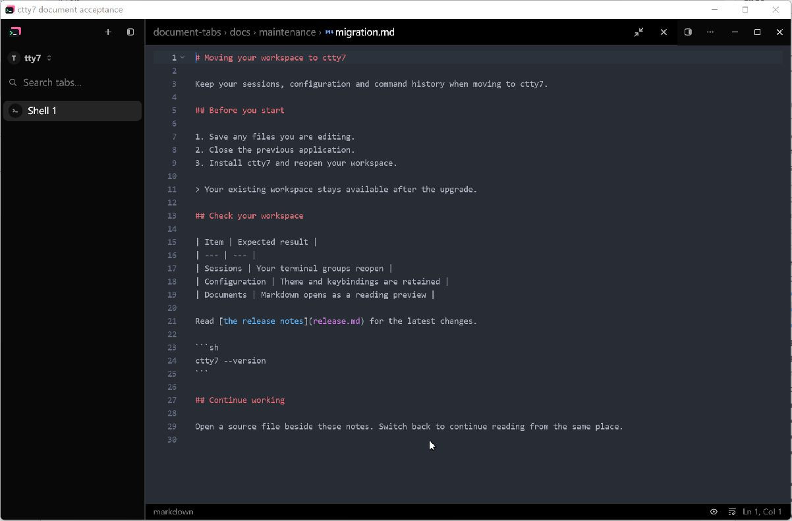
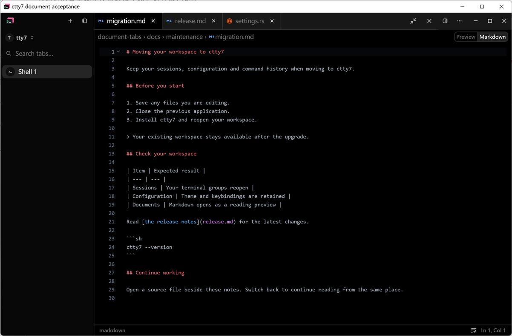
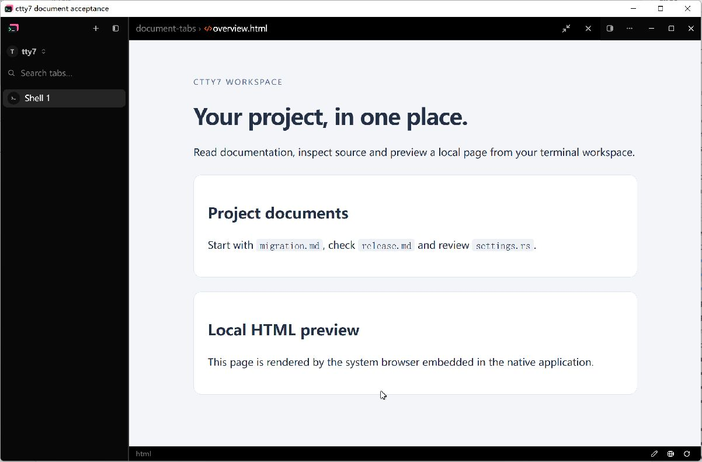
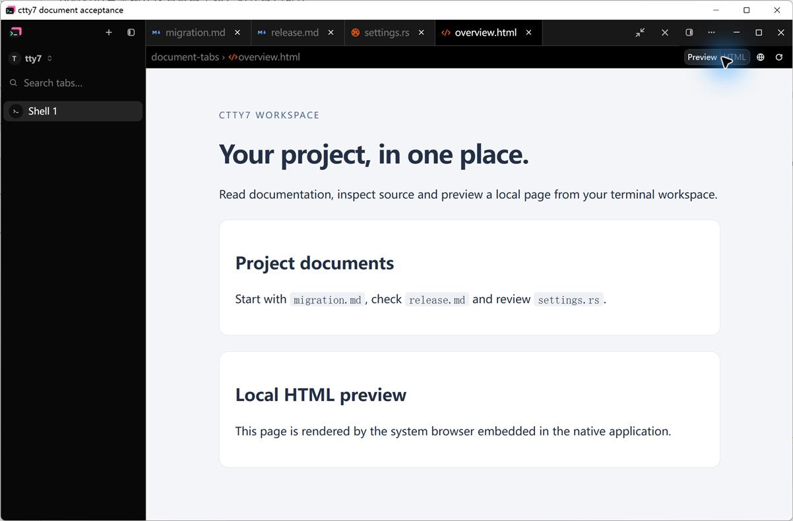

# Native document tab evidence

The opt-in `--document-visual` fixture opens the full production `Tty7App` in a separate native window. It uses normal document-opening actions, awaits each file load and waits for Markdown parsing or the native HTML page before publishing readiness. It does not replace the app's renderer or document controls.

Build with `cargo build --bin tty7-app --features markdown-visual-tests`. Run each capture with its own scratch `--config-dir`, never the user's normal configuration directory. Fixture windows use the title `ctty7 document acceptance` so local computer use can identify them without touching other app windows.

Example options, saved as an absolute JSON file outside the checkout:

```json
{
  "root": "D:/gh-prj/ctty7-file-tabs/tests/fixtures/document-tabs",
  "files": [
    "docs/maintenance/migration.md",
    "docs/maintenance/release.md",
    "src/settings.rs",
    "overview.html"
  ],
  "active": 0,
  "preview": true,
  "width": 1200,
  "height": 900,
  "dark": true,
  "dock": false,
  "output": "D:/gh-prj/document-preview-ready.json",
  "image": "D:/gh-prj/document-preview.png",
  "hold_seconds": 120
}
```

```powershell
Start-Process -WindowStyle Normal -FilePath D:/gh-prj/ctty7-tabs-after.exe -ArgumentList '--config-dir', 'D:/gh-prj/document-preview-config', '--document-visual', 'D:/gh-prj/document-preview-options.json' -RedirectStandardError D:/gh-prj/document-preview.log
```

Remove any previous readiness output before launching. Wait for `NATIVE_DOCUMENT_READY_FOR_CAPTURE` in stderr and `"ready": true` in the output JSON, then capture the fixture's native window. The JSON records the actual viewport, OS scaling, opened documents, selected file and mode. Its `capture` field states whether the requested GPU image was saved or a native screenshot is needed. The fixture holds for the requested duration, capped at 600 seconds, then exits.

For Markdown source use `active: 0, preview: false`; for ordinary source use `active: 2, preview: false`; for HTML use `active: 3, preview: true`. Omitting `preview` retains the production first-open default. Use `dock: true` to inspect the docked document layout. Keep the files, active document, mode, theme, viewport, OS scaling and screenshot method identical in each Before/After pair.

## Baseline reproduction

Create an isolated worktree at `e06271fb` and apply the native evidence fixture and window-registration fix with `git cherry-pick 89176e54 8de7b3f5`. These commits add the fixture, its CLI dispatch, sample documents, these instructions and registration that keeps the fixture window open when the tray is disabled. They do not change production document UI. Build there and copy the executable outside `target` before another build can overwrite it. Run baseline and final binaries sequentially against the same fixture root and separate scratch configuration directories. The fixture is intentionally visible for native inspection and capture, so launch it with `-WindowStyle Normal`.

Keep the captured images in the repository and embed them directly in the PR's Evidence section with repository image URLs. A local file link alone does not give reviewers a visible comparison.

## Windows Before/After comparison

These are Local Computer Use captures of the real native application, using the
same fixture files, dark theme, Fill layout, 1200 by 760 viewport and 1.75 scale
factor. The exported JPEGs include the native frame and measure 1202 by 791
pixels. The refreshed After captures were copied with the active-window screenshot
shortcut and scaled from physical pixels to the same export size. No document
controls were drawn over the screenshots.

The Before application uses production commit `e06271fb` with only fixture
commits `89176e54` and `8de7b3f5` applied. The After application uses the file-tab
UI with theme-following document surfaces. Source content, the gutter, the
active tab and breadcrumb row use the application theme's opaque base color.
Inactive tabs, the empty tab rail and document header actions use the window
hover surface, including the window controls beside a filled document.
Tabs start flush at the document's left edge; only macOS traffic lights reserve
leading space when they occupy the same header. Markdown and HTML previews
retain the window background.
The breadcrumb row has no bottom divider, so it joins the document content.
Markdown cases open the two maintenance documents and
`settings.rs`; the HTML case additionally opens `overview.html`.

| Markdown Preview before | Markdown Preview after |
| --- | --- |
|  |  |

| Markdown source before | Markdown source after |
| --- | --- |
|  |  |

| Local HTML before | Local HTML after |
| --- | --- |
|  |  |

Native input also verified clicking Markdown to enter source, switching to
`release.md` in its independent Preview mode, returning to `migration.md` with
source mode retained, and closing inactive `settings.rs` without changing the
current document. The refreshed source After image starts the fixture with
`active: 0, preview: false`, with all three files still open.

The theme-following surfaces passed these checks on Windows:

- `cargo fmt --all -- --check`.
- `cargo test --bin tty7-app editor_ --no-fail-fast`: 18 passed.
- `cargo test --bin tty7-app document_tabs --no-fail-fast`: 6 passed.
- `cargo test --bin tty7-app source_palette_follows_system --no-fail-fast`: 1 passed.
- `cargo build --bin tty7-app --features markdown-visual-tests`.

The preset regression covers black, One Dark Pro, Dracula, Nord, light and
custom backgrounds, preserving unsaved edits, cursor, selection, scrolling and
undo. It failed against the fixed Atom One Dark background before the fix.
Search contrast and authored syntax-color checks also pass. All three After
images were recaptured from this build and inspected before and after export.

## Capture limits

GPUI's current macOS backend supports native `render_to_image`. The current Windows native backend reports that this operation is unsupported, so use Local Computer Use to inspect and capture the fixture window. An HTML preview is a native child WebView and is absent from GPUI GPU output on any platform; always use a native window screenshot for HTML. Linux retains the production HTML source fallback. The fixture's ready marker proves content load, while visual inspection establishes that controls and content are visible and aligned.
