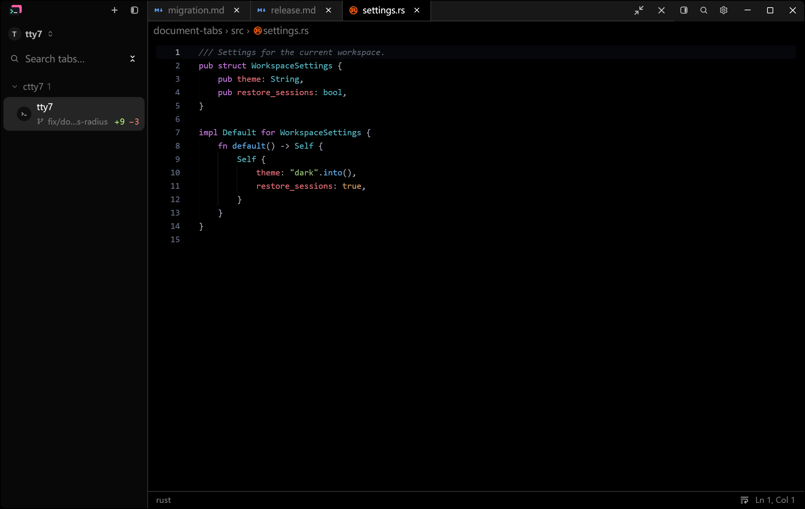
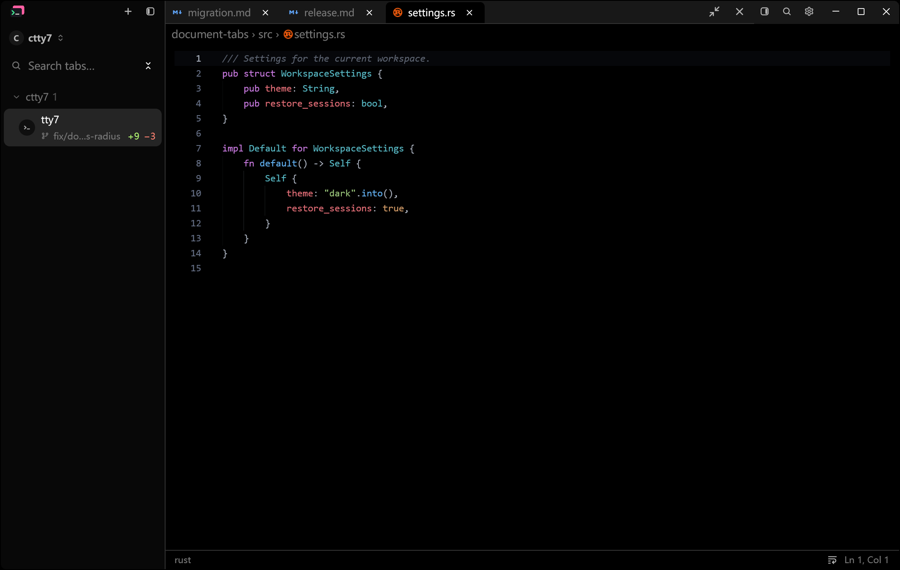

# Document tab shape acceptance

Asked for in review on 2026-11-01: the file tabs above a document or Markdown
view read as hard cells; give them some rounding.

## Reproducible native state

Baseline source: `1063bc9b` (fork `main`; the document fixture is unchanged
there). Final application source: this branch's head. Both are debug builds
with `--features markdown-visual-tests`, started as
`tty7-app --config-dir <fresh dir> --document-visual <options.json>` on the
repository's `tests/fixtures/document-tabs` root with `migration.md`,
`release.md` and `settings.rs` open, `active: 2`, `preview: false`, a
1200 x 760 logical window, dark theme, docked layout off, right panel off.
Windows 11 at 175% scale, `scripts/capture-native-window.ps1` (PrintWindow),
pointer parked outside the window.

## Matched Before and After

Before, each file tab is a full-height cell closed by a 1px right border.
After, tabs sit 4px below the strip's top with rounded top corners and a 2px
gap: the active tab rises into its document, inactive tabs are flat and take
the same rounded shape on hover. Tab widths, the strip's height and its
bottom border are unchanged.

## Automated checks

The nine document-tab tests in `src/ui/code_editor.rs` and
`src/ui/document_column.rs` pass unchanged on Windows.
