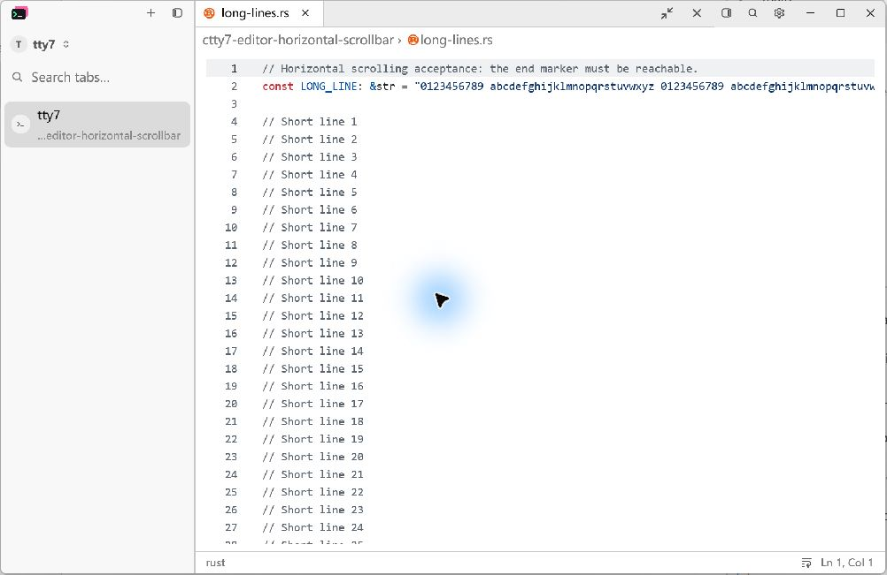
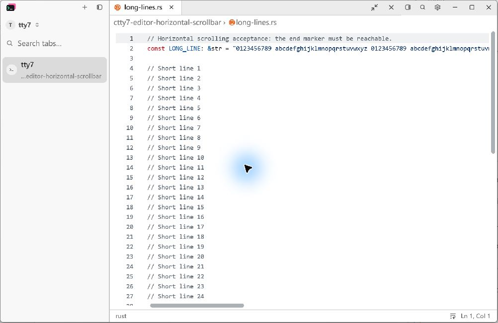
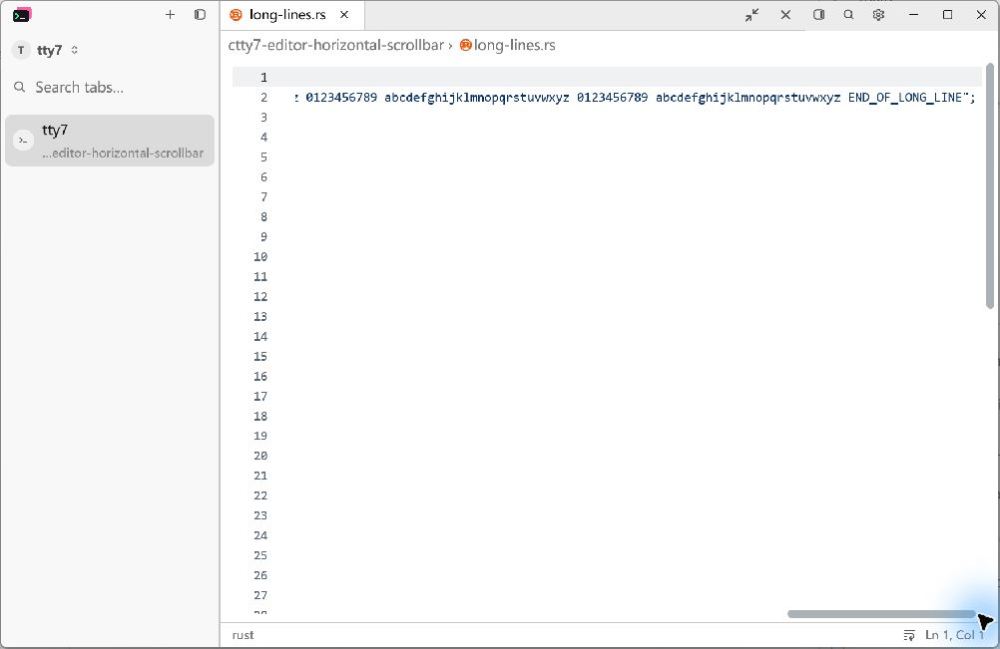
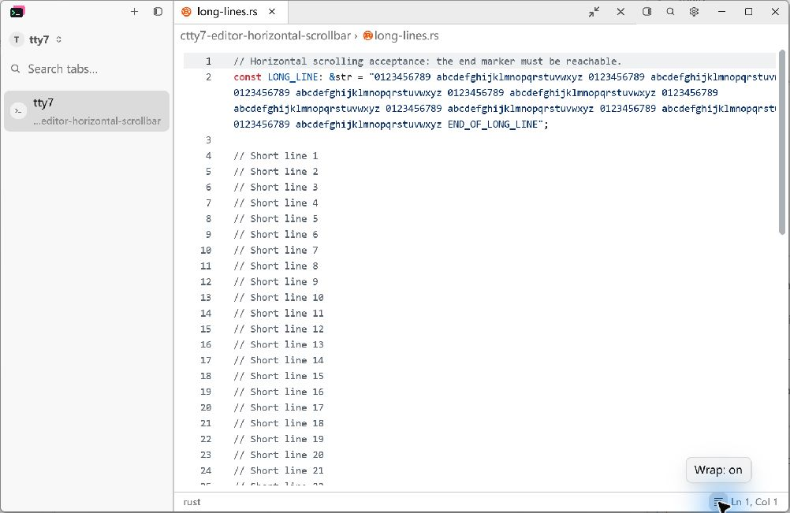
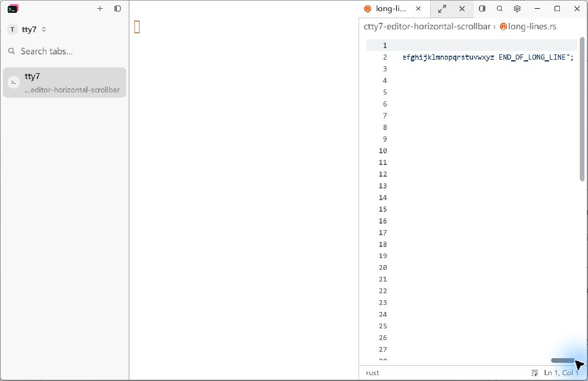

# Source editor horizontal scrolling

## Reproduction and cause

Open a source file with a line wider than the editor, with word wrap off.
The source editor inherited the application's `ScrollbarShow::Scrolling`
policy, so its horizontal scrollbar was invisible on opening and after idle.
The shared scrollbar ignores track clicks while hidden. Git Diff View already
overrides its horizontal scrollbar to `Always`.

The source editor now sets `Input::scrollbar_show(ScrollbarShow::Always)`.
The component option is local to that input and defaults to the existing theme
policy for other inputs. Overflow detection and soft wrapping still determine
whether each axis needs a scrollbar.

## Automated regression

`editor_long_lines_scroll_with_the_horizontal_track` opens a long Rust source
line in the production document panel and clicks the bottom track before any
wheel or keyboard scrolling. Before the fix, the horizontal offset stays zero
and the test fails. With the fix, the track scrolls the source horizontally.

```powershell
cargo test --locked --release --bin tty7-app --features markdown-visual-tests `
  --config profile.release.package.tty7.opt-level=0 `
  --config profile.release.package.tty7.codegen-units=16 `
  editor_long_lines_scroll_with_the_horizontal_track -- --nocapture
```

## Native acceptance

The captures use the production document fixture on Windows at 175% display
scale, a 1000 x 650 logical-pixel viewport, the light theme, the same source
buffer, and word wrap off. Captures are from the running native application.

Before: the long second line is clipped, and the bottom scrollbar is absent.



After: the horizontal track and thumb are visible immediately on opening.



After dragging the horizontal thumb to the right, `END_OF_LONG_LINE` is visible.



Enabling word wrap resets the horizontal position and removes the horizontal
bar while keeping the full line readable.



The same thumb can reach the long line ending in the narrow docked panel.



To reproduce the capture state, copy
`tests/fixtures/editor-horizontal-scrollbar/long-lines.rs` to an isolated
temporary directory outside the Git checkout (so sidebar Git status cannot
change between captures), build with
`--features markdown-visual-tests`, and pass these fixture options through
`--document-visual <options.json>` with an isolated `--config-dir`:

```json
{
  "root": "<absolute fixture directory>",
  "files": ["long-lines.rs"],
  "output": "<absolute path to readiness.json>",
  "preview": false,
  "width": 1000,
  "height": 650,
  "hold_seconds": 600
}
```

## Known limitations

Native macOS and Linux acceptance has not been performed.
