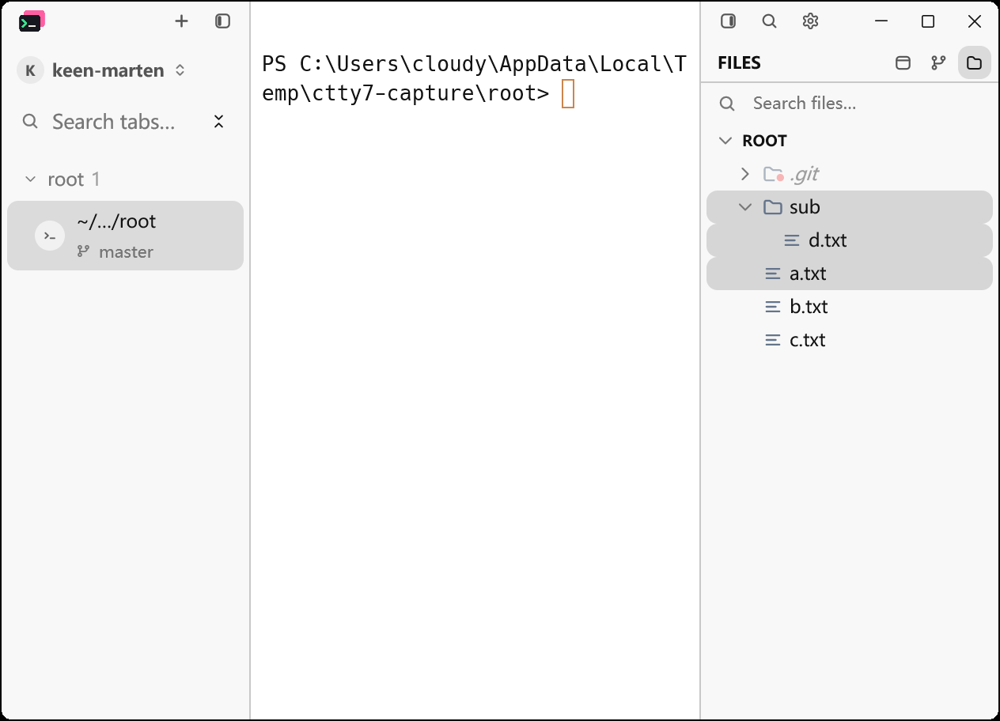
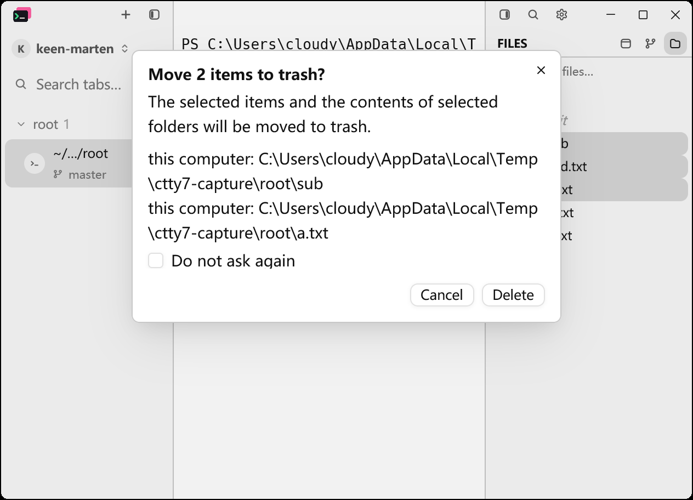
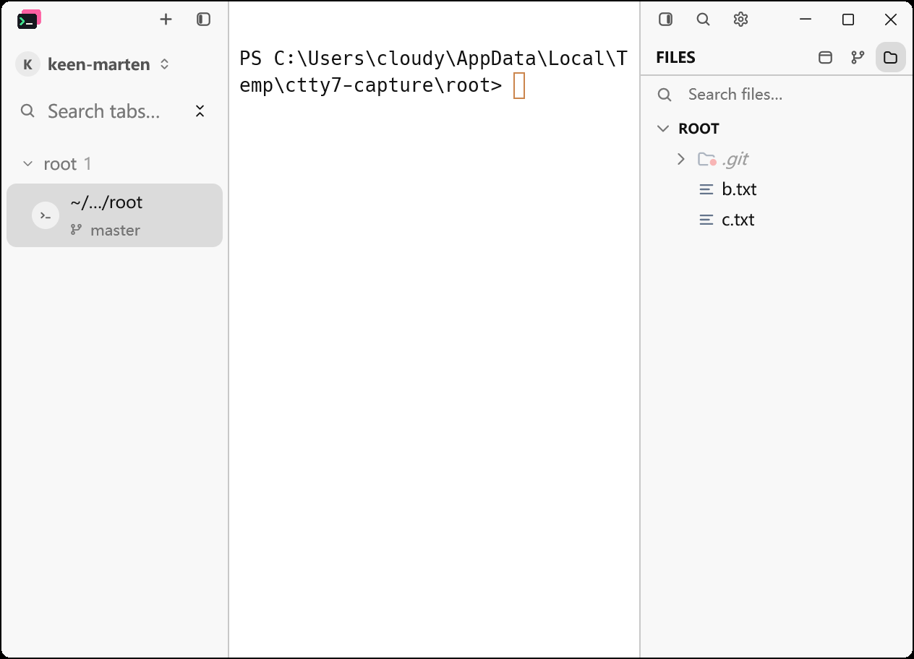

# Files panel: multiple selection and recoverable deletion

Native Windows acceptance for cloudy-liu/ctty7#245, #247 (#248 and #249 reuse the
same confirmation and trash flow over remote hosts).

Both the captures and the checks below come from the application built at
integration revision `47b8e36a`, launched with an isolated configuration
directory (`--config-dir`) and `--open-path` pointing at a throwaway git
repository:

- fixture: `a.txt`, `b.txt`, `c.txt` and `sub/d.txt`, `git init`-ed so the tree
  roots at the fixture itself
- window: 720 x 520 logical (1260 x 910 client) at a 175% display scale, Files
  panel 260 logical wide, light appearance
- `a.txt`/`b.txt`/`c.txt`/`sub/d.txt` sha256 recorded before the operation:
  `b6a98d9c...`, `f2c82dec...`, `ae9a6306...`, `673953e0...`

## Steps and results

1. **Select three rows**: click `sub`, then Shift+Down twice. `sub`, `d.txt` and
   `a.txt` are highlighted together.

   

2. **Delete**: the shared confirmation lists **two** targets -
   `...\ctty7-capture\root\sub` and `...\ctty7-capture\root\a.txt`. The selected
   descendant `d.txt` is suppressed because its parent folder is itself a
   target. "Do not ask again" starts unchecked.

   

3. **Confirm**: the two rows leave the listing, and both land in the Windows
   Recycle Bin. Shell enumeration reports `bin total: 2` with items named
   `a.txt` and `sub`; the untouched siblings hash to the values recorded above.

   

## Automated evidence

- `cargo test --locked` on the integration branch: workspace suite passed.
- `cargo test --locked --bin tty7-app ui::file_tree::tests`: 31 passed.
- `cargo test --locked -p tty7-core -- trash`: 8 passed.
- `cargo fmt --all -- --check`: clean.
- CI run 41678881904 on `47b8e36a`: every job green (Windows, Linux, both macOS
  targets, servers, rustfmt, host boundary).

## Known limitations

- **No Before/After pair.** The baseline build (equivalent to `fork/main`) could
  not be captured in this environment: `PrintWindow` returns a blank client area
  for its window, and the display work area (1463 x 866) is smaller than the
  application's minimum client size (1260 x 910), so a screen-region capture
  clips it. The images above are therefore After-side only, and visual
  acceptance of the repository's Before/After gate is unverified.
- The SFTP side reuses this confirmation, but has no dedicated test: its
  capability check reads a process-global with no test hook.
- Moving a target, or the parent folder of an open document, to trash was not
  exercised end to end: the editors' unsaved-buffer and external-change
  safeguards have their own tests, but the trash-then-edit interaction is
  unverified.
- macOS native restore, Windows Recycle Bin metadata cleanup, directory symlink
  behaviour, WSL/Linux crate tests and real remote hosts remain unverified.
