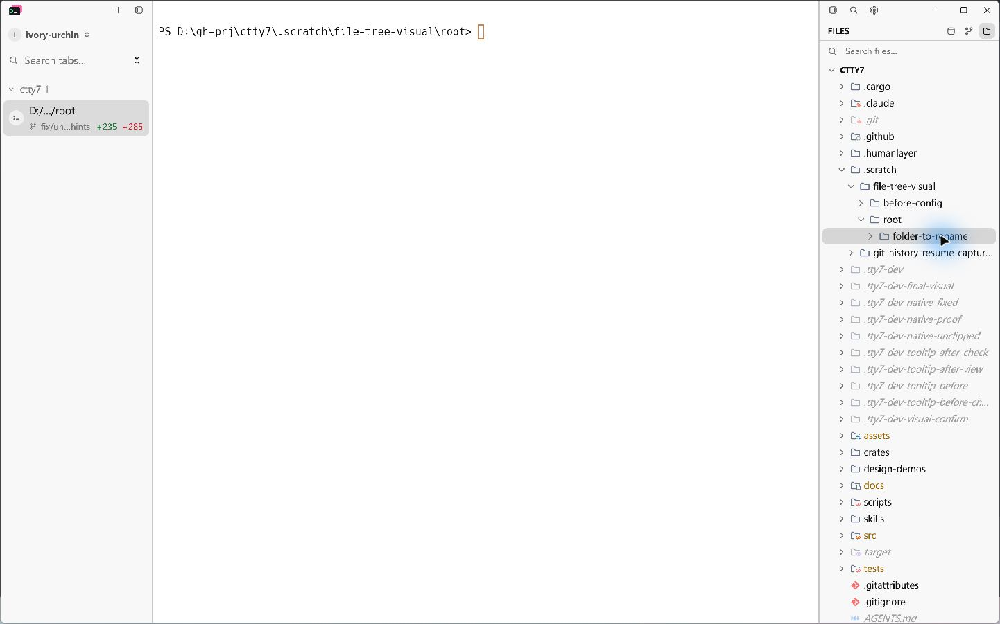
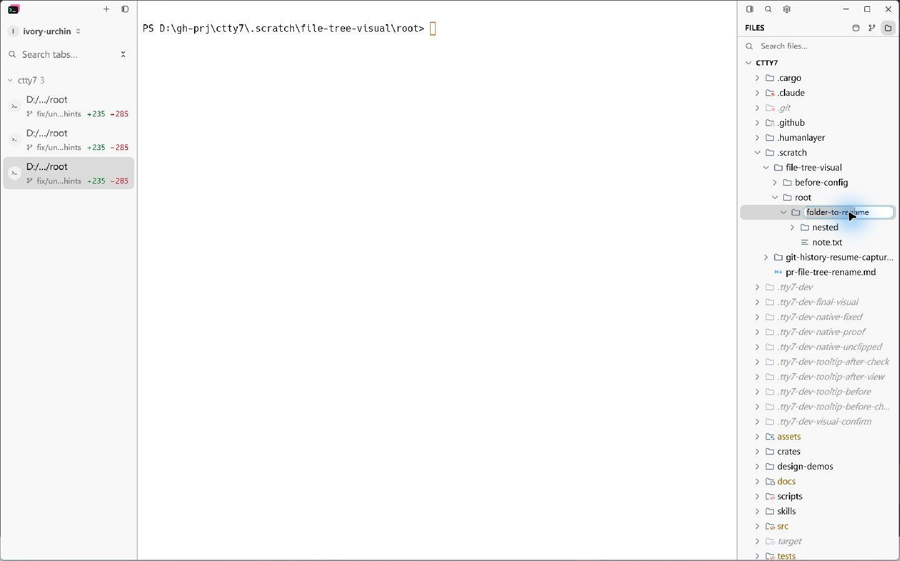
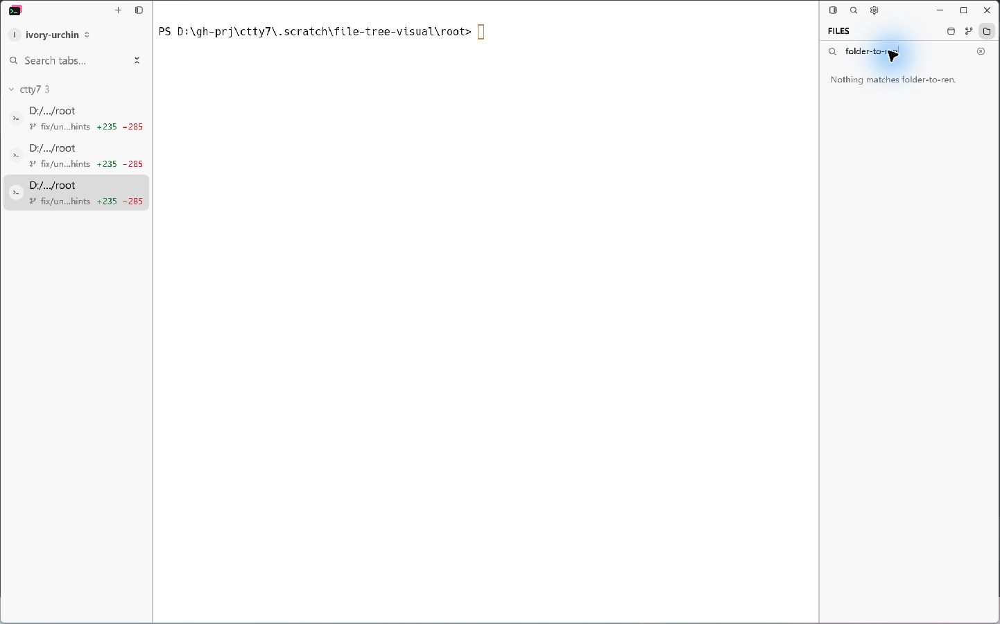

# Folder rename mouse selection

Native Windows acceptance on 2026-10-28 for cloudy-liu/ctty7#214.

Both captures use the same running application fixture, isolated configuration,
1440 × 900 window, unchanged Windows display scale, light appearance, 220px
left sidebar and 260px Files panel. The fixture is
`.scratch/file-tree-visual/root/folder-to-rename`, containing `nested/` and
`note.txt`. The file tree resolves the enclosing repository as its root.
The application was rebuilt from each exact source revision in an isolated
worktree; unrelated local Mermaid and sidebar edits were excluded.

1. Expand `.scratch/file-tree-visual/root/folder-to-rename` in Files.
2. Choose **Rename** from the folder context menu.
3. Drag from window point `(1295, 341)` to `(1370, 341)` across the name.
4. In the fixed build, copy with Ctrl+C, focus Files search and paste with
   Ctrl+V. No renamed path is submitted.

**Before (`a63a85d6`):** the drag reaches the folder row, closes the input and
collapses the folder. Inspect the missing edit border and missing children.

**After (`b8dd3a5b`):** the same drag selects `folder-to-ren`, keeps the edit
input active and leaves `nested/` and `note.txt` visible.

**Copy:** pasting into Files search produces the selected substring
`folder-to-ren`. The ignored fixture has no indexed search match; this capture
verifies the pasted text rather than search indexing.

## Automated evidence

- `cargo test --bin tty7-app ui::file_tree::tests -- --nocapture`: 25 passed.
- `mouse_selection_in_a_folder_rename_input_can_be_copied` checks that dragging
  keeps editing active, does not focus the tree or collapse the folder, creates
  a nonempty selection, and copies exactly that selection to the clipboard.
- `rustfmt --check src/ui/file_tree.rs` and `git diff --check`: passed.
- `cargo build --locked --bin tty7-app` succeeded for both native captures.

## Known limitations

Native interaction acceptance covers Windows with the settings above.
macOS/Linux appearance and other display scales were not inspected manually.
