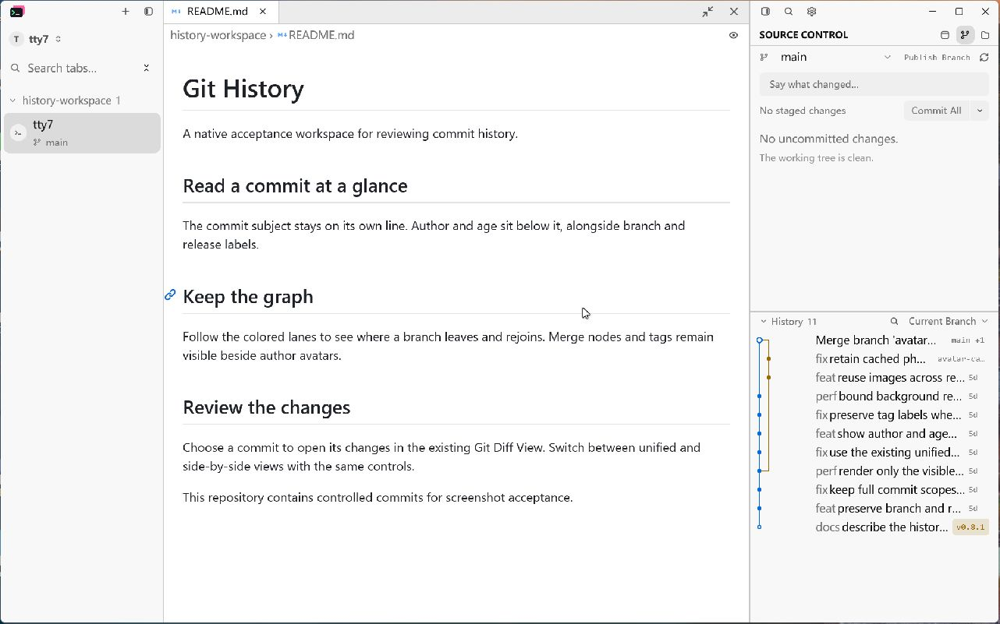
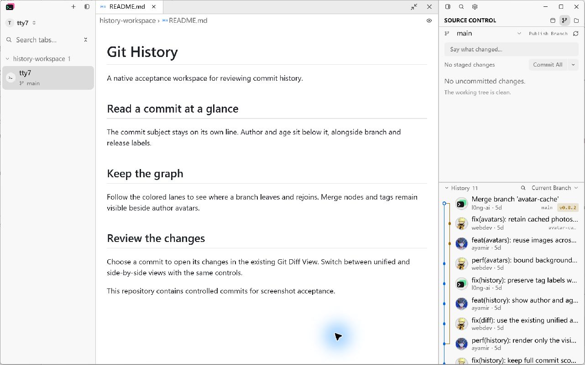
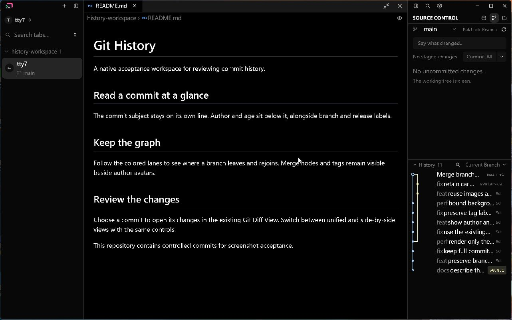
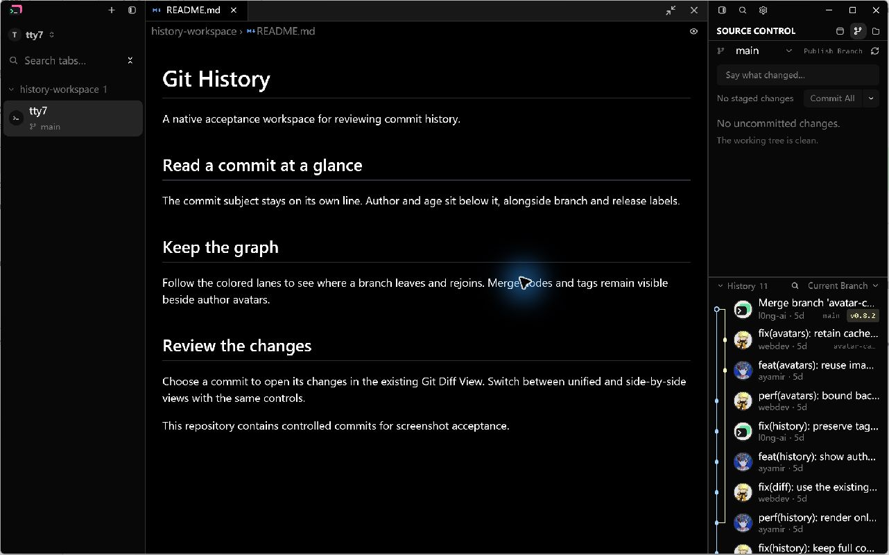
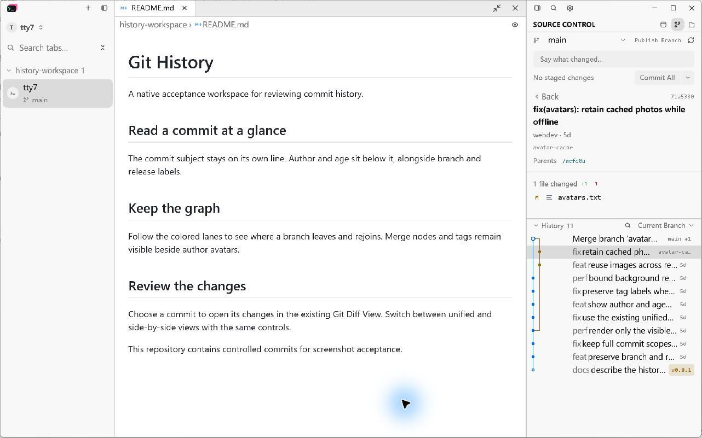
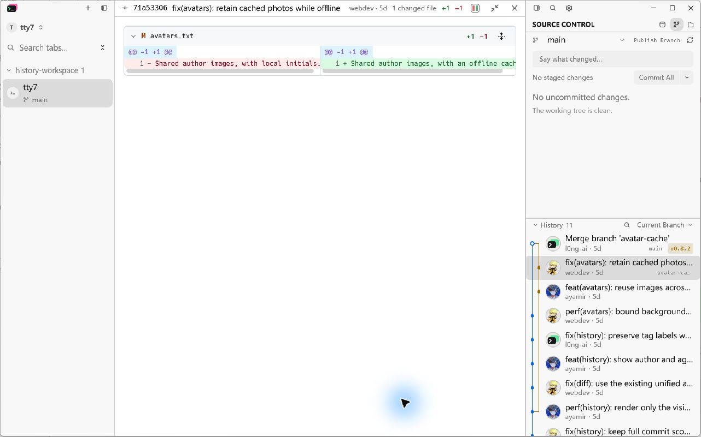
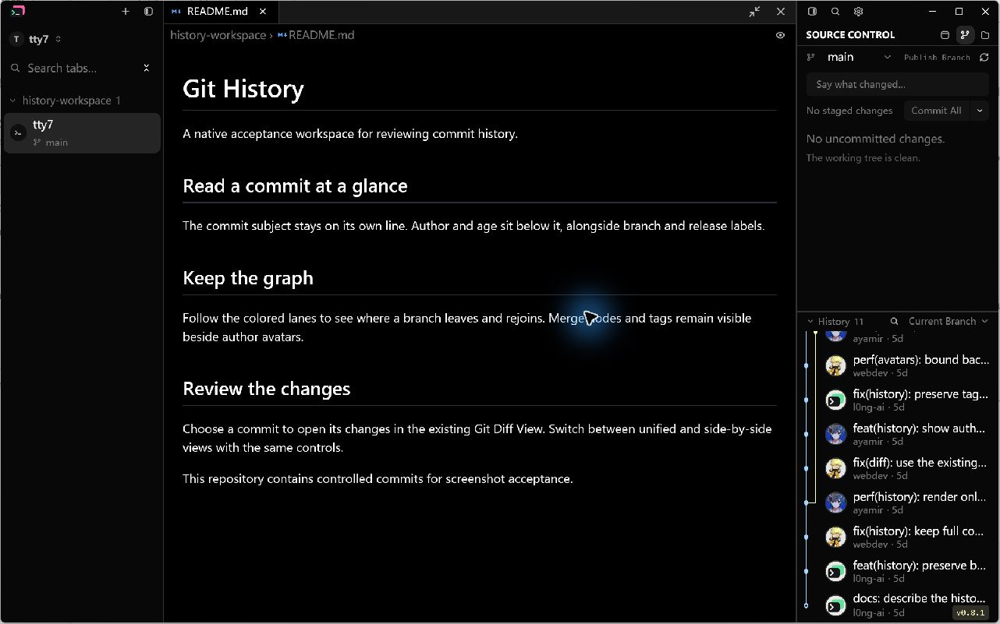

# Git History author rows acceptance

Tracks [spec #207](https://github.com/cloudy-liu/ctty7/issues/207) and the single
[implementation ticket #208](https://github.com/cloudy-liu/ctty7/issues/208).

## Native visual evidence

The screenshots are captures of the running Windows GPUI application through
LCU/Sky. The image bytes are saved unchanged, without cropping, overlays or
redrawing. The same real, isolated Git repository contains eleven commits,
three authors, a side branch and merge, and the v0.8.1/v0.8.2 tags. Public author
photos are preseeded in the app's ordinary avatar cache for reproducible captures.
No fixture data is injected into the production renderer.

Both versions use a 1280 x 800 logical viewport, display scale 1.75, a 400px
History section, and the same theme/sidebar width within each pair. The baseline
is `ee23f9d623e406fdf02484299287a3d916ad817d` with only the opt-in native fixture
extension in [this patch](git-history-before-fixture.patch). Separate config
directories keep the user's real sessions and preferences out of the fixture.

Inspect the original scope in each subject, circular photos, author/age on the
second line, blue/yellow lanes, hollow merge node, and retained branch/tag chips.
The default History section footprint remains 260px; the divider can enlarge it.
The 400px acceptance state makes topology and several authors visible together.

| Light, 320px Before | Light, 320px After |
| --- | --- |
|  |  |

| Dark, 260px Before | Dark, 260px After |
| --- | --- |
|  |  |

The interaction pair selects the same second commit, `71a5330`, in the same
light/320px state. Inspect the center document, History selection, and existing
red/green diff-mode icon. The retained Commit Details view is available from the
commit's context menu.

| Commit selection Before | Commit selection After |
| --- | --- |
|  |  |

## Automated acceptance

The full Windows workspace run passed **3,168 tests, zero failures, 12 ignored**.
After the final ref-overflow/layout adjustment, the focused SCM run passed all
**71 tests**, including the actual rendered-row interaction at 260px with five
lanes, a long author, long branch/tag names, 2,000 refs (`+1998`), and a 5,000-row
page. It checks 44px row bounds, visible author/age and overflow count, no distant
offscreen row allocation, and the correct commit source after a real row click.
Reselecting the same commit also restores the existing viewer's keyboard focus.

Avatar entry-point tests cover normalized author sharing, decoded BGRA colors,
96px normalization, warm memory/disk reuse, stale images while offline,
404/malformed/oversized responses, dimension limits, failure backoff, invalid
identities, and four concurrent HTTP requests. Test-first red/green outputs are
preserved in [the execution excerpts](git-history-test-evidence.txt).

The final native build, rustfmt, Python syntax checks, whitespace check, and
the repository's host-boundary guard pass. No dependency was added. The guard's
new exception is restricted to app-owned avatar files, never workspace paths.

## Standards

The independent Standards review found no hard documented-standard violations.
Three initial correctness findings (current-window GPU cleanup, repeat-selection
focus, and ref chips crowding out metadata) were fixed. A follow-up large-count
edge case was fixed by giving the exact overflow count its own nonshrinking
space outside the shrinking ref names. The cleanup-policy duplication judgement
call was addressed by one deferred-disposal function. No remaining finding.

## Spec

The independent Spec review found four gaps: clipped overflow counts, missing
rendered-row interaction coverage, current-window GPU cleanup, and narrow
metadata collapse. All were corrected and the affected SCM tests pass. It found
no material scope creep. No remaining finding.

## Performance method

Measurements use the running native application with **5,000 loaded commits**,
three authors, the same 1280 x 800 viewport/1.75 scale, light theme, 320px sidebar
and 400px History. In three alternating Before/After pairs, each fresh process
dispatches 140 native scroll
events at 120px per event, with a forced GPUI draw; the first 20 are warmup and
the remaining 120 are sampled. A -9,600px minimum offset verifies that the real
History scroller moves. Both versions use the same fixed Git repository and
preseeded disk images. Memory is sampled from the running process after the
scroll sequence using `Get-Process`.

Timing covers native event dispatch and GPUI CPU layout/prepaint/paint. It
**excludes GPU execution and presentation and is not an FPS measurement**.
Reported aggregate values are medians of the three runs, including the three
per-run P95 values. Private bytes/working set are whole-process snapshots,
including the document and terminal fixture, not isolated avatar allocations.

Build both versions with the same dependency lock and command:

```powershell
cargo build --release --locked --features markdown-visual-tests `
  --config 'profile.release.package.tty7.opt-level=0' `
  --config 'profile.release.package.tty7.codegen-units=16' --bin tty7-app
```

Dependencies use the release profile; the application crate uses opt-level 0
and 16 codegen units to keep local comparison builds practical. These numbers
characterize this controlled build and machine, not optimized release FPS.
Machine: Windows x86_64, AMD Ryzen 7 5800H (16 logical processors), NVIDIA
GeForce GTX 1650 / AMD Radeon graphics.

| Native metric (median of 3 runs) | Before | After | Change |
| --- | ---: | ---: | ---: |
| Scroll CPU wall time, median | 15.91 ms | 17.19 ms | +1.28 ms (+8.0%) |
| Scroll CPU wall time, P95 | 20.08 ms | 19.79 ms | -0.29 ms (-1.4%) |
| Process private memory | 356.68 MiB | 381.80 MiB | +25.12 MiB (+7.0%) |
| Process working set | 275.32 MiB | 301.30 MiB | +25.98 MiB (+9.4%) |


The raw data also preserves the earlier exploratory runs. Their wider tail
variation is why a fresh matched comparison was collected after the final
layout fixes. Background compilation recurred on the shared machine during
the comparison; wall-clock variation is retained in the results. This is a small local sample; it
does not establish a cross-machine performance guarantee.

## Avatar boundary measurements

A controlled HTTP client exercises the production `AvatarCache::image` entry
point and real temporary disk files. This counts requests and concurrent work;
it does not measure public internet latency. A separate six-author gated batch
observes the four-request ceiling before work is released.

| Operation | Before | After |
| --- | ---: | ---: |
| Cold: 5,000 row lookups, 3 authors | 0 (no photos) | 3 HTTP requests |
| Warm memory: same 5,000 lookups | 0 | 0 additional HTTP requests |
| Warm disk: new cache/session, same 3 authors | 0 | 0 additional HTTP requests |
| Peak concurrent HTTP requests, 6 uncached authors | 0 | 4 |

Limits: 128 decoded images (at most 96 x 96 x 4 bytes each, about 4.5 MiB of
pixel buffers before renderer/object overhead), four in-flight jobs, 256 KiB
responses, 512px maximum source dimensions, 8s request timeout, 7-day freshness,
2-minute failure backoff, and an app-owned disk cache pruned on writes to
512 files / 20 MiB. Stale disk images remain visible when refresh fails.
The History scope menu can persistently disable remote photos and cancel work.
LCU input verified disabling/re-enabling the option; the fixture's config file
persisted `scm_remote_avatars: false` and then `true`, respectively. The existing
native Avatar component displayed initials while the option was disabled.

## Reproduction

```powershell
# Run from a checkout of this PR. Use destinations that do not already exist.
python scripts/prepare-git-history-captures.py .scratch/history-visual --download-avatars
python scripts/prepare-git-history-captures.py .scratch/history-perf --download-avatars --profile-commits 5000

# Preserve each built executable at a separate path before the next build.
python scripts/measure-git-history-native.py <before.exe> .scratch/history-perf/light-320.json --label before --runs 3
python scripts/measure-git-history-native.py <after.exe> .scratch/history-perf/light-320.json --label after --runs 3

# Launch matching light/320px or dark/260px cases and capture with LCU.
<after.exe> --config-dir .scratch/history-visual/light-320-config --document-visual .scratch/history-visual/light-320.json
```

For the baseline, create a checkout at the pinned commit and apply only the
linked fixture patch. The preparation and measurement scripts can be run from
this checkout against either executable. Do not apply the production UI/cache
changes to the baseline.

## Known limitations

Native visual/performance acceptance is local Windows evidence; macOS/Linux
appearance has not been inspected locally. No claim is made about real network
latency or GPU frame pacing. Known GitHub no-reply addresses map to public
GitHub photos; other valid addresses use Gravatar's normalized SHA-256 endpoint
with `d=404` ([provider documentation](https://docs.gravatar.com/sdk/images/)).
Addresses with no matching photo display local initials. This does not guarantee
matching an arbitrary Git email to a GitHub account and requires no login.

Raw per-run data, including all exploratory cohorts: [performance JSON](git-history-performance.json).

The aggregate median increased by 1.28ms (8.0%) and private memory by 25.12MiB
(7.0%). P95 overlaps the baseline and varies substantially between runs; the
small difference is not evidence of a tail-latency improvement. The fixed cache
limits and request-sharing tests establish bounded work independently of these
noisy whole-process measurements. These results are not an optimized-release
FPS or isolated-avatar memory claim.

The native JPEG captures are 1282 x 801 including the window frame. The scroll
tail additionally verifies the hollow root node and v0.8.1 release label:


