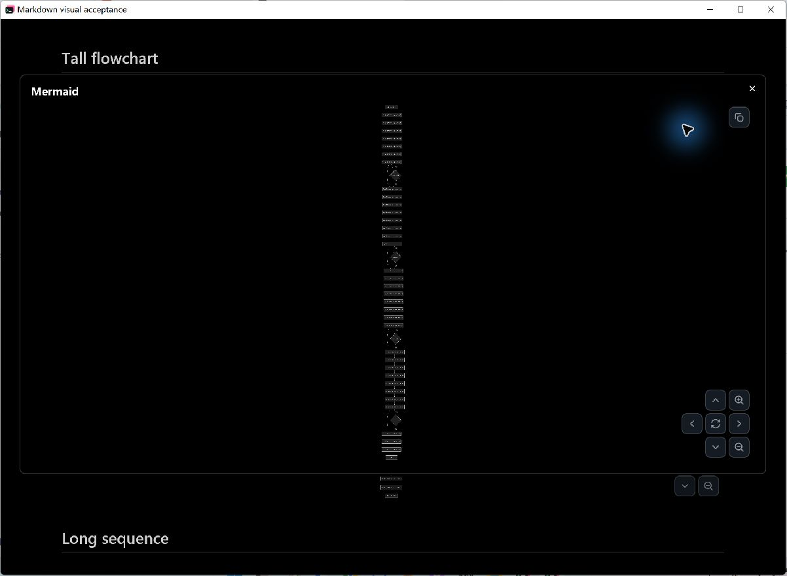

# GitHub-style Mermaid reading verification

Verified on Windows on 2026-10-15. This updates the earlier
[canvas performance record](markdown-navigation-performance.md).
The final executable comes from local composition `306c06c712ac7f095893872d46d4e29902c9f0f3`, including
fork main and open PRs #148, #149, #150 and #151. Mermaid code is `58b0ab938a36cd076b1c0f683206fc034d37448d`.

## Reading behavior

Opening a tall diagram retains its natural SVG width, capped by the available
reading width, and preserves its full height. It starts at the top with an
actual vertical scrollbar. Width overflow after zoom creates a horizontal
scrollbar. Wheel input, thumb dragging, canvas dragging and directional controls
share the same scroll handle; zoom changes the full scroll extent.
Home moves to the top without changing zoom; Reset restores reading size and
position. Short windows account for dialog spacing and compact the controls.
Direction buttons are dimmed and disabled when their axis has no scrollable
overflow. Expanding a diagram does not itself make it wider than the viewer;
further zoom enables horizontal navigation when it creates width overflow.

The product reference is a live GitHub dialog observed on 2026-10-14. Its tall
SVG measured 340.5 × 4,672 inside a 1,152 × 576 dialog; scrolling reached
`TALL_END_36`. The wide diagram fit the available width.
[Recorded browser measurements](markdown-performance-data/github-live-dialog-20261014.json)
and [source fixture on GitHub](https://github.com/cloudy-liu/ctty7/blob/9b0fd9a3d66214788b32ccacf170c3c3432753c9/tests/fixtures/markdown/large-navigation.md).
ctty7 keeps its documented modifier-wheel and keyboard bindings; this change
matches GitHub's reading and scrolling model, not every browser interaction.

Before this follow-up, expansion shrank the whole tall diagram into the viewer:

## Native CPU measurements

Each cell is the median of three trial statistics, in milliseconds. P95 values
are not pooled. These measurements include input dispatch and GPUI CPU
layout/prepaint/paint, excluding GPU execution and presentation.

| Statistic | Original renderer | Previous canvas | Final scroll viewer |
| --- | ---: | ---: | ---: |
| Document wheel median | 118.3344 | 5.4080 | 4.7845 |
| Document wheel P95 | 149.4452 | 10.7624 | 11.9623 |
| Expanded drag median | 114.5559 | 0.7256 | 0.7682 |
| Expanded drag P95 | 135.0061 | 1.3498 | 1.3436 |

The final drag median is 0.0426 ms higher than the previous canvas. Full content/SVG readiness medians were 1,134.99 ms original, 1,122.15 ms canvas, 1,192.84 ms github.
This work does not claim faster initial loading.

All nine fresh native processes used the same 101,027-byte, 1,873-line Markdown
fixture with six Mermaid fences. SHA-256:
`67712a4534ed9faa77bc36d223d76a68770b9c412925b44d2be8965f24746b56`.
The file contains original source, not image substitutes. Each trial runs
original/canvas/final in that order after compilation finishes. Machine, DPI
(175%), app scale (100%), dark theme, requested viewport (1200 × 850), and build
optimization match the earlier record. The actual native height is 850.2857 px.
Build settings: locked optimized dev, debug=0, incremental=false, opt-level=2;
existing GPUI/gpui-component package opt-level remains 3.

Each interaction records 100 frames after 10 warmup frames. All benchmark
windows are hidden to avoid interrupting the user's testing; native CPU draw
is explicitly executed and checked. Document input is
55 downward and 55 upward wheel events of 120 logical pixels at the same outer
margin coordinates; every trial reaches -6600 px. Drag input alternates the
pointer 24 px above/below the expanded viewport center at zoom 4. The new
default reading geometry is intentionally different, so zoom 4 is relative to
each version's own opening size. The final native runner asserts that every
drag changes the scroll offset and actual painted image position, and checks
painted document blocks against the scrolling list. Cached unmoving frames
cannot satisfy these assertions.

Executable SHA-256: `7a693cc1461b12586b2e02cec6f7d479d86e5671297453f81381df5c975c0610`.
Original and previous executables, exact inputs, build configuration, options
and all per-process hashes are recorded with the raw data:

- original: [trial 1](markdown-performance-data/github-comparison-original-1.json), [trial 2](markdown-performance-data/github-comparison-original-2.json), [trial 3](markdown-performance-data/github-comparison-original-3.json).
- canvas: [trial 1](markdown-performance-data/github-comparison-canvas-1.json), [trial 2](markdown-performance-data/github-comparison-canvas-2.json), [trial 3](markdown-performance-data/github-comparison-canvas-3.json).
- github: [trial 1](markdown-performance-data/github-comparison-github-1.json), [trial 2](markdown-performance-data/github-comparison-github-2.json), [trial 3](markdown-performance-data/github-comparison-github-3.json).

[Reproduction script](markdown-performance-data/run-github-profile.py).

## Functional checks and review

- Eleven Mermaid regressions pass, including readable opening size, ordinary
  wheel reach, actual scrollbar thumb dragging, zoom anchoring and repainting.
  Real button clicks also verify that zoom enables left/right movement and
  reaches the rightmost content without changing the zoomed image size.
- Review found short-window overflow and clipped controls at large UI font
  sizes. Both were reproduced before repair. The final test sets the real
  `Config.ui_font_size` to 32, resizes to 400 × 300, and checks the viewer's
  bottom edge plus top/bottom controls. A direct `set_rem_size` was insufficient
  because the application restores it from configuration during rendering.
- Standards review found no violations. Spec review's viewport and control
  findings were fixed and re-reviewed with no remaining findings.
- Formatting, host-boundary checks and the optimized GUI/CLI build pass.
  CLI reports `tty7 0.4.0`.
- Composed workspace at `79316f15`: 3,072 passed, 0 failed, 11 ignored.
  The subsequent direction-button follow-up passed all 11 Mermaid tests.

[Readable-size red run](markdown-performance-data/github-reading-red.log),
[first green run](markdown-performance-data/github-reading-green.log),
[short-window red run](markdown-performance-data/github-short-window-red.log),
[control clipping red run](markdown-performance-data/github-controls-red.log),
[compact-controls green run](markdown-performance-data/github-controls-green.log),
[final Mermaid tests](markdown-performance-data/github-horizontal-controls.log),
[composed workspace log](markdown-performance-data/github-composed-final-tests.log).

## Native UI acceptance limits

During this continuation, Computer Use operated the `034e161c` reading/scrollbar
build, used Home to reveal the top, and dragged the actual vertical thumb to
`TALL_END_36` without shrinking the labels. The final executable was
then generated and all three native performance runs passed their rendered
position assertions. The user stopped Computer Use with physical Escape before
the final manual window recheck, so final manual source-editing, compact-window
and wide/sequence interaction rechecks are not claimed. Earlier screenshots
and manual checks in the canvas record belong to that earlier executable.

Native macOS/Linux interaction has not been run locally. These timings cover
this 100 KiB fixture and input sequence; they do not establish GPU FPS or
arbitrary megabyte-document performance. Cross-screen selection can still
require document-sized geometry work. SVG generation remains asynchronous.
