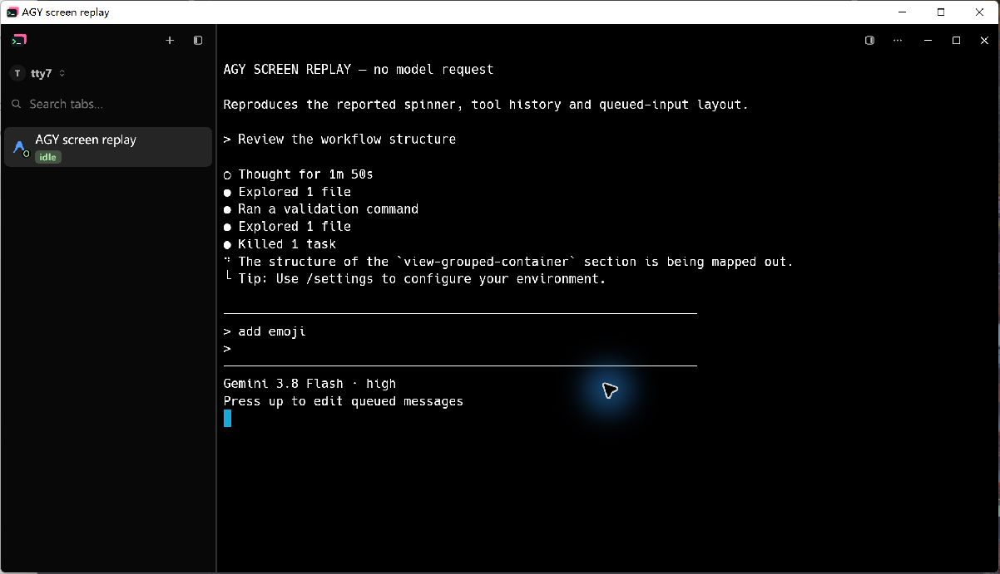
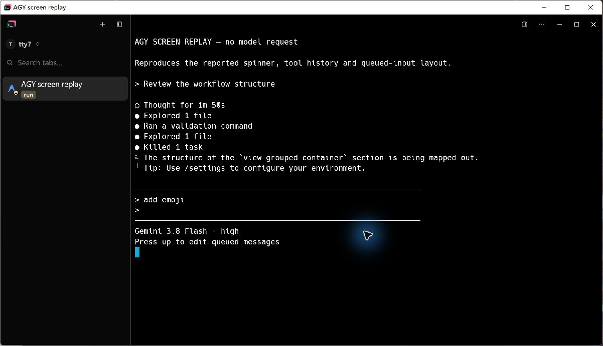
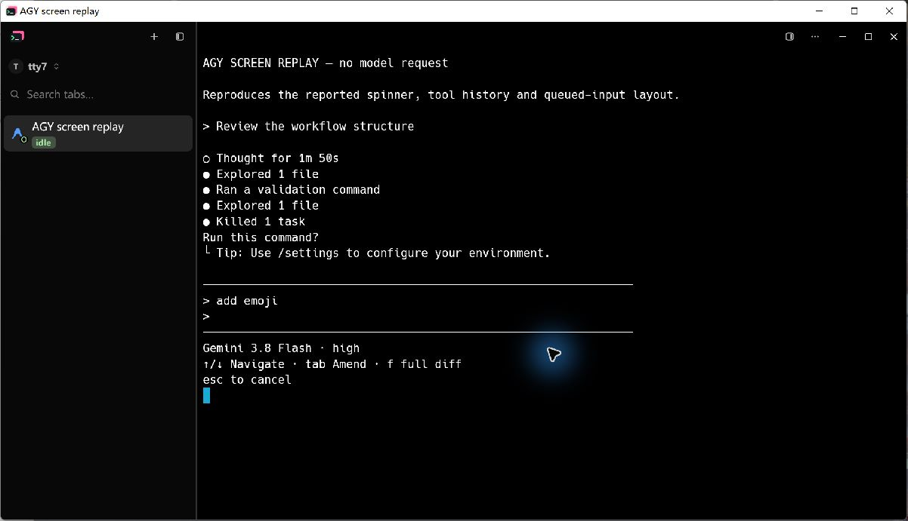
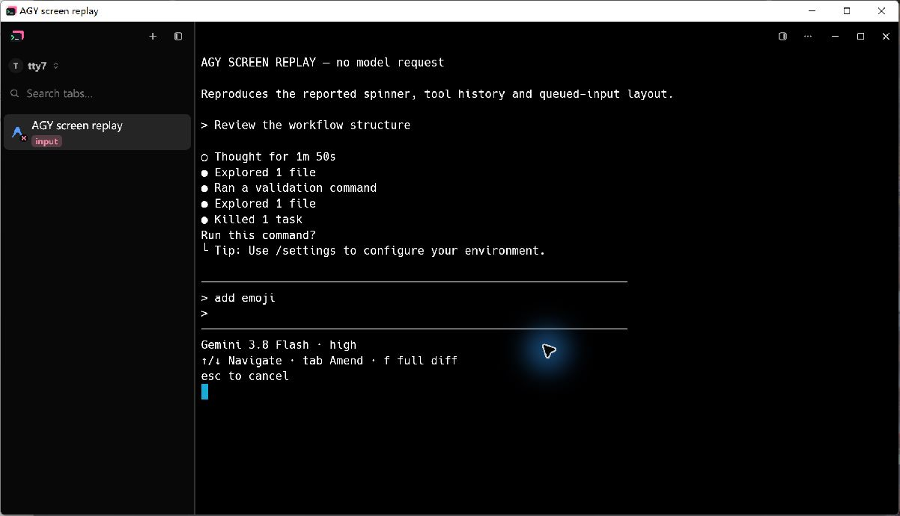
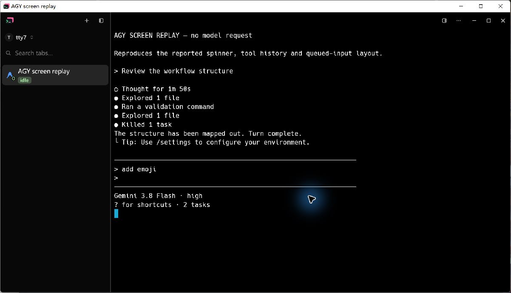

# Herdr detection sync acceptance

## Scope

The accepted change synchronizes all 14 agents already registered in ctty7's
screen detector at Herdr commit `241b99cd397bb642eaabcfee1647bcecffb26be1`.
AGY, Grok, Pi and Codex had stale upstream rules; the other ten were current.
The previous directory-wide source note covered only the Codex update.

The upstream files remain byte-identical, with their own versions and SHA-256
in `assets/agent-detection/upstream.json`. Codex's ctty7 ready-prompt rule lives
in `extensions/codex.toml` and is appended after upstream rules. CI checks the
complete registered set, content hashes and engine compatibility offline.

The GUI detector receives screen text, the current OSC title and OSC 9;4
progress. Progress is read from both live output and replayed snapshots using
the existing streaming OSC tokenizer, including reports split across frames.
Returning to a shell prompt or changing agent identity clears stale progress;
a relink gets a new progress store so retired readers cannot overwrite it.

Session ownership, hook authority, the completion debounce and CLI hook-based
status remain unchanged. No new agent types or runtime rule downloads are added.

## Regression evidence

The reported AGY screen pattern, with a live braille spinner followed by
`The structure ...`, failed before the sync with `Idle` instead of `Working`.
The same tracker test now retains `Working` through successive observations
and leaves working after the spinner is removed.

Before implementation, the current Pi spinner also read `Idle`, a manifest
requiring engine version 4 was accepted, and OSC-only Grok activity never
reached `Working` in the GUI. Tests cover those failures, updated AGY dialogs,
Codex's update picker, background-only idle states, preserved Codex extensions,
and OSC rules for Grok, Qwen and Claude.

The OSC integration test sends real daemon protocol frames through a quiet
terminal connection and polls `TerminalView::agent_status`. It checks a report
split across output frames, completion, and working restored from a snapshot.

```sh
python scripts/sync-agent-detection.py --check
python -m unittest discover -s scripts -p test_sync_agent_detection.py
cargo test --locked --bin tty7-app terminal::
cargo test --workspace --locked
```

## Native Computer Use comparison

The original reported screen is transcribed into the opt-in native visual
fixture in `src/ssh_tab_visual.rs`, enabled only by `markdown-visual-tests`.
It clearly labels itself `AGY SCREEN REPLAY — no model request`. It drives the
production daemon reader, terminal grid, screen detector, sidebar and status
merge with the same data on both builds. The baseline is `46274f4a` plus the
identical visual fixture; its detection rules and engine are unchanged.

Run the fixture with an isolated config directory:

```sh
cargo build --locked --features markdown-visual-tests --bin tty7-app
tty7-app --config-dir <isolated-profile> --ssh-tab-visual <options.json>
```

```json
{"sidebar":true,"output":"unused-on-windows.png","hold_seconds":3600,"agent_replay":true}
```

The sequence animates the freeform working spinner, shows an approval dialog,
resumes work, and returns to a prompt with background tasks still listed.
The attached JPG files are original Computer Use captures, without retouching:

| Screen pattern | Before | After |
| --- | --- | --- |
| Freeform working spinner | `idle` | `run` |
| Approval dialog | `idle` | `input` |
| Completed foreground turn with background tasks | — | `idle` |







## Verification limits

A live Antigravity CLI 1.3.4 session was launched separately with a read-only
fixture. Its Gemini request failed with HTTP 400, `User location is not
supported for the API use`. A Claude attempt in plan mode could not construct
its executor because that plan model was unavailable in settings. Consequently
the screenshots above prove native screen-pattern replay, not a completed
live model task. No account, proxy or security settings were changed.

Native Computer Use acceptance was performed on Windows. Linux and macOS
coverage comes from the repository's cross-platform build and test workflow;
the change adds no Windows-specific detector condition or wire protocol field.
