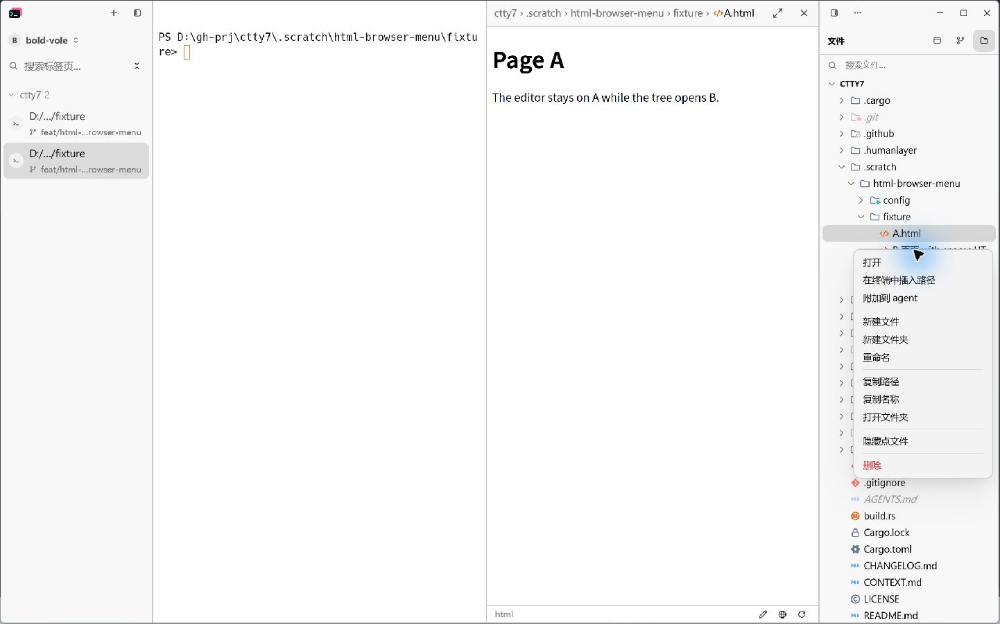
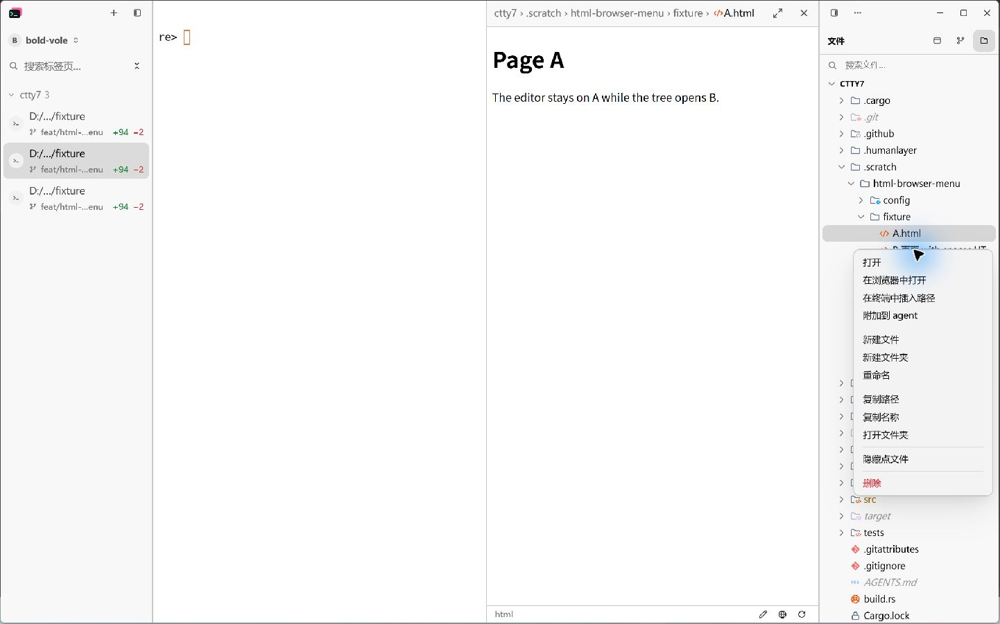

# Open HTML files from the file tree

## Accepted behavior

- Right-click a local `.html` or `.htm` file to find **Open in Browser** directly
  after **Open**. Extension matching is case insensitive.
- Open the right-clicked file from disk, even when another document is active
  or the target has never been opened in the editor. Keep the editor selection.
- If the target has unsaved local edits in any tab, ask the user to save first.
  Unsaved edits to another file must not block opening the target.
- Hide the item for directories, other file types, and remote workspace paths.
- Share the path-based opening command with the HTML status bar's globe button.
  The tree item is independent of embedded-preview platform support.
- Preserve system file associations. Pass a native path to Windows ShellExecute
  so spaces and Unicode resolve correctly; use a `file:` URL on other platforms.
  Whether the file opens in a browser or an editor depends on those associations.

## Native acceptance

Use the LCU MCP native app controls against an isolated `--config-dir` profile.
The fixtures are `A.html`, `B 页面 with spaces.HTML`, and `notes.txt`.
Keep A open in the editor while right-clicking B, then select **Open in Browser**.
Confirm the external browser shows B and the editor still shows A.

| Before | After |
| --- | --- |
|  |  |

Validated on Windows on 2026-10-21 using the final debug build:

- The native menu shows **在浏览器中打开** immediately after **打开**.
- With A visible in the editor, selecting B's menu item changes the external
  Chrome window title to `HTML menu acceptance B - Google Chrome`.
- The initial native run exposed ShellExecute error 2 for the percent-escaped
  Unicode/space `file:` URL. Passing the native Windows path fixes that case
  through the command shared by the menu and globe.
- LCU then stopped browser inspection because it could not determine the current
  browser URL confidently enough for its safety check. Browser page content was
  not inspected further. Menu screenshots were already captured and retained.
- No live SSH workspace or macOS/Linux desktop launch was exercised. Visibility
  restrictions were checked in the menu's local-host, file-type and directory
  conditions; editor selection and unsaved edits were checked by GPUI regressions.

Final verification passed: 2 focused GPUI regressions; `cargo check` and the debug
app build; 3,136 workspace tests with 12 existing ignored tests; formatting; Host
boundary; all 14 pinned agent manifests and their 4 Python tests. Standards and
Spec reviews each reported no findings after the Windows path fix.

## Regression checks

The editor command's GPUI tests observe the system opening boundary:

- An unopened target with Unicode, spaces, and an uppercase extension opens
  while a different active file is dirty. The active editor stays unchanged.
- A target with unsaved edits in another tab does not open or overwrite disk.

Run with:

```text
cargo test --locked --bin tty7-app html_browser_
cargo check --locked --bin tty7-app
cargo test --locked --workspace
cargo fmt --all --check
bash .github/scripts/check-host-boundary.sh
```

Native browser launching needs a desktop session and an installed handler.
The GPUI test platform records the native Windows path or `file:` URL without
launching an application.
