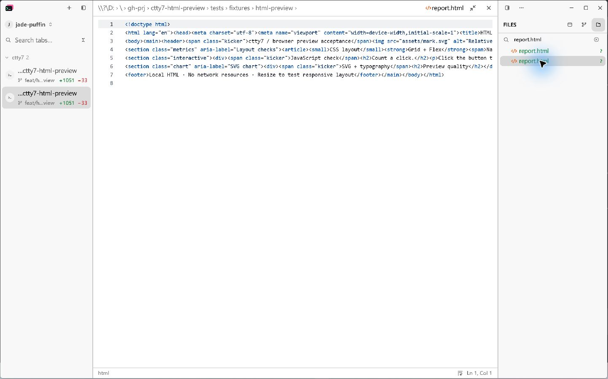
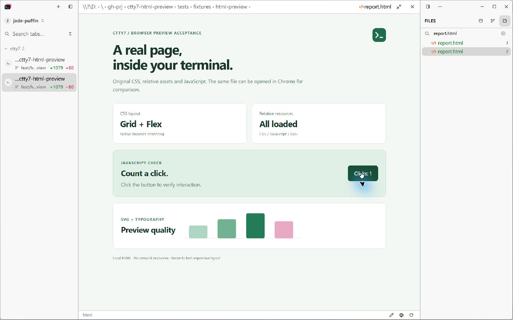
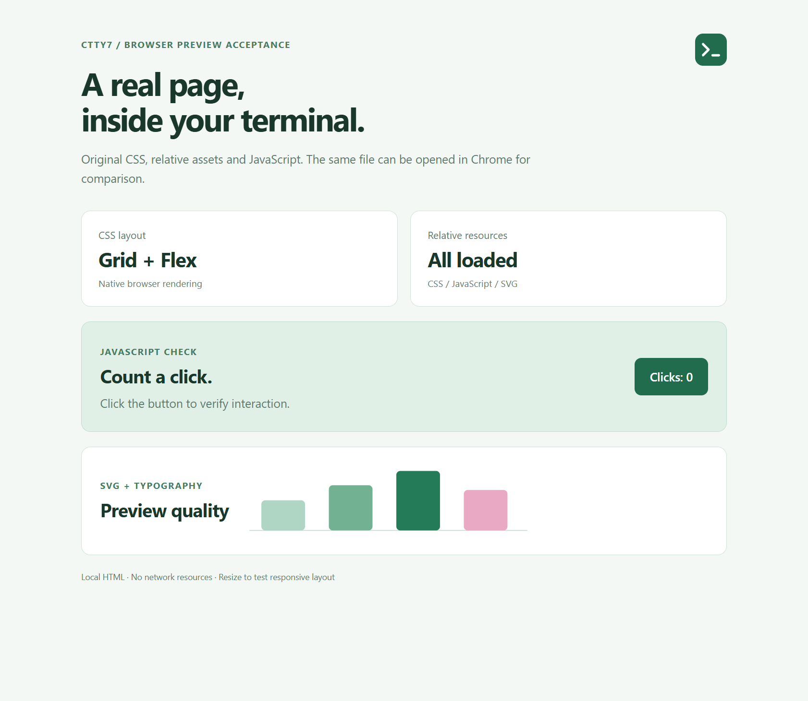
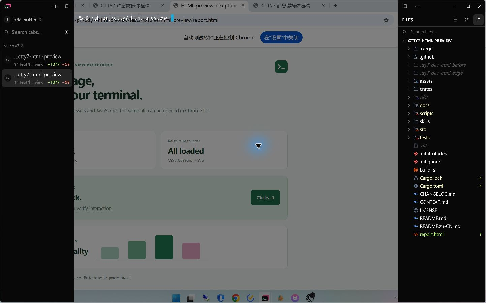
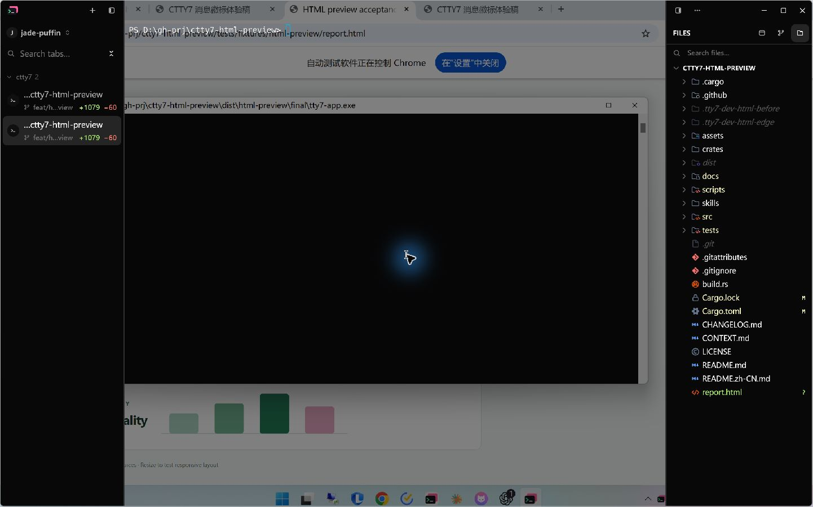

# HTML preview validation

The Windows preview loads the original saved `file://` URL through WebView2.
Chrome is the browser reference. The application uses one lazy browser view per
window and releases it when the user leaves HTML preview.

## Visual evidence

| Before, source only | After, embedded browser |
| --- | --- |
|  |  |

| Chrome through Chrome DevTools MCP | Embedded WebView2 through CDP |
| --- | --- |
|  |  |

Both browsers load `tests/fixtures/html-preview/report.html` at 961 x 835 CSS
pixels, DPR 1.75, light color scheme and 100% zoom. The fixture uses relative CSS,
JavaScript and SVG files without network resources. Twelve selected elements
have equal bounding rectangles, computed fonts, colors, backgrounds and display
properties. Both report `All loaded` and a successfully decoded SVG image.
Raw measurements accompany the PNGs as `chrome-reference.json` and
`webview-reference.json`.

The pixel comparison uses the common image area without resizing. At this DPR,
Chrome exports 1682 x 1461 pixels and WebView2 exports 1682 x 1462. The final
bottom row is excluded from the comparison. `pixels.json` records the exact
comparison result. This fixture validates browser fidelity; it does not promise
identical rendering for every Chrome/WebView2 version, extension, font or site.

The final capture has 2,631 differing pixels out of 2,457,402, or 0.1071%.
Mean absolute RGB channel error is 0.00168 on a 0..255 scale.

## Windows composition

The previous GPUI target was above native child windows, hiding the webpage
even though its resources and JavaScript loaded. The failure is captured in
[the blank-preview screenshot](images/html-preview/direct-composition-blank.jpg).
Disabling DirectComposition made it visible but removed per-pixel alpha, so
that workaround was removed.

The final dependency commit changes `CreateTargetForHwnd(hwnd, true)` to
`CreateTargetForHwnd(hwnd, false)` and retains the existing composition swap
chain, GPU acceleration and alpha configuration. Microsoft's
[composition target documentation](https://learn.microsoft.com/en-us/windows/win32/api/dcomp/nf-dcomp-idcompositiondevice-createtargetforhwnd)
defines this ordering relative to child windows. The change is one commit above
the previous locked dependency:
[GPUI child-window ordering fix](https://github.com/cloudy-liu/zed/commit/7a54867bb4b5b3766855d40f5cbd70d85f229d21).
All replacement GPUI packages use the same immutable source revision.

The terminal remains transparent at 50% opacity with the same controlled Chrome
fixture behind it. These screenshots verify that the previous alpha behavior
survives the composition-order change:

| Baseline at 50% opacity | Final dependency at 50% opacity |
| --- | --- |
|  |  |

Native mouse input increments the fixture counter from 0 to 1. The application
menu hides the native child and displays correctly; Escape restores the page.
See [menu evidence](images/html-preview/menu.jpg).
Dragging the file-panel divider resizes the native child and reflows the page,
as shown in [the narrower preview](images/html-preview/resized.jpg). Refresh
resets the JavaScript click count from 1 to 0. File-tree search remains usable
while the page stays visible.

## Measurement method

Measurements were taken on Windows 11 build 22000, an AMD Ryzen 7 5800H with
16 logical processors and approximately 13.86 GiB of RAM. The application builds
use the debug profile with `markdown-visual-tests`, which enables load-time
logging. This is a development-machine sample, not a release-build benchmark.
The baseline is fork/main `f16436fa5e7ca76f3a4f0e3fe1dd018568cf03d7`.
Both builds use the same isolated configuration and restored terminal sessions.
The existing isolated daemon is shared between runs and excluded from both GUI
process groups.

`scripts/bench/html-preview-memory.ps1` takes five process-tree samples about
two seconds apart. It includes the GUI, console helper and descendant WebView2
processes. Private working set measures resident private pages; private commit
measures committed private memory. Summed total working set also includes shared
pages more than once and must not be interpreted as physical RAM consumption.
CPU is process CPU-time delta divided by elapsed time, with 100% meaning one
logical core. The initial sample has no CPU delta. Tables report medians.

| State | WebView2 processes | Private working set MiB | Summed working set MiB | Private commit MiB | Idle CPU, one core % |
| --- | ---: | ---: | ---: | ---: | ---: |
| Baseline, HTML source | 0 | 37.42 | 127.71 | 190.39 | 0 |
| Final, HTML source | 0 | 37.03 | 119.64 | 190.28 | 0 |
| Final, active preview | 6 | 163.62 | 481.61 | 404.28 | 0 |
| Final, refresh and two navigations | 6 | 168.23 | 496.44 | 421.71 | 0 |
| Final, source restored | 0 | 37.40 | 125.50 | 190.62 | 0 |

Opening this fixture adds 126.59 MiB of private resident memory and 214.00 MiB
of private commit relative to final source mode. After refresh and navigation
from `report.html` to `next.htm` and back, the same browser process group remains
at six WebView2 processes. This short run does not establish long-term leak
behavior. Closing preview removes all six processes and leaves 0.37 MiB more
private resident memory and 0.34 MiB more private commit than source mode.
The small baseline/source difference is within run-to-run variation.

The first preview in the process, with an existing browser profile, takes
2,555.88 ms to the load-finished event. Two refreshes take 517.28 and 507.77 ms;
navigation to `next.htm` takes 451.96 ms and back to `report.html` takes 580.91 ms.
These five timings are individual observations, not percentile estimates.
No CDP port is enabled for these memory, CPU and load-time measurements.
Chrome and WebView2 both report Chromium major version 155 in the capture data.

Raw samples are in `perf/html-preview/`. Preview creation, refresh and navigation
times are wall-clock intervals ending at WRY's page-load-finished event; they
are not first-contentful-paint timings.

## Checks

`cargo build --locked --features markdown-visual-tests --bin tty7-app` passes.
`cargo test --workspace --locked` passes with 3,103 tests passed and 12 ignored,
including the new saved-file/dirty-buffer guard and preview-release tests and
the existing native Markdown tests. `cargo fmt --all --check` and the host
boundary script pass. Agent-detection manifest verification and its four Python
tests pass. The desktop updater suite passes with 32 passed and one ignored.
Standards and Spec reviews found no remaining source blockers after
the focus, target-size and composition changes.

## Reproduction

1. Build with `cargo build --locked --features markdown-visual-tests --bin tty7-app`.
2. Launch an isolated app configuration, open the fixture from the file tree,
   and measure source mode with `html-preview-memory.ps1`.
3. Click the preview icon, exercise the page and refresh, then take active and
   closed process-tree samples using the same root PID.
4. For test captures only, launch with
   `WEBVIEW2_ADDITIONAL_BROWSER_ARGUMENTS=--remote-debugging-port=49791` and run
   `node scripts/bench/html-preview-cdp.mjs http://127.0.0.1:49791 OUTPUT_PREFIX`.
5. Open the same fixture in Chrome through Chrome DevTools MCP, emulate the
   recorded viewport/DPR, evaluate `html-preview-metrics.js`, and capture a PNG.
6. Compare the PNGs with `html-preview-pixels.ps1`.

The production application does not enable a CDP port or install a JavaScript
bridge. HTML scripts execute in the browser environment. Pop-up windows are
denied; external opening uses the original saved URL and the OS browser setting.

## Scope and limits

This version supports saved local Windows `.html`/`.htm` files. Unsaved changes
must be saved before preview or refresh. Remote Host files stay in the source
editor. macOS and Linux browser embedding are not enabled. WebView2 Runtime is
required, and initialization errors return a notification with source editing
available. A genuinely missing-runtime machine was not available for testing.

The browser applies normal local-file origin restrictions, including restrictions
on modules and fetches. A page requiring a development server still requires
that server. Native menus/dialogs hide the child view while they are active.
Long terminal-output workloads, multi-monitor DPI transitions and a full
Mica/Acrylic compatibility matrix were not benchmarked.
