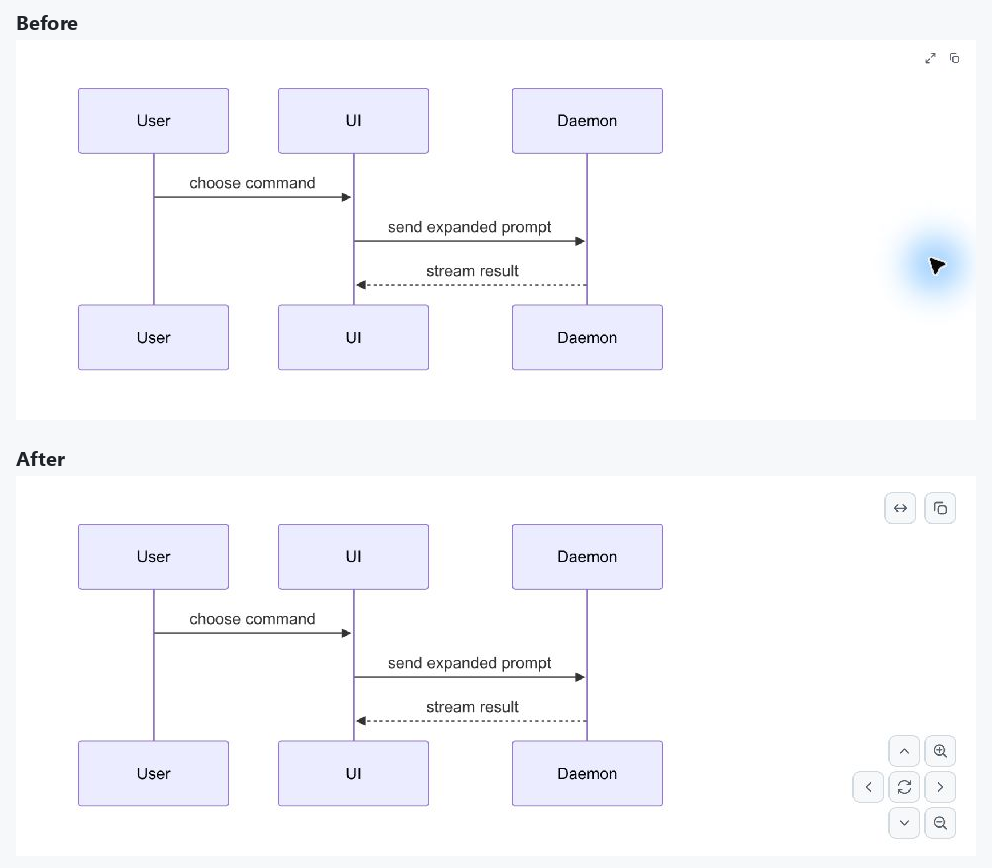
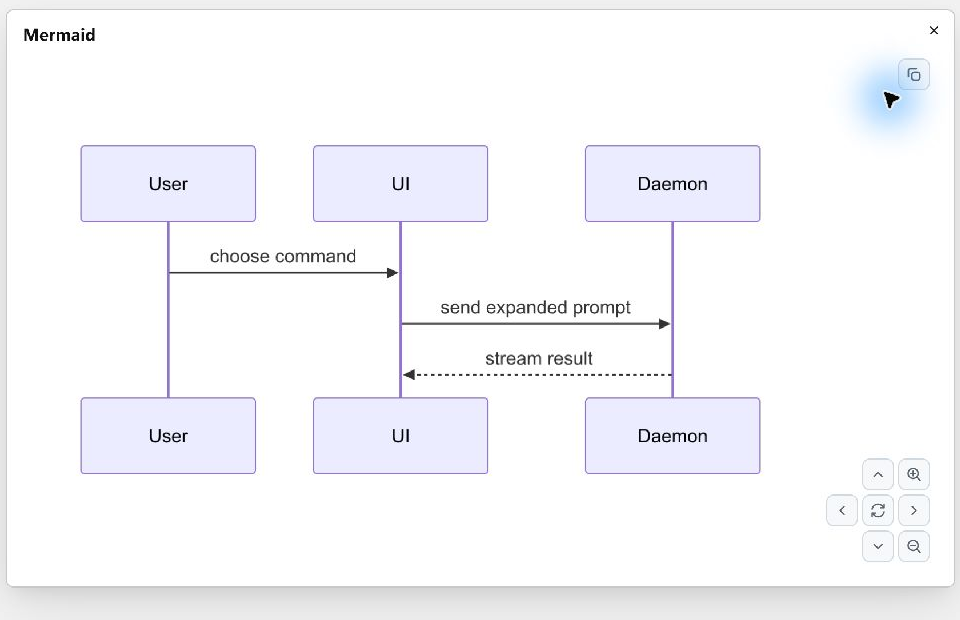

# Mermaid control verification

The current wheel, canvas and long-document behavior is verified in
[Markdown navigation and performance](markdown-navigation-performance.md).
The records below describe earlier checkpoints, including the expanded-wheel
zoom behavior that was subsequently replaced by ordinary-wheel panning.

## Wheel zoom follow-up, 2026-10-14

The wheel handler previously only panned and never changed zoom. Inline diagrams
now zoom with Ctrl+wheel (or the platform modifier), while expanded diagrams zoom
with ordinary wheel input. Both paths share the buttons' 25%–800% limits and
refresh the window after changing the transform. At the initial inline size,
ordinary wheel input still scrolls the document.

The application reading-view test failed before the fix at `Ctrl+wheel must zoom
the cached diagram`. A new test of the production expanded dialog failed at
`wheel must enlarge the expanded diagram`. Both pass after the fix. The dialog
test also checks pixel wheel events at both zoom limits and Reset relative to
the viewport, independent of the dialog's entrance animation.

On Windows, `cargo test --locked --bin tty7-app markdown -- --test-threads=1`
passed 67 tests with two existing opt-in tests ignored. This includes both
interaction regressions, button zoom, dragging at initial and enlarged sizes,
directional movement, copying, and ordinary document scrolling. Formatting and
diff checks passed. These are GPUI interaction tests; this follow-up did not
repeat native desktop screenshot captures or replace the installed application.
The focused Mermaid selection passed all 12 tests. `cargo build --locked --bin
tty7-app` also succeeded, and the copied local test executable matched the build.

## Movement regression, 2026-10-13

The previous panning clamp reduced both movement limits to zero at the initial
zoom of 1. Fitted inline and expanded diagrams now allow dragging and directional
movement, while zoomed diagrams retain their edge limits. Wheel input over a
fitted inline diagram continues scrolling the document.

Mermaid viewport changes explicitly refresh the window after zoom, reset,
directional movement, dragging, or zoomed scrolling so the cached Markdown
reading view paints the new transform immediately.

The regression failed before the fix and passed afterwards. The control test now
opens a Markdown file through the application editor and checks the cached reading
view, including a redraw between mouse press and release, zoom, dragging at both
initial and enlarged sizes, reset, copy, and document scrolling. It records the
transform produced by rendering because GPUI does not retain debug element bounds
when reusing a cached frame. Zoom-button failure was not reproduced by this test.

On Windows, all 11 Mermaid tests passed. The broader Markdown selection passed
serially with 66 tests passing and two opt-in tests skipped. A theme-selection test
failed in the parallel selection and passed in the serial run. Formatting and diff
checks passed; this follow-up did not repeat the native screenshot captures below.

Verified on Windows on 2026-10-09 at 175% system DPI and 100% application scale,
using the production Markdown reading view and its native fixture.

The reference is GitHub's diagram toolbar shown in the issue report: expand and
copy at the upper right, with directional movement, reset, and zoom controls at
the lower right. The original reading view exposed only two compact buttons;
navigation was available in a separate dialog as a compact horizontal row.

## Result

- Both inline diagrams and the expanded viewer use 32-pixel controls with 16-pixel icons.
- Expand and source Copy appear at the upper right. Four directional controls surround Reset, with Zoom in and Zoom out in the right column.
- Each diagram retains its own viewport while interacting. Reset restores its initial fit and position. Source or theme regeneration creates a fresh viewport.
- The inline image retains its natural display size, subject to the available space. The toolbar has reserved space so its controls do not cover the fitted diagram.
- Copy preserves the original diagram source. SVG rendering and the editor buffer remain unchanged.
- The opt-in native fixture includes the application's dialog layer so expansion can be verified.

## Checks

- The symptom-specific regression test failed before the change because inline navigation controls were absent. The final test exercises the production reading view in a full native-style test window and verifies size, placement, zoom, pan, reset, and source copying.
- New icon paths resolve through the application's asset source and contain SVG artwork.
- Native light and narrow dark previews were inspected. Zoom, directional movement, dragging, reset, source Copy, and the expanded dialog were exercised.
- Native source Copy exactly matched the seven-line sequence diagram, including all seven LF line endings.
- `cargo test --workspace --locked`: 2984 passed, 8 ignored, 0 failed. The test process uses Git's existing Unix tools on PATH.
- Formatting, diff checks, and the native fixture build with `markdown-visual-tests` passed. The fixture uses the dev profile and a temporary binary target to avoid replacing the existing debug application.

## Scope

This change concerns the native diagram controls and their layout. CRLF fence
recognition, Skill metadata tables, and ordinary code Copy sizing are tracked
in `cloudy-liu/ctty7#118`. Native interaction checks were run locally on Windows;
the eight ignored workspace tests were not run.
