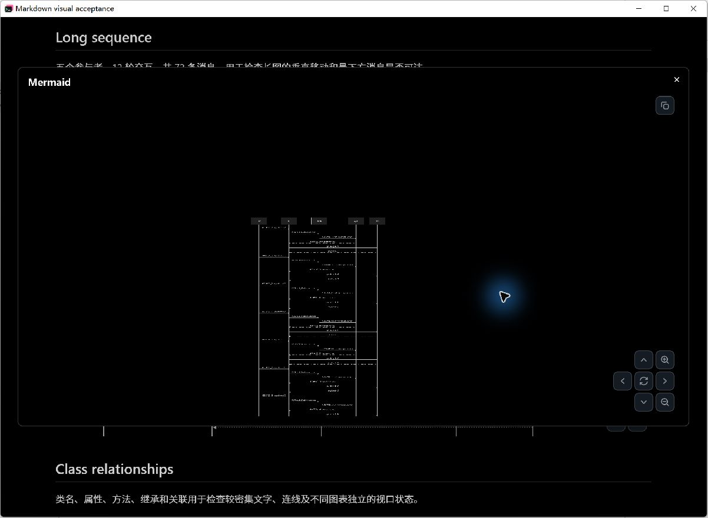
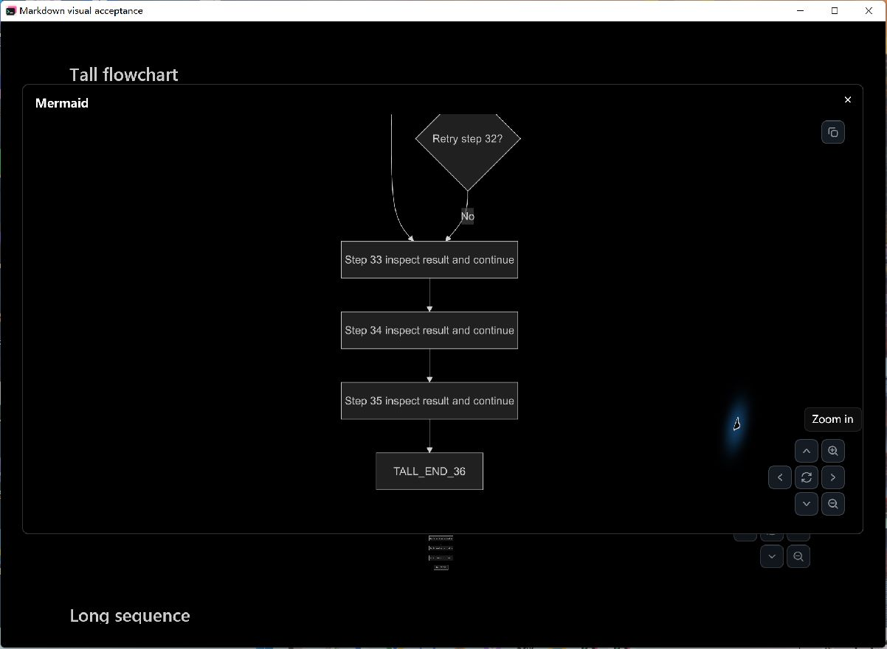
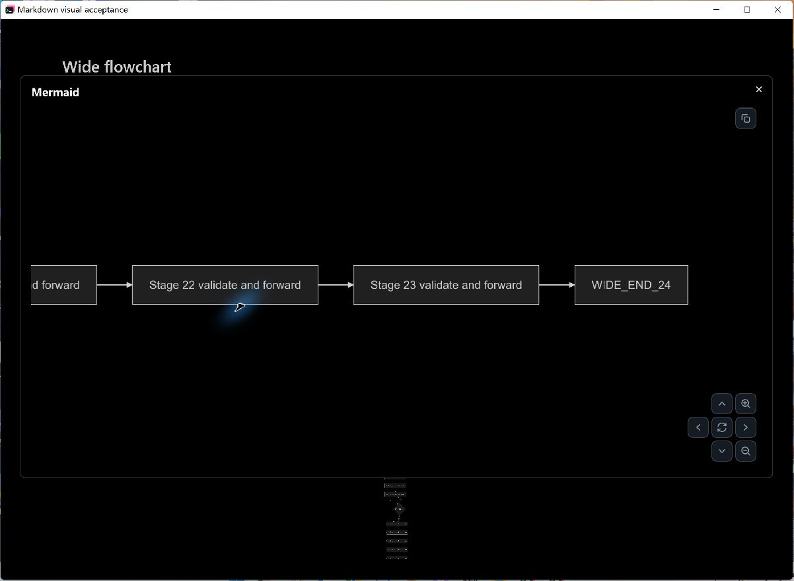
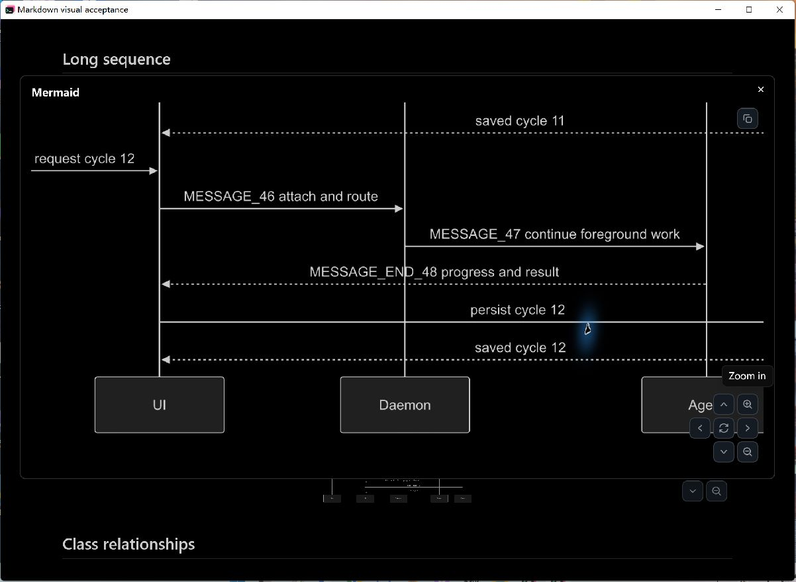
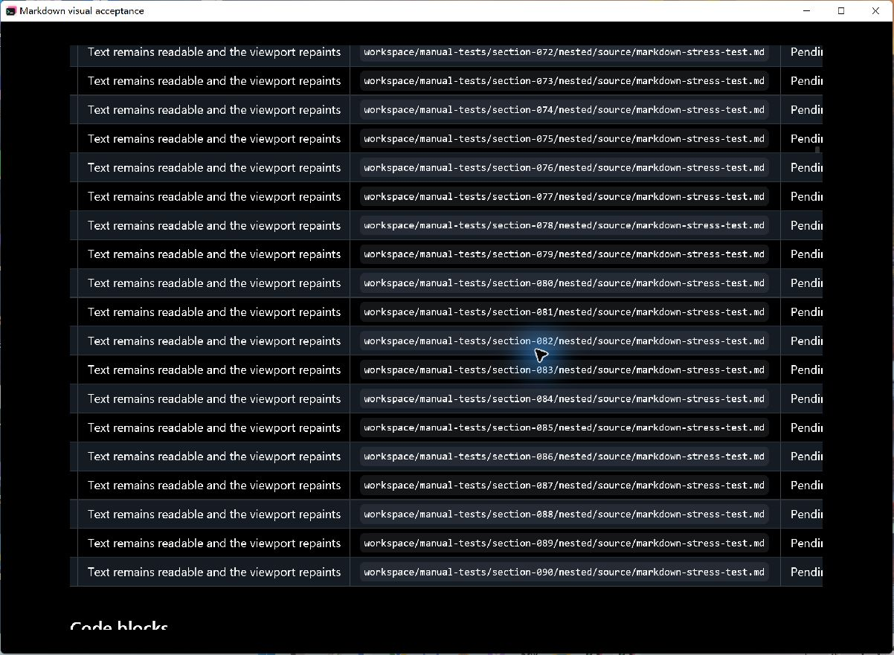
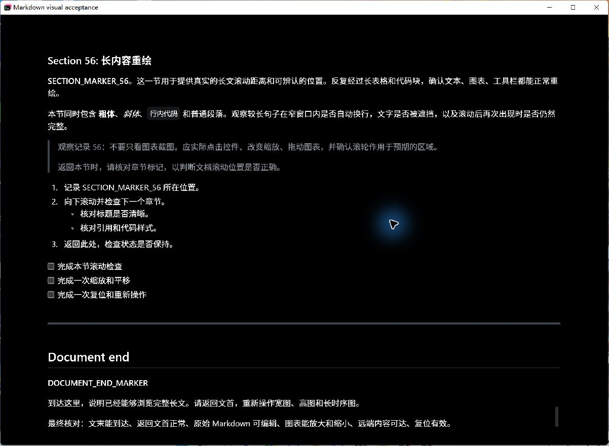

# Markdown navigation and performance verification

This is the historical canvas implementation record. See the
[GitHub-style reading verification](github-mermaid-reading.md) for the newer
scroll viewer, current controls and subsequent native measurements.

Verified on Windows on 2026-10-14. The final local composition includes fork main,
the diff changes from #147, Markdown navigation/performance from #148, and supported
Herdr detection from #149. Tested composition: `462be3e3fc79cecff8209dfdfb63b8c6c4e761b8`.
Production changes are shared GPUI/Rust code; no Windows-only rendering workaround
was added. Native acceptance and these timings were measured on Windows.

## Native measurements

These are CPU event dispatch plus GPUI layout/prepaint/paint timings. They exclude
GPU execution and presentation and must not be interpreted as displayed FPS.
The headline numbers are the median of three trial statistics, not a pooled P95.

| Interaction statistic | Before | After | CPU time reduction |
| --- | ---: | ---: | ---: |
| Document wheel Median | 96.7809 ms | 3.7906 ms | 96.08% |
| Document wheel P95 | 103.2606 ms | 8.8489 ms | 91.43% |
| Expanded diagram drag Median | 93.2821 ms | 0.6606 ms | 99.29% |
| Expanded diagram drag P95 | 95.4066 ms | 0.9049 ms | 99.05% |

| Trial | Document before median / P95 (ms) | Document after median / P95 (ms) | Drag before median / P95 (ms) | Drag after median / P95 (ms) |
| --- | ---: | ---: | ---: | ---: |
| 1 | 96.7809 / 103.3380 | 4.5656 / 11.4406 | 93.2821 / 96.3903 | 0.7673 / 1.0056 |
| 2 | 96.1795 / 103.2606 | 3.7906 / 8.8489 | 91.2672 / 92.8514 | 0.6606 / 0.9049 |
| 3 | 97.1480 / 100.8712 | 3.7902 / 8.1467 | 93.6553 / 95.4066 | 0.6207 / 0.7463 |

The largest measured document frame across all trials was
125.3266 ms before and
24.2241 ms after.
Cold/warmup work remains visible in the raw traces; the first cold virtual layout
can exceed 100 ms. Full content/SVG readiness was 1021.56 ms before and
1055.83 ms after. This change primarily improves interaction, rather than
SVG generation or initial load latency.

## Reproduction protocol

- Input: [large-navigation.md](../../tests/fixtures/markdown/large-navigation.md),
  101,027 UTF-8 bytes, 1,873 lines, six real Mermaid fences, 90 table rows,
  code blocks and long text. SHA-256: `67712a4534ed9faa77bc36d223d76a68770b9c412925b44d2be8965f24746b56`.
  The input is frozen for the comparison; its historical wheel instruction is
  superseded by the current [usage guide](../mermaid-support.md).
  The baseline's `source_bytes` field counts the 92,246-byte preprocessed text;
  per-process metadata records the original 101,027-byte file. The final profile
  separates both counts. All six input hashes are identical.
- AMD Ryzen 7 5800H, 8 cores / 16 threads; Windows 11 `10.0.22000`, 13.9 GiB
  usable RAM. The machine exposes AMD Radeon Graphics and NVIDIA GTX 1650;
  GPU selection and GPU time were not measured.
- 175% system DPI, 100% app scale, dark mode, 1200 × 850 requested viewport
  (native rounding: 1200 × 850.2857 logical pixels).
- Optimized dev build: `--locked`, `profile.dev.debug=0`,
  `profile.dev.incremental=false`, `profile.dev.opt-level=2`.
  Existing GPUI and gpui-component package optimization remains 3.
- Before is `53c0a44e8666e79423531bd3963a31a686380235` plus diagnostic profiling
  hooks. The final composition pins gpui-component
  `1cdb30aa8056f71490392b882a8c2a07be8c8bb0`; GPUI remains
  `d99a40a5f79a173465feec00363d480f75881a81`. No unrelated dependencies were updated.
- Three fresh processes per revision, interleaved before/after. No Cargo build
  was active when the comparisons started. After parse and all SVG generation,
  allow two seconds to settle. Each interaction has 10 warmup frames followed
  by 100 measured frames.
- Scroll: 110 wheel events, 120 logical pixels each; first 55 down, next 55 up,
  at the outer pane's right margin and vertical center. The minimum document
  offset is -6600 pixels in every trial. Both handlers receive the same input
  position and sequence, including the virtual view's margin forwarding.
- Drag: open the same tall diagram, set zoom to 4, settle for 400 ms, then
  alternate the pointer 24 pixels above/below the viewport center while holding
  the left button. Every measured drag must change pan and match the recorded
  render transform. Every final scroll frame checks the actual prepainted block
  position against the list position, so a stale cached frame cannot pass.
- Raw profiles, options and per-process metadata:
  [before 1](markdown-performance-data/before-1.json),
  [before 2](markdown-performance-data/before-2.json),
  [before 3](markdown-performance-data/before-3.json),
  [after 1](markdown-performance-data/final-1.json),
  [after 2](markdown-performance-data/final-2.json),
  [after 3](markdown-performance-data/final-3.json).
- Before executable SHA-256: `003a56dd32cac2fd544cebb0cdc6f13627e7157eebfd8c3c053157c40525c894`.
  Final executable SHA-256: `4be1dc1d2345cc251958ab952e160e0b0bac78f668c2fc41814573edb0fd125a`.
  The shipped local test GUI has the same final executable hash.

## What changed

Ordinary expanded wheel input pans; modifier-wheel zooms around the pointer.
Clicking opens the canvas, dragging preserves it, and keyboard/reset/Escape
navigation is available. Absolute image geometry prevents intrinsic SVG height
from overflowing the fitted viewport. View notifications replace global window
refreshes during diagram interaction.

Documents at least 32 KiB use the existing measured block list. Long fixed-width
tables reuse column/row geometry and draw visible rows. Layout caches include
font, rem size, width and reading style. Selection endpoints trigger a separate
geometry pass, without painting the entire document or altering the real
horizontal scroll handles. Nested heading navigation aligns the actual heading
after revealing its containing block.

## Functional evidence

Computer Use operated native windows: canvas expansion, readable zoom, drag,
ordinary wheel pan, reset and Escape; wide/tall/sequence end markers; table
horizontal scrolling and row 90; and document End navigation. Screenshots below
are original capture bytes, with no retouching.

Before ordinary wheel input shrank the diagram:

After, the tall end remains readable at enlarged zoom:

## Checks and limits

- Composed workspace: **3064 passed, 0 failed, 11 opt-in tests ignored**;
  serial execution with Git's Unix utilities on PATH for stdio transport tests.
- Markdown selection: **71 passed, 0 failed, 3 ignored**.
- Component library: **299 passed**. A 60-row mixed-height table regression
  covers real horizontal scroll, links across a draw between press/release,
  cross-screen UTF-8 selection, shortening, repeated endpoints and font/width
  cache invalidation. Nested offscreen heading clicks have a red/green app test.
- Native GUI and CLI build succeeded; CLI reports `tty7 0.4.0`.
- The separately executed opt-in GPUI editor benchmark passed with 100 measured
  frames: 8.9098 ms median, 14.8599 ms P95 and 17.4116 ms maximum.
  [Raw output](markdown-performance-data/headless-final.log) records first response
  and readiness. These test-platform results are separate from the native comparison.
- The supplied user test Markdown updates the interaction instructions while
  retaining raw Markdown/Mermaid source. The benchmark input remains frozen.
- Timings cover a 100 KiB fixture and this specified event sequence. They do
  not establish performance for arbitrary megabyte documents, GPU frame rates,
  or native macOS/Linux interaction. Selection geometry work can still scale
  with document size during drag-selection. Filled/wrapped/image tables retain
  their existing rendering path.
