# Mermaid controls simplification

Verified on Windows on 2026-11-01 with the production Markdown reading view
through the `--markdown-visual` fixture runner and
`tests/fixtures/markdown/mermaid-controls.md`. The Before captures use a
`markdown-visual-tests` build of fork `main` at `1063bc9b`; the After captures
use the same build configuration of this branch. Each pair uses the same
fixture, app scale 1, 175% Windows display scale, theme and requested viewport:
1000 × 700 for the inline and expanded views, 700 × 700 for the narrow view.

Captures are PNG renders of the fixture window made by
[`scripts/capture-native-window.ps1`](../../scripts/capture-native-window.ps1):
`PrintWindow` with full DWM content, cropped to the window's extended frame
bounds, no other processing. The window is rendered directly, so the images
contain no pointer and are unaffected by other windows. For the inline and
narrow views the script first posts one `WM_MOUSEMOVE` to the top-left corner
of the client area, so nothing is hovered. The expanded view is opened by
posting one left click to the centre of the client area; opening the dialog
focuses its viewport.

The first revision floated the three buttons over the upper-right corner of the
image, which overlapped wide diagrams in narrow windows. The toolbar now has
its own row above the diagram, with the gesture hint at the left of that row,
so nothing is drawn over the image.

## Native captures

| View | Before | After | Inspect |
| --- | --- | --- | --- |
| Inline, light | 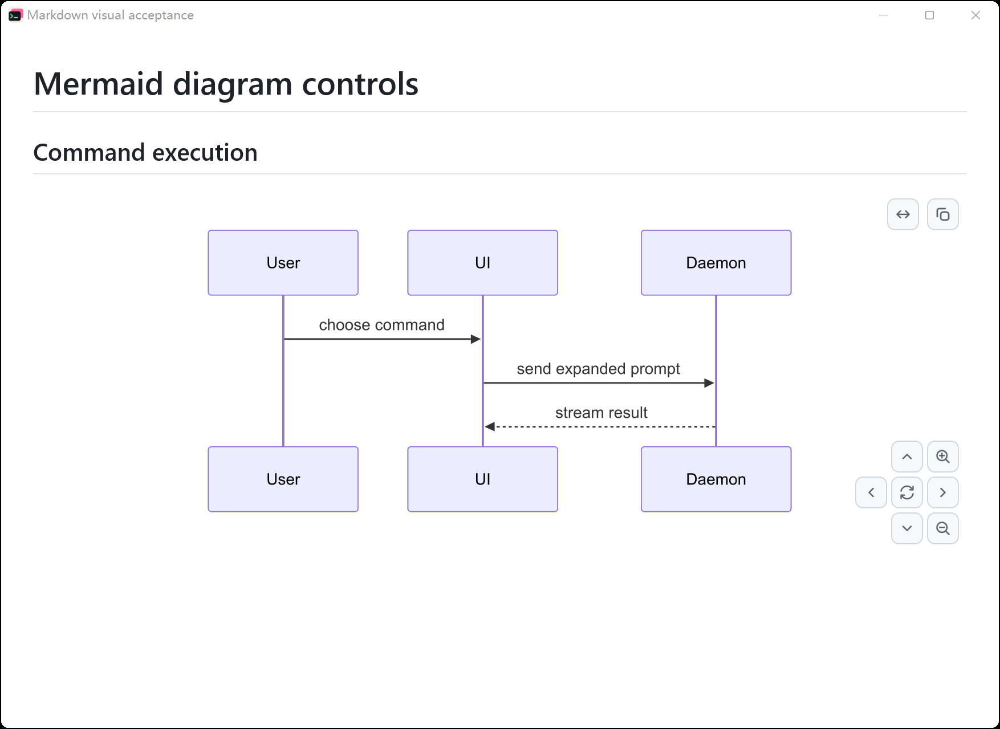 | 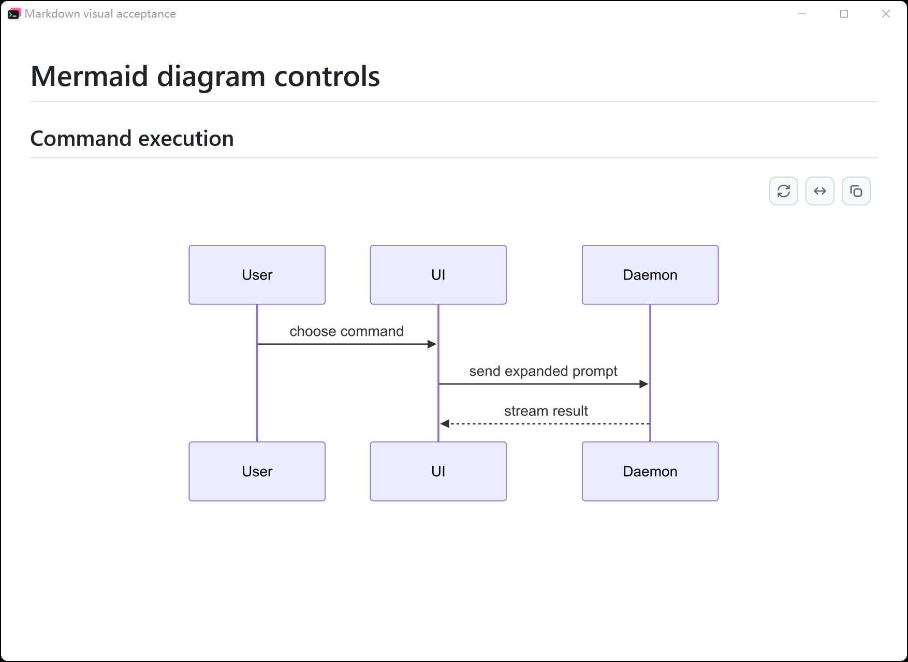 | The lower-right navigation pad is gone. Reset, Expand and Copy sit at the right of a toolbar row above the diagram; nothing is drawn over the image and the diagram keeps its width. |
| Expanded, light | 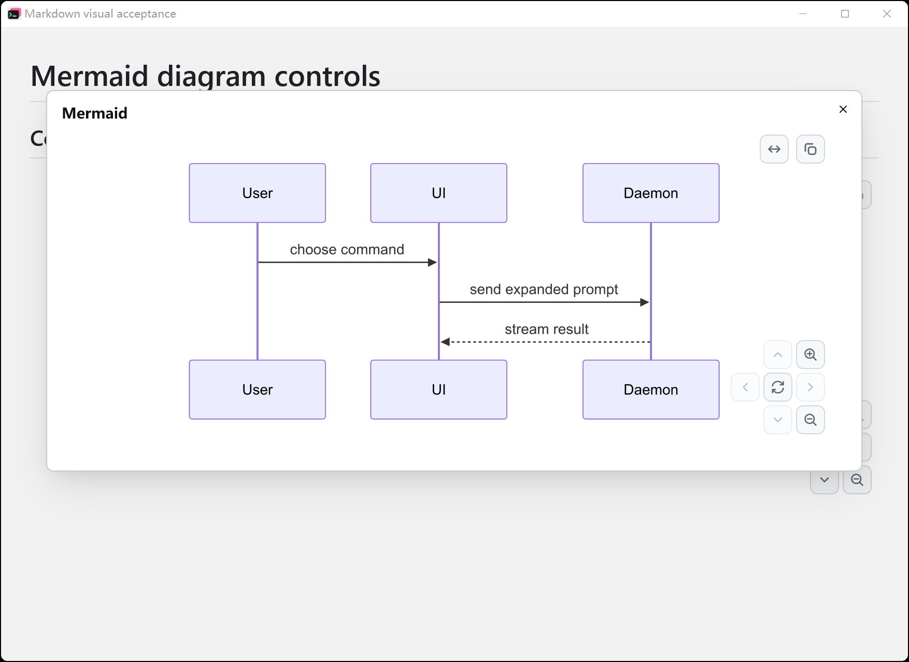 | 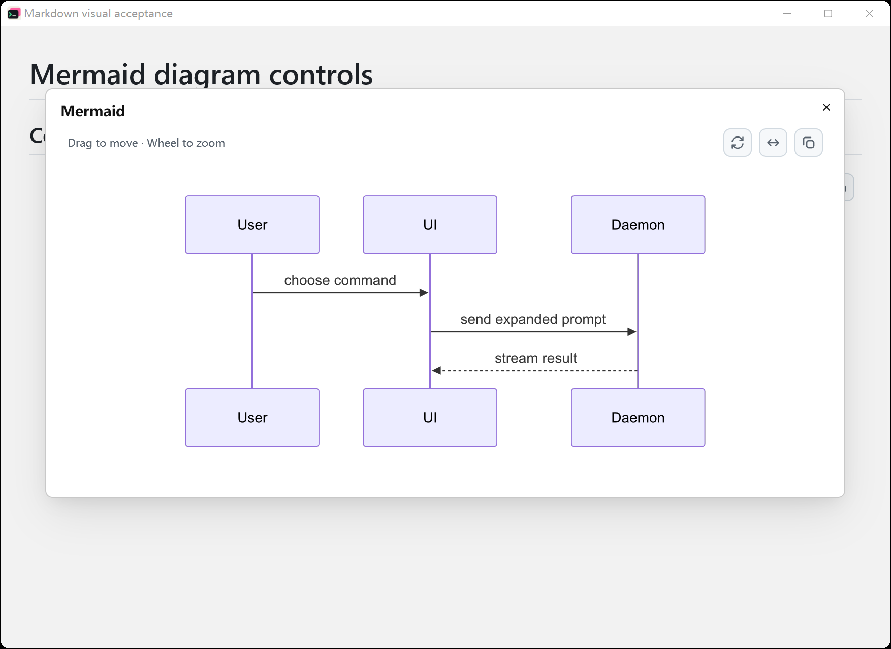 | The dialog's toolbar row holds Reset, Fit whole diagram and Copy above the diagram; the focused dialog shows "Drag to move · Wheel to zoom" at the left of that row. |
| Narrow, light | 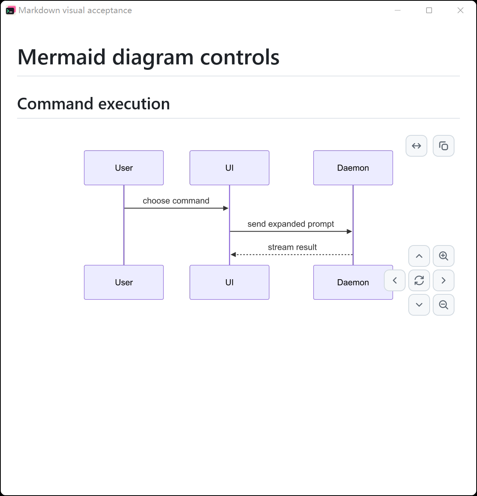 | 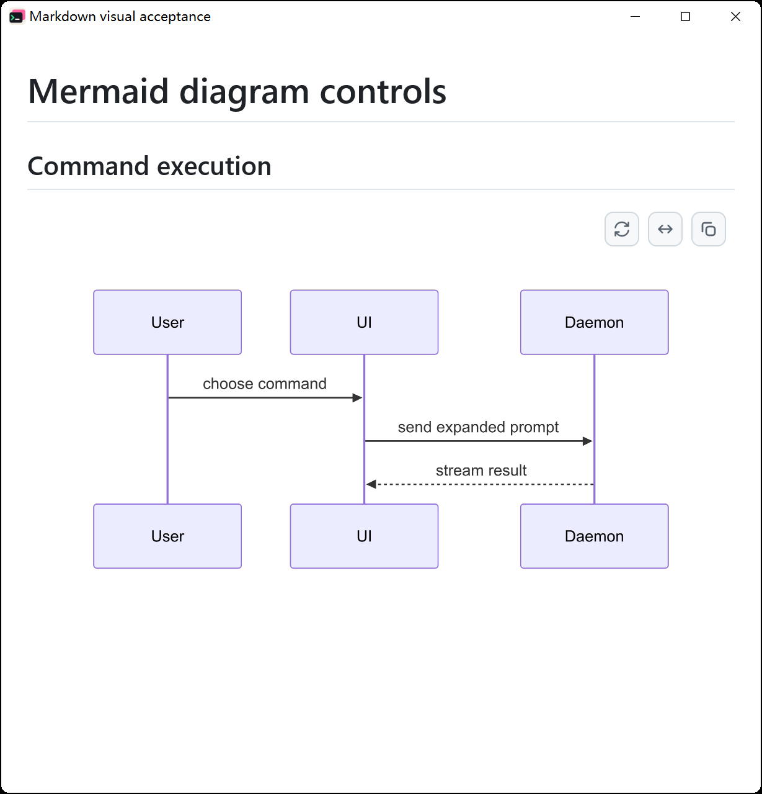 | At 700 px the toolbar row still sits above the diagram instead of over it. |
| Inline, dark | 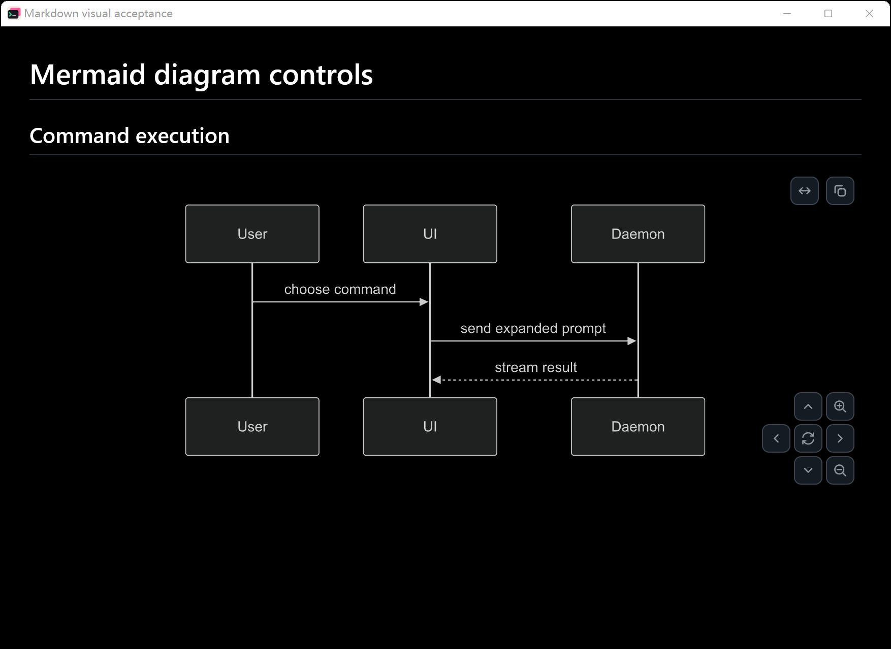 | 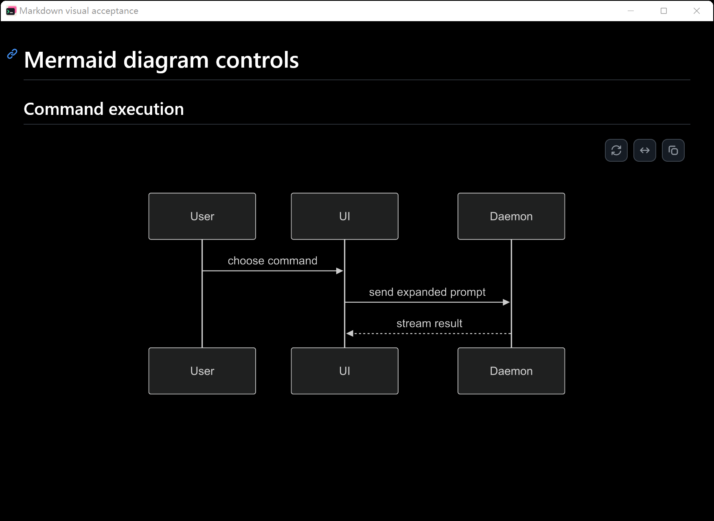 | The toolbar row uses the dark reading palette. |
| Expanded, dark | 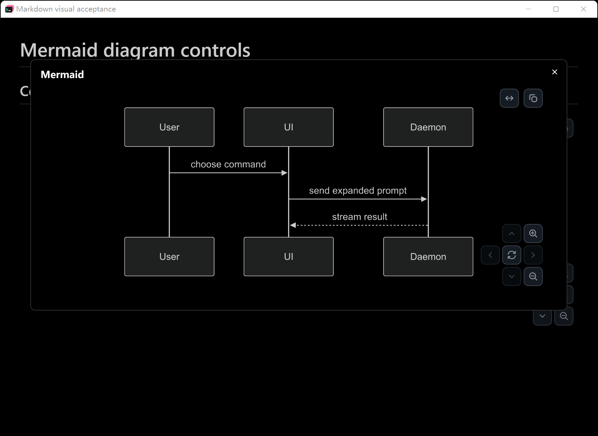 | 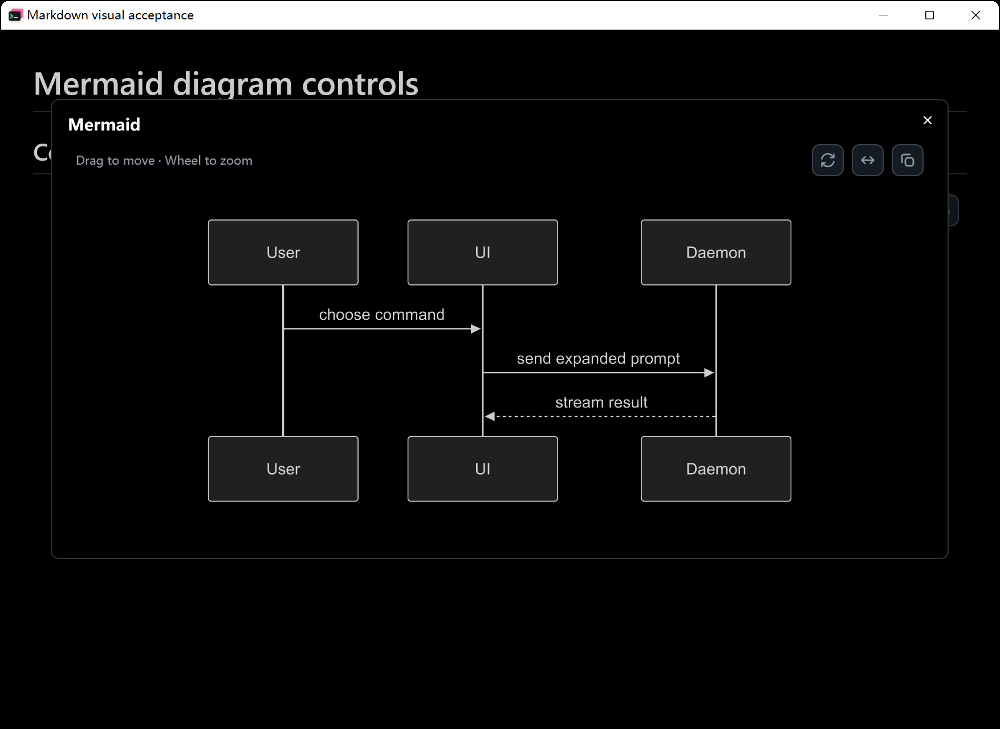 | The dialog toolbar row and hint stay legible on the dark background. |
| Narrow, dark | 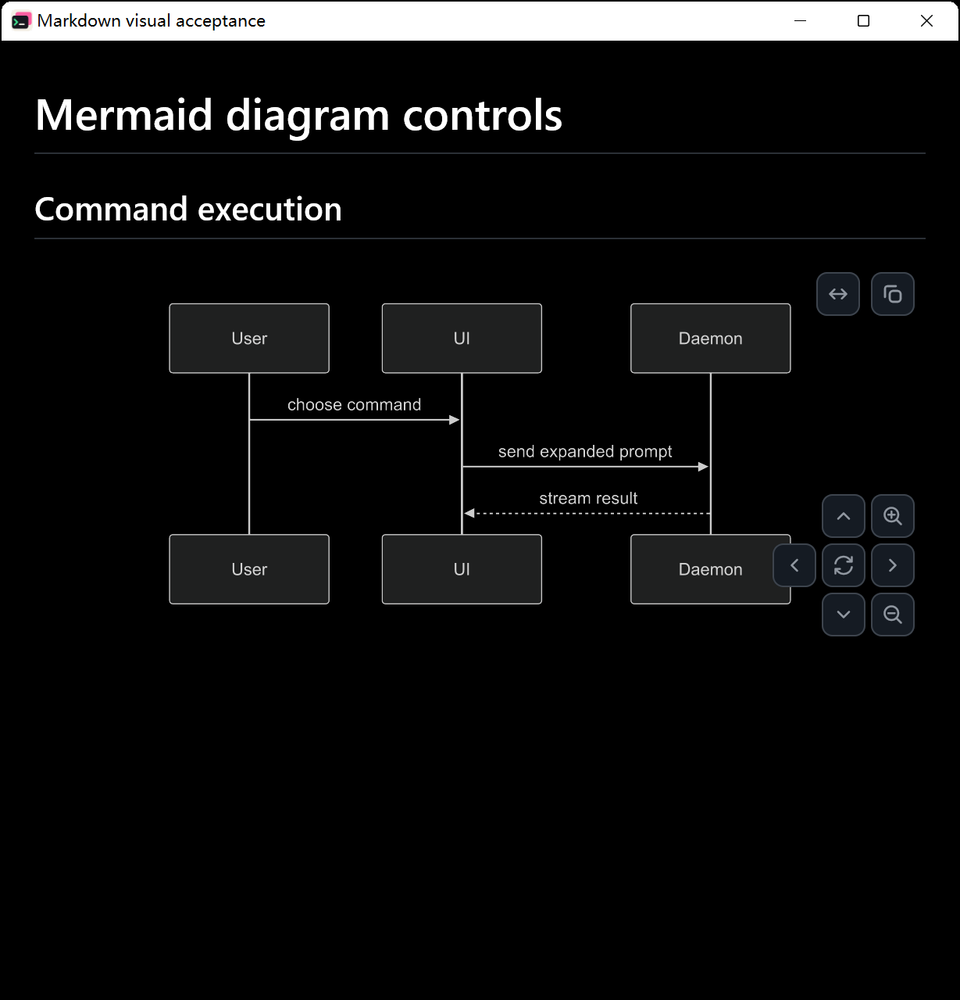 | 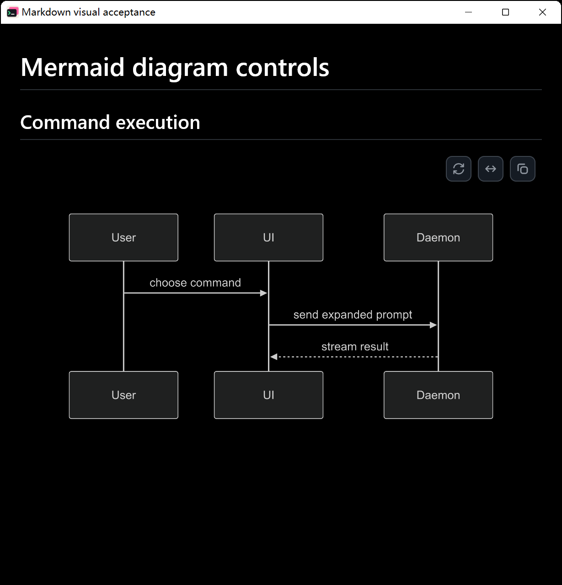 | The narrow dark layout keeps the toolbar clear of the diagram. |

Before shows nine controls across two corners: Expand and Copy at the top,
four direction buttons, two zoom buttons and Reset at the bottom. After shows
three controls in one toolbar row above the diagram.

The gesture hint appears while the diagram is hovered or keyboard-focused and
hides while dragging. With the pointer moved to the centre of the inline
diagram instead (`-Hover`), the same After build shows
"Drag to move · Ctrl+wheel to zoom" at the left of the toolbar row:

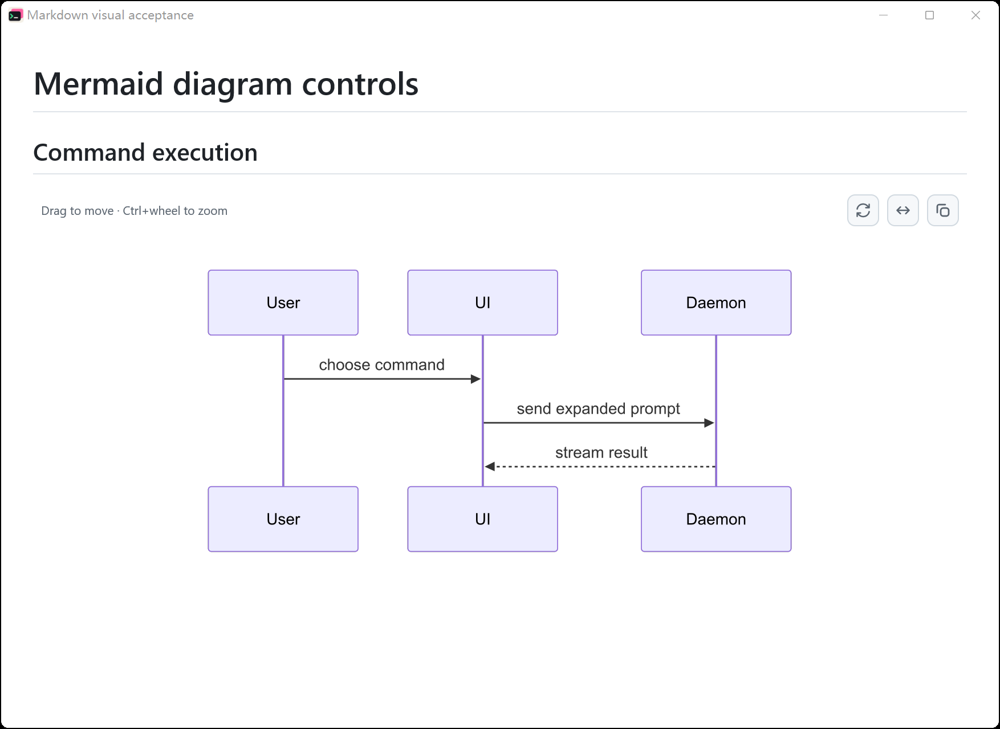

## Checks

- `cargo build --locked --features markdown-visual-tests --bin tty7-app` succeeds.
- `cargo test --locked --bin tty7-app --features markdown-visual-tests mermaid`: 19 passed, 0 failed. The inline test now also asserts that the toolbar does not intersect the diagram.
- `cargo fmt --check`, `bash .github/scripts/check-host-boundary.sh` and `git diff --check` pass.

## Known limitations

- Native captures cover Windows only; macOS and Linux were not exercised.
- The hovered capture was taken separately: hover follows the real pointer
  once the fixture window is in the foreground, so it is not reproducible
  from an unattended script run while the desktop is in use.
- Dragging, wheel zoom, keyboard navigation, Reset, Fit, Expand and Copy are
  covered by the interaction tests, not by captures.
