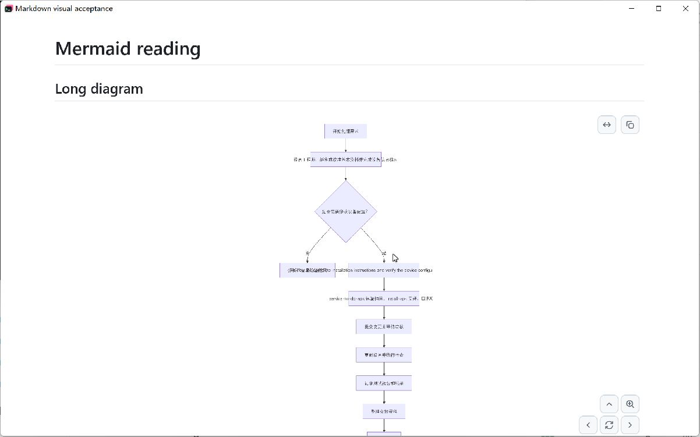

# Mermaid reading and mouse zoom acceptance

Tracks [cloudy-liu/ctty7#195](https://github.com/cloudy-liu/ctty7/issues/195).

## Behavior

Inline diagrams retain their aspect ratio and full height at the document's
reading scale. Ordinary wheel input continues scrolling the document. Expanded
diagrams open at reading size, use ordinary wheel input to zoom around the
pointer, and support left-button dragging, Fit whole diagram, reset, scrollbars,
and keyboard navigation. Raster generation follows display DPI and the actual
displayed size, with a 16,777,216-pixel and 8192-pixel-per-axis allocation limit.

## Execution evidence

Before the interaction fix,
`mermaid_unmodified_wheel_zooms_a_tall_diagram_at_the_pointer` failed with
`ordinary wheel down must zoom the expanded diagram out`. It passes after the
fix and checks that zoom retains the pointer anchor. Native GPUI component tests
also exercise a tall inline diagram, document scrolling, last-node access,
Fit whole diagram and reset, controls, dragging, and label geometry.

On Windows, `cargo test --locked --workspace --features markdown-visual-tests`
passed 3,160 tests with zero failures and 12 ignored tests. `cargo fmt --all --
--check` and `git diff --check` passed. Cross-platform CI is required before
merging the final PR head.

## Native screenshot provenance

Inspect the text crossing the rectangular nodes and the small default diagram.
This is an LCU capture of the running Windows native Markdown reading component
at production baseline `b0b57316`, using
`tests/fixtures/markdown/mermaid-reading.md`. The viewport is 1200 by 720,
application scale is 1, Windows display scale is 1.75, and the light appearance
is active. The captured JPEG includes the native frame (1202 by 751 pixels).

## Known limitations

Final native visual acceptance remains unverified. The final implementation was
built and reached `NATIVE_MARKDOWN_READY` with the same fixture and settings, but
LCU screenshot capture reported `window is minimized; call activate_window,
refresh with get_window, then retry get_window_state` after activation and
window re-selection. The previously captured file called `after-light.jpg`
also came from the old baseline and is deliberately excluded as evidence of
the fix. Automated component tests do not replace a final running-application
capture, real multi-monitor DPI switching, or manual short/long-diagram checks.
The repository owner explicitly accepted the visual limitation for PR #197
on 2026-10-24; it remains documented as unverified.
