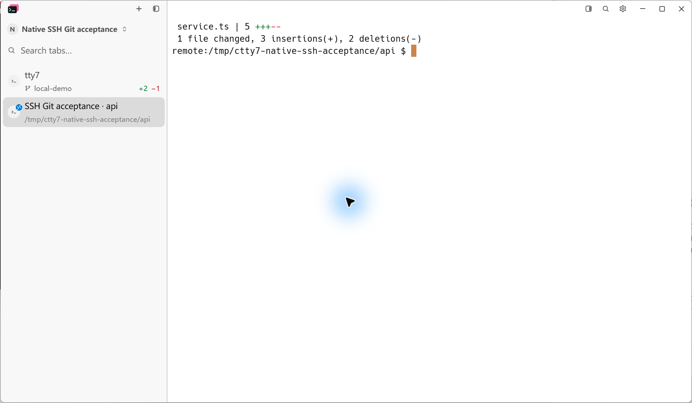
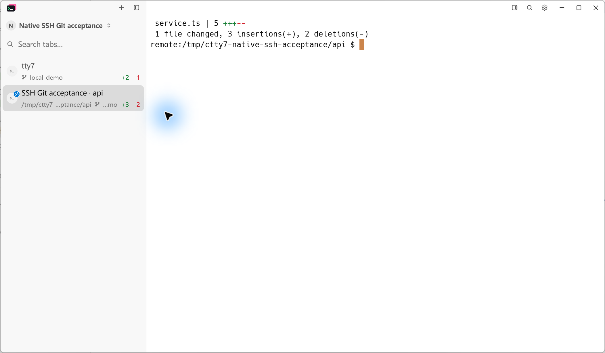
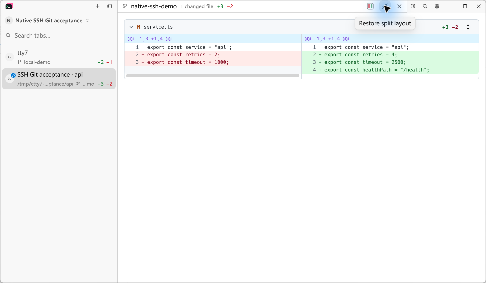
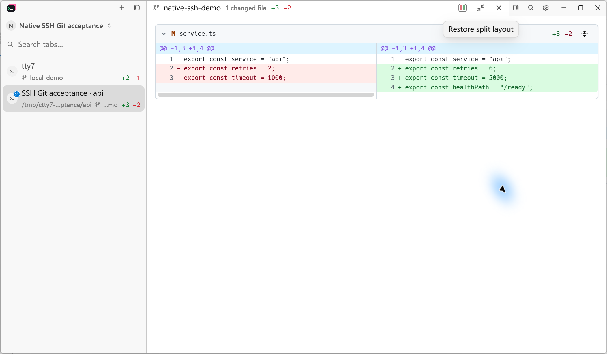
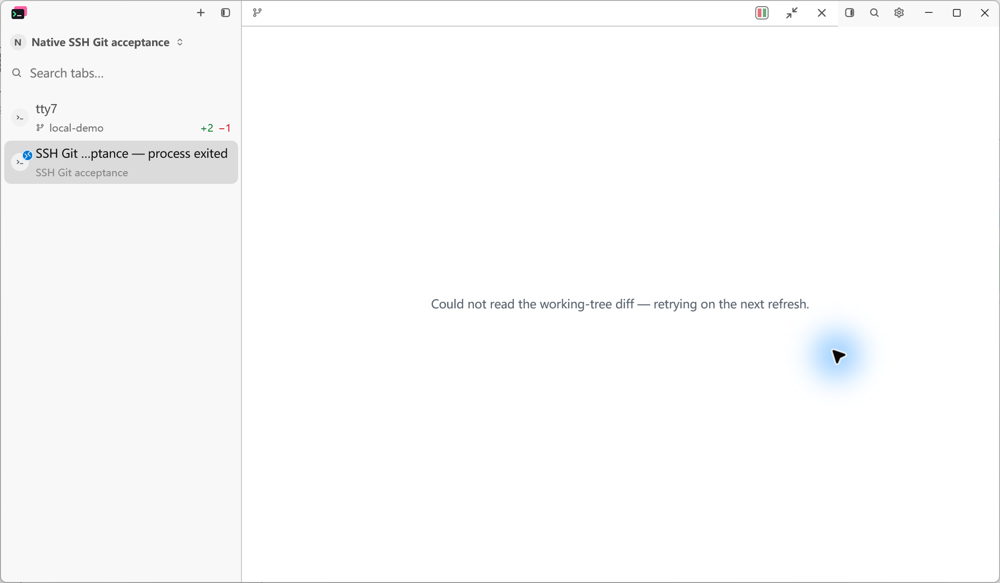
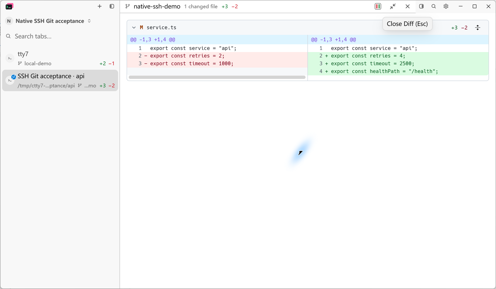
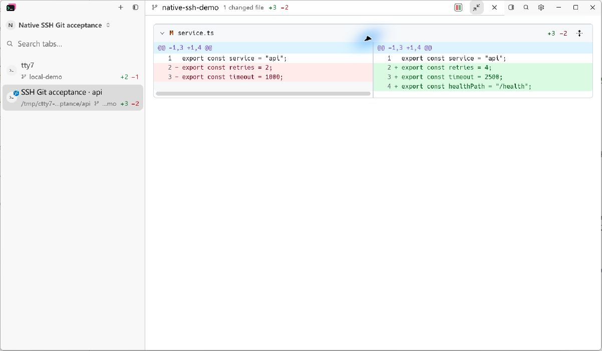
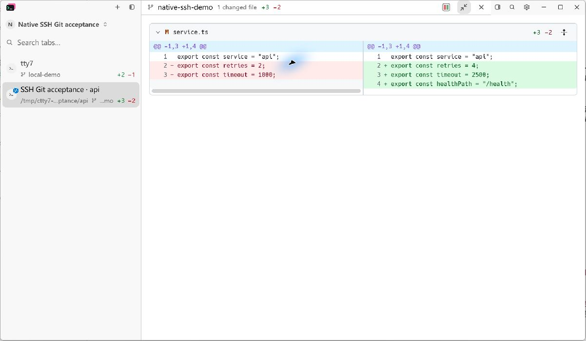

# Native SSH Git status and diff acceptance

Spec: cloudy-liu/ctty7#220. Implementation tickets: cloudy-liu/ctty7#221, cloudy-liu/ctty7#222, cloudy-liu/ctty7#223.

## Reproducible native state

Baseline source: `cb0bc217098687c3ed8655cb62ed2f2f52f6a190`. Final application source: `04bf73324b71e8c6a0cab8e2018cbae51d4879d4`, including independent-review fix `e89fd3a7`. Both phases run the production native Windows application with separate disposable configuration directories, a 1200 x 700 logical window at 175% display scale, light theme, 290-unit sidebar, grouping disabled, and the same two repositories.

The local repository has branch `local-demo` and `+2 -1`. A managed Native SSH profile uses a disposable key and an existing loopback SSH connection to WSL Ubuntu. Its repository `/tmp/ctty7-native-ssh-acceptance/api` has branch `native-ssh-demo` and `+3 -2` in `service.ts`. This remote path has no corresponding local repository. The isolated fixture uses Git 2.47.0; the system Git and user SSH configuration were not changed.

The repository's HEAD has three exported constants. The initial working-tree edit changes retries 2 to 4, timeout 1000 to 2500, and adds healthPath `/health`. An independent `git diff --numstat HEAD` reports `3 2 service.ts`.

## Matched Before and After

Before, the local row has statistics and the remote terminal confirms the remote change, but the SSH row has no Git statistics.

After, the same local row stays `+2 -1` and the Native SSH row shows `+3 -2`. The path and branch share the existing sidebar's elision budget.

Clicking that remote row's totals opens the existing diff. Its header names `native-ssh-demo`; the patch shows the independently specified remote changes and `+3 -2`.

## Refresh and connection lifecycle

While the diff retained focus, a separate WSL command changed retries to 6, timeout to 5000, and healthPath to `/ready`. No command was sent through the terminal. The branch and line totals remained unchanged; the open diff updated through the three-second active refresh.

The remote shell was then exited through the public CLI while the native application was inactive. On returning to the application, old statistics were absent and the old diff body was unavailable.

The fixture file was restored while disconnected. The application's Reconnect button created a new pane (4 to 5); reopening its totals read the restored 4/2500/health values rather than the old 6/5000/ready snapshot.

## Capture method

All images are screenshots of the running native application captured through LCU using native Alt+Print and saved as PNG through Windows Paint. Paint retained a larger blank canvas, so only its padding was removed with a lossless top-left crop to the exact 2104 x 1227 clipboard screenshot object. No application pixels were changed. The capture metadata records the source revisions, matching viewport and fixture states. Unit-test renders and mockups are not used as native evidence.

## Automated evidence

### SSH restoration integration

The release integration also covers cloudy-liu/ctty7#217. Reattaching a live
SSH pane registers the same pane-owned Git adapter as a new connection.
The combined Windows workspace passed 3,198 tests with zero failures and
12 existing skips, including `reattached_native_ssh_registers_its_pane_git_host`.

With the matching candidate daemon, restarting the daemon redials the saved
SSH connection and restores remote Git `+3 -2`. Reopening only the GUI then
reattaches to the same pane 6; the daemon PID, pane ID, and remote diff remain
unchanged. No additional SSH pane is created.

These additional captures are original LCU JPEG bytes from the running
integration candidate, using the same viewport, scale, fixture and theme.
Temporary diagnostic logging was enabled outside the application window to
trace directory and Git routing; it was removed before committing the source.
The earlier fixture daemon did not replay a confirmed directory on attach;
no saved local-path fallback was added. Native Git still requires a confirmed
remote directory and a daemon advertising `native-ssh-git`.

- Whole-workspace validation at `ac32b255`: 3,189 passed, zero failed, 12 existing skips across 17 harnesses, using `cargo test --offline --locked --workspace -- --test-threads=1` with a shared local target directory.
- Ticket lifecycle regression run: 167 passed, zero failed, two existing manual/performance skips. Actual red/green traces cover equal-count edits, hidden polling, immediate revisit, pending replies after disconnect, reconnect identity, and close while another entity retains the pane.
- Real SSH Git boundary: five tests passed, including literal special-character paths, the viewer's full-context patch request, byte/status/stderr preservation, timeout/channel reuse, output cap, and rejection of write queries.
- Post-review fix: two rendered Native SSH scenarios and 52 focused Native Git/SCM/cache/registry regressions passed. The fixture now uses production-shaped weak pane registration and delegates connection lifetime to the real adapter.
- Formatting, full-base whitespace checks, and the Host boundary check (112 UI/terminal files) passed. The final native application build passed.

## Independent review

### Standards

Zero actionable documented-standard violations or material baseline smells were reported.

### Spec

One P1 was found and resolved: SCM cleanup used machine enumeration to identify live hosts, although borrowed pane routes intentionally stay out of that list. Cleanup now uses actual Host lookup. The strengthened weak-registration regression first reproduced lost freshness state and a stale patch, then passed after the fix. The independent Spec reviewer confirmed the resolution at `04bf7332` and found no new mismatch.

## Known limitations

The feature covers tty7-managed Native SSH panes and POSIX remote commands; manually entered nested SSH connections are outside this change. Remote Git must support the existing shared probe's `--path-format=absolute` option. Live native UI acceptance was performed on Windows with WSL SSH; live macOS/Linux SSH UI sessions were not manually exercised. Each Git command is bounded to 15 seconds and 8 MiB of combined output; exceeding the limit reports a failed read.
