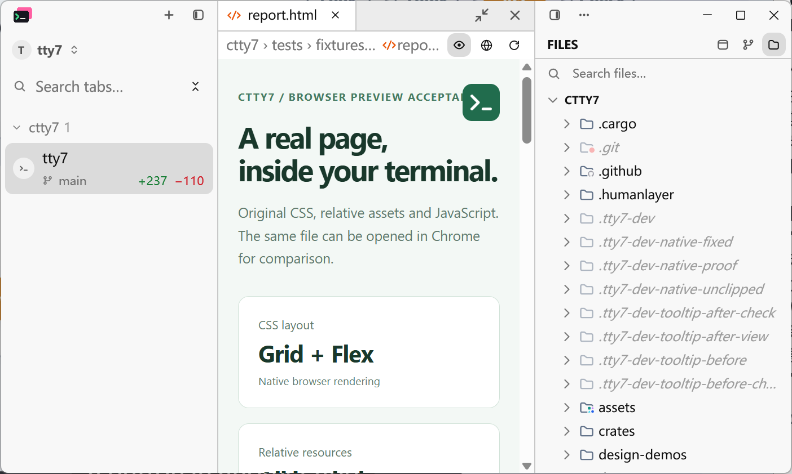
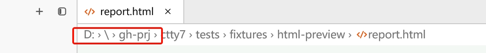
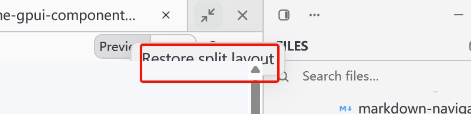

# Compact preview control and native tooltip occlusion

The breadcrumb has one 24 px preview toggle for both Markdown and local HTML.
The eye is selected while preview is open; clicking it switches to source,
and clicking again restores preview. Existing per-file mode and unsaved-edit
handling remain in the editor's normal toggle action.

Breadcrumbs start at the deepest matching project root. If the tree has no
matching root, including during a host change or tree refresh, only the filename
is shown. The full path remains in the path tooltip. Previous tests explicitly
expected absolute paths for these fallback cases; those expectations were the
regression gap. Coverage now includes ordinary and verbatim Windows drive paths,
missing and unrelated roots, other hosts, and reopening a canonicalized file
after removing its project root.

## Native layering

WebView2 is a native child above GPUI's DirectComposition target. GPUI paint
order cannot lift a tooltip over that child. The component library now reports
the laid-out tooltip footprint, including ordinary path tooltips and component
button tooltips. Releasing an old tooltip cannot clear its replacement's bounds.

The Windows HTML preview subtracts that footprint from the child window's GDI
region. Coordinates are converted from window logical pixels to physical pixels
relative to the child. The rest of the browser stays visible and interactive;
dismissing the tooltip restores the unrestricted native region. Cached regions
include the viewport size so resizing cannot retain an old clipping rectangle.
The existing composition target and browser focus handling are retained.

All component packages are pinned to
[`a3a91aa0`](https://github.com/cloudy-liu/gpui-component/commit/a3a91aa0c7bfe70dd9c5f690bf44947e4c41f4cb)
on the maintenance fork. No sibling checkout or local path patch is required.

## Validation

Run the native checks serially: they exercise real windows and require the
acceptance window to receive hover events.

```powershell
cargo test --release --bin tty7-app document_
cargo build --release --locked --bin tty7-app --features markdown-visual-tests
python scripts/html-tooltip-native.py target/release/tty7-app.exe OUTPUT_DIRECTORY
python scripts/html-native-preview.py target/release/tty7-app.exe OUTPUT_DIRECTORY 0
cargo check --release --locked --bin tty7-app
```

The tooltip check opens the real fixture through the production file-opening
flow with a terminal reporting the project directory. It hovers the actual fill
control, waits for the real tooltip footprint, and queries the native child
region at the overlapping point. Disabling the exclusion must reproduce the
coverage failure; enabling it must pass, retain the project breadcrumb, and
restore the browser region after the tooltip disappears. The test uses an
isolated application configuration.

Windows validation on 2026-10-25 used an 800 x 480 logical-pixel viewport at
175% display scale. Document tests passed: 39 passed, zero failed, and one
existing manual frame benchmark ignored. The full HTML acceptance also passed
resource loading, JavaScript interaction, refresh, file and session scroll
ownership, rapid switching, source restoration, and navigation-failure recovery.
The locked production build check passed against the published dependency pin.

## Captures

The retained native window capture shows the single icon and project-relative
breadcrumb. The original reports are retained as user-provided crops; they are
not a standardized, matched before/after tooltip screenshot pair.






