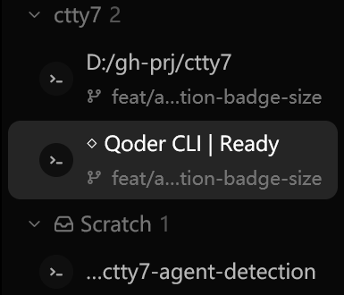
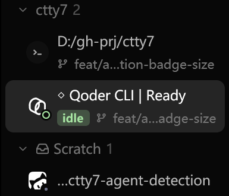
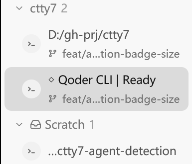
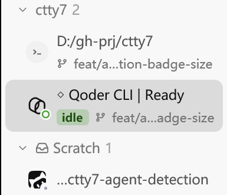

# Qoder CLI and CodeBuddy acceptance

## Scope

This change ports upstream tty7's integrations for Qoder CLI
(l0ng-ai/tty7#873), its mainland-China build Qoder CN CLI (l0ng-ai/tty7#988)
and CodeBuddy (the CodeBuddy half of l0ng-ai/tty7#936). Each agent gets process
detection, a brand mark, Claude-format hooks in its own `settings.json`, and
resume and fork commands. The upstream session-history readers are left out
because ctty7 has no past-session browser, and so are the Cursor CLI hooks
that shipped beside CodeBuddy.

ctty7 adds three things on top:

- Qoder and Qoder CN read their screen with Herdr's `qodercli.toml`, copied
  byte-for-byte at the pinned Herdr commit. A Qoder pane shows working,
  blocked and idle before any hook is installed, the same way Antigravity
  does. Herdr has no CodeBuddy manifest, so CodeBuddy's status comes from its
  hooks alone.
- The three marks are monochrome, so the tab and sidebar draw them in the
  theme foreground like Codex, Cursor and Grok. The tray, which always draws a
  white mark on the agent's accent, gets a near-black field for Qoder instead
  of upstream's white one.
- `qodercli` is Qoder's first alias. A pane that never received input
  relaunches the first alias, and the curl installer ships no `qoder` outside
  its PowerShell dispatcher.

## Automated checks

```sh
cargo test --workspace --locked
python scripts/sync-agent-detection.py --check
python -m unittest discover -s scripts -p test_sync_agent_detection.py
cargo fmt --all -- --check
```

The screen tests use Qoder CLI 1.1.83's own strings: its composer as captured
from a live pane, `Thinking...` and `Generating...` with the
`(esc to cancel, Ns)` timer, and the `Allow this command to run?` dialog with
`Waiting for user confirmation...`. A turn reads as done once its status line
is gone. The process-tree test covers the curl installer's Windows chain, where
`qoder.cmd` hands off to PowerShell, which starts `qodercli.exe`.

## Native capture

`scripts/agent-detection-native-visual.py` runs an already built `tty7-app`
against a throwaway config directory, so the machine's own server, settings and
hooks are untouched. It renders each window with PrintWindow, so no pointer
appears. Before is fork `main` at `44b2e11a`; After is this branch. Both are
debug builds on Windows 11 at 175% scale, in the default 1440x900 window.

The sidebar scene opens three tabs: the startup shell, a stand-in process named
`codebuddy.exe` (a copy of `timeout.exe`), and a real Qoder CLI 1.1.83 started
in a directory Qoder already trusts. No prompt is sent to Qoder. The settings
scene opens **Settings → Agents** and scrolls to its last hook rows.

| | Before | After |
|---|---|---|
| Sidebar, dark |  |  |
| Sidebar, light |  |  |

Full windows: `before-sidebar-dark.png`, `after-sidebar-dark.png`,
`before-sidebar-light.png`, `after-sidebar-light.png`,
`before-settings-dark.png` and `after-settings-dark.png` in
`images/qoder-codebuddy-agents/`.

## Known limitations

- CodeBuddy itself was not run. The stand-in proves detection by process name
  and the mark, not CodeBuddy's hooks; those are covered by the ported tests.
- Qoder's working and blocked states are covered by tests, not captures, because
  capturing them would send a prompt on the user's account.
- Qoder CN CLI was not installed on the capture machine.
- No hook was installed into a real agent config. Install, refresh and
  uninstall run against temporary homes in tests.
