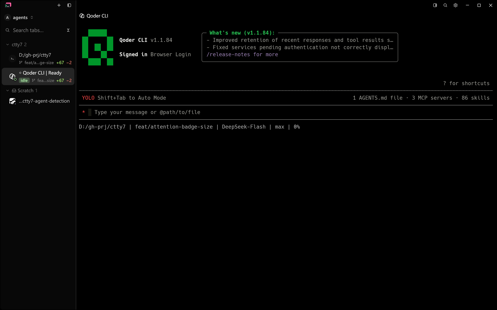
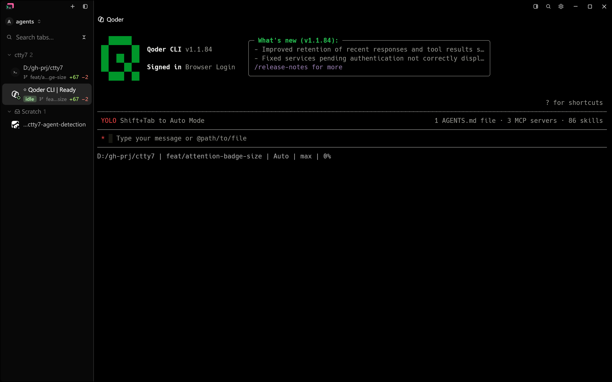
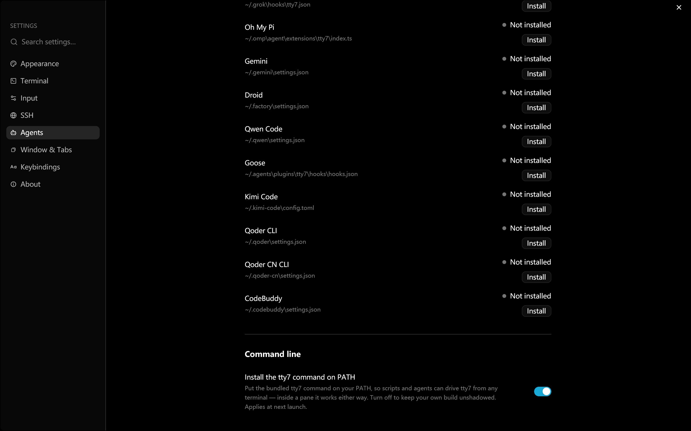
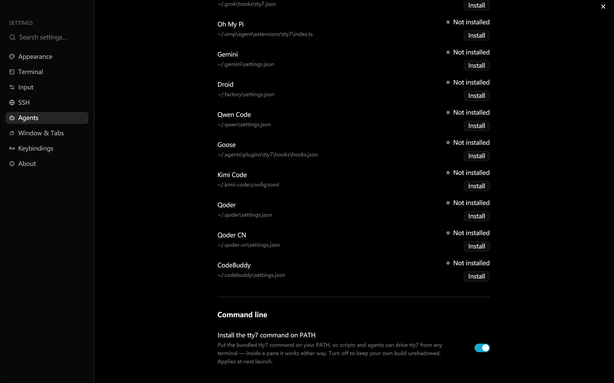

# Qoder display names acceptance

The two Qoder integrations are named **Qoder** and **Qoder CN** everywhere
tty7 prints an agent name. The `CLI` suffix says nothing here: every agent tty7
lists is a terminal CLI.

Baseline source: fork `main` at `eff3c2b5` (v0.11.1). Final application source:
this branch — the two `display_name` tables plus the English, Japanese and
Chinese settings labels. Both are debug builds of the production app on
Windows 11 at 175% display scale, in the default 1440 x 900 window.

## Reproducible native state

`scripts/agent-detection-native-visual.py` runs the built app against a
throwaway config directory, so the machine's server, settings and hooks stay
untouched. The sidebar scene opens three tabs: the startup shell, a stand-in
process named `codebuddy.exe` (a copy of `timeout.exe`) and a real Qoder CLI
1.1.84 pane started in a directory Qoder already trusts. No prompt is sent to
Qoder. The settings scene opens **Settings → Agents** and scrolls to the last
hook rows. Every scene is a fresh process and config directory, so the tty7
chrome differs only in the binary; Qoder's own status line is not fixed by the
harness (it read `DeepSeek-Flash` before and `Auto` after). Captures are
`PrintWindow` renders — the same capture path as the pane-title and
Qoder/CodeBuddy acceptances — with no pointer and no overlapping windows.

## Matched Before and After

**Pane title.** Inspect the row above the terminal: Before reads "Qoder CLI",
After reads "Qoder". The sidebar card's first line is Qoder's own OSC terminal
title ("Qoder CLI"), not tty7's agent label, so it does not change; the
terminal banner is Qoder's own content too.

| | Before | After |
|---|---|---|
| Pane title |  |  |

**Settings → Agents.** Inspect the Qoder and Qoder CN hook rows: Before reads
"Qoder CLI" and "Qoder CN CLI", After reads "Qoder" and "Qoder CN".

| | Before | After |
|---|---|---|
| Agent rows |  |  |

## Automated checks

```sh
cargo test -p tty7-core qoder
cargo test -p tty7 agent_rows_are_in_the_search_index
cargo fmt --all -- --check
```

## Known limitations

- Only the dark theme was captured. The labels are theme-independent; the
  light scenes were not repeated.
- The tray menu and CLI output were not captured separately. They read the
  same `CLIAgent::display_name` and `HookAgent::display_name` values as the
  captured pane title and settings rows.
- Qoder's own status line varied between runs (`DeepSeek-Flash` before, `Auto`
  after). It belongs to the agent, not to tty7 chrome.
