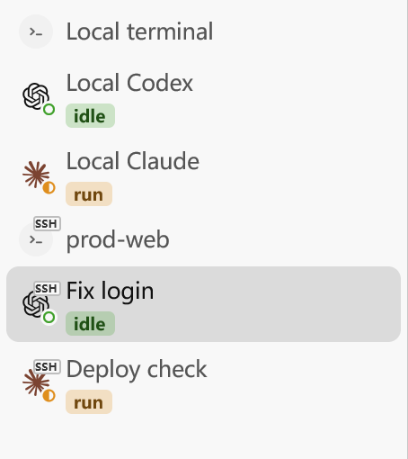
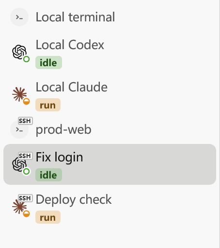

# Working badge animation acceptance

Spec: cloudy-liu/ctty7#141. Implementation: cloudy-liu/ctty7#142, PR cloudy-liu/ctty7#143.

The existing yellow half-circle rotates clockwise once per second in twelve
steps. A window shares one phase and one outstanding wake across its working
badges. Actual visible paint renews the wake; no visible working badge means
no renewal. Agent logos, status text, background discs and other status symbols
remain still.

## Behavior regressions

Six GPUI application/window tests use real daemon status messages and the
existing virtual clock/render counter. The initial settled-window test was
red with zero animation draws in one second before the implementation, then
green with twelve draws. The tests cover:

- One working badge at twelve refreshes per second, and four working badges
  sharing the same twelve refreshes rather than multiplying the rate.
- Waiting, Done and Idle stopping renewal, followed by Working resuming it.
- Search filtering and sidebar collapse stopping renewal, then restoring it.
- A genuinely overflowing sidebar scrolling its sole working badge out of
  view and back into view.
- Top-tab reuse and continued animation in a visible unfocused window.

The blank Codex fixture correctly becomes Idle through its screen detector;
the cadence tests therefore use Claude's authoritative rich hooks. Group
headers currently have no collapse action, so no new group-collapse feature
was introduced.

## Native Windows measurement, 2026-10-12

Baseline source: `703f3d6500a9c0a67c314b77a4dad5e692afe3ff`.
Animation source: `119f486997e7424c72d8c74a3db481a29f05d77f`.
Hardware: AMD Ryzen 7 5800H, sixteen logical processors.

Both measurements used the unchanged six-pane SSH tab visual fixture, isolated
configuration directories, a 1200 by 660 logical-pixel window, the light theme
and disabled cursor blinking. The fixture opens no real agent or SSH service.
Its two Claude panes retain Working; its two blank Codex panes become Idle.
The remaining panes are ordinary terminals.

The native fixture's usual `markdown-visual-tests` feature enables GPUI
`test-support`, whose effect flushing redraws dirty windows even when native
frame callbacks are stopped. That build is useful for screenshots but gives
invalid minimized-window performance evidence. In a separate measurement
checkout, the feature was temporarily set to an empty dependency list. This
enabled the unchanged fixture entry without GPUI test support. The feature
tree was checked to contain no `test-support`. The overlay is not part of the
implementation or its Cargo manifest.

These were **dev-profile builds**, not release builds. Each phase settled for
two seconds and sampled the child's process CPU for ten seconds. The window
render meter was enabled with `TTY7_PROFILE=1`; unrelated process work remains
included in CPU totals. CPU percentages below use one logical processor as
100%, with whole-machine equivalents divided by sixteen.

| Sidebar phase | Baseline CPU, one processor | Animated CPU, one processor | Animated CPU, whole machine | Animation redraws |
| --- | ---: | ---: | ---: | --- |
| Visible | 0.625% | 7.808% | 0.488% | About 12/s |
| Minimized | 2.343% | 1.562% | 0.098% | No window render-meter lines in 10 seconds |
| Restored | 0.624% | 7.805% | 0.488% | About 12/s |
| Hidden with `ShowWindow(SW_HIDE)` | 0.156% | 0.468% | 0.029% | No window render-meter lines in 10 seconds |
| Shown again | 1.562% | 11.087% | 0.693% | About 12/s |

Visible animation added about 0.45 percentage points of whole-machine CPU in
the first sample. Its average root UI build time was 1.08 to 1.21 milliseconds
in the first visible sample. This times construction of the root UI,
not the entire frame or GPU work. CPU varied between phases, so the table is a
local observation rather than a statistical benchmark or power-use estimate.
The important lifecycle result is that native minimized and hidden windows
stop renewing animation work and resume when shown.

The native top-tab fixture also refreshed at about twelve times per second,
stopped while minimized or hidden, and resumed after restore/show. Its visible
sample used 9.520% of one processor, or 0.595% of the whole machine, with average
root UI build times of 0.84 to 0.94 milliseconds. There was no separate native
top-tab CPU baseline in the production-path comparison.

Two lossless native window bitmaps were taken 250 milliseconds apart. Their
pixel differences are confined to the two working status symbols; both have
the same changed region relative to their own location. The surrounding
logos, text and layout are unchanged.

[Native frame A](images/run-badge-native-sidebar-a.png) and
[native frame B](images/run-badge-native-sidebar-b.png).

## Before and after recording

| Before: static working symbol | After: rotating working symbol |
| --- | --- |
|  |  |

Both panels are crops of native Windows window captures with the same fixture
and appearance. The source pixels are not resized or redrawn. All 48 baseline
captures were identical. The after recording contains twelve distinct native
angles, with changes confined to the two working badges. The GIF uses a shared
palette and a 1.95-second loop cut at the return to its initial native pose.
Its crop is 454 by 510 pixels; GitHub may scale the displayed panels to fit.

## Verification limits

- Native CPU and window-hide/minimize measurements were taken on Windows only.
- GPU utilization, energy use and release-build performance were not measured.
- The locked UI framework exposes no system reduced-motion preference accessor;
  the animation currently does not follow that preference.
- Rendering cadence stays bounded as agents are added, but layout and painting
  cost still depend on the contents of the window.

## Reproducing the native comparison

Use isolated baseline and head checkouts and the existing `--ssh-tab-visual`
entry with `sidebar`, `output` and `hold_seconds` options. On Windows only,
temporarily change `markdown-visual-tests` to an empty feature in those
measurement checkouts, then build with:

```text
cargo tree --edges features,no-dev --features markdown-visual-tests -i gpui
cargo build --locked --bin tty7-app --features markdown-visual-tests
```

Confirm the tree contains no GPUI test support. Run each binary with an
isolated `--config-dir`, `TTY7_PROFILE=1`, and the same fixture options. Wait
for `NATIVE_SSH_TABS_READY`, settle the window and sample process CPU and new
`[perf] window` lines over equal periods before and after minimize, restore,
hide and show. Keep the feature overlay out of production changes.
