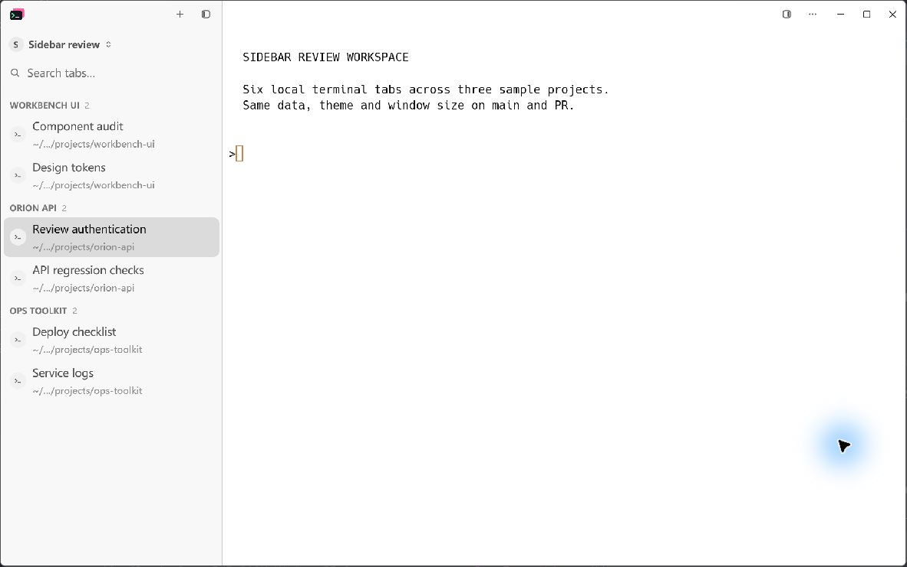
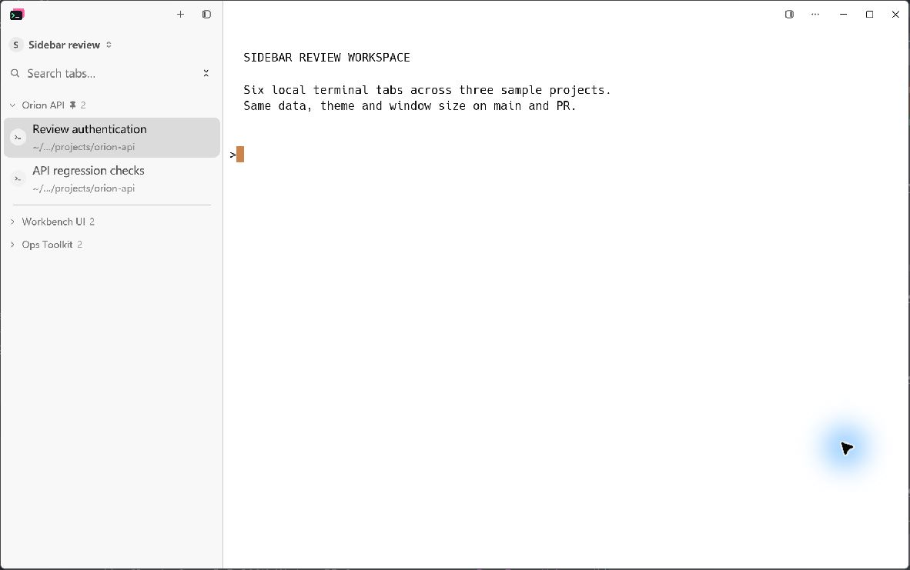
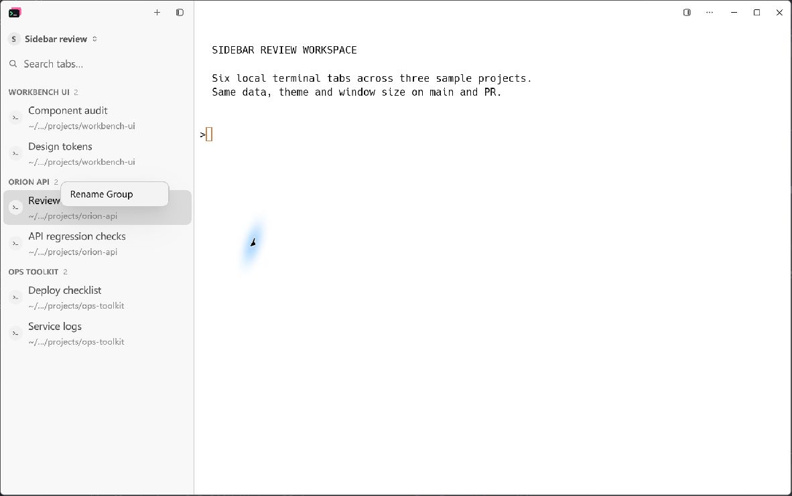
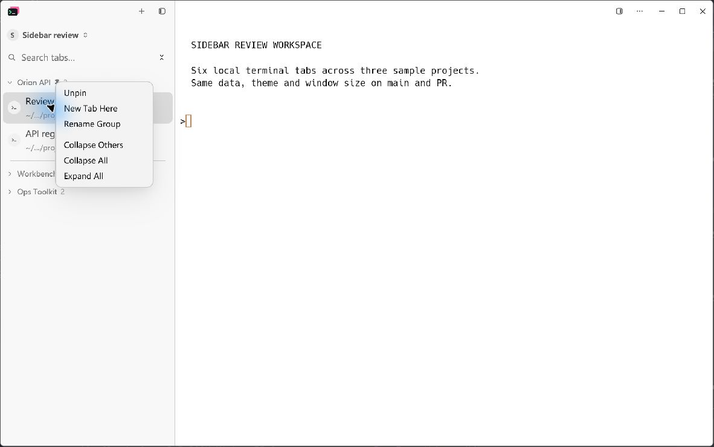
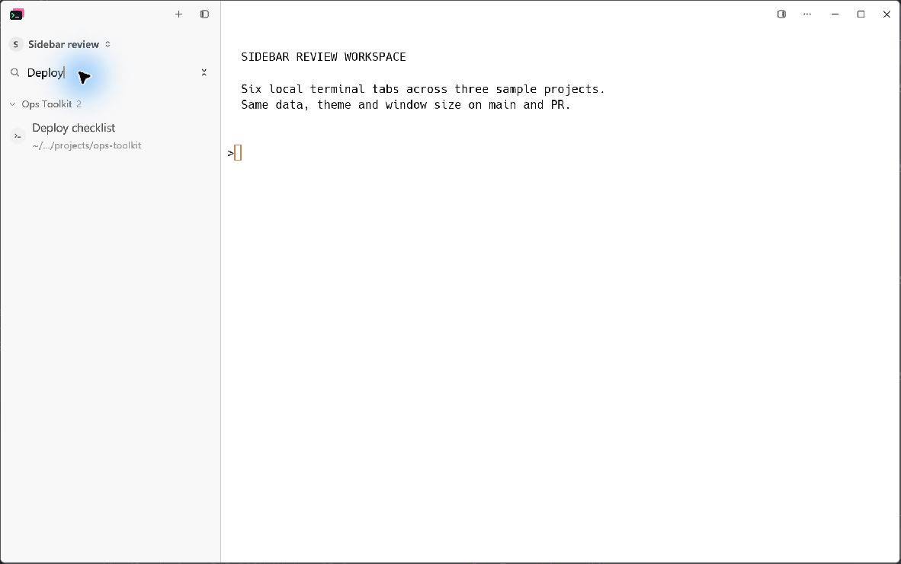
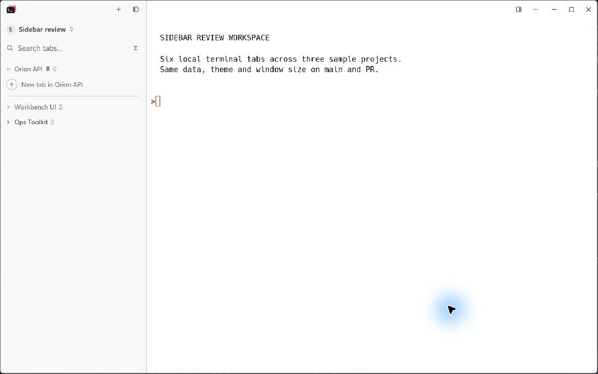

# Sidebar folding and pinning: native UI evidence

Captured on Windows on 2026-10-18 through LCU MCP, using the production
application and real local terminal tabs.

- Before: `main` at `7610165527768d83d7e3c8bae11d9e4d36c8af08`.
- After: UI code at `cbea28f76ea542a9856b4a9d023cbf59c506a4ff`.
- Both instances use the light theme, 16px UI text, a 290px sidebar and an
  1180 x 740 window. Captured images include the window border and are
  1182 x 741 pixels.
- Separate config directories start with the same six sample tabs, custom
  group names and active tab. No coding agents or remote connections run in
  this fixture. The terminal content is a fixed local echo command.
- The baseline binary has a separate build target name to avoid replacing a
  running development executable. Its application sources are unchanged from
  the base revision.
- Images are the original LCU JPEG captures, without compositing, retouching
  or generated UI.

Spec: [cloudy-liu/ctty7#162](https://github.com/cloudy-liu/ctty7/issues/162).

## Same six tabs, before and after

The initial group order is Workbench UI, Orion API, Ops Toolkit, with two
tabs in each group. The selected tab is Review authentication in Orion API.

In the PR instance, Orion API is pinned through its menu, then Workbench UI
and Ops Toolkit are folded by clicking their headers. All six tabs remain
open; the two folded groups retain their counts.

| Before: all tabs visible, passive headers | After: pinned project first, other groups folded |
| --- | --- |
|  |  |

## Group menu

The same Orion API group is right-clicked in both instances. The baseline
offers Rename Group. The PR adds pinning, New Tab Here and folding controls.

| Before | After |
| --- | --- |
|  |  |

## Search inside a folded group

Searching for `Deploy` reveals Deploy checklist inside the folded Ops Toolkit
group. Clearing the search restores its folded state without changing the
saved folds.

## Empty pinned project

Both Orion API tabs are closed through their row close buttons. The project
remains pinned with count zero and a New tab in Orion API launcher. The image
below was captured after restarting the isolated GUI, confirming the pin and
folds persist. Clicking the launcher was also checked: it opens a new terminal
in Orion API and the group count becomes one after the directory probe settles.

These captures cover local sidebar interactions. Remote pin rejection and
known-group placement are covered by the automated regression tests; the
screenshots do not claim to demonstrate a live remote or agent session.
