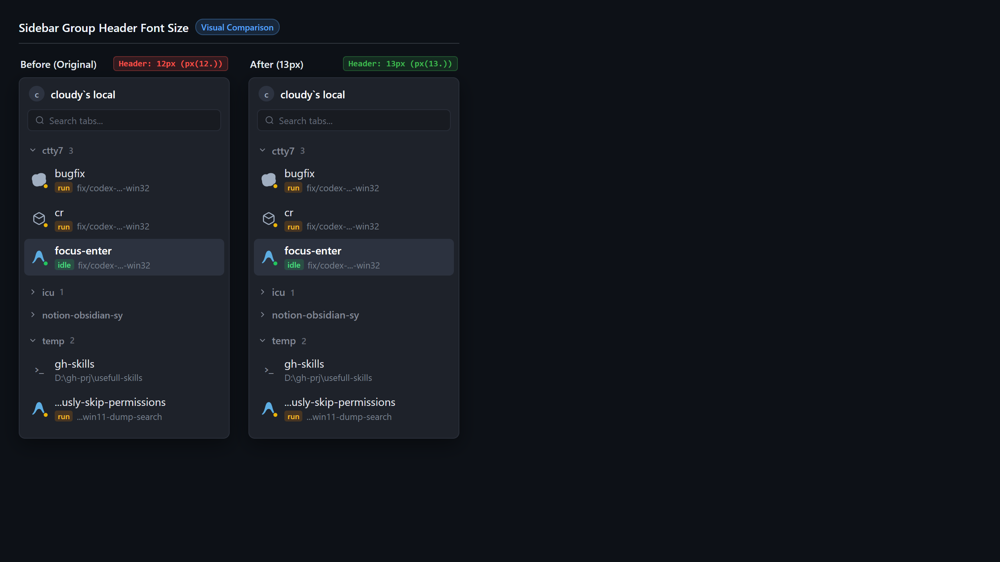
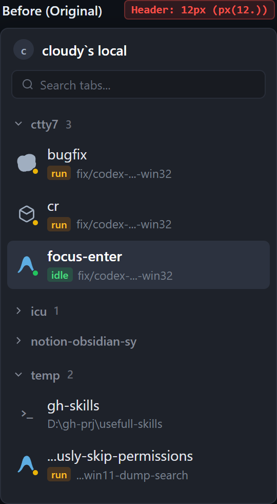
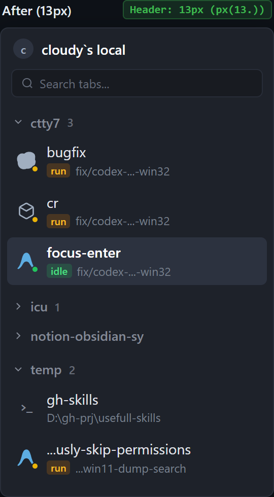

# Sidebar group header font size acceptance

## Visual hierarchy tuning, 2026-10-19

In the vertical tab sidebar, tab rows render as multi-line cards (~48–52 px
height) containing an agent avatar, a 14 px (`text_sm`) title, a status badge,
and a 12 px (`text_xs`) git branch or cwd path.

Previously, the group header row (`ctty7`, `icu`, `temp`) was sized at `px(12.)`.
Because tab titles are 14 px bright text, the 12 px muted header appeared
cramped and thin under DirectWrite rasterization on Windows, creating an inverted
visual weight where the container header felt fragile beneath the heavy child
cards.

This revision adjusts the group header text size from `12px` to `13px` (`px(13.)`):
- **Tab Title (Primary target)**: 14 px (`text_sm`, resting white / active medium)
- **Group Header (Structural container)**: 13 px (`px(13.)`, muted `#848a97`, medium)
- **Tab Metadata (Branch / CWD)**: 12 px (`text_xs`, muted)
- **Status tag**: 11 px (`STATUS_REM * rem`)

Keeping the group header at 13 px ensures it remains slightly smaller than the
tab titles (keeping the user's primary focus on tab discovery and switching
without header visual noise), while eliminating the awkward text-size disparity.

## Visual Comparison

| Before: 12 px group header | After: 13 px group header |
| --- | --- |
| Header `ctty7 3` at 12 px feels compressed beneath 14 px tab cards | Header `ctty7 3` at 13 px forms a smooth 14 px → 13 px → 12 px hierarchy |
|  |  |

## Verification

- `cargo test --bin tty7-app ui::tab_sidebar`: 17 passed.
- `cargo fmt --all -- --check`: passed.
- `git diff --check`: clean.
