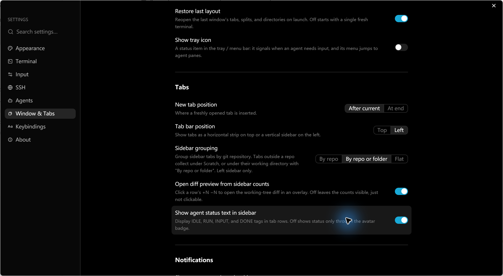
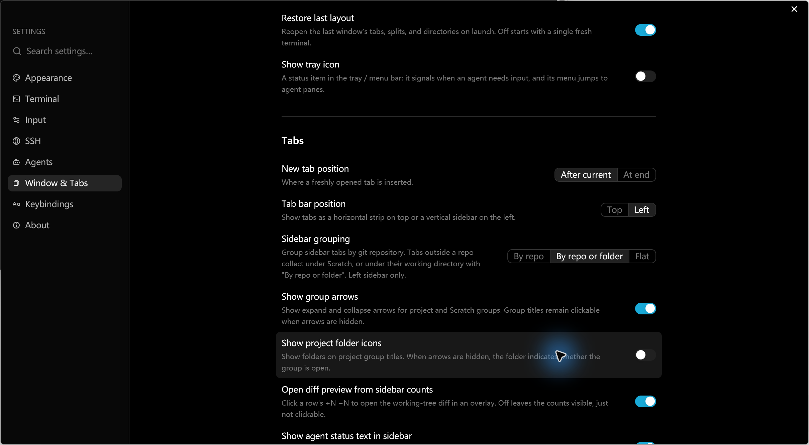
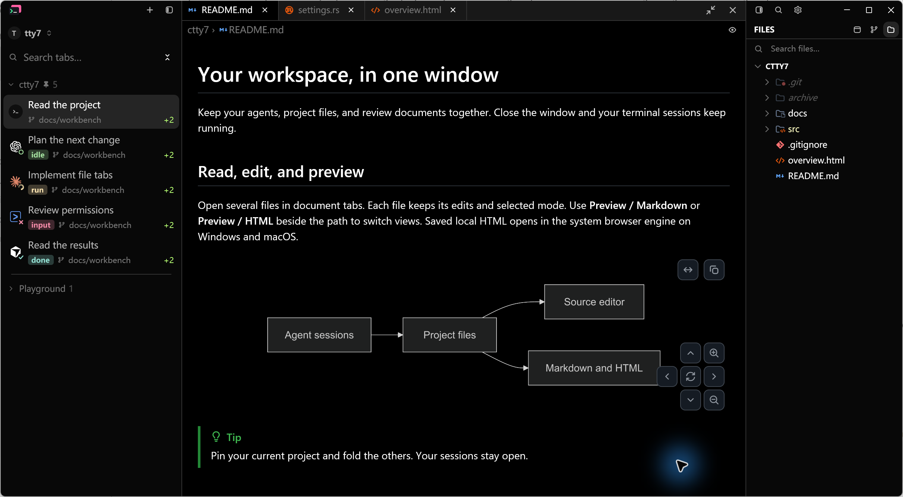
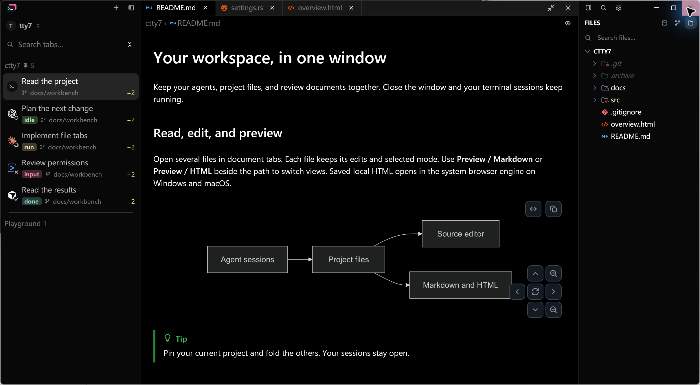
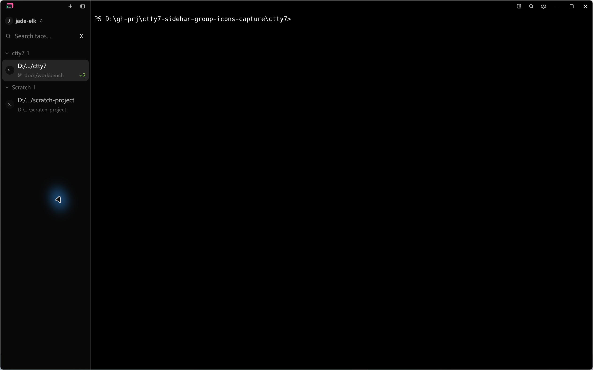
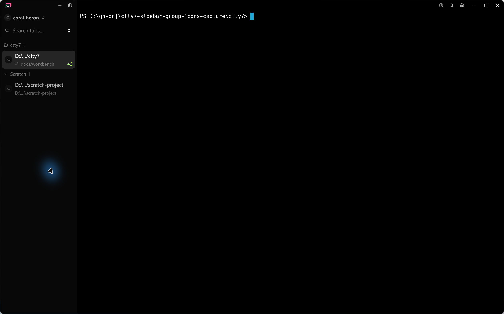

# Sidebar group icons: native UI evidence

Captured on Windows 11 on 2026-10-30 through LCU from the running debug
application (`--features markdown-visual-tests`). Each image is the Alt+Print
clipboard capture of the active window saved as PNG, without cropping,
retouching or compositing.

- Before: `main` at `ddd81dfa`, built from a detached worktree of that commit.
- After: the feature commits on `feat/sidebar-group-icons` (`8f17adb4` adds the
  settings; the capture commits add the images below).
- Each pair runs its own isolated config directory with the built-in Dark
  preset, 175% display scale and the same input sequence in both instances.
- The settings and sidebar pairs use the `--document-visual` workspace fixture:
  a 1380 x 760 logical viewport with the sample `ctty7` project and a folded
  `Playground` group. Those captures are 2419 x 1332 pixels including the
  native border.
- The project-and-Scratch pair runs a normal session with
  `sidebar_grouping = repo`, a custom working directory and one project opened
  with `--open-path`, in the default window size, 1442 x 901 logical or
  2524 x 1577 pixels. Before runs the baseline with no icon settings; After
  adds only `sidebar_group_arrows = false` and `sidebar_group_folders = true`.
  Both runs click the `Scratch` heading twice to fold and unfold it, then click
  the empty sidebar area before the capture.

## Settings

The pair starts at the same scroll position. Inspect the sidebar grouping row
and the two switches immediately below it.

| Before | After |
| --- | --- |
|  |  |

## Sidebar headings

Inspect the expanded `ctty7` and collapsed `Playground` headings. Before shows
the arrow alone; the After images show arrow plus folder, the open and closed
folder states, and both icon styles hidden.

| Before: arrow only | After: arrow and folder |
| --- | --- |
|  |  |

| After: folder only, open and closed | After: neither icon |
| --- | --- |
|  |  |

## Project and Scratch

Inspect the two headings. Before shows an arrow on `ctty7` and on `Scratch`.
After shows an open folder on `ctty7`, while `Scratch` keeps its arrow: folder
icons apply to project groups only, so the Scratch heading keeps the arrow as
its state cue. Headings stay clickable with the arrows hidden.

| Before: arrows on both headings | After: folder on the project, Scratch keeps its arrow |
| --- | --- |
|  |  |

## Verification

- `cargo test --locked --offline -p tty7-core sidebar_group_icons_preserve_old_defaults_and_round_trip_all_choices`
- `cargo test --locked --offline --bin tty7-app ui::tab_sidebar::tests` and `ui::settings::tests`
- `cargo fmt --all -- --check` and `git diff --check`

The captures cover Windows in the dark theme. The light theme, macOS and Linux
were not checked manually.
