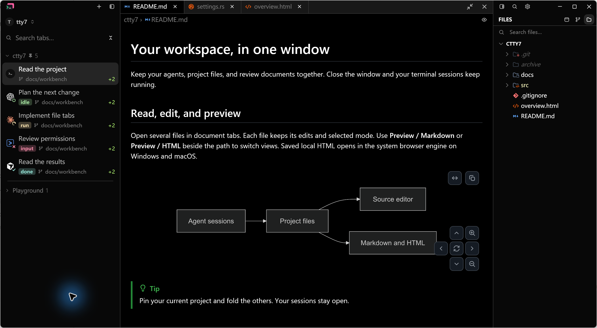
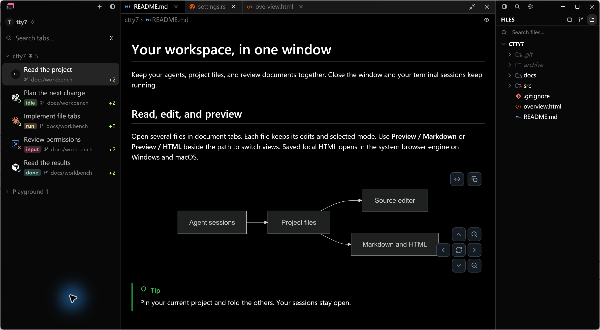
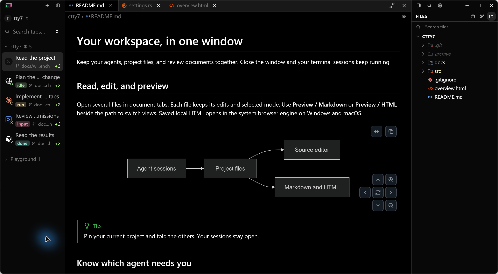
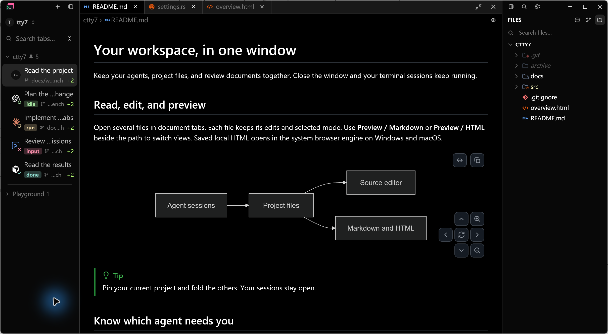
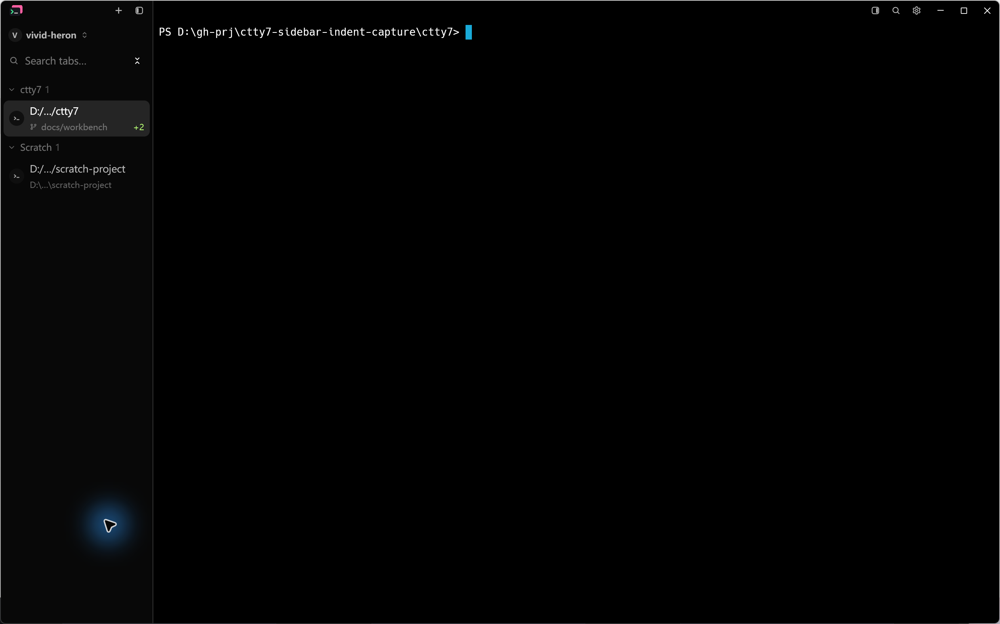
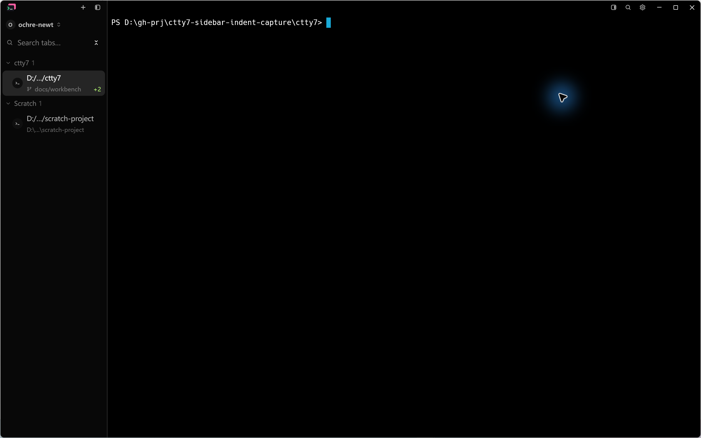

# Sidebar sessions indent under their group header

Rows that sit under a sidebar group header now indent their avatar and text by
12 px, so the sessions read as children of the header. The row itself keeps its
full width: the selected background and the click target are unchanged, and the
text budget shrinks by the same 12 px so long titles elide instead of
overflowing. A flat sidebar (grouping off) has no header and is not indented.

## Native Windows evidence

Captured on Windows 11 on 2026-10-30 through LCU from the running debug
application (`--features markdown-visual-tests`). Each image is the Alt+Print
clipboard capture of the active window saved as PNG, without cropping,
retouching or compositing.

- Before: `fork/main` at `f8b9afcd21710200c99e79c517929d8e18e87d65`, built
  from a detached worktree of that commit.
- After: this change on top of the same commit.
- Both binaries run with their own isolated config directory, the built-in Dark
  preset and 175% display scale. The default and narrow pairs use the
  `--document-visual` workspace fixture: a 1380 x 760 logical viewport with the
  sample `ctty7` project (five sessions) and a folded `Playground` group.
  Captured images are 2419 x 1332 pixels including the native border.
- Both instances receive the same input: one click on the empty sidebar area
  below the rows to settle focus, then the capture. The narrow pair first drags
  the sidebar edge from 277 px to 179 px, which leaves a 180 px sidebar.
- The project-and-Scratch pair runs a normal session with
  `sidebar_grouping = repo`, a custom working directory and one project opened
  with `--open-path`, in the window's default size (2524 x 1577 pixels).

### Default sidebar width

Inspect the five `ctty7` rows: avatar and title move right by 12 px, the
selected `Read the project` background still starts at the sidebar edge and
spans the full row, and the `ctty7` and `Playground` headers do not move.

| Before | After |
| --- | --- |
|  |  |

### 180 px sidebar

Titles and branch lines elide against a budget reduced by the indent; nothing
reaches the right edge of the sidebar.

| Before | After |
| --- | --- |
|  |  |

### Project and Scratch groups

Both named groups indent their rows; the group headers keep their position.

| Before | After |
| --- | --- |
|  |  |

## Verification

- `cargo test --locked --offline --workspace -- --test-threads=4`: every suite
  passes (1822 `tty7-app`, 138 `tty7` CLI and 1222 `tty7-core` unit tests plus
  the integration crates).
- `ui::tab_sidebar::tests::grouped_rows_indent_their_contents_but_keep_the_full_click_target`
  measures the row and avatar bounds through debug selectors with grouping on
  and off: the row keeps its left edge and width, the avatar moves by exactly
  12 px, and a click 2 px inside the row's left edge still activates the tab.
- `cargo fmt --all -- --check` and `git diff --check`: clean.

The flat (ungrouped) sidebar is covered by the test only; no screenshot pair was
taken for it. The light theme, macOS and Linux were not checked manually.
