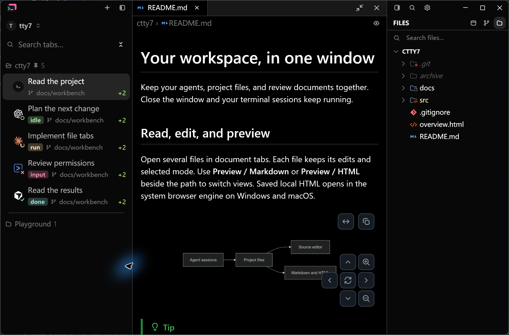
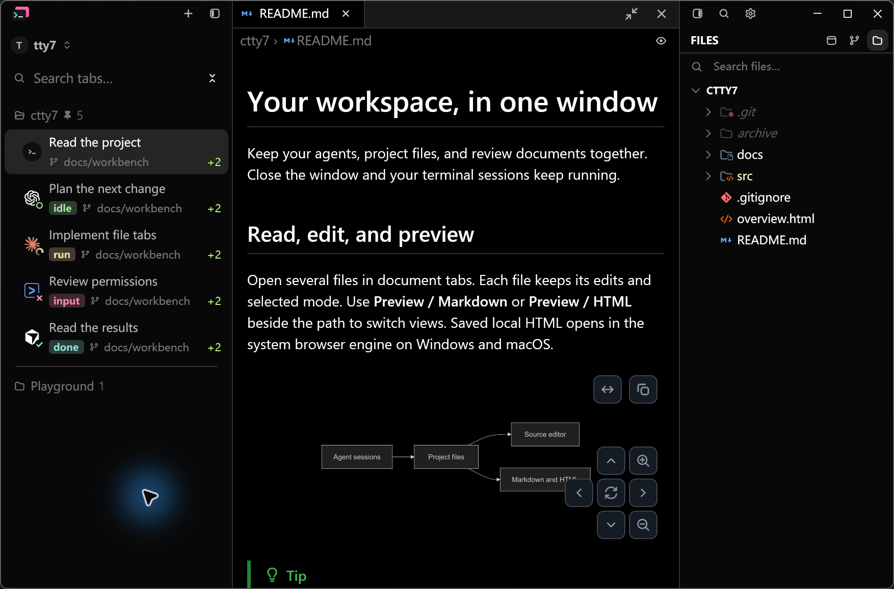
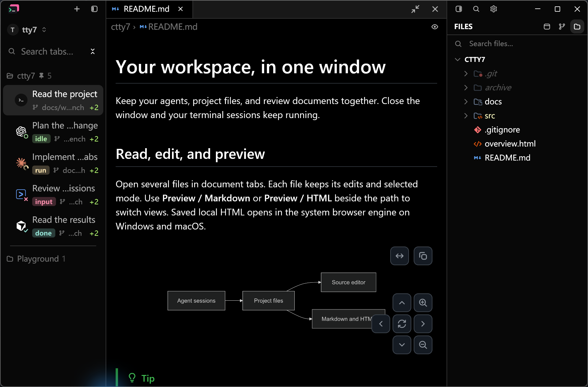
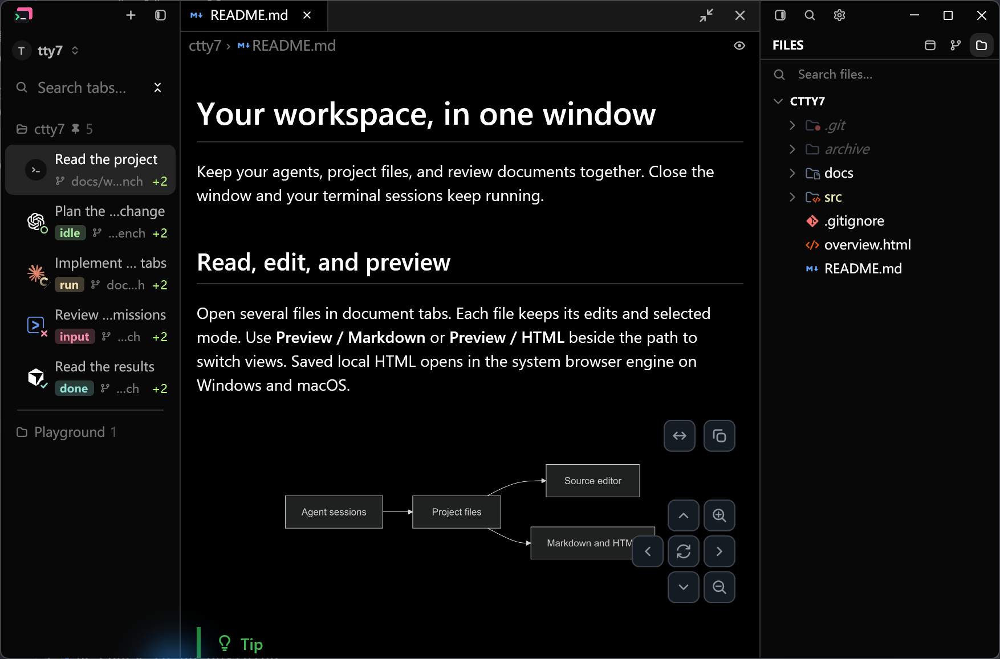
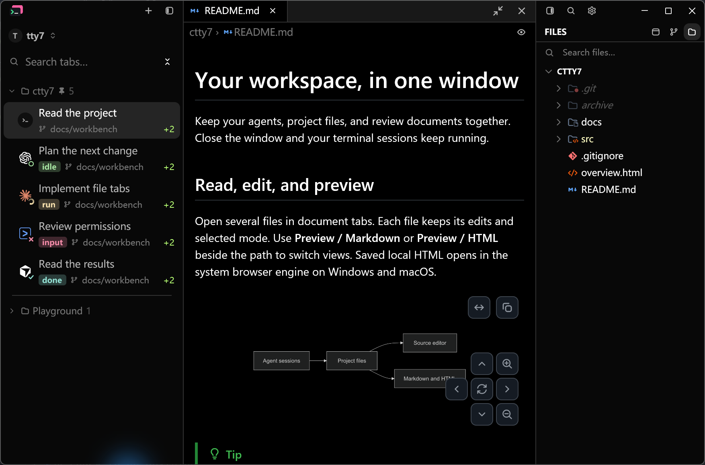
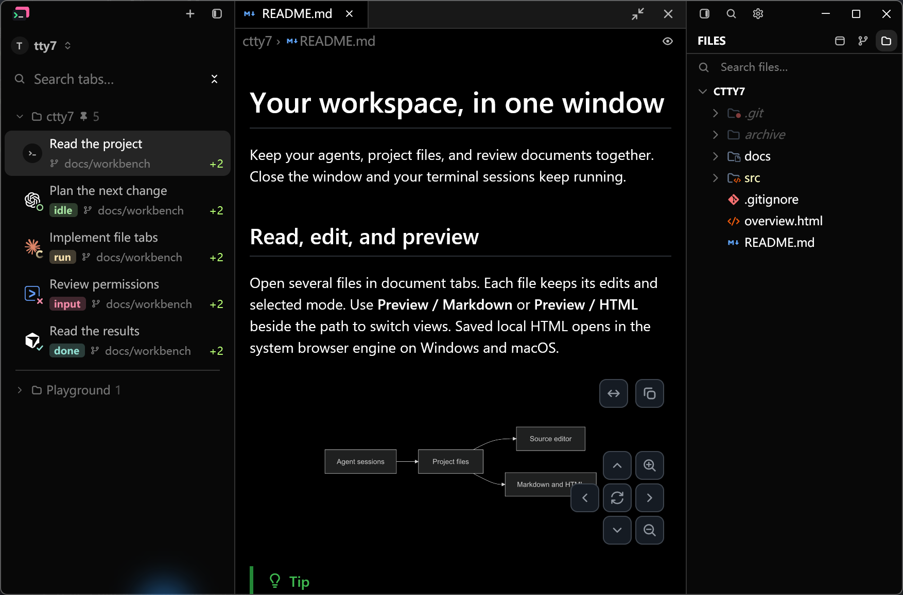

# Sidebar tab title font size acceptance

## Visual hierarchy tuning, 2026-10-31

In the vertical tab sidebar, tab rows render as multi-line cards containing an
agent avatar, a tab title, a status badge (11px, `STATUS_REM`), and a 12px
(`text_xs`) git branch or cwd path.

Previously, tab titles rendered at 14px (`text_sm` / `0.875 * rem`). In a
dense sidebar layout (~200–250px total rail width):
1. **Hierarchy inversion**: Group headers (`ctty7 3`) are set to 13px (`px(13.)`).
   Having child tab titles at 14px created an inverted size step where child items
   dominated the parent section headers.
2. **Horizontal truncation**: Long command arguments and process descriptions
   (e.g. `... --dangerously-skip-permissions`) truncated prematurely due to the
   wider 14px glyphs.
3. **Weight imbalance**: In multi-line cards, 14px title text paired with 11px
   status tags and 12px branch names made the top line feel visually bulky
   relative to the compact metadata underneath.

This revision adjusts tab title size from `14px` (`0.875 * rem`) to `13px` (`TITLE_REM = 0.8125`):
- **Group Header**: 13 px (`px(13.)`, medium)
- **Tab Title**: 13 px (`TITLE_REM * rem` / `px(title_size)`, regular resting / medium active)
- **Tab Metadata (Branch / CWD)**: 12 px (`0.75 * rem` / `text_xs`, muted)
- **Status tag**: 11 px (`STATUS_REM * rem`, semibold)

The text measurement budget calculation and element rendering both consume
`TITLE_REM`, ensuring that label elision precisely matches the rendered glyphs.

## Evidence

The current Before/After pairs use the full native application with identical
sample sessions, a 1000 x 660 logical viewport, Windows 175% display scale and
the built-in Dark preset. LCU raised each fixture window and captured it with
Alt+Print; clipboard PNG exports are unmodified 1754 x 1157 pixel images.

Before uses the production sidebar from `9e8d1661` (0.9.0), with the same native
document fixture options overlay used by After. After includes both the 13px
title adjustment and the leading icon alignment fix. The fixture runs through
production `Tty7App` renderers with separate disposable config directories;
the installed application and the user's sessions are not replaced.

| Before: 14px titles, misaligned icons | After: 13px titles, aligned icons |
| --- | --- |
|  |  |
|  |  |

Inspect the title hierarchy and the narrower title elision in the 180px scene.
The original user screenshot remains at
[before-tab-title-font-size.jpg](images/tab-title-font-size/before-tab-title-font-size.jpg)
as additional context, rather than the reproducible comparison baseline.

## Leading icon alignment

The workspace avatar, search icon and first group icon previously had centers
at 21px, 19px and 16px respectively, measured from the sidebar's left edge.
Search now moves right 2px and group header contents move right 5px to share
the workspace avatar's 21px axis. Arrow-only and folder-only modes use the
same 16px leading slot; in arrow-plus-folder mode the arrow anchors the axis.
Grouped session content keeps its existing 12px indent and full row hit area.

| Mode | Before | After |
| --- | --- | --- |
| Arrow only |  |  |
| Arrow and folder |  |  |

The folder-only pairs above cover an expanded project and a folded Playground
group at 260px and 180px sidebar widths. The layout regression test also checks
Scratch's leading arrow in all three icon configurations.

To reproduce, build with `--features markdown-visual-tests`, prepare the sample
project with `python scripts/prepare-readme-captures.py <fresh-directory>`, then
use its `workspace-dark.json` options with `width: 1000`, `height: 660`, and
`files: ["README.md"]`. Set `sidebar_group_arrows`, `sidebar_group_folders` and
`sidebar_width` for each row above, then run:

```text
tty7-app --config-dir <disposable-directory> --document-visual <options.json>
```

[Capture metadata](images/sidebar-icon-alignment/captures.json) records binary
hashes, image hashes, dimensions and settings for all four pairs.

## Verification

- `cargo test --locked --offline --bin tty7-app ui::tab_sidebar::tests`: 24 passed.
- `leading_icons_share_the_workspace_axis` failed before the fix with search
  at 19px versus the workspace avatar at 21px, then passed for arrow-only,
  folder-only, arrow-plus-folder and Scratch headers.
- The existing grouped-row test confirms the 12px content indent and full row
  click target are preserved.
- `cargo build --locked --offline --bin tty7-app --features markdown-visual-tests`: passed.
- `cargo fmt --all -- --check`: passed.
- `git diff --check`: clean.

Windows Dark was checked visually. Light theme, macOS and Linux were not
checked manually. Hover tooltip title size was not captured; it shares the
same title-size value as the rendered row.
