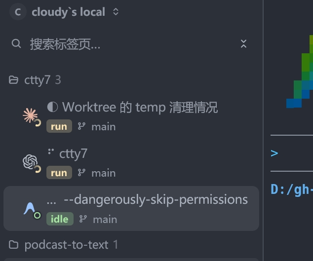

# Sidebar tab title font size acceptance

## Visual hierarchy tuning, 2026-10-31

In the vertical tab sidebar, tab rows render as multi-line cards containing an
agent avatar, a tab title, a status badge (11px, `STATUS_REM`), and a 12px
(`text_xs`) git branch or cwd path.

Previously, tab titles rendered at 14px (`text_sm` / `0.875 * rem`). In a
dense sidebar layout (~200–250px total rail width):
1. **Hierarchy inversion**: Group headers (`ctty7 3`) are set to 13px (`px(13.)`).
   Having child tab titles at 14px created an inverted size step where child items
   dominated the parent section headers.
2. **Horizontal truncation**: Long command arguments and process descriptions
   (e.g. `... --dangerously-skip-permissions`) truncated prematurely due to the
   wider 14px glyphs.
3. **Weight imbalance**: In multi-line cards, 14px title text paired with 11px
   status tags and 12px branch names made the top line feel visually bulky
   relative to the compact metadata underneath.

This revision adjusts tab title size from `14px` (`0.875 * rem`) to `13px` (`TITLE_REM = 0.8125`):
- **Group Header**: 13 px (`px(13.)`, medium)
- **Tab Title**: 13 px (`TITLE_REM * rem` / `px(title_size)`, regular resting / medium active)
- **Tab Metadata (Branch / CWD)**: 12 px (`0.75 * rem` / `text_xs`, muted)
- **Status tag**: 11 px (`STATUS_REM * rem`, semibold)

The text measurement budget calculation and element rendering both consume
`TITLE_REM`, ensuring that label elision precisely matches the rendered glyphs.

## Evidence

- **Before:** [before](images/tab-title-font-size/before-tab-title-font-size.jpg)
  

## Verification

- `cargo test --bin tty7-app ui::tab_sidebar`: 23 passed.
- `cargo fmt --all -- --check`: passed.
- `git diff --check`: clean.
