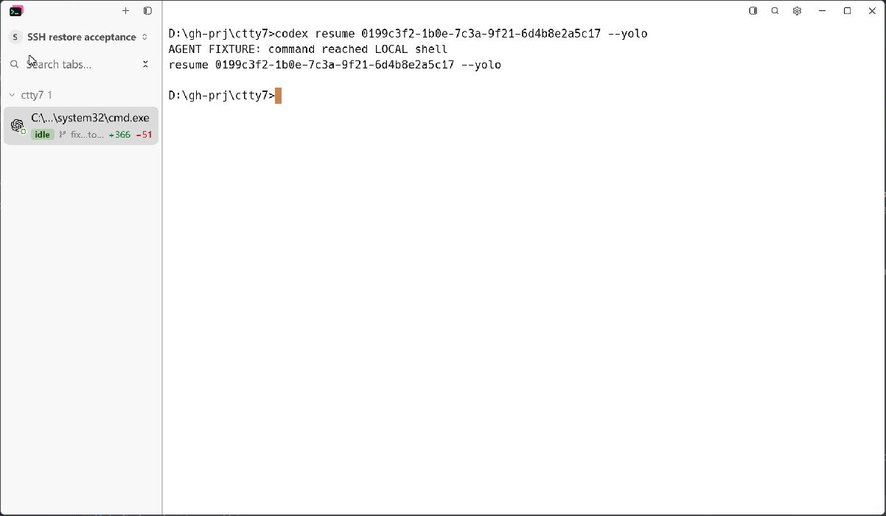
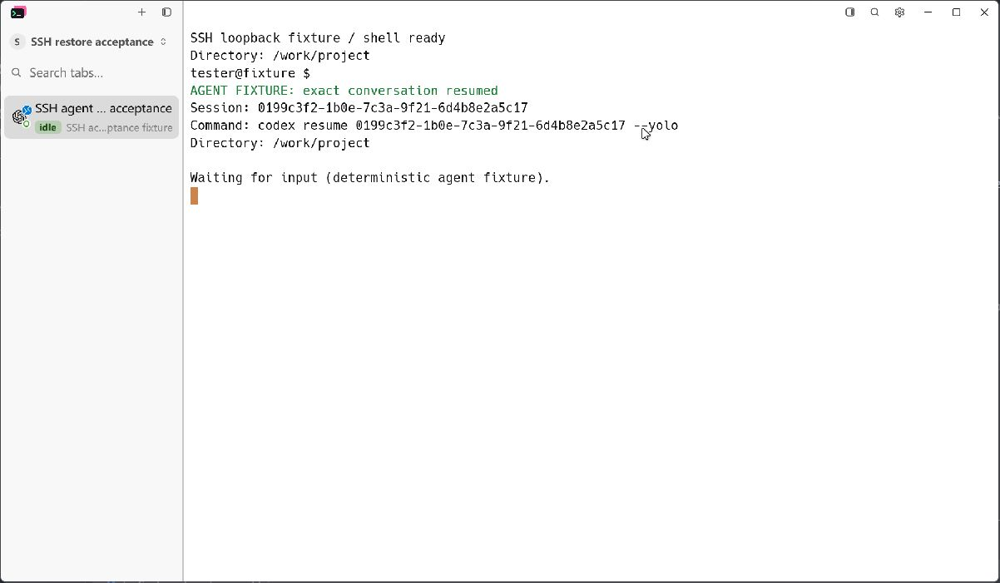
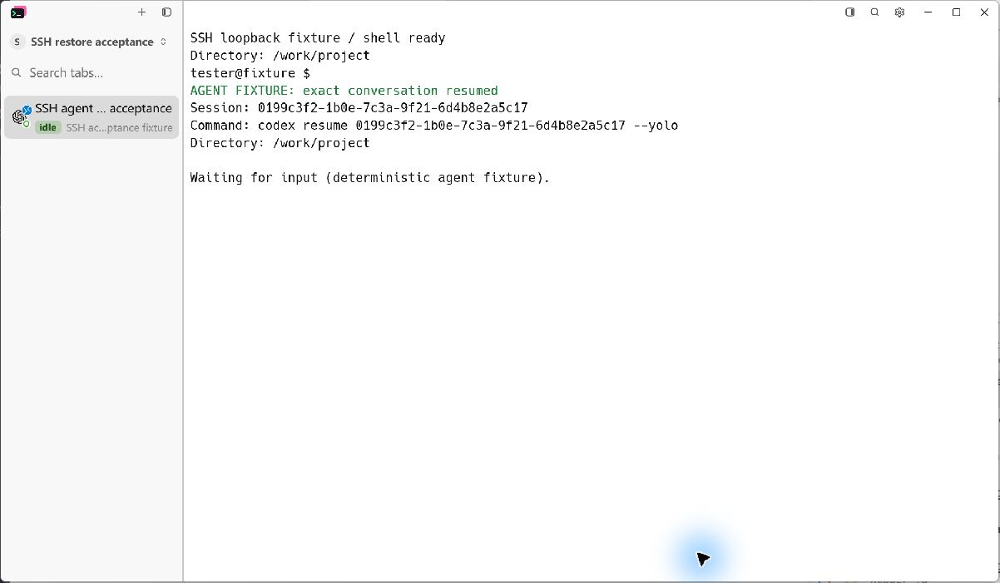
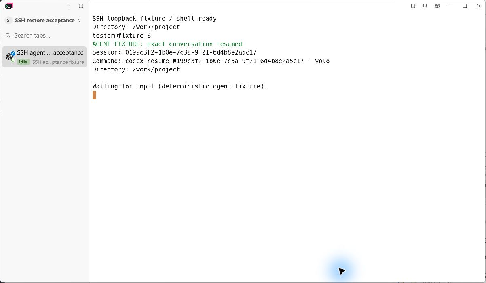

# SSH connection and agent restoration

The accepted scope has two stages: restore native SSH connections, then
restore Claude Code and Codex conversations whose exact session ID is known.
Both stages ship together in the fork pull request.

## Required behavior

- Reattach a live native SSH pane without starting another agent.
- Redial a missing SSH pane as SSH, including when an attach loses a race
  with the old pane exiting. Never send its resume command to a local shell.
- Preserve the SSH connection details across application restarts so later
  manual reconnects still work.
- Restore a known Claude Code or Codex conversation after a server restart
  and after manual SSH reconnect, preserving the original launch flags.
- Keep the known identity in the daemon while waiting for the remote shell.
  Authentication alone is not readiness: wait for the shell prompt before
  sending the queued command, even if the window has closed.
- Carry the saved remote working directory into the shell bootstrap. Paths
  must be absolute and quoted for the remote shell, never resolved locally.
- Dispatch each queued restore once. Real user input cancels a pending
  restore; terminal protocol replies do not cancel it.
- Respect `restore_agent_sessions`, session-history opt-outs, and disabled
  SSH shell integration. Unknown conversations and unsupported agents keep
  an interactive shell. Do not guess a latest session or replay an untouched
  new-agent launch in SSH.

Automatic installation of remote hooks, probing remote Codex history-picker
sessions, and resuming agents other than Claude Code and Codex are outside
this stage.

## Automated checks

```powershell
cargo test --offline --locked -p tty7-core native_ssh_resume_waits_for_the_remote_prompt_without_a_window
cargo test --offline --locked --bin tty7-app native_ssh_known_sessions_use_the_daemon_queue
cargo test --offline --locked --bin tty7-app ineligible_native_ssh_agent_restores_leave_an_interactive_shell
cargo test --offline --locked
cargo fmt --check
```

The daemon regression failed before the prompt gate: it observed a resume
command immediately after authentication. Its startup-command extension also
failed before the readiness fix with `command completion is not a prompt`.
Both pass after the queued restore waits for an actual OSC 133 A/B prompt.
The same check verifies that startup command cycles preserve the exact
conversation identity and that user input cancels a queued restore.

On Windows, the final `cargo test --offline --locked` run passed 3,187 tests,
with zero failures and 12 existing ignored tests. The application build,
`cargo fmt --check`, and `git diff --check` also passed.

## Native application evidence

The captures use the production Windows application and native SSH transport
against a loopback SSH server. The remote agent is a deterministic fixture;
it reports the exact command, conversation ID, and remote working directory.
It does not contact an agent service or use account credentials.

```powershell
python -m pip install --target target/ssh-evidence-python paramiko==3.5.1
python scripts/ssh-agent-resume-acceptance.py --binary <binary> --phase before --output target/ssh-agent-resume-captures
```

Repeat with the changed binary and `--phase after`. Both runs use the same
1200 by 700 window (1202 by 701 including native borders), display scale,
fixture endpoint, saved layout, and settings. The initial saved machine tree
names a missing SSH pane, reproducing the state after a daemon restart.
Capture the native window with LCU. Touch `disconnect` in the after directory
and invoke SSH Reconnect to verify a second restore. Touch `reopen` to restart
only the GUI and verify that it reattaches to the live pane. Touch `stop` to
cleanly stop only that run's application and daemon.

Inspect the Before capture for the resume command reaching a local shell.
Inspect the After captures for SSH identity, the exact remote resume command,
and `/work/project`. Screenshots live in `images/ssh-agent-resume/`.

Before: the old restore path sends the remote conversation's resume command
to a local Windows shell.



After: the missing pane is redialed as SSH; the exact ID, `--yolo`, and remote
working directory reach the fixture.



After manual reconnect: the same exact conversation resumes in the same
remote directory. The fixture recorded exactly one resume per connection.



After reopening the GUI: the existing pane and its output return. The fixture
still recorded two shell starts and two resumes in total (initial restore
and manual reconnect); reopening added neither a shell nor an agent launch.



The final rebuilt executable was also run against a fresh fixture directory;
its recorded resume ID, launch flags, and remote directory matched the above.

## Review

- Standards review found obsolete SSH propagation after the new dedicated
  restore branch and a stale fallback comment; both were removed or updated.
- Spec review found that command-completed marks could dispatch before the
  first prompt; the failing startup-command regression now passes.
- The full suite exposed a missing Claude `--no-session-persistence` opt-out;
  the shared command builder now respects it, and the ineligible-restore test
  passes.

## Known limitations

- Real Claude Code and Codex service sessions require their histories and
  hooks on the remote machine; the loopback fixture does not validate those
  external services.
- Shell integration must be enabled and supported by the remote shell.
