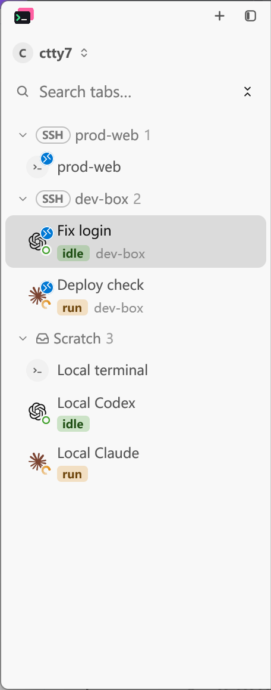
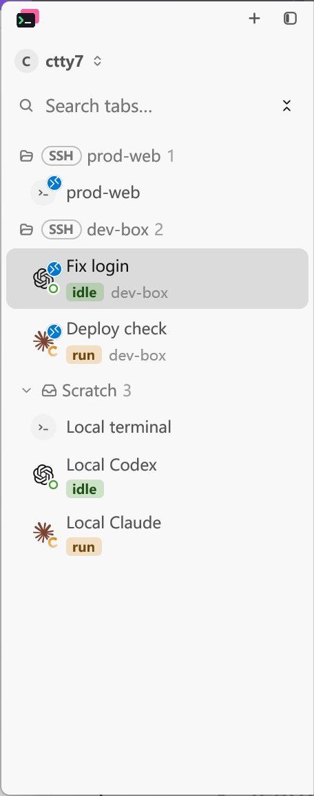

# SSH group icon settings

SSH host groups use the same arrow and folder settings as local project
groups, including when collapsed. The regression test renders both groups
with all four arrow/folder combinations in expanded and collapsed states.

```text
cargo test --locked --offline --bin tty7-app ui::tab_sidebar::tests -- --test-threads=1
cargo fmt --all -- --check
git diff --check
```

Before the fix, `ssh_group_icons_follow_the_same_settings_as_project_groups`
failed on the SSH header with `collapsed=false, arrows=false, folders=true`:
the arrow was present when it should have been absent.

## Native reproduction

Build with `cargo build --locked --features markdown-visual-tests --bin tty7-app`,
then launch `tty7-app --config-dir <isolated-config> --ssh-tab-visual options.json`.
Use the same options for the baseline and fixed builds:

```json
{
  "sidebar": true,
  "output": "capture.png",
  "hold_seconds": 1200,
  "sidebar_group_arrows": false,
  "sidebar_group_folders": true
}
```

Inspect the `prod-web` and `dev-box` group headers. The baseline retains
arrows; the fixed build shows open folders. This fixture uses production
GPUI rendering and deterministic daemon messages without a live SSH connection.

## Native evidence

Captured on Windows on 2026-11-05 through LCU, using `Alt+Print` to capture
the active native application window. The clipboard image was saved as PNG
and cropped to the same sidebar rectangle in both captures: `(0, 0, 456, 1157)`
physical pixels. There is no resizing, retouching or compositing. The crop
excludes an unrelated desktop reminder over the terminal pane.

Both captures use the light theme, 175% display scale, a 1200 x 660 logical
viewport (2104 x 1157 physical pixels including the native frame), the same
six-session fixture, expanded groups, and the active `Fix login` session.
The pointer was moved into the terminal pane, outside the sidebar capture
region, before each capture. Both saved images were inspected: neither has
a visible pointer or unrelated reminder.

- Before: the preserved `0e1bbe15` build with the icon-options fixture overlay.
  Its production `src/ui/tab_sidebar.rs` is byte-identical to PR base
  `fae21972` (Git blob `f5c7878945b6d7ec20a81568d92d63f151afc4d1`).
- After: PR code at `0bd50f4a`, built from the isolated PR worktree.

Inspect the leading icons beside `prod-web` and `dev-box`: Before shows
arrows despite arrows being disabled; After shows open folders. Scratch
retains its existing fallback arrow and inbox icon.

| Before | After |
| --- | --- |
|  |  |

## Known limitations

Manual visual verification covers expanded groups with folder icons enabled
and arrows disabled on Windows in the light theme. Other icon combinations
and collapsed states are covered by the rendering regression test. A live
SSH connection, dark theme, macOS and Linux were not checked manually.
