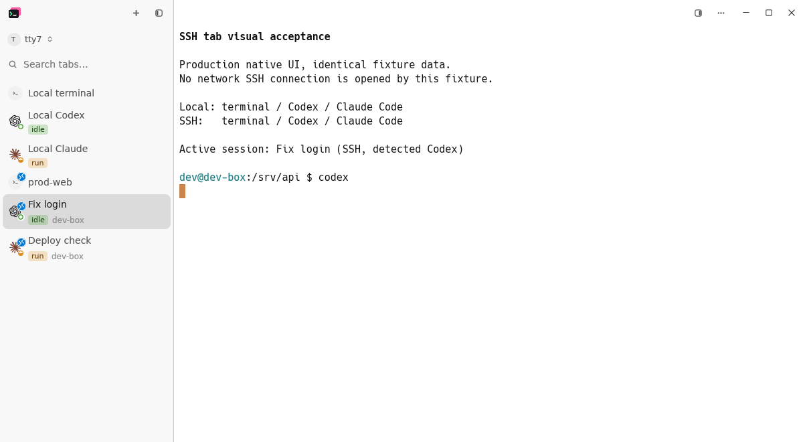
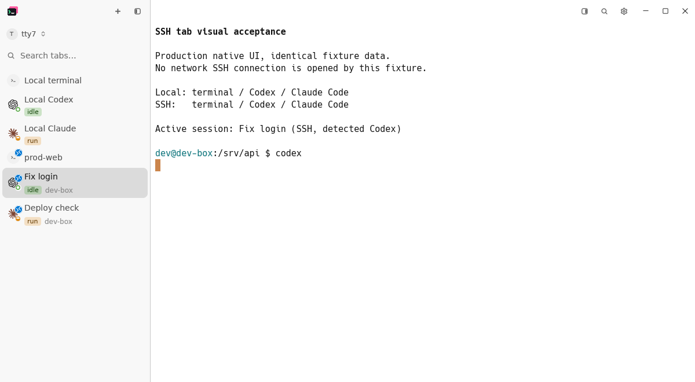

# Direct titlebar actions acceptance

## Scope

对应规格 cloudy-liu/ctty7#198、实现任务 cloudy-liu/ctty7#199 和 PR cloudy-liu/ctty7#200。

将标题栏两项「…」菜单替换为命令搜索和设置齿轮，顺序为详情面板、搜索、设置、平台窗口控制。复用现有 32 像素按钮、13 像素图标、2 像素按钮间距和悬停反馈，不添加竖向分隔线或其他分组装饰。

## Native evidence

| Before | After |
| --- | --- |
|  |  |

截图来自 [PR 首轮 Linux 原生界面 CI](https://github.com/cloudy-liu/ctty7/actions/runs/40053872962)，使用实际 GPUI 应用、相同的演示会话、1200 × 660 视口和浅色外观，没有建立真实 SSH 连接。原图保留全部像素，未重新绘制或缩放。

修改前的源版本为 `b0b57316`；修改后的源版本为 PR 测试合并 `5861505c`，包含首次实现提交 `aa2df71d`。已检查侧栏标签和顶部标签两种截图，右上角图标尺寸及间距一致，没有新增分隔装饰。后续修正只涉及无障碍激活节点与快捷键提示数据，没有修改绘制样式；本组图片用于证明入口布局，不用于证明后续语义或多段提示的运行行为。

## Behavior evidence

- 搜索入口的测试先因按钮不存在而失败；加入按钮后，一次点击打开命令面板，Esc 关闭并恢复原焦点。
- 设置入口的测试先因齿轮不存在而失败；加入后，一次点击打开现有设置，现有快捷键继续工作。
- 文档角落测试先因旧的两个按钮宽度预留而失败；改为三个按钮预留后，代码与 diff 文档的布局检查通过。
- 文档测试还发现焦点停在已隐藏视图时，通用动作分发可能错过应用处理器；直接复用现有处理器后，保留的点击断言通过。
- 渲染后的窗口交互覆盖顶部或侧栏标签、侧栏收起、最窄详情面板、16／24 号界面字号、720 像素窗口，以及 560／360 像素文档窗口。检查实际按钮范围、原有间距、文档工具按钮分离及拖动手势。
- 快捷键回归覆盖默认、自定义和清空绑定，以及从命令面板打开设置、从停靠或填满工作区的源码编辑器返回焦点。

## Review fixes

无障碍名称、按钮角色和点击处理现在属于同一个状态节点。固定版本的 GPUI 会为具有点击监听器的节点公布 Click 操作，并将该操作转换为节点中心的鼠标点击。原有图标按钮继续负责绘制、悬停和避免鼠标按下时抢走焦点；不新增控件、依赖或测试框架。

多段快捷键提示由共用 UI 提示格式化入口处理，保留每一段按键；清空绑定时仍只显示操作名称。窗口测试检查传给提示控件的完整文本，并实际输入两段快捷键，验证只输入第一段不会提前打开面板。这是提示数据与输入路由证据，不等同于读取已经绘制的提示浮层。

## Validation

- 审查修正后的 `ui::app::titlebar_action_tests`：6 项通过，包含完整按键序列提示数据、分段执行、清空绑定、点击、焦点、尺寸、间距和拖动手势。
- 初轮相关回归：文档布局 14 项、标题栏 35 项、窗口拖动 7 项、快捷键 24 项，全部通过；原生视觉测试入口编译通过。
- 初轮完整工作区回归：3,162 项通过、0 失败、12 项既有测试忽略。新增多段提示用例先因实际结果只有第一段而失败，修正后通过。
- 格式检查与 host boundary 检查通过。最终工作区回归、生产构建与最新各平台 CI 的结果记录在 [PR Evidence](https://github.com/cloudy-liu/ctty7/pull/200)。

可在已配置 MSVC 的 Windows 环境中复现：

```powershell
cargo fmt --all -- --check
cargo test --locked --bin tty7-app ui::app::titlebar_action_tests -- --test-threads=1
cargo test --locked --bin tty7-app ui::document_column::gpui_tests -- --test-threads=1
cargo test --locked --workspace -- --test-threads=1
cargo build --locked --workspace
```

## Limits

本地 computer-use 连接在重试和重置后仍不可用，未进行本地 Windows 原生截图或真实屏幕阅读器验收。当前 GPUI 测试版本也没有公开的无障碍树查询、无障碍动作注入或已绘制提示文本读取接口；没有为本次小改动新增这些底层测试能力。Linux 截图证明浅色入口布局，不代表 Windows、macOS 或深色原生界面的现场验收。
