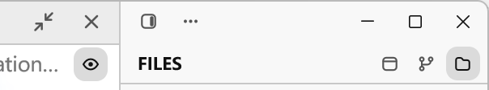
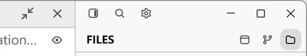
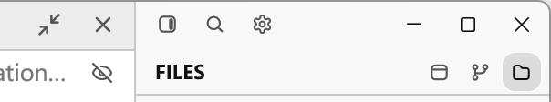

# Direct titlebar actions and flat preview control

The titlebar now exposes the detail-panel toggle, command search, and settings
in that order. Search and settings replace the two-item overflow menu and open
their existing application views in one click. The buttons retain the current
28px targets, 13px glyphs, transparent resting background, and 2px gaps. The
shared trailing-width reservation includes all three buttons.

The document preview toggle uses its existing eye / eye-off icons to show the
current state. Both states now have a transparent resting background instead of
the selected-state gray fill. Hover and press feedback and the existing action
tooltips remain available.

This restores the direct-entry design from `aa2df71d` / `80254e35`, adapted to
the compact chrome merged afterward. It supersedes the menu-only decision
recorded in [the earlier spec](../specs/titlebar-menu-icons.md).

## Native evidence

These are captures of the running Windows GPUI application, driven through LCU.
The native active-window screenshot shortcut exports the image to the clipboard;
the resulting PNG is saved without resizing or redrawing. Before uses the
pre-change local v0.8.1 executable preserved before editing; After uses the
current source and the local validation build below.

Both scenes use the production `--document-visual` fixture, separate scratch
configuration directories, the same `tests/fixtures/document-tabs` root and
`docs/maintenance/migration.md` document, Preview mode, Fill layout, a visible
Files panel with its root collapsed, and the light theme. The viewport is
1000 by 640 logical pixels at a 1.75 display scale. Full captures are 1754 by
1122 physical pixels, including the native frame.

The details below are identical 604 by 112 crops at physical coordinates
`(1150, 0)` in each full capture. Inspect the direct search and settings glyphs
in the upper row and the preview eye's transparent resting background below.

| Before | After |
| --- | --- |
|  |  |

Full captures: [Before](images/titlebar-direct-actions/before-light.png) and
[After](images/titlebar-direct-actions/after-light.png).

Source mode retains the same transparent background and shows the slashed eye:



[Full source-mode capture](images/titlebar-direct-actions/after-source.png).

## Verification

- Formatting and `git diff --check` pass.
- LCU interaction checks confirm that search and settings each open with one
  click, Escape closes them, and clicking the preview eye switches to source
  with a transparent eye-off icon.
- 129 related tests pass, with zero failures and two intentionally ignored
  manual performance tests. Coverage includes rendered titlebar clicks, focus
  restoration, shortcuts, window dragging, tab layouts, narrow document controls,
  document preview switching, and document Fill / Dock layouts.
- The native application builds with the command below. Only the application
  optimization level and codegen unit count are overridden for local validation;
  dependencies and the existing LTO linkage are retained.

```powershell
cargo rustc --release --locked --features markdown-visual-tests --bin tty7-app -- -C opt-level=0 -C codegen-units=16
cargo test --release --locked --features markdown-visual-tests --config 'profile.release.package.tty7.opt-level=0' --config 'profile.release.package.tty7.codegen-units=16' --bin tty7-app -- ui::app::titlebar_action_tests ui::document_column::gpui_tests ui::tab_strip::tests ui::app::window_drag_tests ui::keymap::tests ui::code_editor:: --test-threads=1
```

## Known limitations

Native appearance was inspected on Windows in the light theme. macOS, Linux,
and dark-theme appearance were not captured locally. A fully optimized release
build was not completed in this pass; the local validation build preserves the
same production UI and action paths.
