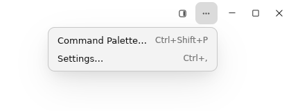
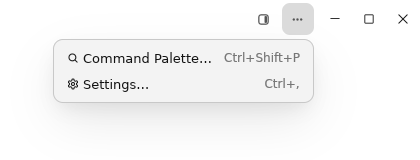

# Titlebar app menu icons acceptance

## Scope

对应规格 cloudy-liu/ctty7#198、实施任务 cloudy-liu/ctty7#199 和 PR cloudy-liu/ctty7#200。

保留原有标题栏三个点，在展开菜单的「Command Palette…」文字前添加搜索图标，在「Settings…」文字前添加齿轮。复用菜单组件现有的图标栏、样式与动作分发。

## Verification

本次修改只给两个已有菜单项指定图标。标题栏、应用动作处理器、快捷键格式化入口和文档布局应与 PR 基线保持一致；不保留独立标题栏按钮实现和对应测试。

使用项目已有的检查入口：

```powershell
cargo fmt --all -- --check
cargo test --locked --bin tty7-app ui::tab_strip::tests -- --test-threads=1
cargo test --locked --bin tty7-app ui::document_column::gpui_tests -- --test-threads=1
cargo test --locked --bin tty7-app ui::app::window_drag_tests -- --test-threads=1
cargo test --locked --bin tty7-app ui::keymap::tests -- --test-threads=1
cargo build --locked --bin tty7-app
```

最终执行结果及对应提交记录在 [PR Evidence](https://github.com/cloudy-liu/ctty7/pull/200)。检查应针对最终菜单图标实现；之前独立标题栏按钮的测试与截图不能作为本次菜单图标验收证据。

## Visual acceptance

| Before | After |
| --- | --- |
|  |  |

完整原图：[修改前](images/titlebar-menu-icons/before-menu-full.png)、[修改后](images/titlebar-menu-icons/after-menu-full.png)。

截图来自 [Linux 原生界面 CI](https://github.com/cloudy-liu/ctty7/actions/runs/40081966798) 的 `native-ssh-tabs-before-after` 产物。两版均运行实际 GPUI 应用，使用相同演示数据、浅色主题和 1200 × 660 窗口，通过真实的三个点按钮展开菜单；没有建立真实 SSH 连接。

修改前为 PR 基线 `b0b573163c0fc3f30b34f57500511d2ef9aa2ad6`；修改后为测试合并提交 `83b82d693ee00401b7d762af164a39d49cdd3892`，其父提交为同一基线和当前实现 `d2f2433ed2588a82741fd2e3225317e1f3cb561f`。

上表只从两张原图相同位置裁切菜单区域（左 780、上 0、宽 420、高 160 像素），没有重绘或缩放。完整原图与 CI 原始文件逐字节一致。

已检查顶部与侧栏布局的展开菜单：新增搜索和齿轮清晰完整，文字与右侧快捷键的位置保持一致，菜单项高度一致，标题栏继续使用原来的两个按钮，没有新增分隔线。采集脚本现在同时保留菜单关闭和展开后的原生截图，便于后续 PR 直接比较。

## Limits

本组截图验证 Linux／X11 浅色原生界面；没有将其作为 Windows、macOS、深色主题或屏幕阅读器的现场验收证据。
