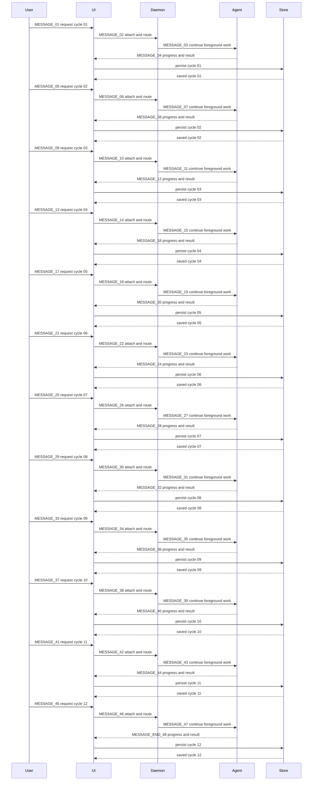
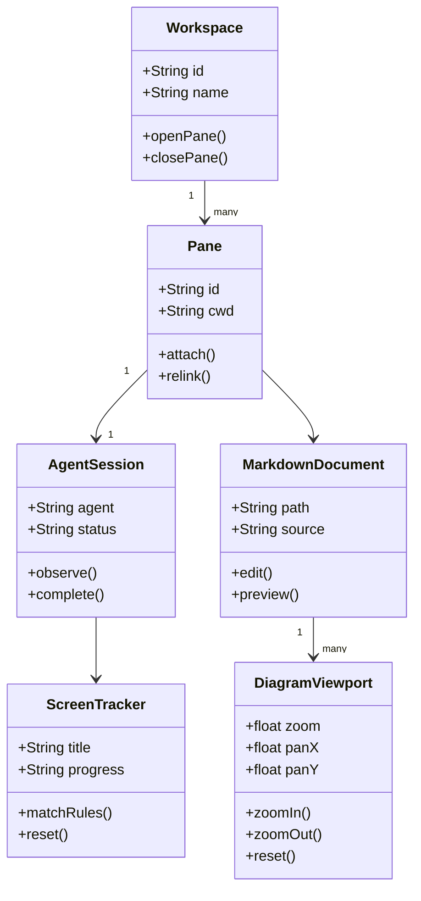
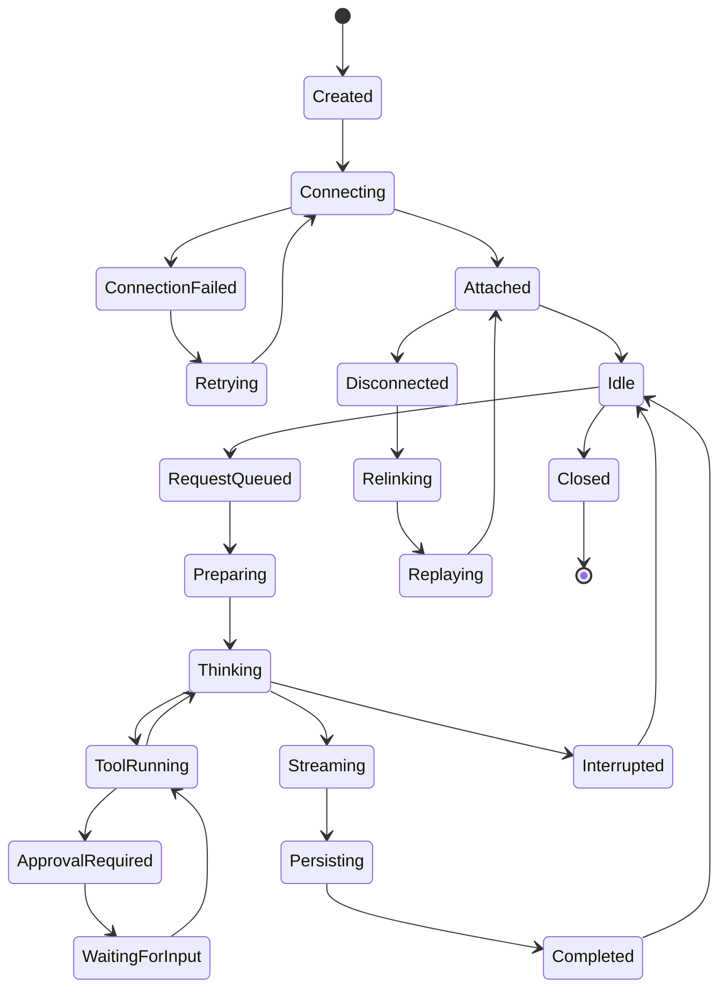
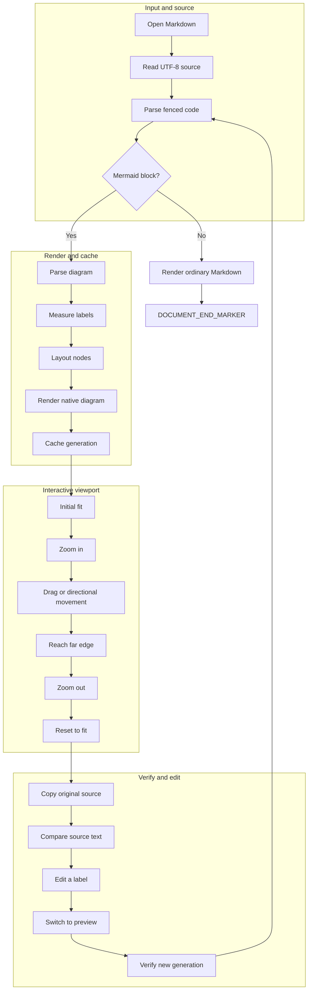

# Markdown and Mermaid manual stress test

这是一份原始 Markdown 测试文档，所有图表都来自下面的 Mermaid 代码块。
文档没有引用 PNG、JPG、WebP，也没有预先生成的 SVG 图片。

## How to test

1. 在 ctty7 中打开本文件，默认会进入阅读预览。
2. 点击底部的 **编辑 / Edit** 查看原始 Markdown；点击 **预览 / Preview** 返回阅读视图。
3. 在宽流程图里放大到文字清晰，拖动到最右边，找到 `WIDE_END_24`。
4. 在高流程图和长时序图里放大，拖动到最下面，找到 `TALL_END_36` 和 `MESSAGE_END_48`。
5. 测试方向按钮、缩小和复位；每张图应保留自己的缩放和平移状态。
6. 内嵌图用 Ctrl+滚轮缩放；展开视图用普通滚轮缩放。
7. 在初始大小的内嵌图上用普通滚轮，应滚动整篇文档。
8. 往下滚动到文末，找到 `DOCUMENT_END_MARKER`，再回到文首。
9. 修改任一 Mermaid 标签并切回预览，检查源码变化是否反映到图表。

## Contents

- [Wide flowchart](#wide-flowchart)
- [Tall flowchart](#tall-flowchart)
- [Long sequence](#long-sequence)
- [Class relationships](#class-relationships)
- [State transitions](#state-transitions)
- [Grouped workflow](#grouped-workflow)
- [Long table](#long-table)
- [Code blocks](#code-blocks)
- [Long document body](#long-document-body)
- [Document end](#document-end)

## Wide flowchart

24 个横向节点。用于检查放大后的左右移动、行尾可达性、方向按钮与复位。


## Tall flowchart

36 个纵向节点与四条重试分支。放大后应能拖到最底部的 TALL_END_36，缩小和复位后应仍可导航。

```mermaid
flowchart TD
  T1["TALL_START_01"]
  T2["Step 02 inspect result and continue"]
  T1 --> T2
  T3["Step 03 inspect result and continue"]
  T2 --> T3
  T4["Step 04 inspect result and continue"]
  T3 --> T4
  T5["Step 05 inspect result and continue"]
  T4 --> T5
  T6["Step 06 inspect result and continue"]
  T5 --> T6
  T7["Step 07 inspect result and continue"]
  T6 --> T7
  T8["Step 08 inspect result and continue"]
  T7 --> T8
  T9["Step 09 inspect result and continue"]
  T8 --> T9
  T10["Step 10 inspect result and continue"]
  T9 --> T10
  T11["Step 11 inspect result and continue"]
  T10 --> T11
  T12["Step 12 inspect result and continue"]
  T11 --> T12
  T13["Step 13 inspect result and continue"]
  T12 --> T13
  T14["Step 14 inspect result and continue"]
  T13 --> T14
  T15["Step 15 inspect result and continue"]
  T14 --> T15
  T16["Step 16 inspect result and continue"]
  T15 --> T16
  T17["Step 17 inspect result and continue"]
  T16 --> T17
  T18["Step 18 inspect result and continue"]
  T17 --> T18
  T19["Step 19 inspect result and continue"]
  T18 --> T19
  T20["Step 20 inspect result and continue"]
  T19 --> T20
  T21["Step 21 inspect result and continue"]
  T20 --> T21
  T22["Step 22 inspect result and continue"]
  T21 --> T22
  T23["Step 23 inspect result and continue"]
  T22 --> T23
  T24["Step 24 inspect result and continue"]
  T23 --> T24
  T25["Step 25 inspect result and continue"]
  T24 --> T25
  T26["Step 26 inspect result and continue"]
  T25 --> T26
  T27["Step 27 inspect result and continue"]
  T26 --> T27
  T28["Step 28 inspect result and continue"]
  T27 --> T28
  T29["Step 29 inspect result and continue"]
  T28 --> T29
  T30["Step 30 inspect result and continue"]
  T29 --> T30
  T31["Step 31 inspect result and continue"]
  T30 --> T31
  T32["Step 32 inspect result and continue"]
  T31 --> T32
  T33["Step 33 inspect result and continue"]
  T32 --> T33
  T34["Step 34 inspect result and continue"]
  T33 --> T34
  T35["Step 35 inspect result and continue"]
  T34 --> T35
  T36["TALL_END_36"]
  T35 --> T36
  T8 --> E8{"Retry step 08?"}
  E8 -->|Yes| T8
  E8 -->|No| T9
  T16 --> E16{"Retry step 16?"}
  E16 -->|Yes| T16
  E16 -->|No| T17
  T24 --> E24{"Retry step 24?"}
  E24 -->|Yes| T24
  E24 -->|No| T25
  T32 --> E32{"Retry step 32?"}
  E32 -->|Yes| T32
  E32 -->|No| T33
```



## Long sequence

五个参与者、12 轮交互，共 72 条消息。用于检查长图的垂直移动和最下方消息是否可达。



## Class relationships

类名、属性、方法、继承和关联用于检查较密集文字、连线及不同图表独立的视口状态。



## State transitions

状态转换、重连和权限分支用于测试复杂图表。此内容只用于渲染测试，不是程序行为规范。



## Grouped workflow

分组、分支、汇合和跨组连线，用于检查较复杂布局的移动与缩放。



## Long table

90 行、六列。用于检查表格宽度、长路径、数字、行内代码和文档滚动。

| Case | Component | Trigger | Expected observation | Source path | Result |
| --- | --- | --- | --- | --- | --- |
| CASE-001 | Inline Mermaid | zoom button | Text remains readable and the viewport repaints | `workspace/manual-tests/section-001/nested/source/markdown-stress-test.md` | Pending manual check |
| CASE-002 | Expanded Mermaid | reverse wheel | Text remains readable and the viewport repaints | `workspace/manual-tests/section-002/nested/source/markdown-stress-test.md` | Pending manual check |
| CASE-003 | Source editor | drag to far edge | Text remains readable and the viewport repaints | `workspace/manual-tests/section-003/nested/source/markdown-stress-test.md` | Pending manual check |
| CASE-004 | Document scroll | reset | Text remains readable and the viewport repaints | `workspace/manual-tests/section-004/nested/source/markdown-stress-test.md` | Pending manual check |
| CASE-005 | Theme repaint | edit source label | Text remains readable and the viewport repaints | `workspace/manual-tests/section-005/nested/source/markdown-stress-test.md` | Pending manual check |
| CASE-006 | Diagram cache | scroll to next section | Text remains readable and the viewport repaints | `workspace/manual-tests/section-006/nested/source/markdown-stress-test.md` | Pending manual check |
| CASE-007 | Inline Mermaid | zoom button | Text remains readable and the viewport repaints | `workspace/manual-tests/section-007/nested/source/markdown-stress-test.md` | Pending manual check |
| CASE-008 | Expanded Mermaid | reverse wheel | Text remains readable and the viewport repaints | `workspace/manual-tests/section-008/nested/source/markdown-stress-test.md` | Pending manual check |
| CASE-009 | Source editor | drag to far edge | Text remains readable and the viewport repaints | `workspace/manual-tests/section-009/nested/source/markdown-stress-test.md` | Pending manual check |
| CASE-010 | Document scroll | reset | Text remains readable and the viewport repaints | `workspace/manual-tests/section-010/nested/source/markdown-stress-test.md` | Pending manual check |
| CASE-011 | Theme repaint | edit source label | Text remains readable and the viewport repaints | `workspace/manual-tests/section-011/nested/source/markdown-stress-test.md` | Pending manual check |
| CASE-012 | Diagram cache | scroll to next section | Text remains readable and the viewport repaints | `workspace/manual-tests/section-012/nested/source/markdown-stress-test.md` | Pending manual check |
| CASE-013 | Inline Mermaid | zoom button | Text remains readable and the viewport repaints | `workspace/manual-tests/section-013/nested/source/markdown-stress-test.md` | Pending manual check |
| CASE-014 | Expanded Mermaid | reverse wheel | Text remains readable and the viewport repaints | `workspace/manual-tests/section-014/nested/source/markdown-stress-test.md` | Pending manual check |
| CASE-015 | Source editor | drag to far edge | Text remains readable and the viewport repaints | `workspace/manual-tests/section-015/nested/source/markdown-stress-test.md` | Pending manual check |
| CASE-016 | Document scroll | reset | Text remains readable and the viewport repaints | `workspace/manual-tests/section-016/nested/source/markdown-stress-test.md` | Pending manual check |
| CASE-017 | Theme repaint | edit source label | Text remains readable and the viewport repaints | `workspace/manual-tests/section-017/nested/source/markdown-stress-test.md` | Pending manual check |
| CASE-018 | Diagram cache | scroll to next section | Text remains readable and the viewport repaints | `workspace/manual-tests/section-018/nested/source/markdown-stress-test.md` | Pending manual check |
| CASE-019 | Inline Mermaid | zoom button | Text remains readable and the viewport repaints | `workspace/manual-tests/section-019/nested/source/markdown-stress-test.md` | Pending manual check |
| CASE-020 | Expanded Mermaid | reverse wheel | Text remains readable and the viewport repaints | `workspace/manual-tests/section-020/nested/source/markdown-stress-test.md` | Pending manual check |
| CASE-021 | Source editor | drag to far edge | Text remains readable and the viewport repaints | `workspace/manual-tests/section-021/nested/source/markdown-stress-test.md` | Pending manual check |
| CASE-022 | Document scroll | reset | Text remains readable and the viewport repaints | `workspace/manual-tests/section-022/nested/source/markdown-stress-test.md` | Pending manual check |
| CASE-023 | Theme repaint | edit source label | Text remains readable and the viewport repaints | `workspace/manual-tests/section-023/nested/source/markdown-stress-test.md` | Pending manual check |
| CASE-024 | Diagram cache | scroll to next section | Text remains readable and the viewport repaints | `workspace/manual-tests/section-024/nested/source/markdown-stress-test.md` | Pending manual check |
| CASE-025 | Inline Mermaid | zoom button | Text remains readable and the viewport repaints | `workspace/manual-tests/section-025/nested/source/markdown-stress-test.md` | Pending manual check |
| CASE-026 | Expanded Mermaid | reverse wheel | Text remains readable and the viewport repaints | `workspace/manual-tests/section-026/nested/source/markdown-stress-test.md` | Pending manual check |
| CASE-027 | Source editor | drag to far edge | Text remains readable and the viewport repaints | `workspace/manual-tests/section-027/nested/source/markdown-stress-test.md` | Pending manual check |
| CASE-028 | Document scroll | reset | Text remains readable and the viewport repaints | `workspace/manual-tests/section-028/nested/source/markdown-stress-test.md` | Pending manual check |
| CASE-029 | Theme repaint | edit source label | Text remains readable and the viewport repaints | `workspace/manual-tests/section-029/nested/source/markdown-stress-test.md` | Pending manual check |
| CASE-030 | Diagram cache | scroll to next section | Text remains readable and the viewport repaints | `workspace/manual-tests/section-030/nested/source/markdown-stress-test.md` | Pending manual check |
| CASE-031 | Inline Mermaid | zoom button | Text remains readable and the viewport repaints | `workspace/manual-tests/section-031/nested/source/markdown-stress-test.md` | Pending manual check |
| CASE-032 | Expanded Mermaid | reverse wheel | Text remains readable and the viewport repaints | `workspace/manual-tests/section-032/nested/source/markdown-stress-test.md` | Pending manual check |
| CASE-033 | Source editor | drag to far edge | Text remains readable and the viewport repaints | `workspace/manual-tests/section-033/nested/source/markdown-stress-test.md` | Pending manual check |
| CASE-034 | Document scroll | reset | Text remains readable and the viewport repaints | `workspace/manual-tests/section-034/nested/source/markdown-stress-test.md` | Pending manual check |
| CASE-035 | Theme repaint | edit source label | Text remains readable and the viewport repaints | `workspace/manual-tests/section-035/nested/source/markdown-stress-test.md` | Pending manual check |
| CASE-036 | Diagram cache | scroll to next section | Text remains readable and the viewport repaints | `workspace/manual-tests/section-036/nested/source/markdown-stress-test.md` | Pending manual check |
| CASE-037 | Inline Mermaid | zoom button | Text remains readable and the viewport repaints | `workspace/manual-tests/section-037/nested/source/markdown-stress-test.md` | Pending manual check |
| CASE-038 | Expanded Mermaid | reverse wheel | Text remains readable and the viewport repaints | `workspace/manual-tests/section-038/nested/source/markdown-stress-test.md` | Pending manual check |
| CASE-039 | Source editor | drag to far edge | Text remains readable and the viewport repaints | `workspace/manual-tests/section-039/nested/source/markdown-stress-test.md` | Pending manual check |
| CASE-040 | Document scroll | reset | Text remains readable and the viewport repaints | `workspace/manual-tests/section-040/nested/source/markdown-stress-test.md` | Pending manual check |
| CASE-041 | Theme repaint | edit source label | Text remains readable and the viewport repaints | `workspace/manual-tests/section-041/nested/source/markdown-stress-test.md` | Pending manual check |
| CASE-042 | Diagram cache | scroll to next section | Text remains readable and the viewport repaints | `workspace/manual-tests/section-042/nested/source/markdown-stress-test.md` | Pending manual check |
| CASE-043 | Inline Mermaid | zoom button | Text remains readable and the viewport repaints | `workspace/manual-tests/section-043/nested/source/markdown-stress-test.md` | Pending manual check |
| CASE-044 | Expanded Mermaid | reverse wheel | Text remains readable and the viewport repaints | `workspace/manual-tests/section-044/nested/source/markdown-stress-test.md` | Pending manual check |
| CASE-045 | Source editor | drag to far edge | Text remains readable and the viewport repaints | `workspace/manual-tests/section-045/nested/source/markdown-stress-test.md` | Pending manual check |
| CASE-046 | Document scroll | reset | Text remains readable and the viewport repaints | `workspace/manual-tests/section-046/nested/source/markdown-stress-test.md` | Pending manual check |
| CASE-047 | Theme repaint | edit source label | Text remains readable and the viewport repaints | `workspace/manual-tests/section-047/nested/source/markdown-stress-test.md` | Pending manual check |
| CASE-048 | Diagram cache | scroll to next section | Text remains readable and the viewport repaints | `workspace/manual-tests/section-048/nested/source/markdown-stress-test.md` | Pending manual check |
| CASE-049 | Inline Mermaid | zoom button | Text remains readable and the viewport repaints | `workspace/manual-tests/section-049/nested/source/markdown-stress-test.md` | Pending manual check |
| CASE-050 | Expanded Mermaid | reverse wheel | Text remains readable and the viewport repaints | `workspace/manual-tests/section-050/nested/source/markdown-stress-test.md` | Pending manual check |
| CASE-051 | Source editor | drag to far edge | Text remains readable and the viewport repaints | `workspace/manual-tests/section-051/nested/source/markdown-stress-test.md` | Pending manual check |
| CASE-052 | Document scroll | reset | Text remains readable and the viewport repaints | `workspace/manual-tests/section-052/nested/source/markdown-stress-test.md` | Pending manual check |
| CASE-053 | Theme repaint | edit source label | Text remains readable and the viewport repaints | `workspace/manual-tests/section-053/nested/source/markdown-stress-test.md` | Pending manual check |
| CASE-054 | Diagram cache | scroll to next section | Text remains readable and the viewport repaints | `workspace/manual-tests/section-054/nested/source/markdown-stress-test.md` | Pending manual check |
| CASE-055 | Inline Mermaid | zoom button | Text remains readable and the viewport repaints | `workspace/manual-tests/section-055/nested/source/markdown-stress-test.md` | Pending manual check |
| CASE-056 | Expanded Mermaid | reverse wheel | Text remains readable and the viewport repaints | `workspace/manual-tests/section-056/nested/source/markdown-stress-test.md` | Pending manual check |
| CASE-057 | Source editor | drag to far edge | Text remains readable and the viewport repaints | `workspace/manual-tests/section-057/nested/source/markdown-stress-test.md` | Pending manual check |
| CASE-058 | Document scroll | reset | Text remains readable and the viewport repaints | `workspace/manual-tests/section-058/nested/source/markdown-stress-test.md` | Pending manual check |
| CASE-059 | Theme repaint | edit source label | Text remains readable and the viewport repaints | `workspace/manual-tests/section-059/nested/source/markdown-stress-test.md` | Pending manual check |
| CASE-060 | Diagram cache | scroll to next section | Text remains readable and the viewport repaints | `workspace/manual-tests/section-060/nested/source/markdown-stress-test.md` | Pending manual check |
| CASE-061 | Inline Mermaid | zoom button | Text remains readable and the viewport repaints | `workspace/manual-tests/section-061/nested/source/markdown-stress-test.md` | Pending manual check |
| CASE-062 | Expanded Mermaid | reverse wheel | Text remains readable and the viewport repaints | `workspace/manual-tests/section-062/nested/source/markdown-stress-test.md` | Pending manual check |
| CASE-063 | Source editor | drag to far edge | Text remains readable and the viewport repaints | `workspace/manual-tests/section-063/nested/source/markdown-stress-test.md` | Pending manual check |
| CASE-064 | Document scroll | reset | Text remains readable and the viewport repaints | `workspace/manual-tests/section-064/nested/source/markdown-stress-test.md` | Pending manual check |
| CASE-065 | Theme repaint | edit source label | Text remains readable and the viewport repaints | `workspace/manual-tests/section-065/nested/source/markdown-stress-test.md` | Pending manual check |
| CASE-066 | Diagram cache | scroll to next section | Text remains readable and the viewport repaints | `workspace/manual-tests/section-066/nested/source/markdown-stress-test.md` | Pending manual check |
| CASE-067 | Inline Mermaid | zoom button | Text remains readable and the viewport repaints | `workspace/manual-tests/section-067/nested/source/markdown-stress-test.md` | Pending manual check |
| CASE-068 | Expanded Mermaid | reverse wheel | Text remains readable and the viewport repaints | `workspace/manual-tests/section-068/nested/source/markdown-stress-test.md` | Pending manual check |
| CASE-069 | Source editor | drag to far edge | Text remains readable and the viewport repaints | `workspace/manual-tests/section-069/nested/source/markdown-stress-test.md` | Pending manual check |
| CASE-070 | Document scroll | reset | Text remains readable and the viewport repaints | `workspace/manual-tests/section-070/nested/source/markdown-stress-test.md` | Pending manual check |
| CASE-071 | Theme repaint | edit source label | Text remains readable and the viewport repaints | `workspace/manual-tests/section-071/nested/source/markdown-stress-test.md` | Pending manual check |
| CASE-072 | Diagram cache | scroll to next section | Text remains readable and the viewport repaints | `workspace/manual-tests/section-072/nested/source/markdown-stress-test.md` | Pending manual check |
| CASE-073 | Inline Mermaid | zoom button | Text remains readable and the viewport repaints | `workspace/manual-tests/section-073/nested/source/markdown-stress-test.md` | Pending manual check |
| CASE-074 | Expanded Mermaid | reverse wheel | Text remains readable and the viewport repaints | `workspace/manual-tests/section-074/nested/source/markdown-stress-test.md` | Pending manual check |
| CASE-075 | Source editor | drag to far edge | Text remains readable and the viewport repaints | `workspace/manual-tests/section-075/nested/source/markdown-stress-test.md` | Pending manual check |
| CASE-076 | Document scroll | reset | Text remains readable and the viewport repaints | `workspace/manual-tests/section-076/nested/source/markdown-stress-test.md` | Pending manual check |
| CASE-077 | Theme repaint | edit source label | Text remains readable and the viewport repaints | `workspace/manual-tests/section-077/nested/source/markdown-stress-test.md` | Pending manual check |
| CASE-078 | Diagram cache | scroll to next section | Text remains readable and the viewport repaints | `workspace/manual-tests/section-078/nested/source/markdown-stress-test.md` | Pending manual check |
| CASE-079 | Inline Mermaid | zoom button | Text remains readable and the viewport repaints | `workspace/manual-tests/section-079/nested/source/markdown-stress-test.md` | Pending manual check |
| CASE-080 | Expanded Mermaid | reverse wheel | Text remains readable and the viewport repaints | `workspace/manual-tests/section-080/nested/source/markdown-stress-test.md` | Pending manual check |
| CASE-081 | Source editor | drag to far edge | Text remains readable and the viewport repaints | `workspace/manual-tests/section-081/nested/source/markdown-stress-test.md` | Pending manual check |
| CASE-082 | Document scroll | reset | Text remains readable and the viewport repaints | `workspace/manual-tests/section-082/nested/source/markdown-stress-test.md` | Pending manual check |
| CASE-083 | Theme repaint | edit source label | Text remains readable and the viewport repaints | `workspace/manual-tests/section-083/nested/source/markdown-stress-test.md` | Pending manual check |
| CASE-084 | Diagram cache | scroll to next section | Text remains readable and the viewport repaints | `workspace/manual-tests/section-084/nested/source/markdown-stress-test.md` | Pending manual check |
| CASE-085 | Inline Mermaid | zoom button | Text remains readable and the viewport repaints | `workspace/manual-tests/section-085/nested/source/markdown-stress-test.md` | Pending manual check |
| CASE-086 | Expanded Mermaid | reverse wheel | Text remains readable and the viewport repaints | `workspace/manual-tests/section-086/nested/source/markdown-stress-test.md` | Pending manual check |
| CASE-087 | Source editor | drag to far edge | Text remains readable and the viewport repaints | `workspace/manual-tests/section-087/nested/source/markdown-stress-test.md` | Pending manual check |
| CASE-088 | Document scroll | reset | Text remains readable and the viewport repaints | `workspace/manual-tests/section-088/nested/source/markdown-stress-test.md` | Pending manual check |
| CASE-089 | Theme repaint | edit source label | Text remains readable and the viewport repaints | `workspace/manual-tests/section-089/nested/source/markdown-stress-test.md` | Pending manual check |
| CASE-090 | Diagram cache | scroll to next section | Text remains readable and the viewport repaints | `workspace/manual-tests/section-090/nested/source/markdown-stress-test.md` | Pending manual check |

## Code blocks

下面是展示用的原始代码，测试语法颜色、长行、复制和页面滚动，不需要执行。

```python
from dataclasses import dataclass

@dataclass
class Viewport:
    zoom: float = 1.0
    pan_x: float = 0.0
    pan_y: float = 0.0

CASES = [
    {"case": "VIEWPORT-001", "document": "workspace/manual-tests/long-document/source/diagram-001.md", "expected": "zoom, drag, reset and repaint preserve readable content"},
    {"case": "VIEWPORT-002", "document": "workspace/manual-tests/long-document/source/diagram-002.md", "expected": "zoom, drag, reset and repaint preserve readable content"},
    {"case": "VIEWPORT-003", "document": "workspace/manual-tests/long-document/source/diagram-003.md", "expected": "zoom, drag, reset and repaint preserve readable content"},
    {"case": "VIEWPORT-004", "document": "workspace/manual-tests/long-document/source/diagram-004.md", "expected": "zoom, drag, reset and repaint preserve readable content"},
    {"case": "VIEWPORT-005", "document": "workspace/manual-tests/long-document/source/diagram-005.md", "expected": "zoom, drag, reset and repaint preserve readable content"},
    {"case": "VIEWPORT-006", "document": "workspace/manual-tests/long-document/source/diagram-006.md", "expected": "zoom, drag, reset and repaint preserve readable content"},
    {"case": "VIEWPORT-007", "document": "workspace/manual-tests/long-document/source/diagram-007.md", "expected": "zoom, drag, reset and repaint preserve readable content"},
    {"case": "VIEWPORT-008", "document": "workspace/manual-tests/long-document/source/diagram-008.md", "expected": "zoom, drag, reset and repaint preserve readable content"},
    {"case": "VIEWPORT-009", "document": "workspace/manual-tests/long-document/source/diagram-009.md", "expected": "zoom, drag, reset and repaint preserve readable content"},
    {"case": "VIEWPORT-010", "document": "workspace/manual-tests/long-document/source/diagram-010.md", "expected": "zoom, drag, reset and repaint preserve readable content"},
    {"case": "VIEWPORT-011", "document": "workspace/manual-tests/long-document/source/diagram-011.md", "expected": "zoom, drag, reset and repaint preserve readable content"},
    {"case": "VIEWPORT-012", "document": "workspace/manual-tests/long-document/source/diagram-012.md", "expected": "zoom, drag, reset and repaint preserve readable content"},
    {"case": "VIEWPORT-013", "document": "workspace/manual-tests/long-document/source/diagram-013.md", "expected": "zoom, drag, reset and repaint preserve readable content"},
    {"case": "VIEWPORT-014", "document": "workspace/manual-tests/long-document/source/diagram-014.md", "expected": "zoom, drag, reset and repaint preserve readable content"},
    {"case": "VIEWPORT-015", "document": "workspace/manual-tests/long-document/source/diagram-015.md", "expected": "zoom, drag, reset and repaint preserve readable content"},
    {"case": "VIEWPORT-016", "document": "workspace/manual-tests/long-document/source/diagram-016.md", "expected": "zoom, drag, reset and repaint preserve readable content"},
    {"case": "VIEWPORT-017", "document": "workspace/manual-tests/long-document/source/diagram-017.md", "expected": "zoom, drag, reset and repaint preserve readable content"},
    {"case": "VIEWPORT-018", "document": "workspace/manual-tests/long-document/source/diagram-018.md", "expected": "zoom, drag, reset and repaint preserve readable content"},
    {"case": "VIEWPORT-019", "document": "workspace/manual-tests/long-document/source/diagram-019.md", "expected": "zoom, drag, reset and repaint preserve readable content"},
    {"case": "VIEWPORT-020", "document": "workspace/manual-tests/long-document/source/diagram-020.md", "expected": "zoom, drag, reset and repaint preserve readable content"},
    {"case": "VIEWPORT-021", "document": "workspace/manual-tests/long-document/source/diagram-021.md", "expected": "zoom, drag, reset and repaint preserve readable content"},
    {"case": "VIEWPORT-022", "document": "workspace/manual-tests/long-document/source/diagram-022.md", "expected": "zoom, drag, reset and repaint preserve readable content"},
    {"case": "VIEWPORT-023", "document": "workspace/manual-tests/long-document/source/diagram-023.md", "expected": "zoom, drag, reset and repaint preserve readable content"},
    {"case": "VIEWPORT-024", "document": "workspace/manual-tests/long-document/source/diagram-024.md", "expected": "zoom, drag, reset and repaint preserve readable content"},
    {"case": "VIEWPORT-025", "document": "workspace/manual-tests/long-document/source/diagram-025.md", "expected": "zoom, drag, reset and repaint preserve readable content"},
    {"case": "VIEWPORT-026", "document": "workspace/manual-tests/long-document/source/diagram-026.md", "expected": "zoom, drag, reset and repaint preserve readable content"},
    {"case": "VIEWPORT-027", "document": "workspace/manual-tests/long-document/source/diagram-027.md", "expected": "zoom, drag, reset and repaint preserve readable content"},
    {"case": "VIEWPORT-028", "document": "workspace/manual-tests/long-document/source/diagram-028.md", "expected": "zoom, drag, reset and repaint preserve readable content"},
    {"case": "VIEWPORT-029", "document": "workspace/manual-tests/long-document/source/diagram-029.md", "expected": "zoom, drag, reset and repaint preserve readable content"},
    {"case": "VIEWPORT-030", "document": "workspace/manual-tests/long-document/source/diagram-030.md", "expected": "zoom, drag, reset and repaint preserve readable content"},
    {"case": "VIEWPORT-031", "document": "workspace/manual-tests/long-document/source/diagram-031.md", "expected": "zoom, drag, reset and repaint preserve readable content"},
    {"case": "VIEWPORT-032", "document": "workspace/manual-tests/long-document/source/diagram-032.md", "expected": "zoom, drag, reset and repaint preserve readable content"},
    {"case": "VIEWPORT-033", "document": "workspace/manual-tests/long-document/source/diagram-033.md", "expected": "zoom, drag, reset and repaint preserve readable content"},
    {"case": "VIEWPORT-034", "document": "workspace/manual-tests/long-document/source/diagram-034.md", "expected": "zoom, drag, reset and repaint preserve readable content"},
    {"case": "VIEWPORT-035", "document": "workspace/manual-tests/long-document/source/diagram-035.md", "expected": "zoom, drag, reset and repaint preserve readable content"},
    {"case": "VIEWPORT-036", "document": "workspace/manual-tests/long-document/source/diagram-036.md", "expected": "zoom, drag, reset and repaint preserve readable content"},
    {"case": "VIEWPORT-037", "document": "workspace/manual-tests/long-document/source/diagram-037.md", "expected": "zoom, drag, reset and repaint preserve readable content"},
    {"case": "VIEWPORT-038", "document": "workspace/manual-tests/long-document/source/diagram-038.md", "expected": "zoom, drag, reset and repaint preserve readable content"},
    {"case": "VIEWPORT-039", "document": "workspace/manual-tests/long-document/source/diagram-039.md", "expected": "zoom, drag, reset and repaint preserve readable content"},
    {"case": "VIEWPORT-040", "document": "workspace/manual-tests/long-document/source/diagram-040.md", "expected": "zoom, drag, reset and repaint preserve readable content"},
    {"case": "VIEWPORT-041", "document": "workspace/manual-tests/long-document/source/diagram-041.md", "expected": "zoom, drag, reset and repaint preserve readable content"},
    {"case": "VIEWPORT-042", "document": "workspace/manual-tests/long-document/source/diagram-042.md", "expected": "zoom, drag, reset and repaint preserve readable content"},
    {"case": "VIEWPORT-043", "document": "workspace/manual-tests/long-document/source/diagram-043.md", "expected": "zoom, drag, reset and repaint preserve readable content"},
    {"case": "VIEWPORT-044", "document": "workspace/manual-tests/long-document/source/diagram-044.md", "expected": "zoom, drag, reset and repaint preserve readable content"},
    {"case": "VIEWPORT-045", "document": "workspace/manual-tests/long-document/source/diagram-045.md", "expected": "zoom, drag, reset and repaint preserve readable content"},
    {"case": "VIEWPORT-046", "document": "workspace/manual-tests/long-document/source/diagram-046.md", "expected": "zoom, drag, reset and repaint preserve readable content"},
    {"case": "VIEWPORT-047", "document": "workspace/manual-tests/long-document/source/diagram-047.md", "expected": "zoom, drag, reset and repaint preserve readable content"},
    {"case": "VIEWPORT-048", "document": "workspace/manual-tests/long-document/source/diagram-048.md", "expected": "zoom, drag, reset and repaint preserve readable content"},
    {"case": "VIEWPORT-049", "document": "workspace/manual-tests/long-document/source/diagram-049.md", "expected": "zoom, drag, reset and repaint preserve readable content"},
    {"case": "VIEWPORT-050", "document": "workspace/manual-tests/long-document/source/diagram-050.md", "expected": "zoom, drag, reset and repaint preserve readable content"},
    {"case": "VIEWPORT-051", "document": "workspace/manual-tests/long-document/source/diagram-051.md", "expected": "zoom, drag, reset and repaint preserve readable content"},
    {"case": "VIEWPORT-052", "document": "workspace/manual-tests/long-document/source/diagram-052.md", "expected": "zoom, drag, reset and repaint preserve readable content"},
    {"case": "VIEWPORT-053", "document": "workspace/manual-tests/long-document/source/diagram-053.md", "expected": "zoom, drag, reset and repaint preserve readable content"},
    {"case": "VIEWPORT-054", "document": "workspace/manual-tests/long-document/source/diagram-054.md", "expected": "zoom, drag, reset and repaint preserve readable content"},
    {"case": "VIEWPORT-055", "document": "workspace/manual-tests/long-document/source/diagram-055.md", "expected": "zoom, drag, reset and repaint preserve readable content"},
    {"case": "VIEWPORT-056", "document": "workspace/manual-tests/long-document/source/diagram-056.md", "expected": "zoom, drag, reset and repaint preserve readable content"},
    {"case": "VIEWPORT-057", "document": "workspace/manual-tests/long-document/source/diagram-057.md", "expected": "zoom, drag, reset and repaint preserve readable content"},
    {"case": "VIEWPORT-058", "document": "workspace/manual-tests/long-document/source/diagram-058.md", "expected": "zoom, drag, reset and repaint preserve readable content"},
    {"case": "VIEWPORT-059", "document": "workspace/manual-tests/long-document/source/diagram-059.md", "expected": "zoom, drag, reset and repaint preserve readable content"},
    {"case": "VIEWPORT-060", "document": "workspace/manual-tests/long-document/source/diagram-060.md", "expected": "zoom, drag, reset and repaint preserve readable content"},
]
```

```rust
struct Observation {
    section: usize,
    zoom_percent: usize,
    reached_far_edge: bool,
}

fn examples() -> Vec<Observation> {
    vec![
        Observation { section: 1, zoom_percent: 50, reached_far_edge: true },
        Observation { section: 2, zoom_percent: 75, reached_far_edge: true },
        Observation { section: 3, zoom_percent: 100, reached_far_edge: true },
        Observation { section: 4, zoom_percent: 125, reached_far_edge: true },
        Observation { section: 5, zoom_percent: 150, reached_far_edge: true },
        Observation { section: 6, zoom_percent: 175, reached_far_edge: true },
        Observation { section: 7, zoom_percent: 200, reached_far_edge: true },
        Observation { section: 8, zoom_percent: 225, reached_far_edge: true },
        Observation { section: 9, zoom_percent: 250, reached_far_edge: true },
        Observation { section: 10, zoom_percent: 275, reached_far_edge: true },
        Observation { section: 11, zoom_percent: 300, reached_far_edge: true },
        Observation { section: 12, zoom_percent: 325, reached_far_edge: true },
        Observation { section: 13, zoom_percent: 350, reached_far_edge: true },
        Observation { section: 14, zoom_percent: 375, reached_far_edge: true },
        Observation { section: 15, zoom_percent: 400, reached_far_edge: true },
        Observation { section: 16, zoom_percent: 25, reached_far_edge: true },
        Observation { section: 17, zoom_percent: 50, reached_far_edge: true },
        Observation { section: 18, zoom_percent: 75, reached_far_edge: true },
        Observation { section: 19, zoom_percent: 100, reached_far_edge: true },
        Observation { section: 20, zoom_percent: 125, reached_far_edge: true },
        Observation { section: 21, zoom_percent: 150, reached_far_edge: true },
        Observation { section: 22, zoom_percent: 175, reached_far_edge: true },
        Observation { section: 23, zoom_percent: 200, reached_far_edge: true },
        Observation { section: 24, zoom_percent: 225, reached_far_edge: true },
        Observation { section: 25, zoom_percent: 250, reached_far_edge: true },
        Observation { section: 26, zoom_percent: 275, reached_far_edge: true },
        Observation { section: 27, zoom_percent: 300, reached_far_edge: true },
        Observation { section: 28, zoom_percent: 325, reached_far_edge: true },
        Observation { section: 29, zoom_percent: 350, reached_far_edge: true },
        Observation { section: 30, zoom_percent: 375, reached_far_edge: true },
        Observation { section: 31, zoom_percent: 400, reached_far_edge: true },
        Observation { section: 32, zoom_percent: 25, reached_far_edge: true },
        Observation { section: 33, zoom_percent: 50, reached_far_edge: true },
        Observation { section: 34, zoom_percent: 75, reached_far_edge: true },
        Observation { section: 35, zoom_percent: 100, reached_far_edge: true },
        Observation { section: 36, zoom_percent: 125, reached_far_edge: true },
        Observation { section: 37, zoom_percent: 150, reached_far_edge: true },
        Observation { section: 38, zoom_percent: 175, reached_far_edge: true },
        Observation { section: 39, zoom_percent: 200, reached_far_edge: true },
        Observation { section: 40, zoom_percent: 225, reached_far_edge: true },
        Observation { section: 41, zoom_percent: 250, reached_far_edge: true },
        Observation { section: 42, zoom_percent: 275, reached_far_edge: true },
        Observation { section: 43, zoom_percent: 300, reached_far_edge: true },
        Observation { section: 44, zoom_percent: 325, reached_far_edge: true },
        Observation { section: 45, zoom_percent: 350, reached_far_edge: true },
        Observation { section: 46, zoom_percent: 375, reached_far_edge: true },
        Observation { section: 47, zoom_percent: 400, reached_far_edge: true },
        Observation { section: 48, zoom_percent: 25, reached_far_edge: true },
        Observation { section: 49, zoom_percent: 50, reached_far_edge: true },
        Observation { section: 50, zoom_percent: 75, reached_far_edge: true },
        Observation { section: 51, zoom_percent: 100, reached_far_edge: true },
        Observation { section: 52, zoom_percent: 125, reached_far_edge: true },
        Observation { section: 53, zoom_percent: 150, reached_far_edge: true },
        Observation { section: 54, zoom_percent: 175, reached_far_edge: true },
        Observation { section: 55, zoom_percent: 200, reached_far_edge: true },
        Observation { section: 56, zoom_percent: 225, reached_far_edge: true },
        Observation { section: 57, zoom_percent: 250, reached_far_edge: true },
        Observation { section: 58, zoom_percent: 275, reached_far_edge: true },
        Observation { section: 59, zoom_percent: 300, reached_far_edge: true },
        Observation { section: 60, zoom_percent: 325, reached_far_edge: true },
    ]
}
```

## Long document body

### Section 01: 阅读位置

**SECTION_MARKER_01**。这一节用于提供真实的长文滚动距离和可辨认的位置。记录当前章节标题，向下滚动三个屏幕后再向上返回，检查标题和正文是否保持稳定。

本节同时包含 **粗体**、*斜体*、`行内代码` 和普通段落。观察较长句子在窄窗口内是否自动换行，文字是否被遮挡，以及滚动后再次出现时是否仍然完整。

> 观察记录 01：不要只看图表截图。应实际点击控件、改变缩放、拖动图表，并确认滚轮作用于预期的区域。
>
> 返回本节时，请核对章节标记，以判断文档滚动位置是否正确。

1. 记录 SECTION_MARKER_01 所在位置。
2. 向下滚动并检查下一个章节。
   - 核对标题是否清晰。
   - 核对引用和代码样式。
3. 返回此处，检查状态是否保持。

- [ ] 完成本节滚动检查
- [ ] 完成一次缩放和平移
- [ ] 完成一次复位和重新操作

---

### Section 02: 图表缩放

**SECTION_MARKER_02**。这一节用于提供真实的长文滚动距离和可辨认的位置。先点击放大按钮，再点击缩小按钮，比较字号和节点尺寸。连续点击时，控件应该保持可点击。

本节同时包含 **粗体**、*斜体*、`行内代码` 和普通段落。观察较长句子在窄窗口内是否自动换行，文字是否被遮挡，以及滚动后再次出现时是否仍然完整。

> 观察记录 02：不要只看图表截图。应实际点击控件、改变缩放、拖动图表，并确认滚轮作用于预期的区域。
>
> 返回本节时，请核对章节标记，以判断文档滚动位置是否正确。

1. 记录 SECTION_MARKER_02 所在位置。
2. 向下滚动并检查下一个章节。
   - 核对标题是否清晰。
   - 核对引用和代码样式。
3. 返回此处，检查状态是否保持。

- [ ] 完成本节滚动检查
- [ ] 完成一次缩放和平移
- [ ] 完成一次复位和重新操作

---

### Section 03: 图表平移

**SECTION_MARKER_03**。这一节用于提供真实的长文滚动距离和可辨认的位置。把图表放大后拖动到远端，确认最后一个节点可以读到。方向按钮应能继续改变位置。

本节同时包含 **粗体**、*斜体*、`行内代码` 和普通段落。观察较长句子在窄窗口内是否自动换行，文字是否被遮挡，以及滚动后再次出现时是否仍然完整。

> 观察记录 03：不要只看图表截图。应实际点击控件、改变缩放、拖动图表，并确认滚轮作用于预期的区域。
>
> 返回本节时，请核对章节标记，以判断文档滚动位置是否正确。

1. 记录 SECTION_MARKER_03 所在位置。
2. 向下滚动并检查下一个章节。
   - 核对标题是否清晰。
   - 核对引用和代码样式。
3. 返回此处，检查状态是否保持。

- [ ] 完成本节滚动检查
- [ ] 完成一次缩放和平移
- [ ] 完成一次复位和重新操作

---

### Section 04: 图表复位

**SECTION_MARKER_04**。这一节用于提供真实的长文滚动距离和可辨认的位置。放大和平移后点击复位，检查是否恢复初始位置。接着再次拖动，确认复位后仍能操作。

本节同时包含 **粗体**、*斜体*、`行内代码` 和普通段落。观察较长句子在窄窗口内是否自动换行，文字是否被遮挡，以及滚动后再次出现时是否仍然完整。

> 观察记录 04：不要只看图表截图。应实际点击控件、改变缩放、拖动图表，并确认滚轮作用于预期的区域。
>
> 返回本节时，请核对章节标记，以判断文档滚动位置是否正确。

1. 记录 SECTION_MARKER_04 所在位置。
2. 向下滚动并检查下一个章节。
   - 核对标题是否清晰。
   - 核对引用和代码样式。
3. 返回此处，检查状态是否保持。

- [ ] 完成本节滚动检查
- [ ] 完成一次缩放和平移
- [ ] 完成一次复位和重新操作

---

### Section 05: 源码编辑

**SECTION_MARKER_05**。这一节用于提供真实的长文滚动距离和可辨认的位置。进入编辑模式修改一个标签，切回预览后确认新标签已经出现；其他章节仍应存在。

本节同时包含 **粗体**、*斜体*、`行内代码` 和普通段落。观察较长句子在窄窗口内是否自动换行，文字是否被遮挡，以及滚动后再次出现时是否仍然完整。

> 观察记录 05：不要只看图表截图。应实际点击控件、改变缩放、拖动图表，并确认滚轮作用于预期的区域。
>
> 返回本节时，请核对章节标记，以判断文档滚动位置是否正确。

1. 记录 SECTION_MARKER_05 所在位置。
2. 向下滚动并检查下一个章节。
   - 核对标题是否清晰。
   - 核对引用和代码样式。
3. 返回此处，检查状态是否保持。

- [ ] 完成本节滚动检查
- [ ] 完成一次缩放和平移
- [ ] 完成一次复位和重新操作

---

### Section 06: 多图状态

**SECTION_MARKER_06**。这一节用于提供真实的长文滚动距离和可辨认的位置。在第一张图里放大，再滚动到下一张图。两个图表的缩放状态不应互相覆盖。

本节同时包含 **粗体**、*斜体*、`行内代码` 和普通段落。观察较长句子在窄窗口内是否自动换行，文字是否被遮挡，以及滚动后再次出现时是否仍然完整。

> 观察记录 06：不要只看图表截图。应实际点击控件、改变缩放、拖动图表，并确认滚轮作用于预期的区域。
>
> 返回本节时，请核对章节标记，以判断文档滚动位置是否正确。

1. 记录 SECTION_MARKER_06 所在位置。
2. 向下滚动并检查下一个章节。
   - 核对标题是否清晰。
   - 核对引用和代码样式。
3. 返回此处，检查状态是否保持。

- [ ] 完成本节滚动检查
- [ ] 完成一次缩放和平移
- [ ] 完成一次复位和重新操作

---

### Section 07: 文档与图表滚轮

**SECTION_MARKER_07**。这一节用于提供真实的长文滚动距离和可辨认的位置。在初始大小的内嵌图上滚动，应能继续浏览文档；在展开视图里滚动，应改变图表缩放。

本节同时包含 **粗体**、*斜体*、`行内代码` 和普通段落。观察较长句子在窄窗口内是否自动换行，文字是否被遮挡，以及滚动后再次出现时是否仍然完整。

> 观察记录 07：不要只看图表截图。应实际点击控件、改变缩放、拖动图表，并确认滚轮作用于预期的区域。
>
> 返回本节时，请核对章节标记，以判断文档滚动位置是否正确。

1. 记录 SECTION_MARKER_07 所在位置。
2. 向下滚动并检查下一个章节。
   - 核对标题是否清晰。
   - 核对引用和代码样式。
3. 返回此处，检查状态是否保持。

- [ ] 完成本节滚动检查
- [ ] 完成一次缩放和平移
- [ ] 完成一次复位和重新操作

---

### Section 08: 长内容重绘

**SECTION_MARKER_08**。这一节用于提供真实的长文滚动距离和可辨认的位置。反复经过长表格和代码块，确认文本、图表、工具栏都能正常重绘。

本节同时包含 **粗体**、*斜体*、`行内代码` 和普通段落。观察较长句子在窄窗口内是否自动换行，文字是否被遮挡，以及滚动后再次出现时是否仍然完整。

> 观察记录 08：不要只看图表截图。应实际点击控件、改变缩放、拖动图表，并确认滚轮作用于预期的区域。
>
> 返回本节时，请核对章节标记，以判断文档滚动位置是否正确。

1. 记录 SECTION_MARKER_08 所在位置。
2. 向下滚动并检查下一个章节。
   - 核对标题是否清晰。
   - 核对引用和代码样式。
3. 返回此处，检查状态是否保持。

- [ ] 完成本节滚动检查
- [ ] 完成一次缩放和平移
- [ ] 完成一次复位和重新操作

---

### Section 09: 阅读位置

**SECTION_MARKER_09**。这一节用于提供真实的长文滚动距离和可辨认的位置。记录当前章节标题，向下滚动三个屏幕后再向上返回，检查标题和正文是否保持稳定。

本节同时包含 **粗体**、*斜体*、`行内代码` 和普通段落。观察较长句子在窄窗口内是否自动换行，文字是否被遮挡，以及滚动后再次出现时是否仍然完整。

> 观察记录 09：不要只看图表截图。应实际点击控件、改变缩放、拖动图表，并确认滚轮作用于预期的区域。
>
> 返回本节时，请核对章节标记，以判断文档滚动位置是否正确。

1. 记录 SECTION_MARKER_09 所在位置。
2. 向下滚动并检查下一个章节。
   - 核对标题是否清晰。
   - 核对引用和代码样式。
3. 返回此处，检查状态是否保持。

- [ ] 完成本节滚动检查
- [ ] 完成一次缩放和平移
- [ ] 完成一次复位和重新操作

---

### Section 10: 图表缩放

**SECTION_MARKER_10**。这一节用于提供真实的长文滚动距离和可辨认的位置。先点击放大按钮，再点击缩小按钮，比较字号和节点尺寸。连续点击时，控件应该保持可点击。

本节同时包含 **粗体**、*斜体*、`行内代码` 和普通段落。观察较长句子在窄窗口内是否自动换行，文字是否被遮挡，以及滚动后再次出现时是否仍然完整。

> 观察记录 10：不要只看图表截图。应实际点击控件、改变缩放、拖动图表，并确认滚轮作用于预期的区域。
>
> 返回本节时，请核对章节标记，以判断文档滚动位置是否正确。

1. 记录 SECTION_MARKER_10 所在位置。
2. 向下滚动并检查下一个章节。
   - 核对标题是否清晰。
   - 核对引用和代码样式。
3. 返回此处，检查状态是否保持。

- [ ] 完成本节滚动检查
- [ ] 完成一次缩放和平移
- [ ] 完成一次复位和重新操作

---

### Section 11: 图表平移

**SECTION_MARKER_11**。这一节用于提供真实的长文滚动距离和可辨认的位置。把图表放大后拖动到远端，确认最后一个节点可以读到。方向按钮应能继续改变位置。

本节同时包含 **粗体**、*斜体*、`行内代码` 和普通段落。观察较长句子在窄窗口内是否自动换行，文字是否被遮挡，以及滚动后再次出现时是否仍然完整。

> 观察记录 11：不要只看图表截图。应实际点击控件、改变缩放、拖动图表，并确认滚轮作用于预期的区域。
>
> 返回本节时，请核对章节标记，以判断文档滚动位置是否正确。

1. 记录 SECTION_MARKER_11 所在位置。
2. 向下滚动并检查下一个章节。
   - 核对标题是否清晰。
   - 核对引用和代码样式。
3. 返回此处，检查状态是否保持。

- [ ] 完成本节滚动检查
- [ ] 完成一次缩放和平移
- [ ] 完成一次复位和重新操作

---

### Section 12: 图表复位

**SECTION_MARKER_12**。这一节用于提供真实的长文滚动距离和可辨认的位置。放大和平移后点击复位，检查是否恢复初始位置。接着再次拖动，确认复位后仍能操作。

本节同时包含 **粗体**、*斜体*、`行内代码` 和普通段落。观察较长句子在窄窗口内是否自动换行，文字是否被遮挡，以及滚动后再次出现时是否仍然完整。

> 观察记录 12：不要只看图表截图。应实际点击控件、改变缩放、拖动图表，并确认滚轮作用于预期的区域。
>
> 返回本节时，请核对章节标记，以判断文档滚动位置是否正确。

1. 记录 SECTION_MARKER_12 所在位置。
2. 向下滚动并检查下一个章节。
   - 核对标题是否清晰。
   - 核对引用和代码样式。
3. 返回此处，检查状态是否保持。

- [ ] 完成本节滚动检查
- [ ] 完成一次缩放和平移
- [ ] 完成一次复位和重新操作

---

### Section 13: 源码编辑

**SECTION_MARKER_13**。这一节用于提供真实的长文滚动距离和可辨认的位置。进入编辑模式修改一个标签，切回预览后确认新标签已经出现；其他章节仍应存在。

本节同时包含 **粗体**、*斜体*、`行内代码` 和普通段落。观察较长句子在窄窗口内是否自动换行，文字是否被遮挡，以及滚动后再次出现时是否仍然完整。

> 观察记录 13：不要只看图表截图。应实际点击控件、改变缩放、拖动图表，并确认滚轮作用于预期的区域。
>
> 返回本节时，请核对章节标记，以判断文档滚动位置是否正确。

1. 记录 SECTION_MARKER_13 所在位置。
2. 向下滚动并检查下一个章节。
   - 核对标题是否清晰。
   - 核对引用和代码样式。
3. 返回此处，检查状态是否保持。

- [ ] 完成本节滚动检查
- [ ] 完成一次缩放和平移
- [ ] 完成一次复位和重新操作

---

### Section 14: 多图状态

**SECTION_MARKER_14**。这一节用于提供真实的长文滚动距离和可辨认的位置。在第一张图里放大，再滚动到下一张图。两个图表的缩放状态不应互相覆盖。

本节同时包含 **粗体**、*斜体*、`行内代码` 和普通段落。观察较长句子在窄窗口内是否自动换行，文字是否被遮挡，以及滚动后再次出现时是否仍然完整。

> 观察记录 14：不要只看图表截图。应实际点击控件、改变缩放、拖动图表，并确认滚轮作用于预期的区域。
>
> 返回本节时，请核对章节标记，以判断文档滚动位置是否正确。

1. 记录 SECTION_MARKER_14 所在位置。
2. 向下滚动并检查下一个章节。
   - 核对标题是否清晰。
   - 核对引用和代码样式。
3. 返回此处，检查状态是否保持。

- [ ] 完成本节滚动检查
- [ ] 完成一次缩放和平移
- [ ] 完成一次复位和重新操作

---

### Section 15: 文档与图表滚轮

**SECTION_MARKER_15**。这一节用于提供真实的长文滚动距离和可辨认的位置。在初始大小的内嵌图上滚动，应能继续浏览文档；在展开视图里滚动，应改变图表缩放。

本节同时包含 **粗体**、*斜体*、`行内代码` 和普通段落。观察较长句子在窄窗口内是否自动换行，文字是否被遮挡，以及滚动后再次出现时是否仍然完整。

> 观察记录 15：不要只看图表截图。应实际点击控件、改变缩放、拖动图表，并确认滚轮作用于预期的区域。
>
> 返回本节时，请核对章节标记，以判断文档滚动位置是否正确。

1. 记录 SECTION_MARKER_15 所在位置。
2. 向下滚动并检查下一个章节。
   - 核对标题是否清晰。
   - 核对引用和代码样式。
3. 返回此处，检查状态是否保持。

- [ ] 完成本节滚动检查
- [ ] 完成一次缩放和平移
- [ ] 完成一次复位和重新操作

---

### Section 16: 长内容重绘

**SECTION_MARKER_16**。这一节用于提供真实的长文滚动距离和可辨认的位置。反复经过长表格和代码块，确认文本、图表、工具栏都能正常重绘。

本节同时包含 **粗体**、*斜体*、`行内代码` 和普通段落。观察较长句子在窄窗口内是否自动换行，文字是否被遮挡，以及滚动后再次出现时是否仍然完整。

> 观察记录 16：不要只看图表截图。应实际点击控件、改变缩放、拖动图表，并确认滚轮作用于预期的区域。
>
> 返回本节时，请核对章节标记，以判断文档滚动位置是否正确。

1. 记录 SECTION_MARKER_16 所在位置。
2. 向下滚动并检查下一个章节。
   - 核对标题是否清晰。
   - 核对引用和代码样式。
3. 返回此处，检查状态是否保持。

- [ ] 完成本节滚动检查
- [ ] 完成一次缩放和平移
- [ ] 完成一次复位和重新操作

---

### Section 17: 阅读位置

**SECTION_MARKER_17**。这一节用于提供真实的长文滚动距离和可辨认的位置。记录当前章节标题，向下滚动三个屏幕后再向上返回，检查标题和正文是否保持稳定。

本节同时包含 **粗体**、*斜体*、`行内代码` 和普通段落。观察较长句子在窄窗口内是否自动换行，文字是否被遮挡，以及滚动后再次出现时是否仍然完整。

> 观察记录 17：不要只看图表截图。应实际点击控件、改变缩放、拖动图表，并确认滚轮作用于预期的区域。
>
> 返回本节时，请核对章节标记，以判断文档滚动位置是否正确。

1. 记录 SECTION_MARKER_17 所在位置。
2. 向下滚动并检查下一个章节。
   - 核对标题是否清晰。
   - 核对引用和代码样式。
3. 返回此处，检查状态是否保持。

- [ ] 完成本节滚动检查
- [ ] 完成一次缩放和平移
- [ ] 完成一次复位和重新操作

---

### Section 18: 图表缩放

**SECTION_MARKER_18**。这一节用于提供真实的长文滚动距离和可辨认的位置。先点击放大按钮，再点击缩小按钮，比较字号和节点尺寸。连续点击时，控件应该保持可点击。

本节同时包含 **粗体**、*斜体*、`行内代码` 和普通段落。观察较长句子在窄窗口内是否自动换行，文字是否被遮挡，以及滚动后再次出现时是否仍然完整。

> 观察记录 18：不要只看图表截图。应实际点击控件、改变缩放、拖动图表，并确认滚轮作用于预期的区域。
>
> 返回本节时，请核对章节标记，以判断文档滚动位置是否正确。

1. 记录 SECTION_MARKER_18 所在位置。
2. 向下滚动并检查下一个章节。
   - 核对标题是否清晰。
   - 核对引用和代码样式。
3. 返回此处，检查状态是否保持。

- [ ] 完成本节滚动检查
- [ ] 完成一次缩放和平移
- [ ] 完成一次复位和重新操作

---

### Section 19: 图表平移

**SECTION_MARKER_19**。这一节用于提供真实的长文滚动距离和可辨认的位置。把图表放大后拖动到远端，确认最后一个节点可以读到。方向按钮应能继续改变位置。

本节同时包含 **粗体**、*斜体*、`行内代码` 和普通段落。观察较长句子在窄窗口内是否自动换行，文字是否被遮挡，以及滚动后再次出现时是否仍然完整。

> 观察记录 19：不要只看图表截图。应实际点击控件、改变缩放、拖动图表，并确认滚轮作用于预期的区域。
>
> 返回本节时，请核对章节标记，以判断文档滚动位置是否正确。

1. 记录 SECTION_MARKER_19 所在位置。
2. 向下滚动并检查下一个章节。
   - 核对标题是否清晰。
   - 核对引用和代码样式。
3. 返回此处，检查状态是否保持。

- [ ] 完成本节滚动检查
- [ ] 完成一次缩放和平移
- [ ] 完成一次复位和重新操作

---

### Section 20: 图表复位

**SECTION_MARKER_20**。这一节用于提供真实的长文滚动距离和可辨认的位置。放大和平移后点击复位，检查是否恢复初始位置。接着再次拖动，确认复位后仍能操作。

本节同时包含 **粗体**、*斜体*、`行内代码` 和普通段落。观察较长句子在窄窗口内是否自动换行，文字是否被遮挡，以及滚动后再次出现时是否仍然完整。

> 观察记录 20：不要只看图表截图。应实际点击控件、改变缩放、拖动图表，并确认滚轮作用于预期的区域。
>
> 返回本节时，请核对章节标记，以判断文档滚动位置是否正确。

1. 记录 SECTION_MARKER_20 所在位置。
2. 向下滚动并检查下一个章节。
   - 核对标题是否清晰。
   - 核对引用和代码样式。
3. 返回此处，检查状态是否保持。

- [ ] 完成本节滚动检查
- [ ] 完成一次缩放和平移
- [ ] 完成一次复位和重新操作

---

### Section 21: 源码编辑

**SECTION_MARKER_21**。这一节用于提供真实的长文滚动距离和可辨认的位置。进入编辑模式修改一个标签，切回预览后确认新标签已经出现；其他章节仍应存在。

本节同时包含 **粗体**、*斜体*、`行内代码` 和普通段落。观察较长句子在窄窗口内是否自动换行，文字是否被遮挡，以及滚动后再次出现时是否仍然完整。

> 观察记录 21：不要只看图表截图。应实际点击控件、改变缩放、拖动图表，并确认滚轮作用于预期的区域。
>
> 返回本节时，请核对章节标记，以判断文档滚动位置是否正确。

1. 记录 SECTION_MARKER_21 所在位置。
2. 向下滚动并检查下一个章节。
   - 核对标题是否清晰。
   - 核对引用和代码样式。
3. 返回此处，检查状态是否保持。

- [ ] 完成本节滚动检查
- [ ] 完成一次缩放和平移
- [ ] 完成一次复位和重新操作

---

### Section 22: 多图状态

**SECTION_MARKER_22**。这一节用于提供真实的长文滚动距离和可辨认的位置。在第一张图里放大，再滚动到下一张图。两个图表的缩放状态不应互相覆盖。

本节同时包含 **粗体**、*斜体*、`行内代码` 和普通段落。观察较长句子在窄窗口内是否自动换行，文字是否被遮挡，以及滚动后再次出现时是否仍然完整。

> 观察记录 22：不要只看图表截图。应实际点击控件、改变缩放、拖动图表，并确认滚轮作用于预期的区域。
>
> 返回本节时，请核对章节标记，以判断文档滚动位置是否正确。

1. 记录 SECTION_MARKER_22 所在位置。
2. 向下滚动并检查下一个章节。
   - 核对标题是否清晰。
   - 核对引用和代码样式。
3. 返回此处，检查状态是否保持。

- [ ] 完成本节滚动检查
- [ ] 完成一次缩放和平移
- [ ] 完成一次复位和重新操作

---

### Section 23: 文档与图表滚轮

**SECTION_MARKER_23**。这一节用于提供真实的长文滚动距离和可辨认的位置。在初始大小的内嵌图上滚动，应能继续浏览文档；在展开视图里滚动，应改变图表缩放。

本节同时包含 **粗体**、*斜体*、`行内代码` 和普通段落。观察较长句子在窄窗口内是否自动换行，文字是否被遮挡，以及滚动后再次出现时是否仍然完整。

> 观察记录 23：不要只看图表截图。应实际点击控件、改变缩放、拖动图表，并确认滚轮作用于预期的区域。
>
> 返回本节时，请核对章节标记，以判断文档滚动位置是否正确。

1. 记录 SECTION_MARKER_23 所在位置。
2. 向下滚动并检查下一个章节。
   - 核对标题是否清晰。
   - 核对引用和代码样式。
3. 返回此处，检查状态是否保持。

- [ ] 完成本节滚动检查
- [ ] 完成一次缩放和平移
- [ ] 完成一次复位和重新操作

---

### Section 24: 长内容重绘

**SECTION_MARKER_24**。这一节用于提供真实的长文滚动距离和可辨认的位置。反复经过长表格和代码块，确认文本、图表、工具栏都能正常重绘。

本节同时包含 **粗体**、*斜体*、`行内代码` 和普通段落。观察较长句子在窄窗口内是否自动换行，文字是否被遮挡，以及滚动后再次出现时是否仍然完整。

> 观察记录 24：不要只看图表截图。应实际点击控件、改变缩放、拖动图表，并确认滚轮作用于预期的区域。
>
> 返回本节时，请核对章节标记，以判断文档滚动位置是否正确。

1. 记录 SECTION_MARKER_24 所在位置。
2. 向下滚动并检查下一个章节。
   - 核对标题是否清晰。
   - 核对引用和代码样式。
3. 返回此处，检查状态是否保持。

- [ ] 完成本节滚动检查
- [ ] 完成一次缩放和平移
- [ ] 完成一次复位和重新操作

---

### Section 25: 阅读位置

**SECTION_MARKER_25**。这一节用于提供真实的长文滚动距离和可辨认的位置。记录当前章节标题，向下滚动三个屏幕后再向上返回，检查标题和正文是否保持稳定。

本节同时包含 **粗体**、*斜体*、`行内代码` 和普通段落。观察较长句子在窄窗口内是否自动换行，文字是否被遮挡，以及滚动后再次出现时是否仍然完整。

> 观察记录 25：不要只看图表截图。应实际点击控件、改变缩放、拖动图表，并确认滚轮作用于预期的区域。
>
> 返回本节时，请核对章节标记，以判断文档滚动位置是否正确。

1. 记录 SECTION_MARKER_25 所在位置。
2. 向下滚动并检查下一个章节。
   - 核对标题是否清晰。
   - 核对引用和代码样式。
3. 返回此处，检查状态是否保持。

- [ ] 完成本节滚动检查
- [ ] 完成一次缩放和平移
- [ ] 完成一次复位和重新操作

---

### Section 26: 图表缩放

**SECTION_MARKER_26**。这一节用于提供真实的长文滚动距离和可辨认的位置。先点击放大按钮，再点击缩小按钮，比较字号和节点尺寸。连续点击时，控件应该保持可点击。

本节同时包含 **粗体**、*斜体*、`行内代码` 和普通段落。观察较长句子在窄窗口内是否自动换行，文字是否被遮挡，以及滚动后再次出现时是否仍然完整。

> 观察记录 26：不要只看图表截图。应实际点击控件、改变缩放、拖动图表，并确认滚轮作用于预期的区域。
>
> 返回本节时，请核对章节标记，以判断文档滚动位置是否正确。

1. 记录 SECTION_MARKER_26 所在位置。
2. 向下滚动并检查下一个章节。
   - 核对标题是否清晰。
   - 核对引用和代码样式。
3. 返回此处，检查状态是否保持。

- [ ] 完成本节滚动检查
- [ ] 完成一次缩放和平移
- [ ] 完成一次复位和重新操作

---

### Section 27: 图表平移

**SECTION_MARKER_27**。这一节用于提供真实的长文滚动距离和可辨认的位置。把图表放大后拖动到远端，确认最后一个节点可以读到。方向按钮应能继续改变位置。

本节同时包含 **粗体**、*斜体*、`行内代码` 和普通段落。观察较长句子在窄窗口内是否自动换行，文字是否被遮挡，以及滚动后再次出现时是否仍然完整。

> 观察记录 27：不要只看图表截图。应实际点击控件、改变缩放、拖动图表，并确认滚轮作用于预期的区域。
>
> 返回本节时，请核对章节标记，以判断文档滚动位置是否正确。

1. 记录 SECTION_MARKER_27 所在位置。
2. 向下滚动并检查下一个章节。
   - 核对标题是否清晰。
   - 核对引用和代码样式。
3. 返回此处，检查状态是否保持。

- [ ] 完成本节滚动检查
- [ ] 完成一次缩放和平移
- [ ] 完成一次复位和重新操作

---

### Section 28: 图表复位

**SECTION_MARKER_28**。这一节用于提供真实的长文滚动距离和可辨认的位置。放大和平移后点击复位，检查是否恢复初始位置。接着再次拖动，确认复位后仍能操作。

本节同时包含 **粗体**、*斜体*、`行内代码` 和普通段落。观察较长句子在窄窗口内是否自动换行，文字是否被遮挡，以及滚动后再次出现时是否仍然完整。

> 观察记录 28：不要只看图表截图。应实际点击控件、改变缩放、拖动图表，并确认滚轮作用于预期的区域。
>
> 返回本节时，请核对章节标记，以判断文档滚动位置是否正确。

1. 记录 SECTION_MARKER_28 所在位置。
2. 向下滚动并检查下一个章节。
   - 核对标题是否清晰。
   - 核对引用和代码样式。
3. 返回此处，检查状态是否保持。

- [ ] 完成本节滚动检查
- [ ] 完成一次缩放和平移
- [ ] 完成一次复位和重新操作

---

### Section 29: 源码编辑

**SECTION_MARKER_29**。这一节用于提供真实的长文滚动距离和可辨认的位置。进入编辑模式修改一个标签，切回预览后确认新标签已经出现；其他章节仍应存在。

本节同时包含 **粗体**、*斜体*、`行内代码` 和普通段落。观察较长句子在窄窗口内是否自动换行，文字是否被遮挡，以及滚动后再次出现时是否仍然完整。

> 观察记录 29：不要只看图表截图。应实际点击控件、改变缩放、拖动图表，并确认滚轮作用于预期的区域。
>
> 返回本节时，请核对章节标记，以判断文档滚动位置是否正确。

1. 记录 SECTION_MARKER_29 所在位置。
2. 向下滚动并检查下一个章节。
   - 核对标题是否清晰。
   - 核对引用和代码样式。
3. 返回此处，检查状态是否保持。

- [ ] 完成本节滚动检查
- [ ] 完成一次缩放和平移
- [ ] 完成一次复位和重新操作

---

### Section 30: 多图状态

**SECTION_MARKER_30**。这一节用于提供真实的长文滚动距离和可辨认的位置。在第一张图里放大，再滚动到下一张图。两个图表的缩放状态不应互相覆盖。

本节同时包含 **粗体**、*斜体*、`行内代码` 和普通段落。观察较长句子在窄窗口内是否自动换行，文字是否被遮挡，以及滚动后再次出现时是否仍然完整。

> 观察记录 30：不要只看图表截图。应实际点击控件、改变缩放、拖动图表，并确认滚轮作用于预期的区域。
>
> 返回本节时，请核对章节标记，以判断文档滚动位置是否正确。

1. 记录 SECTION_MARKER_30 所在位置。
2. 向下滚动并检查下一个章节。
   - 核对标题是否清晰。
   - 核对引用和代码样式。
3. 返回此处，检查状态是否保持。

- [ ] 完成本节滚动检查
- [ ] 完成一次缩放和平移
- [ ] 完成一次复位和重新操作

---

### Section 31: 文档与图表滚轮

**SECTION_MARKER_31**。这一节用于提供真实的长文滚动距离和可辨认的位置。在初始大小的内嵌图上滚动，应能继续浏览文档；在展开视图里滚动，应改变图表缩放。

本节同时包含 **粗体**、*斜体*、`行内代码` 和普通段落。观察较长句子在窄窗口内是否自动换行，文字是否被遮挡，以及滚动后再次出现时是否仍然完整。

> 观察记录 31：不要只看图表截图。应实际点击控件、改变缩放、拖动图表，并确认滚轮作用于预期的区域。
>
> 返回本节时，请核对章节标记，以判断文档滚动位置是否正确。

1. 记录 SECTION_MARKER_31 所在位置。
2. 向下滚动并检查下一个章节。
   - 核对标题是否清晰。
   - 核对引用和代码样式。
3. 返回此处，检查状态是否保持。

- [ ] 完成本节滚动检查
- [ ] 完成一次缩放和平移
- [ ] 完成一次复位和重新操作

---

### Section 32: 长内容重绘

**SECTION_MARKER_32**。这一节用于提供真实的长文滚动距离和可辨认的位置。反复经过长表格和代码块，确认文本、图表、工具栏都能正常重绘。

本节同时包含 **粗体**、*斜体*、`行内代码` 和普通段落。观察较长句子在窄窗口内是否自动换行，文字是否被遮挡，以及滚动后再次出现时是否仍然完整。

> 观察记录 32：不要只看图表截图。应实际点击控件、改变缩放、拖动图表，并确认滚轮作用于预期的区域。
>
> 返回本节时，请核对章节标记，以判断文档滚动位置是否正确。

1. 记录 SECTION_MARKER_32 所在位置。
2. 向下滚动并检查下一个章节。
   - 核对标题是否清晰。
   - 核对引用和代码样式。
3. 返回此处，检查状态是否保持。

- [ ] 完成本节滚动检查
- [ ] 完成一次缩放和平移
- [ ] 完成一次复位和重新操作

---

### Section 33: 阅读位置

**SECTION_MARKER_33**。这一节用于提供真实的长文滚动距离和可辨认的位置。记录当前章节标题，向下滚动三个屏幕后再向上返回，检查标题和正文是否保持稳定。

本节同时包含 **粗体**、*斜体*、`行内代码` 和普通段落。观察较长句子在窄窗口内是否自动换行，文字是否被遮挡，以及滚动后再次出现时是否仍然完整。

> 观察记录 33：不要只看图表截图。应实际点击控件、改变缩放、拖动图表，并确认滚轮作用于预期的区域。
>
> 返回本节时，请核对章节标记，以判断文档滚动位置是否正确。

1. 记录 SECTION_MARKER_33 所在位置。
2. 向下滚动并检查下一个章节。
   - 核对标题是否清晰。
   - 核对引用和代码样式。
3. 返回此处，检查状态是否保持。

- [ ] 完成本节滚动检查
- [ ] 完成一次缩放和平移
- [ ] 完成一次复位和重新操作

---

### Section 34: 图表缩放

**SECTION_MARKER_34**。这一节用于提供真实的长文滚动距离和可辨认的位置。先点击放大按钮，再点击缩小按钮，比较字号和节点尺寸。连续点击时，控件应该保持可点击。

本节同时包含 **粗体**、*斜体*、`行内代码` 和普通段落。观察较长句子在窄窗口内是否自动换行，文字是否被遮挡，以及滚动后再次出现时是否仍然完整。

> 观察记录 34：不要只看图表截图。应实际点击控件、改变缩放、拖动图表，并确认滚轮作用于预期的区域。
>
> 返回本节时，请核对章节标记，以判断文档滚动位置是否正确。

1. 记录 SECTION_MARKER_34 所在位置。
2. 向下滚动并检查下一个章节。
   - 核对标题是否清晰。
   - 核对引用和代码样式。
3. 返回此处，检查状态是否保持。

- [ ] 完成本节滚动检查
- [ ] 完成一次缩放和平移
- [ ] 完成一次复位和重新操作

---

### Section 35: 图表平移

**SECTION_MARKER_35**。这一节用于提供真实的长文滚动距离和可辨认的位置。把图表放大后拖动到远端，确认最后一个节点可以读到。方向按钮应能继续改变位置。

本节同时包含 **粗体**、*斜体*、`行内代码` 和普通段落。观察较长句子在窄窗口内是否自动换行，文字是否被遮挡，以及滚动后再次出现时是否仍然完整。

> 观察记录 35：不要只看图表截图。应实际点击控件、改变缩放、拖动图表，并确认滚轮作用于预期的区域。
>
> 返回本节时，请核对章节标记，以判断文档滚动位置是否正确。

1. 记录 SECTION_MARKER_35 所在位置。
2. 向下滚动并检查下一个章节。
   - 核对标题是否清晰。
   - 核对引用和代码样式。
3. 返回此处，检查状态是否保持。

- [ ] 完成本节滚动检查
- [ ] 完成一次缩放和平移
- [ ] 完成一次复位和重新操作

---

### Section 36: 图表复位

**SECTION_MARKER_36**。这一节用于提供真实的长文滚动距离和可辨认的位置。放大和平移后点击复位，检查是否恢复初始位置。接着再次拖动，确认复位后仍能操作。

本节同时包含 **粗体**、*斜体*、`行内代码` 和普通段落。观察较长句子在窄窗口内是否自动换行，文字是否被遮挡，以及滚动后再次出现时是否仍然完整。

> 观察记录 36：不要只看图表截图。应实际点击控件、改变缩放、拖动图表，并确认滚轮作用于预期的区域。
>
> 返回本节时，请核对章节标记，以判断文档滚动位置是否正确。

1. 记录 SECTION_MARKER_36 所在位置。
2. 向下滚动并检查下一个章节。
   - 核对标题是否清晰。
   - 核对引用和代码样式。
3. 返回此处，检查状态是否保持。

- [ ] 完成本节滚动检查
- [ ] 完成一次缩放和平移
- [ ] 完成一次复位和重新操作

---

### Section 37: 源码编辑

**SECTION_MARKER_37**。这一节用于提供真实的长文滚动距离和可辨认的位置。进入编辑模式修改一个标签，切回预览后确认新标签已经出现；其他章节仍应存在。

本节同时包含 **粗体**、*斜体*、`行内代码` 和普通段落。观察较长句子在窄窗口内是否自动换行，文字是否被遮挡，以及滚动后再次出现时是否仍然完整。

> 观察记录 37：不要只看图表截图。应实际点击控件、改变缩放、拖动图表，并确认滚轮作用于预期的区域。
>
> 返回本节时，请核对章节标记，以判断文档滚动位置是否正确。

1. 记录 SECTION_MARKER_37 所在位置。
2. 向下滚动并检查下一个章节。
   - 核对标题是否清晰。
   - 核对引用和代码样式。
3. 返回此处，检查状态是否保持。

- [ ] 完成本节滚动检查
- [ ] 完成一次缩放和平移
- [ ] 完成一次复位和重新操作

---

### Section 38: 多图状态

**SECTION_MARKER_38**。这一节用于提供真实的长文滚动距离和可辨认的位置。在第一张图里放大，再滚动到下一张图。两个图表的缩放状态不应互相覆盖。

本节同时包含 **粗体**、*斜体*、`行内代码` 和普通段落。观察较长句子在窄窗口内是否自动换行，文字是否被遮挡，以及滚动后再次出现时是否仍然完整。

> 观察记录 38：不要只看图表截图。应实际点击控件、改变缩放、拖动图表，并确认滚轮作用于预期的区域。
>
> 返回本节时，请核对章节标记，以判断文档滚动位置是否正确。

1. 记录 SECTION_MARKER_38 所在位置。
2. 向下滚动并检查下一个章节。
   - 核对标题是否清晰。
   - 核对引用和代码样式。
3. 返回此处，检查状态是否保持。

- [ ] 完成本节滚动检查
- [ ] 完成一次缩放和平移
- [ ] 完成一次复位和重新操作

---

### Section 39: 文档与图表滚轮

**SECTION_MARKER_39**。这一节用于提供真实的长文滚动距离和可辨认的位置。在初始大小的内嵌图上滚动，应能继续浏览文档；在展开视图里滚动，应改变图表缩放。

本节同时包含 **粗体**、*斜体*、`行内代码` 和普通段落。观察较长句子在窄窗口内是否自动换行，文字是否被遮挡，以及滚动后再次出现时是否仍然完整。

> 观察记录 39：不要只看图表截图。应实际点击控件、改变缩放、拖动图表，并确认滚轮作用于预期的区域。
>
> 返回本节时，请核对章节标记，以判断文档滚动位置是否正确。

1. 记录 SECTION_MARKER_39 所在位置。
2. 向下滚动并检查下一个章节。
   - 核对标题是否清晰。
   - 核对引用和代码样式。
3. 返回此处，检查状态是否保持。

- [ ] 完成本节滚动检查
- [ ] 完成一次缩放和平移
- [ ] 完成一次复位和重新操作

---

### Section 40: 长内容重绘

**SECTION_MARKER_40**。这一节用于提供真实的长文滚动距离和可辨认的位置。反复经过长表格和代码块，确认文本、图表、工具栏都能正常重绘。

本节同时包含 **粗体**、*斜体*、`行内代码` 和普通段落。观察较长句子在窄窗口内是否自动换行，文字是否被遮挡，以及滚动后再次出现时是否仍然完整。

> 观察记录 40：不要只看图表截图。应实际点击控件、改变缩放、拖动图表，并确认滚轮作用于预期的区域。
>
> 返回本节时，请核对章节标记，以判断文档滚动位置是否正确。

1. 记录 SECTION_MARKER_40 所在位置。
2. 向下滚动并检查下一个章节。
   - 核对标题是否清晰。
   - 核对引用和代码样式。
3. 返回此处，检查状态是否保持。

- [ ] 完成本节滚动检查
- [ ] 完成一次缩放和平移
- [ ] 完成一次复位和重新操作

---

### Section 41: 阅读位置

**SECTION_MARKER_41**。这一节用于提供真实的长文滚动距离和可辨认的位置。记录当前章节标题，向下滚动三个屏幕后再向上返回，检查标题和正文是否保持稳定。

本节同时包含 **粗体**、*斜体*、`行内代码` 和普通段落。观察较长句子在窄窗口内是否自动换行，文字是否被遮挡，以及滚动后再次出现时是否仍然完整。

> 观察记录 41：不要只看图表截图。应实际点击控件、改变缩放、拖动图表，并确认滚轮作用于预期的区域。
>
> 返回本节时，请核对章节标记，以判断文档滚动位置是否正确。

1. 记录 SECTION_MARKER_41 所在位置。
2. 向下滚动并检查下一个章节。
   - 核对标题是否清晰。
   - 核对引用和代码样式。
3. 返回此处，检查状态是否保持。

- [ ] 完成本节滚动检查
- [ ] 完成一次缩放和平移
- [ ] 完成一次复位和重新操作

---

### Section 42: 图表缩放

**SECTION_MARKER_42**。这一节用于提供真实的长文滚动距离和可辨认的位置。先点击放大按钮，再点击缩小按钮，比较字号和节点尺寸。连续点击时，控件应该保持可点击。

本节同时包含 **粗体**、*斜体*、`行内代码` 和普通段落。观察较长句子在窄窗口内是否自动换行，文字是否被遮挡，以及滚动后再次出现时是否仍然完整。

> 观察记录 42：不要只看图表截图。应实际点击控件、改变缩放、拖动图表，并确认滚轮作用于预期的区域。
>
> 返回本节时，请核对章节标记，以判断文档滚动位置是否正确。

1. 记录 SECTION_MARKER_42 所在位置。
2. 向下滚动并检查下一个章节。
   - 核对标题是否清晰。
   - 核对引用和代码样式。
3. 返回此处，检查状态是否保持。

- [ ] 完成本节滚动检查
- [ ] 完成一次缩放和平移
- [ ] 完成一次复位和重新操作

---

### Section 43: 图表平移

**SECTION_MARKER_43**。这一节用于提供真实的长文滚动距离和可辨认的位置。把图表放大后拖动到远端，确认最后一个节点可以读到。方向按钮应能继续改变位置。

本节同时包含 **粗体**、*斜体*、`行内代码` 和普通段落。观察较长句子在窄窗口内是否自动换行，文字是否被遮挡，以及滚动后再次出现时是否仍然完整。

> 观察记录 43：不要只看图表截图。应实际点击控件、改变缩放、拖动图表，并确认滚轮作用于预期的区域。
>
> 返回本节时，请核对章节标记，以判断文档滚动位置是否正确。

1. 记录 SECTION_MARKER_43 所在位置。
2. 向下滚动并检查下一个章节。
   - 核对标题是否清晰。
   - 核对引用和代码样式。
3. 返回此处，检查状态是否保持。

- [ ] 完成本节滚动检查
- [ ] 完成一次缩放和平移
- [ ] 完成一次复位和重新操作

---

### Section 44: 图表复位

**SECTION_MARKER_44**。这一节用于提供真实的长文滚动距离和可辨认的位置。放大和平移后点击复位，检查是否恢复初始位置。接着再次拖动，确认复位后仍能操作。

本节同时包含 **粗体**、*斜体*、`行内代码` 和普通段落。观察较长句子在窄窗口内是否自动换行，文字是否被遮挡，以及滚动后再次出现时是否仍然完整。

> 观察记录 44：不要只看图表截图。应实际点击控件、改变缩放、拖动图表，并确认滚轮作用于预期的区域。
>
> 返回本节时，请核对章节标记，以判断文档滚动位置是否正确。

1. 记录 SECTION_MARKER_44 所在位置。
2. 向下滚动并检查下一个章节。
   - 核对标题是否清晰。
   - 核对引用和代码样式。
3. 返回此处，检查状态是否保持。

- [ ] 完成本节滚动检查
- [ ] 完成一次缩放和平移
- [ ] 完成一次复位和重新操作

---

### Section 45: 源码编辑

**SECTION_MARKER_45**。这一节用于提供真实的长文滚动距离和可辨认的位置。进入编辑模式修改一个标签，切回预览后确认新标签已经出现；其他章节仍应存在。

本节同时包含 **粗体**、*斜体*、`行内代码` 和普通段落。观察较长句子在窄窗口内是否自动换行，文字是否被遮挡，以及滚动后再次出现时是否仍然完整。

> 观察记录 45：不要只看图表截图。应实际点击控件、改变缩放、拖动图表，并确认滚轮作用于预期的区域。
>
> 返回本节时，请核对章节标记，以判断文档滚动位置是否正确。

1. 记录 SECTION_MARKER_45 所在位置。
2. 向下滚动并检查下一个章节。
   - 核对标题是否清晰。
   - 核对引用和代码样式。
3. 返回此处，检查状态是否保持。

- [ ] 完成本节滚动检查
- [ ] 完成一次缩放和平移
- [ ] 完成一次复位和重新操作

---

### Section 46: 多图状态

**SECTION_MARKER_46**。这一节用于提供真实的长文滚动距离和可辨认的位置。在第一张图里放大，再滚动到下一张图。两个图表的缩放状态不应互相覆盖。

本节同时包含 **粗体**、*斜体*、`行内代码` 和普通段落。观察较长句子在窄窗口内是否自动换行，文字是否被遮挡，以及滚动后再次出现时是否仍然完整。

> 观察记录 46：不要只看图表截图。应实际点击控件、改变缩放、拖动图表，并确认滚轮作用于预期的区域。
>
> 返回本节时，请核对章节标记，以判断文档滚动位置是否正确。

1. 记录 SECTION_MARKER_46 所在位置。
2. 向下滚动并检查下一个章节。
   - 核对标题是否清晰。
   - 核对引用和代码样式。
3. 返回此处，检查状态是否保持。

- [ ] 完成本节滚动检查
- [ ] 完成一次缩放和平移
- [ ] 完成一次复位和重新操作

---

### Section 47: 文档与图表滚轮

**SECTION_MARKER_47**。这一节用于提供真实的长文滚动距离和可辨认的位置。在初始大小的内嵌图上滚动，应能继续浏览文档；在展开视图里滚动，应改变图表缩放。

本节同时包含 **粗体**、*斜体*、`行内代码` 和普通段落。观察较长句子在窄窗口内是否自动换行，文字是否被遮挡，以及滚动后再次出现时是否仍然完整。

> 观察记录 47：不要只看图表截图。应实际点击控件、改变缩放、拖动图表，并确认滚轮作用于预期的区域。
>
> 返回本节时，请核对章节标记，以判断文档滚动位置是否正确。

1. 记录 SECTION_MARKER_47 所在位置。
2. 向下滚动并检查下一个章节。
   - 核对标题是否清晰。
   - 核对引用和代码样式。
3. 返回此处，检查状态是否保持。

- [ ] 完成本节滚动检查
- [ ] 完成一次缩放和平移
- [ ] 完成一次复位和重新操作

---

### Section 48: 长内容重绘

**SECTION_MARKER_48**。这一节用于提供真实的长文滚动距离和可辨认的位置。反复经过长表格和代码块，确认文本、图表、工具栏都能正常重绘。

本节同时包含 **粗体**、*斜体*、`行内代码` 和普通段落。观察较长句子在窄窗口内是否自动换行，文字是否被遮挡，以及滚动后再次出现时是否仍然完整。

> 观察记录 48：不要只看图表截图。应实际点击控件、改变缩放、拖动图表，并确认滚轮作用于预期的区域。
>
> 返回本节时，请核对章节标记，以判断文档滚动位置是否正确。

1. 记录 SECTION_MARKER_48 所在位置。
2. 向下滚动并检查下一个章节。
   - 核对标题是否清晰。
   - 核对引用和代码样式。
3. 返回此处，检查状态是否保持。

- [ ] 完成本节滚动检查
- [ ] 完成一次缩放和平移
- [ ] 完成一次复位和重新操作

---

### Section 49: 阅读位置

**SECTION_MARKER_49**。这一节用于提供真实的长文滚动距离和可辨认的位置。记录当前章节标题，向下滚动三个屏幕后再向上返回，检查标题和正文是否保持稳定。

本节同时包含 **粗体**、*斜体*、`行内代码` 和普通段落。观察较长句子在窄窗口内是否自动换行，文字是否被遮挡，以及滚动后再次出现时是否仍然完整。

> 观察记录 49：不要只看图表截图。应实际点击控件、改变缩放、拖动图表，并确认滚轮作用于预期的区域。
>
> 返回本节时，请核对章节标记，以判断文档滚动位置是否正确。

1. 记录 SECTION_MARKER_49 所在位置。
2. 向下滚动并检查下一个章节。
   - 核对标题是否清晰。
   - 核对引用和代码样式。
3. 返回此处，检查状态是否保持。

- [ ] 完成本节滚动检查
- [ ] 完成一次缩放和平移
- [ ] 完成一次复位和重新操作

---

### Section 50: 图表缩放

**SECTION_MARKER_50**。这一节用于提供真实的长文滚动距离和可辨认的位置。先点击放大按钮，再点击缩小按钮，比较字号和节点尺寸。连续点击时，控件应该保持可点击。

本节同时包含 **粗体**、*斜体*、`行内代码` 和普通段落。观察较长句子在窄窗口内是否自动换行，文字是否被遮挡，以及滚动后再次出现时是否仍然完整。

> 观察记录 50：不要只看图表截图。应实际点击控件、改变缩放、拖动图表，并确认滚轮作用于预期的区域。
>
> 返回本节时，请核对章节标记，以判断文档滚动位置是否正确。

1. 记录 SECTION_MARKER_50 所在位置。
2. 向下滚动并检查下一个章节。
   - 核对标题是否清晰。
   - 核对引用和代码样式。
3. 返回此处，检查状态是否保持。

- [ ] 完成本节滚动检查
- [ ] 完成一次缩放和平移
- [ ] 完成一次复位和重新操作

---

### Section 51: 图表平移

**SECTION_MARKER_51**。这一节用于提供真实的长文滚动距离和可辨认的位置。把图表放大后拖动到远端，确认最后一个节点可以读到。方向按钮应能继续改变位置。

本节同时包含 **粗体**、*斜体*、`行内代码` 和普通段落。观察较长句子在窄窗口内是否自动换行，文字是否被遮挡，以及滚动后再次出现时是否仍然完整。

> 观察记录 51：不要只看图表截图。应实际点击控件、改变缩放、拖动图表，并确认滚轮作用于预期的区域。
>
> 返回本节时，请核对章节标记，以判断文档滚动位置是否正确。

1. 记录 SECTION_MARKER_51 所在位置。
2. 向下滚动并检查下一个章节。
   - 核对标题是否清晰。
   - 核对引用和代码样式。
3. 返回此处，检查状态是否保持。

- [ ] 完成本节滚动检查
- [ ] 完成一次缩放和平移
- [ ] 完成一次复位和重新操作

---

### Section 52: 图表复位

**SECTION_MARKER_52**。这一节用于提供真实的长文滚动距离和可辨认的位置。放大和平移后点击复位，检查是否恢复初始位置。接着再次拖动，确认复位后仍能操作。

本节同时包含 **粗体**、*斜体*、`行内代码` 和普通段落。观察较长句子在窄窗口内是否自动换行，文字是否被遮挡，以及滚动后再次出现时是否仍然完整。

> 观察记录 52：不要只看图表截图。应实际点击控件、改变缩放、拖动图表，并确认滚轮作用于预期的区域。
>
> 返回本节时，请核对章节标记，以判断文档滚动位置是否正确。

1. 记录 SECTION_MARKER_52 所在位置。
2. 向下滚动并检查下一个章节。
   - 核对标题是否清晰。
   - 核对引用和代码样式。
3. 返回此处，检查状态是否保持。

- [ ] 完成本节滚动检查
- [ ] 完成一次缩放和平移
- [ ] 完成一次复位和重新操作

---

### Section 53: 源码编辑

**SECTION_MARKER_53**。这一节用于提供真实的长文滚动距离和可辨认的位置。进入编辑模式修改一个标签，切回预览后确认新标签已经出现；其他章节仍应存在。

本节同时包含 **粗体**、*斜体*、`行内代码` 和普通段落。观察较长句子在窄窗口内是否自动换行，文字是否被遮挡，以及滚动后再次出现时是否仍然完整。

> 观察记录 53：不要只看图表截图。应实际点击控件、改变缩放、拖动图表，并确认滚轮作用于预期的区域。
>
> 返回本节时，请核对章节标记，以判断文档滚动位置是否正确。

1. 记录 SECTION_MARKER_53 所在位置。
2. 向下滚动并检查下一个章节。
   - 核对标题是否清晰。
   - 核对引用和代码样式。
3. 返回此处，检查状态是否保持。

- [ ] 完成本节滚动检查
- [ ] 完成一次缩放和平移
- [ ] 完成一次复位和重新操作

---

### Section 54: 多图状态

**SECTION_MARKER_54**。这一节用于提供真实的长文滚动距离和可辨认的位置。在第一张图里放大，再滚动到下一张图。两个图表的缩放状态不应互相覆盖。

本节同时包含 **粗体**、*斜体*、`行内代码` 和普通段落。观察较长句子在窄窗口内是否自动换行，文字是否被遮挡，以及滚动后再次出现时是否仍然完整。

> 观察记录 54：不要只看图表截图。应实际点击控件、改变缩放、拖动图表，并确认滚轮作用于预期的区域。
>
> 返回本节时，请核对章节标记，以判断文档滚动位置是否正确。

1. 记录 SECTION_MARKER_54 所在位置。
2. 向下滚动并检查下一个章节。
   - 核对标题是否清晰。
   - 核对引用和代码样式。
3. 返回此处，检查状态是否保持。

- [ ] 完成本节滚动检查
- [ ] 完成一次缩放和平移
- [ ] 完成一次复位和重新操作

---

### Section 55: 文档与图表滚轮

**SECTION_MARKER_55**。这一节用于提供真实的长文滚动距离和可辨认的位置。在初始大小的内嵌图上滚动，应能继续浏览文档；在展开视图里滚动，应改变图表缩放。

本节同时包含 **粗体**、*斜体*、`行内代码` 和普通段落。观察较长句子在窄窗口内是否自动换行，文字是否被遮挡，以及滚动后再次出现时是否仍然完整。

> 观察记录 55：不要只看图表截图。应实际点击控件、改变缩放、拖动图表，并确认滚轮作用于预期的区域。
>
> 返回本节时，请核对章节标记，以判断文档滚动位置是否正确。

1. 记录 SECTION_MARKER_55 所在位置。
2. 向下滚动并检查下一个章节。
   - 核对标题是否清晰。
   - 核对引用和代码样式。
3. 返回此处，检查状态是否保持。

- [ ] 完成本节滚动检查
- [ ] 完成一次缩放和平移
- [ ] 完成一次复位和重新操作

---

### Section 56: 长内容重绘

**SECTION_MARKER_56**。这一节用于提供真实的长文滚动距离和可辨认的位置。反复经过长表格和代码块，确认文本、图表、工具栏都能正常重绘。

本节同时包含 **粗体**、*斜体*、`行内代码` 和普通段落。观察较长句子在窄窗口内是否自动换行，文字是否被遮挡，以及滚动后再次出现时是否仍然完整。

> 观察记录 56：不要只看图表截图。应实际点击控件、改变缩放、拖动图表，并确认滚轮作用于预期的区域。
>
> 返回本节时，请核对章节标记，以判断文档滚动位置是否正确。

1. 记录 SECTION_MARKER_56 所在位置。
2. 向下滚动并检查下一个章节。
   - 核对标题是否清晰。
   - 核对引用和代码样式。
3. 返回此处，检查状态是否保持。

- [ ] 完成本节滚动检查
- [ ] 完成一次缩放和平移
- [ ] 完成一次复位和重新操作

---

## Document end

**DOCUMENT_END_MARKER**

到达这里，说明已经能够浏览完整长文。请返回文首，重新操作宽图、高图和长时序图。

最终核对：文末能到达、返回文首正常、原始 Markdown 可编辑、图表能放大和缩小、远端内容可达、复位有效。
